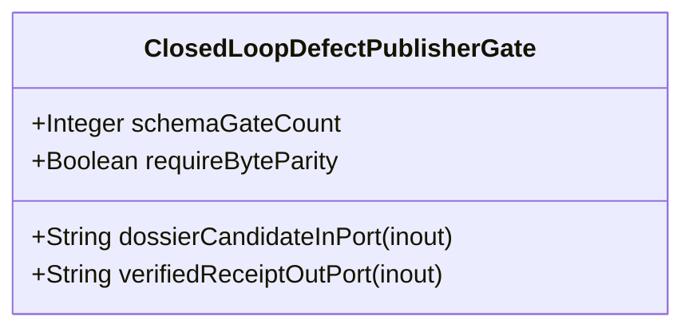

| Attribute | Specification Detail |
| :--- | :--- |
| **Issue ID** | #680 |
| **Title** | Feature 26: [BP 06 Deterministic Static 5 Pillar Code Auditor and Defect Dossier Synthesizer Blueprint] ClosedLoopDefectPublisherGate |
| **Type** | feature |
| **Parent Epic** | [EPIC-06-BP_06_Deterministic_Static_5_Pillar_Code_Auditor_and_Defect_Dossier_Synthesizer_Blueprint](../epics/EPIC-06-BP_06_Deterministic_Static_5_Pillar_Code_Auditor_and_Defect_Dossier_Synthesizer_Blueprint.md) |
| **Interface Type** | Physical / Structural / Internal Bus |
| **Schema Containers** | `BP_06_Deterministic_Static_5_Pillar_Code_Auditor_and_Defect_Dossier_Synthesizer_Blueprint::ClosedLoopDefectPublisherGate` |
| **Generation Mode** | subagent |
| **Specification Source** | [schema/subsystems/b_p_06_deterministic_static_5_pillar_code_auditor_and_defect_dossier_synthesizer_blueprint/architecture.sysml](../../schema/subsystems/b_p_06_deterministic_static_5_pillar_code_auditor_and_defect_dossier_synthesizer_blueprint/architecture.sysml) |

# Feature 26: [BP 06 Deterministic Static 5 Pillar Code Auditor and Defect Dossier Synthesizer Blueprint] ClosedLoopDefectPublisherGate

## UML Class Diagram



## Interface Requirements
### 1. Test Data Shape
```json
{
  "$schema": "https://json-schema.org/draft/2020-12/schema",
  "title": "ClosedLoopDefectPublisherGatePayloadSchema",
  "type": "object",
  "properties": {
    "part": {
      "type": "string",
      "const": "ClosedLoopDefectPublisherGate"
    },
    "status": {
      "type": "string",
      "enum": ["nominal", "degraded", "fault"]
    },
    "schemaGateCount": {
      "type": "integer",
      "description": "Subsystem attribute schemaGateCount"
    },
    "requireByteParity": {
      "type": "boolean",
      "description": "Subsystem attribute requireByteParity"
    },
    "dossierCandidateInPort": {
      "type": "object",
      "properties": {
        "direction": { "type": "string", "const": "inout" },
        "port_type": { "type": "string", "const": "String" }
      },
      "required": ["direction", "port_type"]
    },
    "verifiedReceiptOutPort": {
      "type": "object",
      "properties": {
        "direction": { "type": "string", "const": "inout" },
        "port_type": { "type": "string", "const": "String" }
      },
      "required": ["direction", "port_type"]
    }
  },
  "required": [
    "part",
    "status",
    "schemaGateCount",
    "requireByteParity",
    "dossierCandidateInPort",
    "verifiedReceiptOutPort"
  ],
  "additionalProperties": false
}
```

### 2. Validation & Constraints
Formal constraints and invariant guarantees enforced by ClosedLoopDefectPublisherGate.

### 3. Visual Layout & Arrangement
Logical layout, viewport containment, and container structure for ClosedLoopDefectPublisherGate conforming to platform design tokens. Container boundaries enforce @container isolation rules.

### 4. Interactive Flow & States
Operational lifecycle events and discrete state transitions for ClosedLoopDefectPublisherGate.

### Layer 1: Domain State & Signal Model
Domain state vector representing ClosedLoopDefectPublisherGate status, AST references, and typed signal models.

### Layer 2: Logic & Safety State Management
Deterministic state machine solver and safety monitor logic for ClosedLoopDefectPublisherGate.

### Layer 3: Presentation & Actuator Interface Binding
Presentation interface binding and diagnostic event routing for ClosedLoopDefectPublisherGate.

### Associated Use Cases & User Stories

#### Associated Use Cases
- [ ] #649 - [Use Case 26: UC AC 01 Static Five Pillar AST Defect Detection](https://github.com/gintatkinson/DEAP01-spec-core/blob/main/.pipeline/upstream/docs/use-cases/UC-26-UC_AC_01_Static_Five_Pillar_AST_Defect_Detection.md)
- [ ] #650 - [Use Case 27: UC AC 02 Deterministic Seven Section Dossier and Mermaid Synthesis](https://github.com/gintatkinson/DEAP01-spec-core/blob/main/.pipeline/upstream/docs/use-cases/UC-27-UC_AC_02_Deterministic_Seven_Section_Dossier_and_Mermaid_Synthesis.md)
- [ ] #651 - [Use Case 28: UC AC 03 Idempotent Local and Remote SSOT Deduplication](https://github.com/gintatkinson/DEAP01-spec-core/blob/main/.pipeline/upstream/docs/use-cases/UC-28-UC_AC_03_Idempotent_Local_and_Remote_SSOT_Deduplication.md)
- [ ] #652 - [Use Case 29: UC AC 04 Closed Loop Git Hub SSOT Publishing and Byte Parity Verification](https://github.com/gintatkinson/DEAP01-spec-core/blob/main/.pipeline/upstream/docs/use-cases/UC-29-UC_AC_04_Closed_Loop_GitHub_SSOT_Publishing_and_Byte_Parity_Verification.md)
- [ ] #653 - [Use Case 30: UC AC 05 Fail Closed Rejection on Malformed Dossier Schema Ephemeral Paths or Payload Divergence](https://github.com/gintatkinson/DEAP01-spec-core/blob/main/.pipeline/upstream/docs/use-cases/UC-30-UC_AC_05_Fail_Closed_Rejection_on_Malformed_Dossier_Schema_Ephemeral_Paths_or_Payload_Divergence.md)
- [ ] #654 - [Use Case 31: UC AC 06 Dogfood Sys ML v2 Markdown Ingestion and Blueprint Gate Conformance](https://github.com/gintatkinson/DEAP01-spec-core/blob/main/.pipeline/upstream/docs/use-cases/UC-31-UC_AC_06_Dogfood_SysML_v2_Markdown_Ingestion_and_Blueprint_Gate_Conformance.md)

#### Associated User Stories
- None allocated (structural subsystem component)

## Acceptance Criteria (BDD)
- [ ] AC-01: Given nominal ClosedLoopDefectPublisherGate domain state, When command or input signals are received, Then updates internal state and signal outputs within declared bounds.
- [ ] AC-02: Given operational state, When ClosedLoopDefectPublisherGate evaluates constraint 'Invariant_REQ_0606_SC_01', Then asserts invariant satisfaction without violation.
- [ ] AC-03: Given operational state, When ClosedLoopDefectPublisherGate evaluates constraint 'Invariant_REQ_0606_SC_02', Then asserts invariant satisfaction without violation.
- [ ] AC-04: Given malformed input signals or boundary condition violation, When ClosedLoopDefectPublisherGate error handling is invoked, Then transitions safely to failsafe fallback state without corruption.

## Source References
Formal component specifications and normative systems engineering requirements:
- Subsystem Requirements: `schema/subsystems/b_p_06_deterministic_static_5_pillar_code_auditor_and_defect_dossier_synthesizer_blueprint/requirements.sysml`
- Subsystem Architecture: `schema/subsystems/b_p_06_deterministic_static_5_pillar_code_auditor_and_defect_dossier_synthesizer_blueprint/architecture.sysml`
- Normative Systems Engineering Standard: ISO/IEC/IEEE 15288:2023 §6.4.3 Architecture Definition Process

Component behavior and interface definitions derive from `schema/model.sysml` pursuant to ISO/IEC/IEEE 15288.
