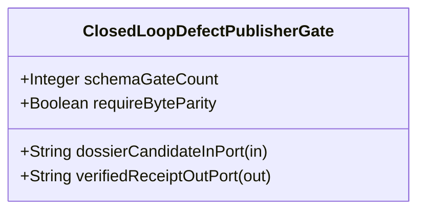

| Attribute | Specification Detail |
| :--- | :--- |
| **Issue ID** | #680 |
| **Title** | Feature 26: [BP 06 Deterministic Static 5 Pillar Code Auditor and Defect Dossier Synthesizer Blueprint] ClosedLoopDefectPublisherGate |
| **Type** | feature |
| **Parent Epic** | [EPIC-06-BP_06_Deterministic_Static_5_Pillar_Code_Auditor_and_Defect_Dossier_Synthesizer_Blueprint](../epics/EPIC-06-BP_06_Deterministic_Static_5_Pillar_Code_Auditor_and_Defect_Dossier_Synthesizer_Blueprint.md) |
| **Interface Type** | Physical / Structural / Internal Bus |
| **Schema Containers** | `BP_06_Deterministic_Static_5_Pillar_Code_Auditor_and_Defect_Dossier_Synthesizer_Blueprint::ClosedLoopDefectPublisherGate` |
| **Generation Mode** | subagent |
| **Specification Source** | [schema/model.sysml](../../schema/model.sysml) |

# Feature 26: [BP 06 Deterministic Static 5 Pillar Code Auditor and Defect Dossier Synthesizer Blueprint] ClosedLoopDefectPublisherGate

## UML Class Diagram



## Interface Requirements
### 1. Test Data Shape
```json
{
  "$schema": "https://json-schema.org/draft/2020-12/schema",
  "title": "ClosedLoopDefectPublisherGatePayloadSchema",
  "type": "object",
  "properties": {
    "part": {
      "type": "string",
      "const": "ClosedLoopDefectPublisherGate"
    },
    "status": {
      "type": "string",
      "enum": ["nominal", "degraded", "fault"]
    },
    "schemaGateCount": {
      "type": "integer",
      "x-sysml-type": "Integer",
      "description": "Declared attribute schemaGateCount (Integer)",
      "default": 12
    },
    "requireByteParity": {
      "type": "boolean",
      "x-sysml-type": "Boolean",
      "description": "Requires zero byte discrepancy between local `.pipeline/defects/` file and remote GitHub issue body. [unit: flag]",
      "default": true
    },
    "dossierCandidateInPort": {
      "type": "object",
      "properties": {
        "direction": { "type": "string", "const": "in" },
        "port_type": { "type": "string", "const": "String" }
      },
      "required": ["direction", "port_type"]
    },
    "verifiedReceiptOutPort": {
      "type": "object",
      "properties": {
        "direction": { "type": "string", "const": "out" },
        "port_type": { "type": "string", "const": "String" }
      },
      "required": ["direction", "port_type"]
    }
  },
  "required": [
    "part",
    "status",
    "dossierCandidateInPort",
    "verifiedReceiptOutPort"
  ],
  "additionalProperties": false
}
```

### 2. Validation & Constraints
Declared structural attributes, boundary ports, invariants, and allocated requirements for classifier `ClosedLoopDefectPublisherGate`:

| AST Member Kind | Identifier | Declared Type / Direction | Default / Invariant Contract |
| :--- | :--- | :--- | :--- |
| Attribute | `schemaGateCount` | `Integer` | Default `12` |
| Attribute | `requireByteParity` | `Boolean` | Default `true` |
| Port | `dossierCandidateInPort` | `in String` | Boundary interface contract |
| Port | `verifiedReceiptOutPort` | `out String` | Boundary interface contract |
| Constraint | `Invariant_REQ_0606_SC_01` | Invariant (`REQ-0606 (REQ_0606_BP_06_Deterministic_Static_5_Pillar_Code_Auditor_and_Defect_Dossier_Synthesizer_Blueprint)`) | Declared structural invariant |
| Constraint | `Invariant_REQ_0606_SC_02` | Invariant (`REQ-0606 (REQ_0606_BP_06_Deterministic_Static_5_Pillar_Code_Auditor_and_Defect_Dossier_Synthesizer_Blueprint)`) | Declared structural invariant |
| Requirement | `REQ-0606 (REQ_0606_BP_06_Deterministic_Static_5_Pillar_Code_Auditor_and_Defect_Dossier_Synthesizer_Blueprint)` | Allocated Requirement | The DeterministicStaticDefectAuditor subsystem (**REQ-0606** / BP-06 / DEAP-BP-DET-06, deterministic UUIDv5 6ba7b810-9dad-11d1-80b4-00c04fd430c6, complexity class Class P linear single-pass token-stream and AST traversal, governed by DO-178C Level A, DO-330 TQL-4, ISO 26262 ASIL D, and |

```sysml
constraint Invariant_REQ_0606_SC_01 {}
constraint Invariant_REQ_0606_SC_02 {}
```

### 3. Visual Layout & Arrangement
Structural composition and boundary topology for classifier `ClosedLoopDefectPublisherGate` organize no nested subparts declared in schema paired with boundary ports `in dossierCandidateInPort : String`, `out verifiedReceiptOutPort : String`.

### 4. Interactive Flow & States
Operational lifecycle events and discrete state transitions for ClosedLoopDefectPublisherGate.

### Layer 1: Domain State & Signal Model
Classifier `ClosedLoopDefectPublisherGate` encapsulates typed domain state attributes `schemaGateCount : Integer`, `requireByteParity : Boolean` alongside operational lifecycle status.

### Layer 2: Logic & Safety State Management
Classifier `ClosedLoopDefectPublisherGate` governs stateless structural transition evaluation enforcing invariant obligations `Invariant_REQ_0606_SC_01`, `Invariant_REQ_0606_SC_02`.

### Layer 3: Presentation & Actuator Interface Binding
Classifier `ClosedLoopDefectPublisherGate` binds external and behavioral interfaces across port `in dossierCandidateInPort : String`, port `out verifiedReceiptOutPort : String`.

### Associated Use Cases & User Stories

#### Associated Use Cases
- [ ] #649 - [Use Case 26: Static Five Pillar AST Defect Detection](../use-cases/UC-26-Static_Five_Pillar_AST_Defect_Detection.md)
- [ ] #650 - [Use Case 27: Deterministic Seven Section Dossier and Mermaid Synthesis](../use-cases/UC-27-Deterministic_Seven_Section_Dossier_and_Mermaid_Synthesis.md)
- [ ] #651 - [Use Case 28: Idempotent Local and Remote SSOT Deduplication](../use-cases/UC-28-Idempotent_Local_and_Remote_SSOT_Deduplication.md)
- [ ] #652 - [Use Case 29: Closed Loop GitHub SSOT Publishing and Byte Parity Verification](../use-cases/UC-29-Closed_Loop_GitHub_SSOT_Publishing_and_Byte_Parity_Verification.md)
- [ ] #653 - [Use Case 30: Fail Closed Rejection on Malformed Dossier Schema Ephemeral Paths or Payload Divergence](../use-cases/UC-30-Fail_Closed_Rejection_on_Malformed_Dossier_Schema_Ephemeral_Paths_or_Payload_Divergence.md)
- [ ] #654 - [Use Case 31: Dogfood SysML v2 Markdown Ingestion and Blueprint Gate Conformance](../use-cases/UC-31-Dogfood_SysML_v2_Markdown_Ingestion_and_Blueprint_Gate_Conformance.md)

#### Associated User Stories
- [ ] #726 - [User Story 37: Verify Baseline Audit Code Path Crates](../user-stories/US-37-VerifyBaselineAuditCodePathCrates.md)
- [ ] #727 - [User Story 38: Parse Rust Source Ast And Parse](../user-stories/US-38-ParseRustSourceAstAndParse.md)
- [ ] #728 - [User Story 39: Evaluate Source File Pillars Across5](../user-stories/US-39-EvaluateSourceFilePillarsAcross5.md)
- [ ] #615 - [User Story 40: synthesize defect dossier markdown](../user-stories/US-40-synthesize_defect_dossier_markdown.md)
- [ ] #617 - [User Story 41: run check defect](../user-stories/US-41-run_check_defect.md)
- [ ] #729 - [User Story 42: Execute12 Check Validate Defect Dossier](../user-stories/US-42-Execute12CheckValidateDefectDossier.md)
- [ ] #730 - [User Story 43: Gh Issue Create Or Gh Issue](../user-stories/US-43-GhIssueCreateOrGhIssue.md)
- [ ] #731 - [User Story 44: Gh Issue View Json Title Body](../user-stories/US-44-GhIssueViewJsonTitleBody.md)

## Acceptance Criteria (BDD)
- [ ] AC-01: Given valid `ClosedLoopDefectPublisherGate` inputs satisfying `Invariant_REQ_0606_SC_01` [Req `REQ-0606 (REQ_0606_BP_06_Deterministic_Static_5_Pillar_Code_Auditor_and_Defect_Dossier_Synthesizer_Blueprint)`], When `ClosedLoopDefectPublisherGate` evaluates invariant `Invariant_REQ_0606_SC_01`, Then the invariant holds and verified state is committed.
- [ ] AC-02: Given boundary inputs that violate `Invariant_REQ_0606_SC_01` [Req `REQ-0606 (REQ_0606_BP_06_Deterministic_Static_5_Pillar_Code_Auditor_and_Defect_Dossier_Synthesizer_Blueprint)`], When `ClosedLoopDefectPublisherGate` evaluates invariant `Invariant_REQ_0606_SC_01`, Then `ClosedLoopDefectPublisherGate` rejects the invalid transition and routes a diagnostic via diagnostic port `verifiedReceiptOutPort`.
- [ ] AC-03: Given valid `ClosedLoopDefectPublisherGate` inputs satisfying `Invariant_REQ_0606_SC_02` [Req `REQ-0606 (REQ_0606_BP_06_Deterministic_Static_5_Pillar_Code_Auditor_and_Defect_Dossier_Synthesizer_Blueprint)`], When `ClosedLoopDefectPublisherGate` evaluates invariant `Invariant_REQ_0606_SC_02`, Then the invariant holds and verified state is committed.
- [ ] AC-04: Given boundary inputs that violate `Invariant_REQ_0606_SC_02` [Req `REQ-0606 (REQ_0606_BP_06_Deterministic_Static_5_Pillar_Code_Auditor_and_Defect_Dossier_Synthesizer_Blueprint)`], When `ClosedLoopDefectPublisherGate` evaluates invariant `Invariant_REQ_0606_SC_02`, Then `ClosedLoopDefectPublisherGate` rejects the invalid transition and routes a diagnostic via diagnostic port `verifiedReceiptOutPort`.
- [ ] AC-05: Given nominal typed values for `schemaGateCount` (`Integer`), `requireByteParity` (`Boolean`) across `dossierCandidateInPort` (`in String`), `verifiedReceiptOutPort` (`out String`), When `ClosedLoopDefectPublisherGate` executes structural interface processing, Then state and output ports conform to declared schema types.
- [ ] AC-06: Given malformed input frames across `schemaGateCount` (`Integer`), `requireByteParity` (`Boolean`) or `dossierCandidateInPort` (`in String`), `verifiedReceiptOutPort` (`out String`), When `ClosedLoopDefectPublisherGate` boundary validation executes, Then `ClosedLoopDefectPublisherGate` rejects the malformed input via diagnostic port `verifiedReceiptOutPort`.

## Source References
Formal component specifications and normative systems engineering requirements:
- System Architecture Model: `schema/model.sysml`
- Normative Systems Engineering Standard: ISO/IEC/IEEE 15288:2023 §6.4.3 Architecture Definition Process

Component behavior and interface definitions derive from `schema/model.sysml` pursuant to ISO/IEC/IEEE 15288.
