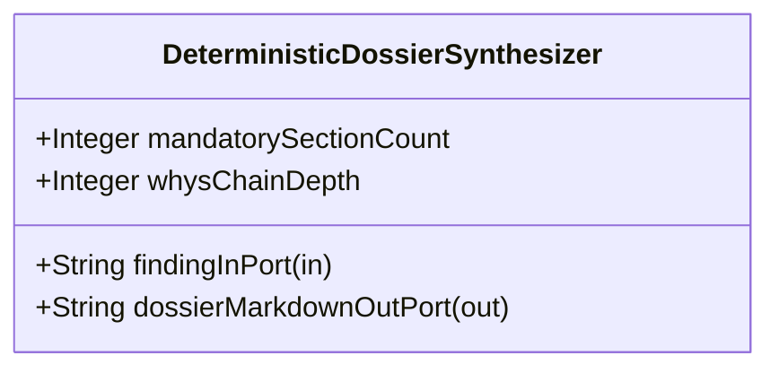

| Attribute | Specification Detail |
| :--- | :--- |
| **Issue ID** | #681 |
| **Title** | Feature 27: [BP 06 Deterministic Static 5 Pillar Code Auditor and Defect Dossier Synthesizer Blueprint] DeterministicDossierSynthesizer |
| **Type** | feature |
| **Parent Epic** | [EPIC-06-BP_06_Deterministic_Static_5_Pillar_Code_Auditor_and_Defect_Dossier_Synthesizer_Blueprint](../epics/EPIC-06-BP_06_Deterministic_Static_5_Pillar_Code_Auditor_and_Defect_Dossier_Synthesizer_Blueprint.md) |
| **Interface Type** | Physical / Structural / Internal Bus |
| **Schema Containers** | `BP_06_Deterministic_Static_5_Pillar_Code_Auditor_and_Defect_Dossier_Synthesizer_Blueprint::DeterministicDossierSynthesizer` |
| **Generation Mode** | subagent |
| **Specification Source** | [schema/model.sysml](../../schema/model.sysml) |

# Feature 27: [BP 06 Deterministic Static 5 Pillar Code Auditor and Defect Dossier Synthesizer Blueprint] DeterministicDossierSynthesizer

## UML Class Diagram



## Interface Requirements
### 1. Test Data Shape
```json
{
  "$schema": "https://json-schema.org/draft/2020-12/schema",
  "title": "DeterministicDossierSynthesizerPayloadSchema",
  "type": "object",
  "properties": {
    "part": {
      "type": "string",
      "const": "DeterministicDossierSynthesizer"
    },
    "status": {
      "type": "string",
      "enum": ["nominal", "degraded", "fault"]
    },
    "mandatorySectionCount": {
      "type": "integer",
      "x-sysml-type": "Integer",
      "description": "Declared attribute mandatorySectionCount (Integer)",
      "default": 7
    },
    "whysChainDepth": {
      "type": "integer",
      "x-sysml-type": "Integer",
      "description": "Enforces 5 numbered causal `Why ...? Because ...` root-cause steps in Section 2. [unit: steps]",
      "default": 5
    },
    "findingInPort": {
      "type": "object",
      "properties": {
        "direction": { "type": "string", "const": "in" },
        "port_type": { "type": "string", "const": "String" }
      },
      "required": ["direction", "port_type"]
    },
    "dossierMarkdownOutPort": {
      "type": "object",
      "properties": {
        "direction": { "type": "string", "const": "out" },
        "port_type": { "type": "string", "const": "String" }
      },
      "required": ["direction", "port_type"]
    }
  },
  "required": [
    "part",
    "status",
    "findingInPort",
    "dossierMarkdownOutPort"
  ],
  "additionalProperties": false
}
```

### 2. Validation & Constraints
Declared structural attributes, boundary ports, invariants, and allocated requirements for classifier `DeterministicDossierSynthesizer`:

| AST Member Kind | Identifier | Declared Type / Direction | Default / Invariant Contract |
| :--- | :--- | :--- | :--- |
| Attribute | `mandatorySectionCount` | `Integer` | Default `7` |
| Attribute | `whysChainDepth` | `Integer` | Default `5` |
| Port | `findingInPort` | `in String` | Boundary interface contract |
| Port | `dossierMarkdownOutPort` | `out String` | Boundary interface contract |

### 3. Visual Layout & Arrangement
Structural composition and boundary topology for classifier `DeterministicDossierSynthesizer` organize no nested subparts declared in schema paired with boundary ports `in findingInPort : String`, `out dossierMarkdownOutPort : String`.

### 4. Interactive Flow & States
Operational lifecycle events and discrete state transitions for DeterministicDossierSynthesizer.

### Layer 1: Domain State & Signal Model
Classifier `DeterministicDossierSynthesizer` encapsulates typed domain state attributes `mandatorySectionCount : Integer`, `whysChainDepth : Integer` alongside operational lifecycle status.

### Layer 2: Logic & Safety State Management
Classifier `DeterministicDossierSynthesizer` governs stateless structural transition evaluation enforcing no additional invariant guards declared in schema.

### Layer 3: Presentation & Actuator Interface Binding
Classifier `DeterministicDossierSynthesizer` binds external and behavioral interfaces across port `in findingInPort : String`, port `out dossierMarkdownOutPort : String`.

### Associated Use Cases & User Stories

#### Associated Use Cases
- None allocated (structural subsystem component)

#### Associated User Stories
- [ ] #726 - [User Story 37: Verify Baseline Audit Code Path Crates](../user-stories/US-37-VerifyBaselineAuditCodePathCrates.md)
- [ ] #727 - [User Story 38: Parse Rust Source Ast And Parse](../user-stories/US-38-ParseRustSourceAstAndParse.md)
- [ ] #728 - [User Story 39: Evaluate Source File Pillars Across5](../user-stories/US-39-EvaluateSourceFilePillarsAcross5.md)
- [ ] #615 - [User Story 40: synthesize defect dossier markdown](../user-stories/US-40-synthesize_defect_dossier_markdown.md)
- [ ] #617 - [User Story 41: run check defect](../user-stories/US-41-run_check_defect.md)
- [ ] #729 - [User Story 42: Execute12 Check Validate Defect Dossier](../user-stories/US-42-Execute12CheckValidateDefectDossier.md)
- [ ] #730 - [User Story 43: Gh Issue Create Or Gh Issue](../user-stories/US-43-GhIssueCreateOrGhIssue.md)
- [ ] #731 - [User Story 44: Gh Issue View Json Title Body](../user-stories/US-44-GhIssueViewJsonTitleBody.md)

## Acceptance Criteria (BDD)
- [ ] AC-01: Given valid `DeterministicDossierSynthesizer` initialization inputs for `mandatorySectionCount` (`Integer`), `whysChainDepth` (`Integer`) (no additional constraints specified in schema), When `DeterministicDossierSynthesizer` commits typed domain state, Then declared state attributes hold verified values.
- [ ] AC-02: Given malformed or out-of-domain input values for `mandatorySectionCount` (`Integer`), `whysChainDepth` (`Integer`), When `DeterministicDossierSynthesizer` validates incoming state updates, Then `DeterministicDossierSynthesizer` rejects the invalid state update and emits a diagnostic via diagnostic port `dossierMarkdownOutPort`.
- [ ] AC-03: Given nominal signal arrival across `findingInPort` (`in String`), `dossierMarkdownOutPort` (`out String`), When `DeterministicDossierSynthesizer` processes the declared interface transaction, Then output state conforms to the structural classifier contract.
- [ ] AC-04: Given an invalid or unrecognized interface frame across `findingInPort` (`in String`), `dossierMarkdownOutPort` (`out String`), When `DeterministicDossierSynthesizer` boundary validation executes, Then `DeterministicDossierSynthesizer` refuses the malformed frame via diagnostic port `dossierMarkdownOutPort` and preserves prior verified state.

## Source References
Formal component specifications and normative systems engineering requirements:
- System Architecture Model: `schema/model.sysml`
- Normative Systems Engineering Standard: ISO/IEC/IEEE 15288:2023 §6.4.3 Architecture Definition Process

Component behavior and interface definitions derive from `schema/model.sysml` pursuant to ISO/IEC/IEEE 15288.
