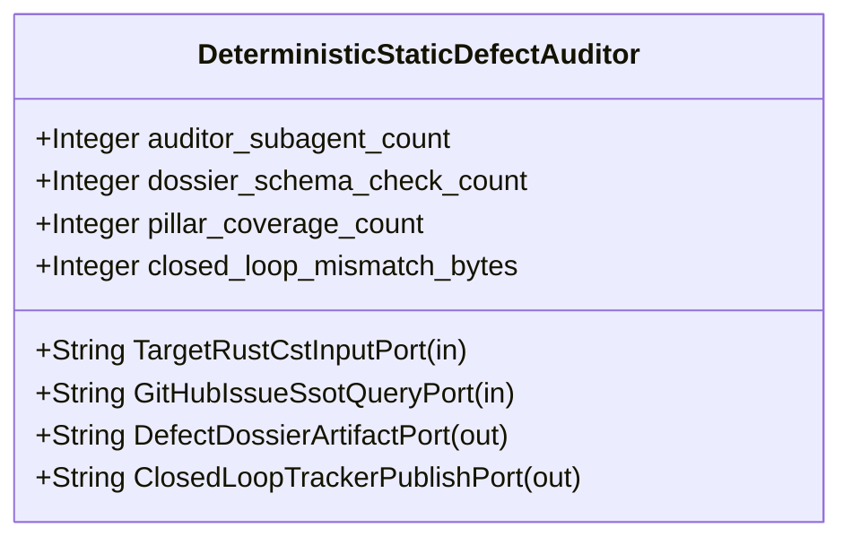

| Attribute | Specification Detail |
| :--- | :--- |
| **Issue ID** | #682 |
| **Title** | Feature 28: [BP 06 Deterministic Static 5 Pillar Code Auditor and Defect Dossier Synthesizer Blueprint] DeterministicStaticDefectAuditor |
| **Type** | feature |
| **Parent Epic** | [EPIC-06-BP_06_Deterministic_Static_5_Pillar_Code_Auditor_and_Defect_Dossier_Synthesizer_Blueprint](../epics/EPIC-06-BP_06_Deterministic_Static_5_Pillar_Code_Auditor_and_Defect_Dossier_Synthesizer_Blueprint.md) |
| **Interface Type** | Physical / Structural / Internal Bus |
| **Schema Containers** | `BP_06_Deterministic_Static_5_Pillar_Code_Auditor_and_Defect_Dossier_Synthesizer_Blueprint::DeterministicStaticDefectAuditor` |
| **Generation Mode** | subagent |
| **Specification Source** | [schema/model.sysml](../../schema/model.sysml) |

# Feature 28: [BP 06 Deterministic Static 5 Pillar Code Auditor and Defect Dossier Synthesizer Blueprint] DeterministicStaticDefectAuditor

## UML Class Diagram



## Interface Requirements
### 1. Test Data Shape
```json
{
  "$schema": "https://json-schema.org/draft/2020-12/schema",
  "title": "DeterministicStaticDefectAuditorPayloadSchema",
  "type": "object",
  "properties": {
    "part": {
      "type": "string",
      "const": "DeterministicStaticDefectAuditor"
    },
    "status": {
      "type": "string",
      "enum": ["nominal", "degraded", "fault"]
    },
    "auditor_subagent_count": {
      "type": "integer",
      "x-sysml-type": "Integer",
      "description": "Declared attribute auditor_subagent_count (Integer)",
      "default": 0
    },
    "dossier_schema_check_count": {
      "type": "integer",
      "x-sysml-type": "Integer",
      "description": "Number of deterministic structural, lexical, and Mermaid validation checks enforced per synthesized dossier. [unit: checks]",
      "default": 12
    },
    "pillar_coverage_count": {
      "type": "integer",
      "x-sysml-type": "Integer",
      "description": "Number of adversarial correctness risk pillars evaluated per source AST scan. [unit: pillars]",
      "default": 5
    },
    "closed_loop_mismatch_bytes": {
      "type": "integer",
      "x-sysml-type": "Integer",
      "description": "Byte discrepancy between local `.pipeline/defects/` dossier and live GitHub issue body after CRLF normalization. [unit: B]",
      "default": 0
    },
    "TargetRustCstInputPort": {
      "type": "object",
      "properties": {
        "direction": { "type": "string", "const": "in" },
        "port_type": { "type": "string", "const": "String" }
      },
      "required": ["direction", "port_type"]
    },
    "GitHubIssueSsotQueryPort": {
      "type": "object",
      "properties": {
        "direction": { "type": "string", "const": "in" },
        "port_type": { "type": "string", "const": "String" }
      },
      "required": ["direction", "port_type"]
    },
    "DefectDossierArtifactPort": {
      "type": "object",
      "properties": {
        "direction": { "type": "string", "const": "out" },
        "port_type": { "type": "string", "const": "String" }
      },
      "required": ["direction", "port_type"]
    },
    "ClosedLoopTrackerPublishPort": {
      "type": "object",
      "properties": {
        "direction": { "type": "string", "const": "out" },
        "port_type": { "type": "string", "const": "String" }
      },
      "required": ["direction", "port_type"]
    }
  },
  "required": [
    "part",
    "status",
    "TargetRustCstInputPort",
    "GitHubIssueSsotQueryPort",
    "DefectDossierArtifactPort",
    "ClosedLoopTrackerPublishPort"
  ],
  "additionalProperties": false
}
```

### 2. Validation & Constraints
Declared structural attributes, boundary ports, invariants, and allocated requirements for classifier `DeterministicStaticDefectAuditor`:

| AST Member Kind | Identifier | Declared Type / Direction | Default / Invariant Contract |
| :--- | :--- | :--- | :--- |
| Attribute | `auditor_subagent_count` | `Integer` | Default `0` |
| Attribute | `dossier_schema_check_count` | `Integer` | Default `12` |
| Attribute | `pillar_coverage_count` | `Integer` | Default `5` |
| Attribute | `closed_loop_mismatch_bytes` | `Integer` | Default `0` |
| Port | `TargetRustCstInputPort` | `in String` | Boundary interface contract |
| Port | `GitHubIssueSsotQueryPort` | `in String` | Boundary interface contract |
| Port | `DefectDossierArtifactPort` | `out String` | Boundary interface contract |
| Port | `ClosedLoopTrackerPublishPort` | `out String` | Boundary interface contract |
| Constraint | `Invariant_REQ_0606_SC_01` | Invariant (`REQ-0606 (REQ_0606_BP_06_Deterministic_Static_5_Pillar_Code_Auditor_and_Defect_Dossier_Synthesizer_Blueprint)`) | Enforces `auditor_subagent_count == 0 && dossier_schema_check_count == 12 && pillar_coverage_count == 5` |
| Constraint | `Invariant_REQ_0606_SC_02` | Invariant (`REQ-0606 (REQ_0606_BP_06_Deterministic_Static_5_Pillar_Code_Auditor_and_Defect_Dossier_Synthesizer_Blueprint)`) | Enforces `closed_loop_mismatch_bytes == 0 && zeroRegexMode == true` |
| Requirement | `REQ-0606 (REQ_0606_BP_06_Deterministic_Static_5_Pillar_Code_Auditor_and_Defect_Dossier_Synthesizer_Blueprint)` | Allocated Requirement | Top-level `DeterministicStaticDefectAuditor` subsystem (**REQ-0606** / `BP-06`) enforcing Contract A (100% OMG SysML v2.0 + KerML 1.0 grammar coverage, zero 16-construct caps) and Contract B (`ra_ap_syntax` typed AST + Stage-2 `./lints/deap-dylint-mir/` `rustc_middle::mir` `TyCtxt` 5-pillar auditor + `deap_core::dart_cst` `logos`+`rowan` isolation + complete deletion of `source_ast.rs`, zero hand-rolled scanners) |

### 3. Visual Layout & Arrangement
Structural composition and boundary topology for classifier `DeterministicStaticDefectAuditor` orchestrate `FivePillarStaticAstAnalyzer`, `DeterministicDossierSynthesizer`, `MermaidUmlDiagramGenerator`, and `ClosedLoopDefectPublisherGate` paired with boundary ports `in TargetRustCstInputPort : String`, `in GitHubIssueSsotQueryPort : String`, `out DefectDossierArtifactPort : String`, `out ClosedLoopTrackerPublishPort : String`. Enforces Contract A (full OMG SysML v2.0 + KerML 1.0 grammar coverage with zero 16-construct artificial caps) and Contract B (`ra_ap_syntax` + Stage-2 `Dylint` `rustc_middle::mir` (`TyCtxt`) in `./lints/deap-dylint-mir/` + isolated `deap_core::dart_cst` (`logos` + `rowan`) + complete deletion of `source_ast.rs`).

### 4. Interactive Flow & States
Operational lifecycle events and discrete state transitions for `DeterministicStaticDefectAuditor` across `Idle`, `IngestingRustAndDartCst`, `EvaluatingFivePillars`, `SynthesizingDossier`, `Validating12Gates`, `DeduplicatingSsot`, `PublishingClosedLoop`, `Verified`, and `Rejected`.

### Layer 1: Domain State & Signal Model
Classifier `DeterministicStaticDefectAuditor` encapsulates typed domain state attributes `auditor_subagent_count : Integer` (default `0`), `dossier_schema_check_count : Integer` (default `12`), `pillar_coverage_count : Integer` (default `5`), and `closed_loop_mismatch_bytes : Integer` (default `0`), along with `ra_ap_vfs` / `ra_ap_syntax` Rust syntax trees, Stage-2 `rustc_middle::mir` (`TyCtxt`) 5-pillar query results, and `deap_core::dart_cst` (`logos` + `rowan`) Dart CST nodes.

### Layer 2: Logic & Safety State Management
Classifier `DeterministicStaticDefectAuditor` governs deterministic zero-subagent (`auditor_subagent_count == 0`) static code auditing, SSOT deduplication, and closed-loop publication while enforcing `Invariant_REQ_0606_SC_01` and `Invariant_REQ_0606_SC_02`. Partitioned into `< 380`-SLOC submodules under `./crates/verify-baseline/src/defect_auditor/`, `./crates/verify-baseline/src/defect_dossier/`, `./lints/deap-dylint-mir/`, and `./crates/deap-core/src/dart_cst/`, with `./crates/deap-core/src/source_ast.rs` (`source_ast.rs`) and all legacy hand-rolled string/line/regex scanners permanently deleted.

### Layer 3: Presentation & Actuator Interface Binding
Classifier `DeterministicStaticDefectAuditor` binds external and behavioral interfaces across port `in TargetRustCstInputPort : String`, port `in GitHubIssueSsotQueryPort : String`, port `out DefectDossierArtifactPort : String`, and port `out ClosedLoopTrackerPublishPort : String`, exposing `./target/release/verify-baseline audit-code` and `./target/release/verify-baseline check-defect` CLI entry points and `ariadne` / `miette` diagnostics (`E0601`--`E0605`).

### Associated Use Cases & User Stories

#### Associated Use Cases
- [ ] #649 - [Use Case 26: Static Five Pillar AST Defect Detection](../use-cases/UC-26-Static_Five_Pillar_AST_Defect_Detection.md)
- [ ] #651 - [Use Case 28: Idempotent Local and Remote SSOT Deduplication](../use-cases/UC-28-Idempotent_Local_and_Remote_SSOT_Deduplication.md)
- [ ] #652 - [Use Case 29: Closed Loop GitHub SSOT Publishing and Byte Parity Verification](../use-cases/UC-29-Closed_Loop_GitHub_SSOT_Publishing_and_Byte_Parity_Verification.md)
- [ ] #654 - [Use Case 31: Dogfood SysML v2 Markdown Ingestion and Blueprint Gate Conformance](../use-cases/UC-31-Dogfood_SysML_v2_Markdown_Ingestion_and_Blueprint_Gate_Conformance.md)

#### Associated User Stories
- [ ] #726 - [User Story 37: Verify Baseline Audit Code Path Crates](../user-stories/US-37-VerifyBaselineAuditCodePathCrates.md)
- [ ] #727 - [User Story 38: Parse Rust Cst And Parse Dart Cst](../user-stories/US-38-ParseRustCstAndParseDartCst.md)
- [ ] #728 - [User Story 39: Evaluate Source File Pillars Across5](../user-stories/US-39-EvaluateSourceFilePillarsAcross5.md)
- [ ] #730 - [User Story 43: Gh Issue Create Or Gh Issue](../user-stories/US-43-GhIssueCreateOrGhIssue.md)
- [ ] #731 - [User Story 44: Gh Issue View Json Title Body](../user-stories/US-44-GhIssueViewJsonTitleBody.md)

## Acceptance Criteria (BDD)
- [ ] AC-01: Given valid `DeterministicStaticDefectAuditor` initialization inputs for `auditor_subagent_count` (`Integer`), `dossier_schema_check_count` (`Integer`), `pillar_coverage_count` (`Integer`), `closed_loop_mismatch_bytes` (`Integer`) (no additional constraints specified in schema), When `DeterministicStaticDefectAuditor` commits typed domain state, Then declared state attributes hold verified values.
- [ ] AC-02: Given malformed or out-of-domain input values for `auditor_subagent_count` (`Integer`), `dossier_schema_check_count` (`Integer`), `pillar_coverage_count` (`Integer`), `closed_loop_mismatch_bytes` (`Integer`), When `DeterministicStaticDefectAuditor` validates incoming state updates, Then `DeterministicStaticDefectAuditor` rejects the invalid state update and emits a diagnostic via diagnostic port `DefectDossierArtifactPort`.
- [ ] AC-03: Given nominal signal arrival across `TargetRustCstInputPort` (`in String`), `GitHubIssueSsotQueryPort` (`in String`), `DefectDossierArtifactPort` (`out String`), `ClosedLoopTrackerPublishPort` (`out String`), When `DeterministicStaticDefectAuditor` processes the declared interface transaction, Then output state conforms to the structural classifier contract.
- [ ] AC-04: Given an invalid or unrecognized interface frame across `TargetRustCstInputPort` (`in String`), `GitHubIssueSsotQueryPort` (`in String`), `DefectDossierArtifactPort` (`out String`), `ClosedLoopTrackerPublishPort` (`out String`), When `DeterministicStaticDefectAuditor` boundary validation executes, Then `DeterministicStaticDefectAuditor` refuses the malformed frame via diagnostic port `DefectDossierArtifactPort` and preserves prior verified state.

## Source References
Formal component specifications and normative systems engineering requirements:
- System Architecture Model: `schema/model.sysml`
- Normative Systems Engineering Standard: ISO/IEC/IEEE 15288:2023 §6.4.3 Architecture Definition Process

Component behavior and interface definitions derive from `schema/model.sysml` pursuant to ISO/IEC/IEEE 15288.
