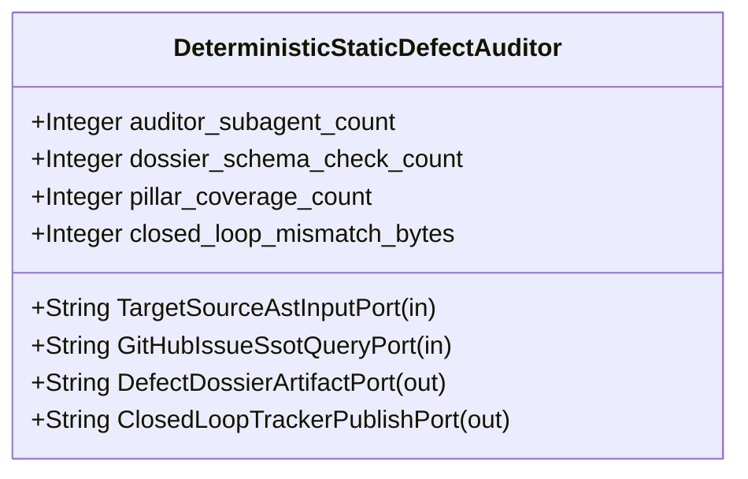

| Attribute | Specification Detail |
| :--- | :--- |
| **Issue ID** | #682 |
| **Title** | Feature 28: [BP 06 Deterministic Static 5 Pillar Code Auditor and Defect Dossier Synthesizer Blueprint] DeterministicStaticDefectAuditor |
| **Type** | feature |
| **Parent Epic** | [EPIC-06-BP_06_Deterministic_Static_5_Pillar_Code_Auditor_and_Defect_Dossier_Synthesizer_Blueprint](../epics/EPIC-06-BP_06_Deterministic_Static_5_Pillar_Code_Auditor_and_Defect_Dossier_Synthesizer_Blueprint.md) |
| **Interface Type** | Physical / Structural / Internal Bus |
| **Schema Containers** | `BP_06_Deterministic_Static_5_Pillar_Code_Auditor_and_Defect_Dossier_Synthesizer_Blueprint::DeterministicStaticDefectAuditor` |
| **Generation Mode** | subagent |
| **Specification Source** | [schema/model.sysml](../../schema/model.sysml) |

# Feature 28: [BP 06 Deterministic Static 5 Pillar Code Auditor and Defect Dossier Synthesizer Blueprint] DeterministicStaticDefectAuditor

## UML Class Diagram



## Interface Requirements
### 1. Test Data Shape
```json
{
  "$schema": "https://json-schema.org/draft/2020-12/schema",
  "title": "DeterministicStaticDefectAuditorPayloadSchema",
  "type": "object",
  "properties": {
    "part": {
      "type": "string",
      "const": "DeterministicStaticDefectAuditor"
    },
    "status": {
      "type": "string",
      "enum": ["nominal", "degraded", "fault"]
    },
    "auditor_subagent_count": {
      "type": "integer",
      "x-sysml-type": "Integer",
      "description": "Declared attribute auditor_subagent_count (Integer)",
      "default": 0
    },
    "dossier_schema_check_count": {
      "type": "integer",
      "x-sysml-type": "Integer",
      "description": "Number of deterministic structural, lexical, and Mermaid validation checks enforced per synthesized dossier. [unit: checks]",
      "default": 12
    },
    "pillar_coverage_count": {
      "type": "integer",
      "x-sysml-type": "Integer",
      "description": "Number of adversarial correctness risk pillars evaluated per source AST scan. [unit: pillars]",
      "default": 5
    },
    "closed_loop_mismatch_bytes": {
      "type": "integer",
      "x-sysml-type": "Integer",
      "description": "Byte discrepancy between local `.pipeline/defects/` dossier and live GitHub issue body after CRLF normalization. [unit: B]",
      "default": 0
    },
    "TargetSourceAstInputPort": {
      "type": "object",
      "properties": {
        "direction": { "type": "string", "const": "in" },
        "port_type": { "type": "string", "const": "String" }
      },
      "required": ["direction", "port_type"]
    },
    "GitHubIssueSsotQueryPort": {
      "type": "object",
      "properties": {
        "direction": { "type": "string", "const": "in" },
        "port_type": { "type": "string", "const": "String" }
      },
      "required": ["direction", "port_type"]
    },
    "DefectDossierArtifactPort": {
      "type": "object",
      "properties": {
        "direction": { "type": "string", "const": "out" },
        "port_type": { "type": "string", "const": "String" }
      },
      "required": ["direction", "port_type"]
    },
    "ClosedLoopTrackerPublishPort": {
      "type": "object",
      "properties": {
        "direction": { "type": "string", "const": "out" },
        "port_type": { "type": "string", "const": "String" }
      },
      "required": ["direction", "port_type"]
    }
  },
  "required": [
    "part",
    "status",
    "TargetSourceAstInputPort",
    "GitHubIssueSsotQueryPort",
    "DefectDossierArtifactPort",
    "ClosedLoopTrackerPublishPort"
  ],
  "additionalProperties": false
}
```

### 2. Validation & Constraints
Declared structural attributes, boundary ports, invariants, and allocated requirements for classifier `DeterministicStaticDefectAuditor`:

| AST Member Kind | Identifier | Declared Type / Direction | Default / Invariant Contract |
| :--- | :--- | :--- | :--- |
| Attribute | `auditor_subagent_count` | `Integer` | Default `0` |
| Attribute | `dossier_schema_check_count` | `Integer` | Default `12` |
| Attribute | `pillar_coverage_count` | `Integer` | Default `5` |
| Attribute | `closed_loop_mismatch_bytes` | `Integer` | Default `0` |
| Port | `TargetSourceAstInputPort` | `in String` | Boundary interface contract |
| Port | `GitHubIssueSsotQueryPort` | `in String` | Boundary interface contract |
| Port | `DefectDossierArtifactPort` | `out String` | Boundary interface contract |
| Port | `ClosedLoopTrackerPublishPort` | `out String` | Boundary interface contract |

### 3. Visual Layout & Arrangement
Structural composition and boundary topology for classifier `DeterministicStaticDefectAuditor` organize no nested subparts declared in schema paired with boundary ports `in TargetSourceAstInputPort : String`, `in GitHubIssueSsotQueryPort : String`, `out DefectDossierArtifactPort : String`, `out ClosedLoopTrackerPublishPort : String`.

### 4. Interactive Flow & States
Operational lifecycle events and discrete state transitions for DeterministicStaticDefectAuditor.

### Layer 1: Domain State & Signal Model
Classifier `DeterministicStaticDefectAuditor` encapsulates typed domain state attributes `auditor_subagent_count : Integer`, `dossier_schema_check_count : Integer`, `pillar_coverage_count : Integer`, `closed_loop_mismatch_bytes : Integer` alongside operational lifecycle status.

### Layer 2: Logic & Safety State Management
Classifier `DeterministicStaticDefectAuditor` governs stateless structural transition evaluation enforcing no additional invariant guards declared in schema.

### Layer 3: Presentation & Actuator Interface Binding
Classifier `DeterministicStaticDefectAuditor` binds external and behavioral interfaces across port `in TargetSourceAstInputPort : String`, port `in GitHubIssueSsotQueryPort : String`, port `out DefectDossierArtifactPort : String`, port `out ClosedLoopTrackerPublishPort : String`.

## Acceptance Criteria (BDD)
- [ ] AC-01: Given valid `DeterministicStaticDefectAuditor` initialization inputs for `auditor_subagent_count` (`Integer`), `dossier_schema_check_count` (`Integer`), `pillar_coverage_count` (`Integer`), `closed_loop_mismatch_bytes` (`Integer`) (no additional constraints specified in schema), When `DeterministicStaticDefectAuditor` commits typed domain state, Then declared state attributes hold verified values.
- [ ] AC-02: Given malformed or out-of-domain input values for `auditor_subagent_count` (`Integer`), `dossier_schema_check_count` (`Integer`), `pillar_coverage_count` (`Integer`), `closed_loop_mismatch_bytes` (`Integer`), When `DeterministicStaticDefectAuditor` validates incoming state updates, Then `DeterministicStaticDefectAuditor` rejects the invalid state update and emits a diagnostic via diagnostic port `DefectDossierArtifactPort`.
- [ ] AC-03: Given nominal signal arrival across `TargetSourceAstInputPort` (`in String`), `GitHubIssueSsotQueryPort` (`in String`), `DefectDossierArtifactPort` (`out String`), `ClosedLoopTrackerPublishPort` (`out String`), When `DeterministicStaticDefectAuditor` processes the declared interface transaction, Then output state conforms to the structural classifier contract.
- [ ] AC-04: Given an invalid or unrecognized interface frame across `TargetSourceAstInputPort` (`in String`), `GitHubIssueSsotQueryPort` (`in String`), `DefectDossierArtifactPort` (`out String`), `ClosedLoopTrackerPublishPort` (`out String`), When `DeterministicStaticDefectAuditor` boundary validation executes, Then `DeterministicStaticDefectAuditor` refuses the malformed frame via diagnostic port `DefectDossierArtifactPort` and preserves prior verified state.

## Source References
Formal component specifications and normative systems engineering requirements:
- System Architecture Model: `schema/model.sysml`
- Normative Systems Engineering Standard: ISO/IEC/IEEE 15288:2023 §6.4.3 Architecture Definition Process

Component behavior and interface definitions derive from `schema/model.sysml` pursuant to ISO/IEC/IEEE 15288.
