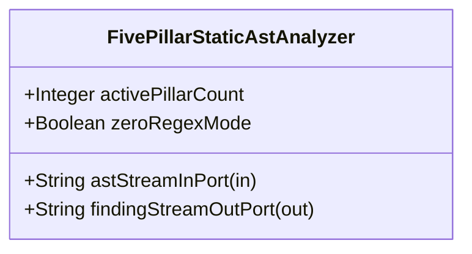

| Attribute | Specification Detail |
| :--- | :--- |
| **Issue ID** | #683 |
| **Title** | Feature 29: [BP 06 Deterministic Static 5 Pillar Code Auditor and Defect Dossier Synthesizer Blueprint] FivePillarStaticAstAnalyzer |
| **Type** | feature |
| **Parent Epic** | [EPIC-06-BP_06_Deterministic_Static_5_Pillar_Code_Auditor_and_Defect_Dossier_Synthesizer_Blueprint](../epics/EPIC-06-BP_06_Deterministic_Static_5_Pillar_Code_Auditor_and_Defect_Dossier_Synthesizer_Blueprint.md) |
| **Interface Type** | Physical / Structural / Internal Bus |
| **Schema Containers** | `BP_06_Deterministic_Static_5_Pillar_Code_Auditor_and_Defect_Dossier_Synthesizer_Blueprint::FivePillarStaticAstAnalyzer` |
| **Generation Mode** | subagent |
| **Specification Source** | [schema/model.sysml](../../schema/model.sysml) |

# Feature 29: [BP 06 Deterministic Static 5 Pillar Code Auditor and Defect Dossier Synthesizer Blueprint] FivePillarStaticAstAnalyzer

## UML Class Diagram



## Interface Requirements
### 1. Test Data Shape
```json
{
  "$schema": "https://json-schema.org/draft/2020-12/schema",
  "title": "FivePillarStaticAstAnalyzerPayloadSchema",
  "type": "object",
  "properties": {
    "part": {
      "type": "string",
      "const": "FivePillarStaticAstAnalyzer"
    },
    "status": {
      "type": "string",
      "enum": ["nominal", "degraded", "fault"]
    },
    "activePillarCount": {
      "type": "integer",
      "x-sysml-type": "Integer",
      "description": "Declared attribute activePillarCount (Integer)",
      "default": 5
    },
    "zeroRegexMode": {
      "type": "boolean",
      "x-sysml-type": "Boolean",
      "description": "Enforces linear token-stream and `SourceAstItem` slice traversal without regular expressions. [unit: flag]",
      "default": true
    },
    "astStreamInPort": {
      "type": "object",
      "properties": {
        "direction": { "type": "string", "const": "in" },
        "port_type": { "type": "string", "const": "String" }
      },
      "required": ["direction", "port_type"]
    },
    "findingStreamOutPort": {
      "type": "object",
      "properties": {
        "direction": { "type": "string", "const": "out" },
        "port_type": { "type": "string", "const": "String" }
      },
      "required": ["direction", "port_type"]
    }
  },
  "required": [
    "part",
    "status",
    "astStreamInPort",
    "findingStreamOutPort"
  ],
  "additionalProperties": false
}
```

### 2. Validation & Constraints
Declared structural attributes, boundary ports, invariants, and allocated requirements for classifier `FivePillarStaticAstAnalyzer`:

| AST Member Kind | Identifier | Declared Type / Direction | Default / Invariant Contract |
| :--- | :--- | :--- | :--- |
| Attribute | `activePillarCount` | `Integer` | Default `5` |
| Attribute | `zeroRegexMode` | `Boolean` | Default `true` |
| Port | `astStreamInPort` | `in String` | Boundary interface contract |
| Port | `findingStreamOutPort` | `out String` | Boundary interface contract |

### 3. Visual Layout & Arrangement
Structural composition and boundary topology for classifier `FivePillarStaticAstAnalyzer` organize no nested subparts declared in schema paired with boundary ports `in astStreamInPort : String`, `out findingStreamOutPort : String`.

### 4. Interactive Flow & States
Operational lifecycle events and discrete state transitions for FivePillarStaticAstAnalyzer.

### Layer 1: Domain State & Signal Model
Classifier `FivePillarStaticAstAnalyzer` encapsulates typed domain state attributes `activePillarCount : Integer`, `zeroRegexMode : Boolean` alongside operational lifecycle status.

### Layer 2: Logic & Safety State Management
Classifier `FivePillarStaticAstAnalyzer` governs stateless structural transition evaluation enforcing no additional invariant guards declared in schema.

### Layer 3: Presentation & Actuator Interface Binding
Classifier `FivePillarStaticAstAnalyzer` binds external and behavioral interfaces across port `in astStreamInPort : String`, port `out findingStreamOutPort : String`.

## Acceptance Criteria (BDD)
- [ ] AC-01: Given valid `FivePillarStaticAstAnalyzer` initialization inputs for `activePillarCount` (`Integer`), `zeroRegexMode` (`Boolean`) (no additional constraints specified in schema), When `FivePillarStaticAstAnalyzer` commits typed domain state, Then declared state attributes hold verified values.
- [ ] AC-02: Given malformed or out-of-domain input values for `activePillarCount` (`Integer`), `zeroRegexMode` (`Boolean`), When `FivePillarStaticAstAnalyzer` validates incoming state updates, Then `FivePillarStaticAstAnalyzer` rejects the invalid state update and emits a diagnostic via diagnostic port `findingStreamOutPort`.
- [ ] AC-03: Given nominal signal arrival across `astStreamInPort` (`in String`), `findingStreamOutPort` (`out String`), When `FivePillarStaticAstAnalyzer` processes the declared interface transaction, Then output state conforms to the structural classifier contract.
- [ ] AC-04: Given an invalid or unrecognized interface frame across `astStreamInPort` (`in String`), `findingStreamOutPort` (`out String`), When `FivePillarStaticAstAnalyzer` boundary validation executes, Then `FivePillarStaticAstAnalyzer` refuses the malformed frame via diagnostic port `findingStreamOutPort` and preserves prior verified state.

## Source References
Formal component specifications and normative systems engineering requirements:
- System Architecture Model: `schema/model.sysml`
- Normative Systems Engineering Standard: ISO/IEC/IEEE 15288:2023 §6.4.3 Architecture Definition Process

Component behavior and interface definitions derive from `schema/model.sysml` pursuant to ISO/IEC/IEEE 15288.
