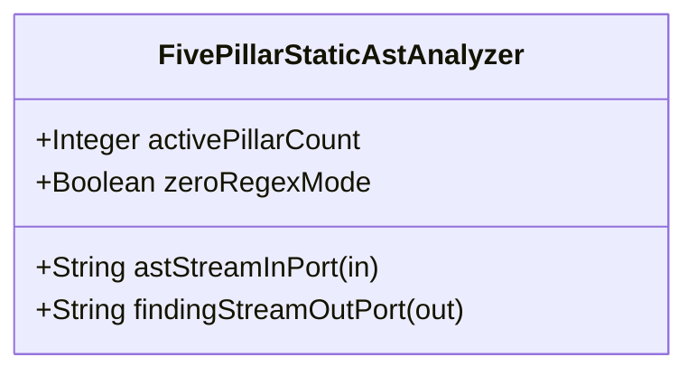

| Attribute | Specification Detail |
| :--- | :--- |
| **Issue ID** | #683 |
| **Title** | Feature 29: [BP 06 Deterministic Static 5 Pillar Code Auditor and Defect Dossier Synthesizer Blueprint] FivePillarStaticAstAnalyzer |
| **Type** | feature |
| **Parent Epic** | [EPIC-06-BP_06_Deterministic_Static_5_Pillar_Code_Auditor_and_Defect_Dossier_Synthesizer_Blueprint](../epics/EPIC-06-BP_06_Deterministic_Static_5_Pillar_Code_Auditor_and_Defect_Dossier_Synthesizer_Blueprint.md) |
| **Interface Type** | Physical / Structural / Internal Bus |
| **Schema Containers** | `BP_06_Deterministic_Static_5_Pillar_Code_Auditor_and_Defect_Dossier_Synthesizer_Blueprint::FivePillarStaticAstAnalyzer` |
| **Generation Mode** | subagent |
| **Specification Source** | [schema/model.sysml](../../schema/model.sysml) |

# Feature 29: [BP 06 Deterministic Static 5 Pillar Code Auditor and Defect Dossier Synthesizer Blueprint] FivePillarStaticAstAnalyzer

## UML Class Diagram



## Interface Requirements
### 1. Test Data Shape
```json
{
  "$schema": "https://json-schema.org/draft/2020-12/schema",
  "title": "FivePillarStaticAstAnalyzerPayloadSchema",
  "type": "object",
  "properties": {
    "part": {
      "type": "string",
      "const": "FivePillarStaticAstAnalyzer"
    },
    "status": {
      "type": "string",
      "enum": ["nominal", "degraded", "fault"]
    },
    "activePillarCount": {
      "type": "integer",
      "x-sysml-type": "Integer",
      "description": "Declared attribute activePillarCount (Integer)",
      "default": 5
    },
    "zeroRegexMode": {
      "type": "boolean",
      "x-sysml-type": "Boolean",
      "description": "Enforces linear token-stream and `rust_cst` item slice traversal without regular expressions. [unit: flag]",
      "default": true
    },
    "astStreamInPort": {
      "type": "object",
      "properties": {
        "direction": { "type": "string", "const": "in" },
        "port_type": { "type": "string", "const": "String" }
      },
      "required": ["direction", "port_type"]
    },
    "findingStreamOutPort": {
      "type": "object",
      "properties": {
        "direction": { "type": "string", "const": "out" },
        "port_type": { "type": "string", "const": "String" }
      },
      "required": ["direction", "port_type"]
    }
  },
  "required": [
    "part",
    "status",
    "astStreamInPort",
    "findingStreamOutPort"
  ],
  "additionalProperties": false
}
```

### 2. Validation & Constraints
Declared structural attributes, boundary ports, invariants, and allocated requirements for classifier `FivePillarStaticAstAnalyzer`:

| AST Member Kind | Identifier | Declared Type / Direction | Default / Invariant Contract |
| :--- | :--- | :--- | :--- |
| Attribute | `activePillarCount` | `Integer` | Default `5` |
| Attribute | `zeroRegexMode` | `Boolean` | Default `true` |
| Port | `astStreamInPort` | `in String` | Boundary interface contract |
| Port | `findingStreamOutPort` | `out String` | Boundary interface contract |
| Constraint | `Invariant_REQ_0606_SC_01` | Invariant (`REQ-0606 (REQ_0606_BP_06_Deterministic_Static_5_Pillar_Code_Auditor_and_Defect_Dossier_Synthesizer_Blueprint)`) | Enforces `activePillarCount == 5 && pillar_coverage_count == 5` |
| Constraint | `Invariant_REQ_0606_SC_02` | Invariant (`REQ-0606 (REQ_0606_BP_06_Deterministic_Static_5_Pillar_Code_Auditor_and_Defect_Dossier_Synthesizer_Blueprint)`) | Enforces `zeroRegexMode == true` and zero hand-rolled scanners |
| Requirement | `REQ-0606 (REQ_0606_BP_06_Deterministic_Static_5_Pillar_Code_Auditor_and_Defect_Dossier_Synthesizer_Blueprint)` | Allocated Requirement | Evaluates all 5 correctness risk pillars (`E0601`--`E0605`) using `ra_ap_syntax` typed AST, Stage-2 isolated `Dylint` `rustc_middle::mir` (`TyCtxt`) in `./lints/deap-dylint-mir/`, and `deap_core::dart_cst` (`logos` + `rowan`) with `source_ast.rs` deleted |

### 3. Visual Layout & Arrangement
Structural composition and boundary topology for classifier `FivePillarStaticAstAnalyzer` organize no nested subparts declared in schema paired with boundary ports `in astStreamInPort : String`, `out findingStreamOutPort : String`. Enforces Contract A (100% normative OMG SysML v2.0 + KerML 1.0 grammar coverage with zero 16-construct caps) and Contract B (`ra_ap_syntax` typed AST `ast::{MatchExpr, MatchArmList, CallExpr, MethodCallExpr, TryExpr, Fn, HasDocComments, HasAttrs}` + Stage-2 isolated `Dylint` `rustc_middle::mir` (`TyCtxt`) 5-pillar defect auditor in `./lints/deap-dylint-mir/` + `deap_core::dart_cst` (`logos` + `rowan`) isolation + complete deletion of `source_ast.rs` with zero hand-rolled scanners).

### 4. Interactive Flow & States
Operational lifecycle events and discrete state transitions for `FivePillarStaticAstAnalyzer` transitioning from `IngestingRustAndDartCst` to `EvaluatingFivePillars` on `RustCstItem_slice_parsed`, and then to `SynthesizingDossier` on `AuditFinding_emitted` or `Verified` on `zero_findings_detected`.

### Layer 1: Domain State & Signal Model
Classifier `FivePillarStaticAstAnalyzer` encapsulates typed domain state attributes `activePillarCount : Integer` (default `5`) and `zeroRegexMode : Boolean` (default `true`), `ra_ap_syntax` typed AST nodes, Stage-2 `rustc_middle::mir` (`TyCtxt`) basic blocks and terminator graphs, `deap_core::dart_cst` (`logos` + `rowan`) syntax nodes, and line-exact `AuditFinding` records (`E0601`--`E0605`).

### Layer 2: Logic & Safety State Management
Classifier `FivePillarStaticAstAnalyzer` governs deterministic single-pass 5-pillar evaluation across `ra_ap_syntax` typed AST, Stage-2 `./lints/deap-dylint-mir/` `rustc_middle::mir` (`TyCtxt`), and `deap_core::dart_cst` enforcing `Invariant_REQ_0606_SC_01` (`activePillarCount == 5`) and `Invariant_REQ_0606_SC_02` (`zeroRegexMode == true`). Partitioned into `< 380`-SLOC submodules under `./crates/verify-baseline/src/defect_auditor/`, `./lints/deap-dylint-mir/`, and `./crates/deap-core/src/dart_cst/` with `./crates/deap-core/src/source_ast.rs` (`source_ast.rs`) and all legacy hand-rolled scanners permanently deleted.

### Layer 3: Presentation & Actuator Interface Binding
Classifier `FivePillarStaticAstAnalyzer` binds external and behavioral interfaces across port `in astStreamInPort : String` and port `out findingStreamOutPort : String`, streaming typed `AuditFinding` payloads to `DeterministicDossierSynthesizer` and `MermaidUmlDiagramGenerator` and emitting `ariadne` / `miette` byte-span diagnostics (`E0601`).

### Associated Use Cases & User Stories

#### Associated Use Cases
- [ ] #649 - [Use Case 26: Static Five Pillar AST Defect Detection](../use-cases/UC-26-Static_Five_Pillar_AST_Defect_Detection.md)

#### Associated User Stories
- [ ] #727 - [User Story 38: Parse Rust Cst And Parse Dart Cst](../user-stories/US-38-ParseRustCstAndParseDartCst.md)
- [ ] #728 - [User Story 39: Evaluate Source File Pillars Across5](../user-stories/US-39-EvaluateSourceFilePillarsAcross5.md)

## Acceptance Criteria (BDD)
- [ ] AC-01: Given valid `FivePillarStaticAstAnalyzer` initialization inputs for `activePillarCount` (`Integer`), `zeroRegexMode` (`Boolean`) (no additional constraints specified in schema), When `FivePillarStaticAstAnalyzer` commits typed domain state, Then declared state attributes hold verified values.
- [ ] AC-02: Given malformed or out-of-domain input values for `activePillarCount` (`Integer`), `zeroRegexMode` (`Boolean`), When `FivePillarStaticAstAnalyzer` validates incoming state updates, Then `FivePillarStaticAstAnalyzer` rejects the invalid state update and emits a diagnostic via diagnostic port `findingStreamOutPort`.
- [ ] AC-03: Given nominal signal arrival across `astStreamInPort` (`in String`), `findingStreamOutPort` (`out String`), When `FivePillarStaticAstAnalyzer` processes the declared interface transaction, Then output state conforms to the structural classifier contract.
- [ ] AC-04: Given an invalid or unrecognized interface frame across `astStreamInPort` (`in String`), `findingStreamOutPort` (`out String`), When `FivePillarStaticAstAnalyzer` boundary validation executes, Then `FivePillarStaticAstAnalyzer` refuses the malformed frame via diagnostic port `findingStreamOutPort` and preserves prior verified state.

## Source References
Formal component specifications and normative systems engineering requirements:
- System Architecture Model: `schema/model.sysml`
- Normative Systems Engineering Standard: ISO/IEC/IEEE 15288:2023 §6.4.3 Architecture Definition Process

Component behavior and interface definitions derive from `schema/model.sysml` pursuant to ISO/IEC/IEEE 15288.
