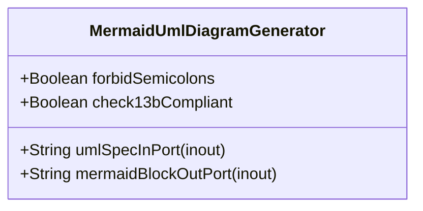

| Attribute | Specification Detail |
| :--- | :--- |
| **Issue ID** | #684 |
| **Title** | Feature 30: [BP 06 Deterministic Static 5 Pillar Code Auditor and Defect Dossier Synthesizer Blueprint] MermaidUmlDiagramGenerator |
| **Type** | feature |
| **Parent Epic** | [EPIC-06-BP_06_Deterministic_Static_5_Pillar_Code_Auditor_and_Defect_Dossier_Synthesizer_Blueprint](../epics/EPIC-06-BP_06_Deterministic_Static_5_Pillar_Code_Auditor_and_Defect_Dossier_Synthesizer_Blueprint.md) |
| **Interface Type** | Physical / Structural / Internal Bus |
| **Schema Containers** | `BP_06_Deterministic_Static_5_Pillar_Code_Auditor_and_Defect_Dossier_Synthesizer_Blueprint::MermaidUmlDiagramGenerator` |
| **Generation Mode** | subagent |
| **Specification Source** | [schema/model.sysml](../../schema/model.sysml) |

# Feature 30: [BP 06 Deterministic Static 5 Pillar Code Auditor and Defect Dossier Synthesizer Blueprint] MermaidUmlDiagramGenerator

## UML Class Diagram



## Interface Requirements
### 1. Test Data Shape
```json
{
  "$schema": "https://json-schema.org/draft/2020-12/schema",
  "title": "MermaidUmlDiagramGeneratorPayloadSchema",
  "type": "object",
  "properties": {
    "part": {
      "type": "string",
      "const": "MermaidUmlDiagramGenerator"
    },
    "status": {
      "type": "string",
      "enum": ["nominal", "degraded", "fault"]
    },
    "forbidSemicolons": {
      "type": "boolean",
      "description": "Subsystem attribute forbidSemicolons"
    },
    "check13bCompliant": {
      "type": "boolean",
      "description": "Subsystem attribute check13bCompliant"
    },
    "umlSpecInPort": {
      "type": "object",
      "properties": {
        "direction": { "type": "string", "const": "inout" },
        "port_type": { "type": "string", "const": "String" }
      },
      "required": ["direction", "port_type"]
    },
    "mermaidBlockOutPort": {
      "type": "object",
      "properties": {
        "direction": { "type": "string", "const": "inout" },
        "port_type": { "type": "string", "const": "String" }
      },
      "required": ["direction", "port_type"]
    }
  },
  "required": [
    "part",
    "status",
    "forbidSemicolons",
    "check13bCompliant",
    "umlSpecInPort",
    "mermaidBlockOutPort"
  ],
  "additionalProperties": false
}
```

### 2. Validation & Constraints
Formal constraints and invariant guarantees enforced by MermaidUmlDiagramGenerator.

### 3. Visual Layout & Arrangement
Logical layout, viewport containment, and container structure for MermaidUmlDiagramGenerator conforming to platform design tokens. Container boundaries enforce @container isolation rules.

### 4. Interactive Flow & States
Operational lifecycle events and discrete state transitions for MermaidUmlDiagramGenerator.

### Layer 1: Domain State & Signal Model
Domain state vector representing MermaidUmlDiagramGenerator status, AST references, and typed signal models.

### Layer 2: Logic & Safety State Management
Deterministic state machine solver and safety monitor logic for MermaidUmlDiagramGenerator.

### Layer 3: Presentation & Actuator Interface Binding
Presentation interface binding and diagnostic event routing for MermaidUmlDiagramGenerator.

## Acceptance Criteria (BDD)
- [ ] AC-01: Given nominal MermaidUmlDiagramGenerator domain state, When command or input signals are received, Then updates internal state and signal outputs within declared bounds.
- [ ] AC-02: Given operational state, When MermaidUmlDiagramGenerator evaluates constraint 'operational_invariants', Then asserts invariant satisfaction without violation.
- [ ] AC-03: Given malformed input signals or boundary condition violation, When MermaidUmlDiagramGenerator error handling is invoked, Then transitions safely to failsafe fallback state without corruption.

## Source References
Formal component specifications and normative systems engineering requirements:
- System Architecture Model: `schema/model.sysml`
- Normative Systems Engineering Standard: ISO/IEC/IEEE 15288:2023 §6.4.3 Architecture Definition Process

Component behavior and interface definitions derive from `schema/model.sysml` pursuant to ISO/IEC/IEEE 15288.
