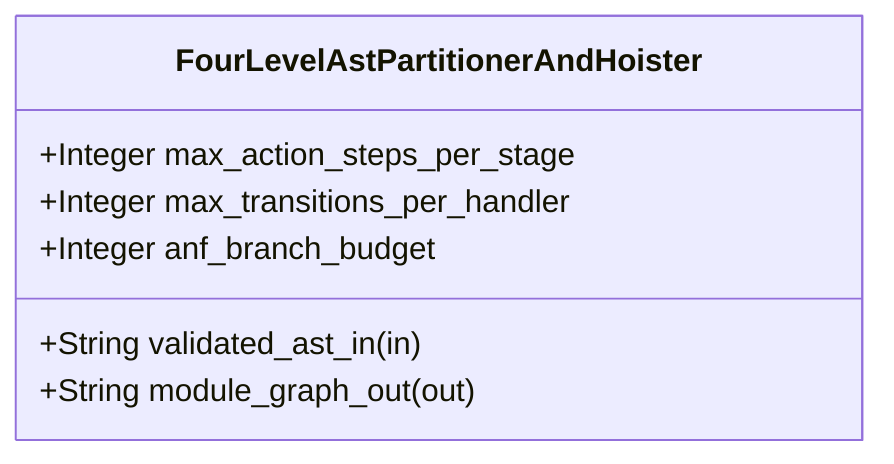

| Attribute | Specification Detail |
| :--- | :--- |
| **Issue ID** | #737 |
| **Title** | Feature 31: [BP 07 Self Hosting 4 Level Modular Multi File Code Generator Blueprint] FourLevelAstPartitionerAndHoister |
| **Type** | feature |
| **Parent Epic** | [EPIC-07-BP_07_Self_Hosting_4_Level_Modular_Multi_File_Code_Generator_Blueprint](../epics/EPIC-07-BP_07_Self_Hosting_4_Level_Modular_Multi_File_Code_Generator_Blueprint.md) |
| **Interface Type** | Physical / Structural / Internal Bus |
| **Schema Containers** | `BP_07_Self_Hosting_4_Level_Modular_Multi_File_Code_Generator_Blueprint::FourLevelAstPartitionerAndHoister` |
| **Generation Mode** | subagent |
| **Specification Source** | [schema/model.sysml](../../schema/model.sysml) |

# Feature 31: [BP 07 Self Hosting 4 Level Modular Multi File Code Generator Blueprint] FourLevelAstPartitionerAndHoister

## UML Class Diagram



## Interface Requirements
### 1. Test Data Shape
```json
{
  "$schema": "https://json-schema.org/draft/2020-12/schema",
  "title": "FourLevelAstPartitionerAndHoisterPayloadSchema",
  "type": "object",
  "properties": {
    "part": {
      "type": "string",
      "const": "FourLevelAstPartitionerAndHoister"
    },
    "status": {
      "type": "string",
      "enum": ["nominal", "degraded", "fault"]
    },
    "max_action_steps_per_stage": {
      "type": "integer",
      "x-sysml-type": "Integer",
      "description": "Declared attribute max_action_steps_per_stage (Integer)",
      "default": 6
    },
    "max_transitions_per_handler": {
      "type": "integer",
      "x-sysml-type": "Integer",
      "description": "Maximum outgoing `StateDef::transitions` arms per `step_from_()` handler unit. [unit: arms]",
      "default": 6
    },
    "anf_branch_budget": {
      "type": "integer",
      "x-sysml-type": "Integer",
      "description": "Maximum boolean branching operators retained before hoisting `eval__term_` helpers. [unit: branches]",
      "default": 6
    },
    "validated_ast_in": {
      "type": "object",
      "properties": {
        "direction": { "type": "string", "const": "in" },
        "port_type": { "type": "string", "const": "String" }
      },
      "required": ["direction", "port_type"]
    },
    "module_graph_out": {
      "type": "object",
      "properties": {
        "direction": { "type": "string", "const": "out" },
        "port_type": { "type": "string", "const": "String" }
      },
      "required": ["direction", "port_type"]
    }
  },
  "required": [
    "part",
    "status",
    "validated_ast_in",
    "module_graph_out"
  ],
  "additionalProperties": false
}
```

### 2. Validation & Constraints
Declared structural attributes, boundary ports, invariants, and allocated requirements for classifier `FourLevelAstPartitionerAndHoister`:

| AST Member Kind | Identifier | Declared Type / Direction | Default / Invariant Contract |
| :--- | :--- | :--- | :--- |
| Attribute | `max_action_steps_per_stage` | `Integer` | Default `6` |
| Attribute | `max_transitions_per_handler` | `Integer` | Default `6` |
| Attribute | `anf_branch_budget` | `Integer` | Default `6` |
| Port | `validated_ast_in` | `in String` | Boundary interface contract |
| Port | `module_graph_out` | `out String` | Boundary interface contract |
| Constraint | `Invariant_REQ_0607_SC_02` | Invariant (`REQ-0607 (REQ_0607_BP_07_Self_Hosting_4_Level_Modular_Multi_File_Code_Generator_Blueprint)`) | Declared structural invariant |
| Constraint | `Invariant_REQ_0607_SC_01` | Invariant (`REQ-0607 (REQ_0607_BP_07_Self_Hosting_4_Level_Modular_Multi_File_Code_Generator_Blueprint)`) | Declared structural invariant |
| Constraint | `Invariant_REQ_0607_SC_04` | Invariant (`REQ-0607 (REQ_0607_BP_07_Self_Hosting_4_Level_Modular_Multi_File_Code_Generator_Blueprint)`) | Declared structural invariant |
| Constraint | `Invariant_REQ_0607_REQ_0607` | Invariant (`REQ-0607 (REQ_0607_BP_07_Self_Hosting_4_Level_Modular_Multi_File_Code_Generator_Blueprint)`) | Declared structural invariant |
| Constraint | `Invariant_REQ_0607_SC_03` | Invariant (`REQ-0607 (REQ_0607_BP_07_Self_Hosting_4_Level_Modular_Multi_File_Code_Generator_Blueprint)`) | Declared structural invariant |
| Requirement | `REQ-0607 (REQ_0607_BP_07_Self_Hosting_4_Level_Modular_Multi_File_Code_Generator_Blueprint)` | Allocated Requirement | SelfHostingModularCodegenCompiler (**REQ-0607** / BP-07 / DEAP-BP-DET-07, UUIDv5 6ba7b810-9dad-11d1-80b4-00c04fd430c7, Class P linear Kahn DAG and AST traversal complexity, governed by DO-178C Level A, DO-330 TQL-4, ISO 26262 ASIL D, and ECSS-E-ST-40C) eliminates monolithic single-file code |

```sysml
constraint Invariant_REQ_0607_SC_02 {}
constraint Invariant_REQ_0607_SC_01 {}
constraint Invariant_REQ_0607_SC_04 {}
constraint Invariant_REQ_0607_REQ_0607 {}
constraint Invariant_REQ_0607_SC_03 {}
```

### 3. Visual Layout & Arrangement
Structural composition and boundary topology for classifier `FourLevelAstPartitionerAndHoister` organize no nested subparts declared in schema paired with boundary ports `in validated_ast_in : String`, `out module_graph_out : String`.

### 4. Interactive Flow & States
Operational lifecycle events and discrete state transitions for FourLevelAstPartitionerAndHoister.

### Layer 1: Domain State & Signal Model
Classifier `FourLevelAstPartitionerAndHoister` encapsulates typed domain state attributes `max_action_steps_per_stage : Integer`, `max_transitions_per_handler : Integer`, `anf_branch_budget : Integer` alongside operational lifecycle status.

### Layer 2: Logic & Safety State Management
Classifier `FourLevelAstPartitionerAndHoister` governs stateless structural transition evaluation enforcing invariant obligations `Invariant_REQ_0607_SC_02`, `Invariant_REQ_0607_SC_01`, `Invariant_REQ_0607_SC_04`, `Invariant_REQ_0607_REQ_0607`, `Invariant_REQ_0607_SC_03`.

### Layer 3: Presentation & Actuator Interface Binding
Classifier `FourLevelAstPartitionerAndHoister` binds external and behavioral interfaces across port `in validated_ast_in : String`, port `out module_graph_out : String`.

### Associated Use Cases & User Stories

#### Associated Use Cases
- [ ] #760 - [Use Case 32: Fail Closed Rejection on Directed Dependency Cycles and Upward Layer Imports](../use-cases/UC-32-Fail_Closed_Rejection_on_Directed_Dependency_Cycles_and_Upward_Layer_Imports.md)
- [ ] #761 - [Use Case 33: Four Level Deterministic Lowering with Typed syn File AST and prettyplease Formatting](../use-cases/UC-33-Four_Level_Deterministic_Lowering_with_Typed_syn_File_AST_and_prettyplease_Formatting.md)
- [ ] #762 - [Use Case 34: Metacircular Self Hosting Stage 1 to Stage 2 SHA 256 Fixed Point Identity](../use-cases/UC-34-Metacircular_Self_Hosting_Stage_1_to_Stage_2_SHA_256_Fixed_Point_Identity.md)
- [ ] #763 - [Use Case 35: Modular Multi File Flutter_Contract Emission and Monolith Barrel Decomposition](../use-cases/UC-35-Modular_Multi_File_Flutter_Contract_Emission_and_Monolith_Barrel_Decomposition.md)
- [ ] #764 - [Use Case 36: Zero String Concatenation Codegen DO 178 C Seven Section Docstring and Clippy Forbid Compliance](../use-cases/UC-36-Zero_String_Concatenation_Codegen_DO_178C_Seven_Section_Docstring_and_Clippy_Forbid_Compliance.md)
- [ ] #765 - [Use Case 37: Dogfood SysML v2 Blueprint Ingestion and Twelve Gate Closed Loop Conformance](../use-cases/UC-37-Dogfood_SysML_v2_Blueprint_Ingestion_and_Twelve_Gate_Closed_Loop_Conformance.md)

#### Associated User Stories
- None allocated (structural subsystem component)

## Acceptance Criteria (BDD)
- [ ] AC-01: Given valid `FourLevelAstPartitionerAndHoister` inputs satisfying `Invariant_REQ_0607_SC_02` [Req `REQ-0607 (REQ_0607_BP_07_Self_Hosting_4_Level_Modular_Multi_File_Code_Generator_Blueprint)`], When `FourLevelAstPartitionerAndHoister` evaluates invariant `Invariant_REQ_0607_SC_02`, Then the invariant holds and verified state is committed.
- [ ] AC-02: Given boundary inputs that violate `Invariant_REQ_0607_SC_02` [Req `REQ-0607 (REQ_0607_BP_07_Self_Hosting_4_Level_Modular_Multi_File_Code_Generator_Blueprint)`], When `FourLevelAstPartitionerAndHoister` evaluates invariant `Invariant_REQ_0607_SC_02`, Then `FourLevelAstPartitionerAndHoister` rejects the invalid transition and routes a diagnostic via diagnostic port `module_graph_out`.
- [ ] AC-03: Given valid `FourLevelAstPartitionerAndHoister` inputs satisfying `Invariant_REQ_0607_SC_01` [Req `REQ-0607 (REQ_0607_BP_07_Self_Hosting_4_Level_Modular_Multi_File_Code_Generator_Blueprint)`], When `FourLevelAstPartitionerAndHoister` evaluates invariant `Invariant_REQ_0607_SC_01`, Then the invariant holds and verified state is committed.
- [ ] AC-04: Given boundary inputs that violate `Invariant_REQ_0607_SC_01` [Req `REQ-0607 (REQ_0607_BP_07_Self_Hosting_4_Level_Modular_Multi_File_Code_Generator_Blueprint)`], When `FourLevelAstPartitionerAndHoister` evaluates invariant `Invariant_REQ_0607_SC_01`, Then `FourLevelAstPartitionerAndHoister` rejects the invalid transition and routes a diagnostic via diagnostic port `module_graph_out`.
- [ ] AC-05: Given valid `FourLevelAstPartitionerAndHoister` inputs satisfying `Invariant_REQ_0607_SC_04` [Req `REQ-0607 (REQ_0607_BP_07_Self_Hosting_4_Level_Modular_Multi_File_Code_Generator_Blueprint)`], When `FourLevelAstPartitionerAndHoister` evaluates invariant `Invariant_REQ_0607_SC_04`, Then the invariant holds and verified state is committed.
- [ ] AC-06: Given boundary inputs that violate `Invariant_REQ_0607_SC_04` [Req `REQ-0607 (REQ_0607_BP_07_Self_Hosting_4_Level_Modular_Multi_File_Code_Generator_Blueprint)`], When `FourLevelAstPartitionerAndHoister` evaluates invariant `Invariant_REQ_0607_SC_04`, Then `FourLevelAstPartitionerAndHoister` rejects the invalid transition and routes a diagnostic via diagnostic port `module_graph_out`.
- [ ] AC-07: Given valid `FourLevelAstPartitionerAndHoister` state satisfying composite invariants (`Invariant_REQ_0607_REQ_0607` [Req `REQ-0607 (REQ_0607_BP_07_Self_Hosting_4_Level_Modular_Multi_File_Code_Generator_Blueprint)`]; `Invariant_REQ_0607_SC_03` [Req `REQ-0607 (REQ_0607_BP_07_Self_Hosting_4_Level_Modular_Multi_File_Code_Generator_Blueprint)`]), When `FourLevelAstPartitionerAndHoister` evaluates the remaining invariant conjunction, Then all declared invariants hold and verified state is committed.
- [ ] AC-08: Given input state that violates any invariant in (`Invariant_REQ_0607_REQ_0607` [Req `REQ-0607 (REQ_0607_BP_07_Self_Hosting_4_Level_Modular_Multi_File_Code_Generator_Blueprint)`]; `Invariant_REQ_0607_SC_03` [Req `REQ-0607 (REQ_0607_BP_07_Self_Hosting_4_Level_Modular_Multi_File_Code_Generator_Blueprint)`]), When `FourLevelAstPartitionerAndHoister` evaluates the composite guard, Then `FourLevelAstPartitionerAndHoister` rejects the invalid state transition and routes a diagnostic via diagnostic port `module_graph_out`.
- [ ] AC-09: Given nominal typed values for `max_action_steps_per_stage` (`Integer`), `max_transitions_per_handler` (`Integer`), `anf_branch_budget` (`Integer`) across `validated_ast_in` (`in String`), `module_graph_out` (`out String`), When `FourLevelAstPartitionerAndHoister` executes structural interface processing, Then state and output ports conform to declared schema types.
- [ ] AC-10: Given malformed input frames across `max_action_steps_per_stage` (`Integer`), `max_transitions_per_handler` (`Integer`), `anf_branch_budget` (`Integer`) or `validated_ast_in` (`in String`), `module_graph_out` (`out String`), When `FourLevelAstPartitionerAndHoister` boundary validation executes, Then `FourLevelAstPartitionerAndHoister` rejects the malformed input via diagnostic port `module_graph_out`.

## Source References
Formal component specifications and normative systems engineering requirements:
- System Architecture Model: `schema/model.sysml`
- Normative Systems Engineering Standard: ISO/IEC/IEEE 15288:2023 §6.4.3 Architecture Definition Process

Component behavior and interface definitions derive from `schema/model.sysml` pursuant to ISO/IEC/IEEE 15288.
