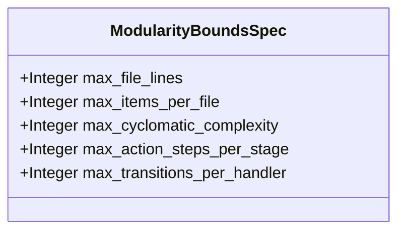

| Attribute | Specification Detail |
| :--- | :--- |
| **Issue ID** | TBD |
| **Title** | Feature 31: [BP 07 Self Hosting 4 Level Modular Multi File Code Generator Blueprint] ModularityBoundsSpec |
| **Type** | feature |
| **Parent Epic** | [EPIC-07-BP_07_Self_Hosting_4_Level_Modular_Multi_File_Code_Generator_Blueprint](../epics/EPIC-07-BP_07_Self_Hosting_4_Level_Modular_Multi_File_Code_Generator_Blueprint.md) |
| **Interface Type** | Physical / Structural / Internal Bus |
| **Schema Containers** | `BP_07_Self_Hosting_4_Level_Modular_Multi_File_Code_Generator_Blueprint::ModularityBoundsSpec` |
| **Generation Mode** | subagent |
| **Specification Source** | [schema/model.sysml](../../schema/model.sysml) |

# Feature 31: [BP 07 Self Hosting 4 Level Modular Multi File Code Generator Blueprint] ModularityBoundsSpec

## UML Class Diagram



## Interface Requirements
### 1. Test Data Shape
```json
{
  "$schema": "https://json-schema.org/draft/2020-12/schema",
  "title": "ModularityBoundsSpecPayloadSchema",
  "type": "object",
  "properties": {
    "part": {
      "type": "string",
      "const": "ModularityBoundsSpec"
    },
    "status": {
      "type": "string",
      "enum": ["nominal", "degraded", "fault"]
    },
    "max_file_lines": {
      "type": "integer",
      "x-sysml-type": "Integer",
      "description": "Declared attribute max_file_lines (Integer)",
      "default": 400
    },
    "max_items_per_file": {
      "type": "integer",
      "x-sysml-type": "Integer",
      "description": "Declared attribute max_items_per_file (Integer)",
      "default": 12
    },
    "max_cyclomatic_complexity": {
      "type": "integer",
      "x-sysml-type": "Integer",
      "description": "Declared attribute max_cyclomatic_complexity (Integer)",
      "default": 8
    },
    "max_action_steps_per_stage": {
      "type": "integer",
      "x-sysml-type": "Integer",
      "description": "Declared attribute max_action_steps_per_stage (Integer)",
      "default": 5
    },
    "max_transitions_per_handler": {
      "type": "integer",
      "x-sysml-type": "Integer",
      "description": "Declared attribute max_transitions_per_handler (Integer)",
      "default": 6
    }
  },
  "required": [
    "part",
    "status"
  ],
  "x-sysml-constraints": [
    { "name": "ValidBoundsEnvelope", "expression": "max_file_lines >= 50 and max_file_lines <= 400 and max_items_per_file >= 1 and max_items_per_file <= 12 and max_cyclomatic_complexity >= 1 and max_cyclomatic_complexity <= 8 and max_action_steps_per_stage >= 1 and max_action_steps_per_stage <= 8 and max_transitions_per_handler >= 1 and max_transitions_per_handler <= 8" }
  ],
  "additionalProperties": false
}
```

### 2. Validation & Constraints
Declared structural attributes, boundary ports, invariants, and allocated requirements for classifier `ModularityBoundsSpec`:

| AST Member Kind | Identifier | Declared Type / Direction | Default / Invariant Contract |
| :--- | :--- | :--- | :--- |
| Attribute | `max_file_lines` | `Integer` | Default `400` |
| Attribute | `max_items_per_file` | `Integer` | Default `12` |
| Attribute | `max_cyclomatic_complexity` | `Integer` | Default `8` |
| Attribute | `max_action_steps_per_stage` | `Integer` | Default `5` |
| Attribute | `max_transitions_per_handler` | `Integer` | Default `6` |
| Constraint | `ValidBoundsEnvelope` | Invariant | `max_file_lines >= 50 and max_file_lines <= 400 and max_items_per_file >= 1 and max_items_per_file <= 12 and max_cyclomatic_complexity >= 1 and max_cyclomatic_complexity <= 8 and max_action_steps_per_stage >= 1 and max_action_steps_per_stage <= 8 and max_transitions_per_handler >= 1 and max_transitions_per_handler <= 8` |

```sysml
constraint ValidBoundsEnvelope { max_file_lines >= 50 and max_file_lines <= 400 and max_items_per_file >= 1 and max_items_per_file <= 12 and max_cyclomatic_complexity >= 1 and max_cyclomatic_complexity <= 8 and max_action_steps_per_stage >= 1 and max_action_steps_per_stage <= 8 and max_transitions_per_handler >= 1 and max_transitions_per_handler <= 8 }
```

### 3. Visual Layout & Arrangement
Structural composition and boundary topology for classifier `ModularityBoundsSpec` organize no nested subparts declared in schema paired with no external boundary ports declared in schema.

### 4. Interactive Flow & States
Operational lifecycle events and discrete state transitions for ModularityBoundsSpec.

### Layer 1: Domain State & Signal Model
Classifier `ModularityBoundsSpec` encapsulates typed domain state attributes `max_file_lines : Integer`, `max_items_per_file : Integer`, `max_cyclomatic_complexity : Integer`, `max_action_steps_per_stage : Integer`, `max_transitions_per_handler : Integer` alongside operational lifecycle status.

### Layer 2: Logic & Safety State Management
Classifier `ModularityBoundsSpec` governs stateless structural transition evaluation enforcing invariant obligations `ValidBoundsEnvelope`.

### Layer 3: Presentation & Actuator Interface Binding
Classifier `ModularityBoundsSpec` exposes an internal structural boundary with no external ports, operations, or actions declared in schema.

## Acceptance Criteria (BDD)
- [ ] AC-01: Given valid `ModularityBoundsSpec` inputs satisfying `ValidBoundsEnvelope` (`max_file_lines >= 50 and max_file_lines <= 400 and max_items_per_file >= 1 and max_items_per_file <= 12 and max_cyclomatic_complexity >= 1 and max_cyclomatic_complexity <= 8 and max_action_steps_per_stage >= 1 and max_action_steps_per_stage <= 8 and max_transitions_per_handler >= 1 and max_transitions_per_handler <= 8`), When `ModularityBoundsSpec` evaluates invariant `ValidBoundsEnvelope`, Then the invariant holds and verified state is committed.
- [ ] AC-02: Given boundary inputs that violate `ValidBoundsEnvelope` (`max_file_lines >= 50 and max_file_lines <= 400 and max_items_per_file >= 1 and max_items_per_file <= 12 and max_cyclomatic_complexity >= 1 and max_cyclomatic_complexity <= 8 and max_action_steps_per_stage >= 1 and max_action_steps_per_stage <= 8 and max_transitions_per_handler >= 1 and max_transitions_per_handler <= 8`), When `ModularityBoundsSpec` evaluates invariant `ValidBoundsEnvelope`, Then `ModularityBoundsSpec` rejects the invalid transition and routes a diagnostic via deterministic error diagnostic output.
- [ ] AC-03: Given nominal typed values for `max_file_lines` (`Integer`), `max_items_per_file` (`Integer`), `max_cyclomatic_complexity` (`Integer`), `max_action_steps_per_stage` (`Integer`), `max_transitions_per_handler` (`Integer`) across `ModularityBoundsSpec` structural boundary, When `ModularityBoundsSpec` executes structural interface processing, Then state and output ports conform to declared schema types.
- [ ] AC-04: Given malformed input frames across `max_file_lines` (`Integer`), `max_items_per_file` (`Integer`), `max_cyclomatic_complexity` (`Integer`), `max_action_steps_per_stage` (`Integer`), `max_transitions_per_handler` (`Integer`) or `ModularityBoundsSpec` structural boundary, When `ModularityBoundsSpec` boundary validation executes, Then `ModularityBoundsSpec` rejects the malformed input via deterministic error diagnostic output.

## Source References
Formal component specifications and normative systems engineering requirements:
- System Architecture Model: `schema/model.sysml`
- Normative Systems Engineering Standard: ISO/IEC/IEEE 15288:2023 §6.4.3 Architecture Definition Process

Component behavior and interface definitions derive from `schema/model.sysml` pursuant to ISO/IEC/IEEE 15288.
