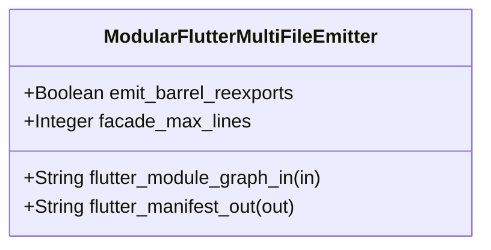

| Attribute | Specification Detail |
| :--- | :--- |
| **Issue ID** | #830 |
| **Title** | Feature 32: [BP 07 Self Hosting 4 Level Modular Multi File Code Generator Blueprint] ModularFlutterMultiFileEmitter |
| **Type** | feature |
| **Parent Epic** | [EPIC-07-BP_07_Self_Hosting_4_Level_Modular_Multi_File_Code_Generator_Blueprint](../epics/EPIC-07-BP_07_Self_Hosting_4_Level_Modular_Multi_File_Code_Generator_Blueprint.md) (#852) |
| **Interface Type** | Physical / Structural / Internal Bus |
| **Schema Containers** | `BP_07_Self_Hosting_4_Level_Modular_Multi_File_Code_Generator_Blueprint::ModularFlutterMultiFileEmitter` |
| **Generation Mode** | subagent |
| **Specification Source** | [schema/model.sysml](../../schema/model.sysml) |

# Feature 32: [BP 07 Self Hosting 4 Level Modular Multi File Code Generator Blueprint] ModularFlutterMultiFileEmitter

## UML Class Diagram



## Interface Requirements
### 1. Test Data Shape
```json
{
  "$schema": "https://json-schema.org/draft/2020-12/schema",
  "title": "ModularFlutterMultiFileEmitterPayloadSchema",
  "type": "object",
  "properties": {
    "part": {
      "type": "string",
      "const": "ModularFlutterMultiFileEmitter"
    },
    "status": {
      "type": "string",
      "enum": ["nominal", "degraded", "fault"]
    },
    "emit_barrel_reexports": {
      "type": "boolean",
      "x-sysml-type": "Boolean",
      "description": "Declared attribute emit_barrel_reexports (Boolean)",
      "default": true
    },
    "facade_max_lines": {
      "type": "integer",
      "x-sysml-type": "Integer",
      "description": "Strict upper bound on `crates/compile-sysml/src/flutter_codegen.rs` barrel facade line count. [unit: LOC]",
      "default": 100
    },
    "flutter_module_graph_in": {
      "type": "object",
      "properties": {
        "direction": { "type": "string", "const": "in" },
        "port_type": { "type": "string", "const": "String" }
      },
      "required": ["direction", "port_type"]
    },
    "flutter_manifest_out": {
      "type": "object",
      "properties": {
        "direction": { "type": "string", "const": "out" },
        "port_type": { "type": "string", "const": "String" }
      },
      "required": ["direction", "port_type"]
    }
  },
  "required": [
    "part",
    "status",
    "flutter_module_graph_in",
    "flutter_manifest_out"
  ],
  "additionalProperties": false
}
```

### 2. Validation & Constraints
Declared structural attributes, boundary ports, invariants, and allocated requirements for classifier `ModularFlutterMultiFileEmitter`:

| AST Member Kind | Identifier | Declared Type / Direction | Default / Invariant Contract |
| :--- | :--- | :--- | :--- |
| Attribute | `emit_barrel_reexports` | `Boolean` | Default `true` |
| Attribute | `facade_max_lines` | `Integer` | Default `100` |
| Port | `flutter_module_graph_in` | `in String` | Boundary interface contract |
| Port | `flutter_manifest_out` | `out String` | Boundary interface contract |

### 3. Visual Layout & Arrangement
Structural composition and boundary topology for classifier `ModularFlutterMultiFileEmitter` organize no nested subparts declared in schema paired with boundary ports `in flutter_module_graph_in : String`, `out flutter_manifest_out : String`.

### 4. Interactive Flow & States
Operational lifecycle events and discrete state transitions for ModularFlutterMultiFileEmitter.

### Layer 1: Domain State & Signal Model
Classifier `ModularFlutterMultiFileEmitter` encapsulates typed domain state attributes `emit_barrel_reexports : Boolean` (default `true`), `facade_max_lines : Integer` (default `100`, runtime target `<= 80` LOC) alongside operational lifecycle status. Under **Contract A (100% Normative OMG SysML v2.0 + KerML 1.0 Grammar Coverage -- Zero 16-Construct Caps)**, `ModularFlutterMultiFileEmitter` consumes 4-level lowered module graphs derived from the complete OMG SysML v2.0 and KerML 1.0 textual grammar (`package`/`library package`/`standard library package`, `import`, `metadata def`/`@Metadata`/`#capability`/`#hazard`/`#risk`/`#rt_loop`/`#dal`/`#fls` while preserving backward-compatible parsing of legacy `hazard def`/`risk def`/`capability def`, `part def`/`part`, `item def`/`item`, `attribute def`/`attribute`, `enum def`/`enum`, `port def`/`port` `in`/`out`/`inout`/`~`, `connection def`/`connection`, `interface def`/`interface`, `flow def`/`flow`, `allocation def`/`allocation`, `occurrence def`/`occurrence`, `action def`/`action`, `state def`/`state`, `calc def`/`calc`, `constraint def`/`constraint`, `requirement def`/`requirement`, `concern def`/`concern`, `use case def`/`use case`, `analysis def`/`analysis`, `verification def`/`verification`, `test case def`/`test case`, `interaction def`/`interaction`, `view def`/`view`, `viewpoint def`/`viewpoint`, `rendering def`/`rendering`, `variation`/`variant`, and KerML specialization/multiplicity/expressions) via `deap_core::sysml_cst` and `deap_core::dart_cst` (`logos` + `rowan` + `salsa` + `ariadne`).

### Layer 2: Logic & Safety State Management
Classifier `ModularFlutterMultiFileEmitter` governs stateless structural transition evaluation enforcing `C_MOD_01` (`<= 400` LOC per file), `C_MOD_02` (`<= 12` items per file), `C_MOD_03` (`v(G) <= 8`), `C_MOD_04` (Stage-1 == Stage-2 SHA-256 fixed-point identity), and `C_MOD_05` (`runtime_llm_subagent_count == 0`). Under **Contract B (Official Rust Compiler & Codegen Stack -- Zero Hand-Rolled Scanners)** and the **3-Layer Definition of Done (DoD)**, `ModularFlutterMultiFileEmitter` emits per-package and per-classifier `.g.dart` units (`models/generated/<pkg>/<part>_view.g.dart`, `data/generated/ffi/*.g.dart`, `data/generated/dto/<pkg>/<dto>_dto.g.dart`, `data/seeds/generated/*.g.dart`, `test/generated/support/*.g.dart`) and backward-compatible barrel re-export facades (`<= 80` LOC) inside `< 380` exec SLOC submodules (`./crates/compile-sysml/src/modular_codegen/`) while explicitly deleting `-650+` SLOC of legacy monolithic string-concatenation templates in `./crates/compile-sysml/src/flutter_codegen.rs` and zero hand-rolled scanners.

### Layer 3: Presentation & Actuator Interface Binding
Classifier `ModularFlutterMultiFileEmitter` binds external and behavioral interfaces across ingress port `in flutter_module_graph_in : String` and egress port `out flutter_manifest_out : String`, atomically persisting the modular `.g.dart` contract tree and `GeneratedTreeManifest` SHA-256 records or routing fail-closed diagnostics (`E0701`--`E0705`) on invariant violations.

## Acceptance Criteria (BDD)
- [ ] AC-01: Given valid `ModularFlutterMultiFileEmitter` initialization inputs for `emit_barrel_reexports` (`Boolean`), `facade_max_lines` (`Integer`) (no additional constraints specified in schema), When `ModularFlutterMultiFileEmitter` commits typed domain state, Then declared state attributes hold verified values.
- [ ] AC-02: Given malformed or out-of-domain input values for `emit_barrel_reexports` (`Boolean`), `facade_max_lines` (`Integer`), When `ModularFlutterMultiFileEmitter` validates incoming state updates, Then `ModularFlutterMultiFileEmitter` rejects the invalid state update and emits a diagnostic via diagnostic port `flutter_manifest_out`.
- [ ] AC-03: Given nominal signal arrival across `flutter_module_graph_in` (`in String`), `flutter_manifest_out` (`out String`), When `ModularFlutterMultiFileEmitter` processes the declared interface transaction, Then output state conforms to the structural classifier contract.
- [ ] AC-04: Given an invalid or unrecognized interface frame across `flutter_module_graph_in` (`in String`), `flutter_manifest_out` (`out String`), When `ModularFlutterMultiFileEmitter` boundary validation executes, Then `ModularFlutterMultiFileEmitter` refuses the malformed frame via diagnostic port `flutter_manifest_out` and preserves prior verified state.

## Source References
Formal component specifications and normative systems engineering requirements:
- System Architecture Model: `schema/model.sysml`
- Normative Systems Engineering Standard: ISO/IEC/IEEE 15288:2023 §6.4.3 Architecture Definition Process

Component behavior and interface definitions derive from `schema/model.sysml` pursuant to ISO/IEC/IEEE 15288.
