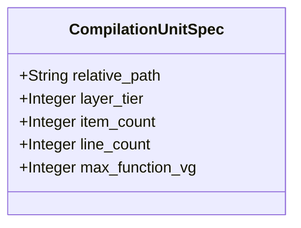

| Attribute | Specification Detail |
| :--- | :--- |
| **Issue ID** | TBD |
| **Title** | Feature 33: [BP 07 Self Hosting 4 Level Modular Multi File Code Generator Blueprint] CompilationUnitSpec |
| **Type** | feature |
| **Parent Epic** | [EPIC-07-BP_07_Self_Hosting_4_Level_Modular_Multi_File_Code_Generator_Blueprint](../epics/EPIC-07-BP_07_Self_Hosting_4_Level_Modular_Multi_File_Code_Generator_Blueprint.md) |
| **Interface Type** | Physical / Structural / Internal Bus |
| **Schema Containers** | `BP_07_Self_Hosting_4_Level_Modular_Multi_File_Code_Generator_Blueprint::CompilationUnitSpec` |
| **Generation Mode** | subagent |
| **Specification Source** | [schema/model.sysml](../../schema/model.sysml) |

# Feature 33: [BP 07 Self Hosting 4 Level Modular Multi File Code Generator Blueprint] CompilationUnitSpec

## UML Class Diagram



## Interface Requirements
### 1. Test Data Shape
```json
{
  "$schema": "https://json-schema.org/draft/2020-12/schema",
  "title": "CompilationUnitSpecPayloadSchema",
  "type": "object",
  "properties": {
    "part": {
      "type": "string",
      "const": "CompilationUnitSpec"
    },
    "status": {
      "type": "string",
      "enum": ["nominal", "degraded", "fault"]
    },
    "relative_path": {
      "type": "string",
      "x-sysml-type": "String",
      "description": "Declared attribute relative_path (String)",
      "default": "mod.rs"
    },
    "layer_tier": {
      "type": "integer",
      "x-sysml-type": "Integer",
      "description": "Declared attribute layer_tier (Integer)",
      "default": 1
    },
    "item_count": {
      "type": "integer",
      "x-sysml-type": "Integer",
      "description": "Declared attribute item_count (Integer)",
      "default": 1
    },
    "line_count": {
      "type": "integer",
      "x-sysml-type": "Integer",
      "description": "Declared attribute line_count (Integer)",
      "default": 10
    },
    "max_function_vg": {
      "type": "integer",
      "x-sysml-type": "Integer",
      "description": "Declared attribute max_function_vg (Integer)",
      "default": 1
    }
  },
  "required": [
    "part",
    "status"
  ],
  "x-sysml-constraints": [
    { "name": "UnitObeysBounds", "expression": "line_count >= 1 and line_count <= max_file_lines and item_count >= 1 and item_count <= max_items_per_file and max_function_vg >= 1 and max_function_vg <= max_cyclomatic_complexity" }
  ],
  "additionalProperties": false
}
```

### 2. Validation & Constraints
Declared structural attributes, boundary ports, invariants, and allocated requirements for classifier `CompilationUnitSpec`:

| AST Member Kind | Identifier | Declared Type / Direction | Default / Invariant Contract |
| :--- | :--- | :--- | :--- |
| Attribute | `relative_path` | `String` | Default `"mod.rs"` |
| Attribute | `layer_tier` | `Integer` | Default `1` |
| Attribute | `item_count` | `Integer` | Default `1` |
| Attribute | `line_count` | `Integer` | Default `10` |
| Attribute | `max_function_vg` | `Integer` | Default `1` |
| Constraint | `UnitObeysBounds` | Invariant | `line_count >= 1 and line_count <= max_file_lines and item_count >= 1 and item_count <= max_items_per_file and max_function_vg >= 1 and max_function_vg <= max_cyclomatic_complexity` |

```sysml
constraint UnitObeysBounds { line_count >= 1 and line_count <= max_file_lines and item_count >= 1 and item_count <= max_items_per_file and max_function_vg >= 1 and max_function_vg <= max_cyclomatic_complexity }
```

### 3. Visual Layout & Arrangement
Structural composition and boundary topology for classifier `CompilationUnitSpec` organize no nested subparts declared in schema paired with no external boundary ports declared in schema.

### 4. Interactive Flow & States
Operational lifecycle events and discrete state transitions for CompilationUnitSpec.

### Layer 1: Domain State & Signal Model
Classifier `CompilationUnitSpec` encapsulates typed domain state attributes `relative_path : String`, `layer_tier : Integer`, `item_count : Integer`, `line_count : Integer`, `max_function_vg : Integer` alongside operational lifecycle status.

### Layer 2: Logic & Safety State Management
Classifier `CompilationUnitSpec` governs stateless structural transition evaluation enforcing invariant obligations `UnitObeysBounds`.

### Layer 3: Presentation & Actuator Interface Binding
Classifier `CompilationUnitSpec` exposes an internal structural boundary with no external ports, operations, or actions declared in schema.

## Acceptance Criteria (BDD)
- [ ] AC-01: Given valid `CompilationUnitSpec` inputs satisfying `UnitObeysBounds` (`line_count >= 1 and line_count <= max_file_lines and item_count >= 1 and item_count <= max_items_per_file and max_function_vg >= 1 and max_function_vg <= max_cyclomatic_complexity`), When `CompilationUnitSpec` evaluates invariant `UnitObeysBounds`, Then the invariant holds and verified state is committed.
- [ ] AC-02: Given boundary inputs that violate `UnitObeysBounds` (`line_count >= 1 and line_count <= max_file_lines and item_count >= 1 and item_count <= max_items_per_file and max_function_vg >= 1 and max_function_vg <= max_cyclomatic_complexity`), When `CompilationUnitSpec` evaluates invariant `UnitObeysBounds`, Then `CompilationUnitSpec` rejects the invalid transition and routes a diagnostic via deterministic error diagnostic output.
- [ ] AC-03: Given nominal typed values for `relative_path` (`String`), `layer_tier` (`Integer`), `item_count` (`Integer`), `line_count` (`Integer`), `max_function_vg` (`Integer`) across `CompilationUnitSpec` structural boundary, When `CompilationUnitSpec` executes structural interface processing, Then state and output ports conform to declared schema types.
- [ ] AC-04: Given malformed input frames across `relative_path` (`String`), `layer_tier` (`Integer`), `item_count` (`Integer`), `line_count` (`Integer`), `max_function_vg` (`Integer`) or `CompilationUnitSpec` structural boundary, When `CompilationUnitSpec` boundary validation executes, Then `CompilationUnitSpec` rejects the malformed input via deterministic error diagnostic output.

## Source References
Formal component specifications and normative systems engineering requirements:
- System Architecture Model: `schema/model.sysml`
- Normative Systems Engineering Standard: ISO/IEC/IEEE 15288:2023 §6.4.3 Architecture Definition Process

Component behavior and interface definitions derive from `schema/model.sysml` pursuant to ISO/IEC/IEEE 15288.
