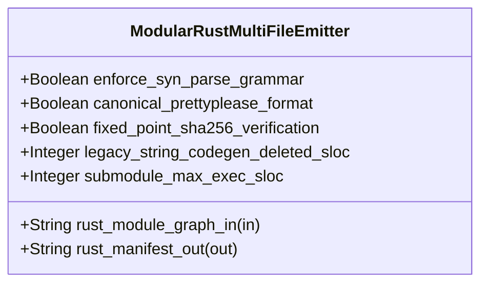

| Attribute | Specification Detail |
| :--- | :--- |
| **Issue ID** | #739 |
| **Title** | Feature 33: [BP 07 Self Hosting 4 Level Modular Multi File Code Generator Blueprint] ModularRustMultiFileEmitter |
| **Type** | feature |
| **Parent Epic** | [EPIC-07-BP_07_Self_Hosting_4_Level_Modular_Multi_File_Code_Generator_Blueprint](../epics/EPIC-07-BP_07_Self_Hosting_4_Level_Modular_Multi_File_Code_Generator_Blueprint.md) |
| **Interface Type** | Physical / Structural / Internal Bus |
| **Schema Containers** | `BP_07_Self_Hosting_4_Level_Modular_Multi_File_Code_Generator_Blueprint::ModularRustMultiFileEmitter` |
| **Generation Mode** | subagent |
| **Specification Source** | [schema/model.sysml](../../schema/model.sysml) |

# Feature 33: [BP 07 Self Hosting 4 Level Modular Multi File Code Generator Blueprint] ModularRustMultiFileEmitter

## UML Class Diagram



## Interface Requirements
### 1. Test Data Shape
```json
{
  "$schema": "https://json-schema.org/draft/2020-12/schema",
  "title": "ModularRustMultiFileEmitterPayloadSchema",
  "type": "object",
  "properties": {
    "part": {
      "type": "string",
      "const": "ModularRustMultiFileEmitter"
    },
    "status": {
      "type": "string",
      "enum": ["nominal", "degraded", "fault"]
    },
    "enforce_syn_parse_grammar": {
      "type": "boolean",
      "x-sysml-type": "Boolean",
      "description": "Declared attribute enforce_syn_parse_grammar (Boolean)",
      "default": true
    },
    "canonical_prettyplease_format": {
      "type": "boolean",
      "x-sysml-type": "Boolean",
      "description": "Formats Rust AST via prettyplease::unparse with zero external rustfmt subprocess invocations. [unit: flag]",
      "default": true
    },
    "fixed_point_sha256_verification": {
      "type": "boolean",
      "x-sysml-type": "Boolean",
      "description": "Verifies ra_ap_syntax lossless parse-clean AST and Stage-1 == Stage-2 SHA-256 fixed-point equality. [unit: flag]",
      "default": true
    },
    "legacy_string_codegen_deleted_sloc": {
      "type": "integer",
      "x-sysml-type": "Integer",
      "description": "Net-negative legacy string-concatenation emitter deletion target in compile-sysml. [unit: LOC]",
      "default": 1100
    },
    "submodule_max_exec_sloc": {
      "type": "integer",
      "x-sysml-type": "Integer",
      "description": "Strict execution SLOC ceiling per modular codegen submodule. [unit: LOC]",
      "default": 380
    },
    "rust_module_graph_in": {
      "type": "object",
      "properties": {
        "direction": { "type": "string", "const": "in" },
        "port_type": { "type": "string", "const": "String" }
      },
      "required": ["direction", "port_type"]
    },
    "rust_manifest_out": {
      "type": "object",
      "properties": {
        "direction": { "type": "string", "const": "out" },
        "port_type": { "type": "string", "const": "String" }
      },
      "required": ["direction", "port_type"]
    }
  },
  "required": [
    "part",
    "status",
    "rust_module_graph_in",
    "rust_manifest_out"
  ],
  "additionalProperties": false
}
```

### 2. Validation & Constraints
Declared structural attributes, boundary ports, invariants, and allocated requirements for classifier `ModularRustMultiFileEmitter`:

| AST Member Kind | Identifier | Declared Type / Direction | Default / Invariant Contract |
| :--- | :--- | :--- | :--- |
| Attribute | `enforce_syn_parse_grammar` | `Boolean` | Default `true` |
| Attribute | `canonical_prettyplease_format` | `Boolean` | Default `true` |
| Attribute | `fixed_point_sha256_verification` | `Boolean` | Default `true` |
| Attribute | `legacy_string_codegen_deleted_sloc` | `Integer` | Default `1100` |
| Attribute | `submodule_max_exec_sloc` | `Integer` | Default `380` |
| Port | `rust_module_graph_in` | `in String` | Boundary interface contract |
| Port | `rust_manifest_out` | `out String` | Boundary interface contract |

### 3. Visual Layout & Arrangement
Structural composition and boundary topology for classifier `ModularRustMultiFileEmitter` organize no nested subparts declared in schema paired with boundary ports `in rust_module_graph_in : String`, `out rust_manifest_out : String`.

### 4. Interactive Flow & States
Operational lifecycle events and discrete state transitions for ModularRustMultiFileEmitter.

### Layer 1: Domain State & Signal Model
Classifier `ModularRustMultiFileEmitter` encapsulates typed domain state attributes `enforce_syn_parse_grammar : Boolean` (default `true`), `canonical_prettyplease_format : Boolean` (default `true`), `fixed_point_sha256_verification : Boolean` (default `true`), `legacy_string_codegen_deleted_sloc : Integer` (default `1100`), `submodule_max_exec_sloc : Integer` (default `380`) alongside operational lifecycle status. Under **Contract A (100% Normative OMG SysML v2.0 + KerML 1.0 Grammar Coverage -- Zero 16-Construct Caps)**, `ModularRustMultiFileEmitter` lowers full Definition and Usage symmetry across the complete OMG SysML v2.0 and KerML 1.0 textual grammar (`package`/`library package`/`standard library package`, `import`, `metadata def`/`@Metadata`/`#capability`/`#hazard`/`#risk`/`#rt_loop`/`#dal`/`#fls` while preserving backward-compatible parsing of legacy `hazard def`/`risk def`/`capability def`, `part def`/`part`, `item def`/`item`, `attribute def`/`attribute`, `enum def`/`enum`, `port def`/`port` `in`/`out`/`inout`/`~`, `connection def`/`connection`, `interface def`/`interface`, `flow def`/`flow`, `allocation def`/`allocation`, `occurrence def`/`occurrence`, `action def`/`action`, `state def`/`state`, `calc def`/`calc`, `constraint def`/`constraint`, `requirement def`/`requirement`, `concern def`/`concern`, `use case def`/`use case`, `analysis def`/`analysis`, `verification def`/`verification`, `test case def`/`test case`, `interaction def`/`interaction`, `view def`/`view`, `viewpoint def`/`viewpoint`, `rendering def`/`rendering`, `variation`/`variant`, and KerML 1.0 specialization/multiplicity/expressions) parsed via `deap_core::sysml_cst` (`logos` + `rowan` + `salsa` + `ariadne`).

### Layer 2: Logic & Safety State Management
Classifier `ModularRustMultiFileEmitter` governs stateless structural transition evaluation enforcing **Contract B (Official Rust Compiler & Deterministic Fixed-Point Codegen Stack -- Zero Hand-Rolled Scanners)**: synthesizes Rust code exclusively via `proc-macro2::TokenStream` + `quote::quote!` (`synthesize_module_tokens`), validates every compilation unit into a typed `syn::File` AST via `syn::parse2::<syn::File>` (`build_syn_file`), formats canonical LF source via `prettyplease::unparse(&syn_file)` (`format_pretty_syn_file`) with zero external `rustfmt` subprocesses, validates lossless Rust CST structure via `ra_ap_syntax` (`SourceFile::parse`), and verifies metacircular bootstrap fixed-point identity `SHA-256(Stage 1) == SHA-256(Stage 2)` (`verify_fixed_point_digest`, `C_MOD_04`). Under the **3-Layer Definition of Done (DoD)**, implementation is bounded inside `< 380` exec SLOC submodules (`./crates/compile-sysml/src/modular_codegen/` and `./crates/deap-core/src/rust_cst/`) with explicit deletion of legacy hand-rolled scanners and monolithic string-concatenation codegen templates in `./crates/compile-sysml/src/driver.rs` (`-450+` SLOC) and `./crates/compile-sysml/src/flutter_codegen.rs` (`-650+` SLOC, `legacy_string_codegen_deleted_sloc = 1100`).

### Layer 3: Presentation & Actuator Interface Binding
Classifier `ModularRustMultiFileEmitter` binds external and behavioral interfaces across ingress port `in rust_module_graph_in : String` (wired from `FourLevelAstPartitionerAndHoister.module_graph_out` via `BP_07_PartitionerToRustEmitterConnection`) and egress port `out rust_manifest_out : String`, atomically persisting hierarchical `mod.rs` barrels and facet submodules (`model.rs`, `invariants.rs`, `ports.rs`, `fsm.rs`) or emitting fail-closed diagnostics (`E0701`--`E0705`) prior to any target directory mutation.

## Acceptance Criteria (BDD)
- [ ] AC-01: Given valid `ModularRustMultiFileEmitter` initialization inputs for `enforce_syn_parse_grammar` (`Boolean`), `canonical_prettyplease_format` (`Boolean`), `fixed_point_sha256_verification` (`Boolean`), `legacy_string_codegen_deleted_sloc` (`Integer`), `submodule_max_exec_sloc` (`Integer`) (no additional constraints specified in schema), When `ModularRustMultiFileEmitter` commits typed domain state, Then declared state attributes hold verified values.
- [ ] AC-02: Given malformed or out-of-domain input values for `enforce_syn_parse_grammar` (`Boolean`), `canonical_prettyplease_format` (`Boolean`), `fixed_point_sha256_verification` (`Boolean`), `legacy_string_codegen_deleted_sloc` (`Integer`), `submodule_max_exec_sloc` (`Integer`), When `ModularRustMultiFileEmitter` validates incoming state updates, Then `ModularRustMultiFileEmitter` rejects the invalid state update and emits a diagnostic via diagnostic port `rust_manifest_out`.
- [ ] AC-03: Given nominal signal arrival across `rust_module_graph_in` (`in String`), `rust_manifest_out` (`out String`), When `ModularRustMultiFileEmitter` processes the declared interface transaction, Then output state conforms to the structural classifier contract.
- [ ] AC-04: Given an invalid or unrecognized interface frame across `rust_module_graph_in` (`in String`), `rust_manifest_out` (`out String`), When `ModularRustMultiFileEmitter` boundary validation executes, Then `ModularRustMultiFileEmitter` refuses the malformed frame via diagnostic port `rust_manifest_out` and preserves prior verified state.

## Source References
Formal component specifications and normative systems engineering requirements:
- System Architecture Model: `schema/model.sysml`
- Normative Systems Engineering Standard: ISO/IEC/IEEE 15288:2023 §6.4.3 Architecture Definition Process

Component behavior and interface definitions derive from `schema/model.sysml` pursuant to ISO/IEC/IEEE 15288.
