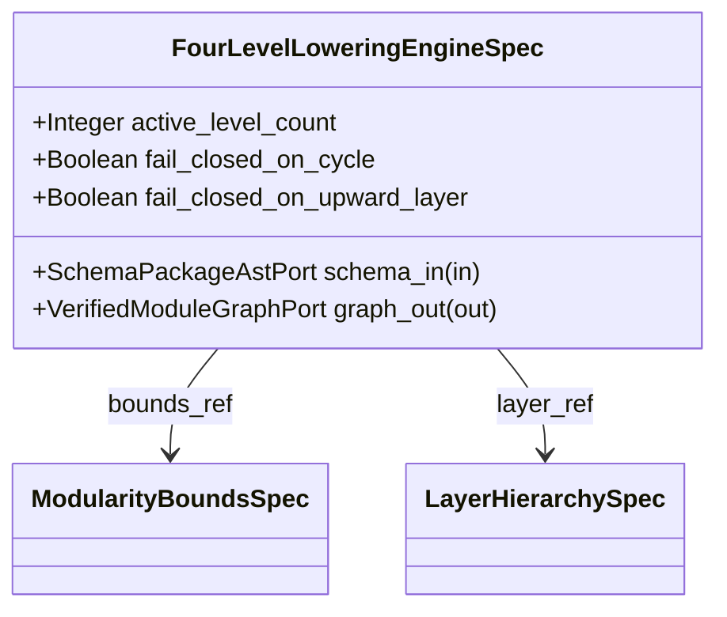

| Attribute | Specification Detail |
| :--- | :--- |
| **Issue ID** | TBD |
| **Title** | Feature 34: [BP 07 Self Hosting 4 Level Modular Multi File Code Generator Blueprint] FourLevelLoweringEngineSpec |
| **Type** | feature |
| **Parent Epic** | [EPIC-07-BP_07_Self_Hosting_4_Level_Modular_Multi_File_Code_Generator_Blueprint](../epics/EPIC-07-BP_07_Self_Hosting_4_Level_Modular_Multi_File_Code_Generator_Blueprint.md) |
| **Interface Type** | Physical / Structural / Internal Bus |
| **Schema Containers** | `BP_07_Self_Hosting_4_Level_Modular_Multi_File_Code_Generator_Blueprint::FourLevelLoweringEngineSpec` |
| **Generation Mode** | subagent |
| **Specification Source** | [schema/model.sysml](../../schema/model.sysml) |

# Feature 34: [BP 07 Self Hosting 4 Level Modular Multi File Code Generator Blueprint] FourLevelLoweringEngineSpec

## UML Class Diagram



## Interface Requirements
### 1. Test Data Shape
```json
{
  "$schema": "https://json-schema.org/draft/2020-12/schema",
  "title": "FourLevelLoweringEngineSpecPayloadSchema",
  "type": "object",
  "properties": {
    "part": {
      "type": "string",
      "const": "FourLevelLoweringEngineSpec"
    },
    "status": {
      "type": "string",
      "enum": ["nominal", "degraded", "fault"]
    },
    "active_level_count": {
      "type": "integer",
      "x-sysml-type": "Integer",
      "description": "Declared attribute active_level_count (Integer)",
      "default": 4
    },
    "fail_closed_on_cycle": {
      "type": "boolean",
      "x-sysml-type": "Boolean",
      "description": "Declared attribute fail_closed_on_cycle (Boolean)",
      "default": true
    },
    "fail_closed_on_upward_layer": {
      "type": "boolean",
      "x-sysml-type": "Boolean",
      "description": "Declared attribute fail_closed_on_upward_layer (Boolean)",
      "default": true
    },
    "schema_in": {
      "type": "object",
      "properties": {
        "direction": { "type": "string", "const": "in" },
        "port_type": { "type": "string", "const": "SchemaPackageAstPort" }
      },
      "required": ["direction", "port_type"]
    },
    "graph_out": {
      "type": "object",
      "properties": {
        "direction": { "type": "string", "const": "out" },
        "port_type": { "type": "string", "const": "VerifiedModuleGraphPort" }
      },
      "required": ["direction", "port_type"]
    }
  },
  "required": [
    "part",
    "status",
    "schema_in",
    "graph_out"
  ],
  "x-sysml-constraints": [
    { "name": "LoweringLevelsComplete", "expression": "active_level_count == 4" }
  ],
  "additionalProperties": false
}
```

### 2. Validation & Constraints
Declared structural attributes, boundary ports, invariants, and allocated requirements for classifier `FourLevelLoweringEngineSpec`:

| AST Member Kind | Identifier | Declared Type / Direction | Default / Invariant Contract |
| :--- | :--- | :--- | :--- |
| Attribute | `active_level_count` | `Integer` | Default `4` |
| Attribute | `fail_closed_on_cycle` | `Boolean` | Default `true` |
| Attribute | `fail_closed_on_upward_layer` | `Boolean` | Default `true` |
| Port | `schema_in` | `in SchemaPackageAstPort` | Boundary interface contract |
| Port | `graph_out` | `out VerifiedModuleGraphPort` | Boundary interface contract |
| Constraint | `LoweringLevelsComplete` | Invariant | `active_level_count == 4` |

```sysml
constraint LoweringLevelsComplete { active_level_count == 4 }
```

### 3. Visual Layout & Arrangement
Structural composition and boundary topology for classifier `FourLevelLoweringEngineSpec` organize nested subparts `bounds_ref : ModularityBoundsSpec`, `layer_ref : LayerHierarchySpec` paired with boundary ports `in schema_in : SchemaPackageAstPort`, `out graph_out : VerifiedModuleGraphPort`.

### 4. Interactive Flow & States
Operational lifecycle events and discrete state transitions for FourLevelLoweringEngineSpec.

### Layer 1: Domain State & Signal Model
Classifier `FourLevelLoweringEngineSpec` encapsulates typed domain state attributes `active_level_count : Integer`, `fail_closed_on_cycle : Boolean`, `fail_closed_on_upward_layer : Boolean` alongside operational lifecycle status.

### Layer 2: Logic & Safety State Management
Classifier `FourLevelLoweringEngineSpec` governs stateless structural transition evaluation enforcing invariant obligations `LoweringLevelsComplete`.

### Layer 3: Presentation & Actuator Interface Binding
Classifier `FourLevelLoweringEngineSpec` binds external and behavioral interfaces across port `in schema_in : SchemaPackageAstPort`, port `out graph_out : VerifiedModuleGraphPort`.

## Acceptance Criteria (BDD)
- [ ] AC-01: Given valid `FourLevelLoweringEngineSpec` inputs satisfying `LoweringLevelsComplete` (`active_level_count == 4`), When `FourLevelLoweringEngineSpec` evaluates invariant `LoweringLevelsComplete`, Then the invariant holds and verified state is committed.
- [ ] AC-02: Given boundary inputs that violate `LoweringLevelsComplete` (`active_level_count == 4`), When `FourLevelLoweringEngineSpec` evaluates invariant `LoweringLevelsComplete`, Then `FourLevelLoweringEngineSpec` rejects the invalid transition and routes a diagnostic via diagnostic port `graph_out`.
- [ ] AC-03: Given nominal typed values for `active_level_count` (`Integer`), `fail_closed_on_cycle` (`Boolean`), `fail_closed_on_upward_layer` (`Boolean`) across `schema_in` (`in SchemaPackageAstPort`), `graph_out` (`out VerifiedModuleGraphPort`), When `FourLevelLoweringEngineSpec` executes structural interface processing, Then state and output ports conform to declared schema types.
- [ ] AC-04: Given malformed input frames across `active_level_count` (`Integer`), `fail_closed_on_cycle` (`Boolean`), `fail_closed_on_upward_layer` (`Boolean`) or `schema_in` (`in SchemaPackageAstPort`), `graph_out` (`out VerifiedModuleGraphPort`), When `FourLevelLoweringEngineSpec` boundary validation executes, Then `FourLevelLoweringEngineSpec` rejects the malformed input via diagnostic port `graph_out`.

## Source References
Formal component specifications and normative systems engineering requirements:
- System Architecture Model: `schema/model.sysml`
- Normative Systems Engineering Standard: ISO/IEC/IEEE 15288:2023 §6.4.3 Architecture Definition Process

Component behavior and interface definitions derive from `schema/model.sysml` pursuant to ISO/IEC/IEEE 15288.
