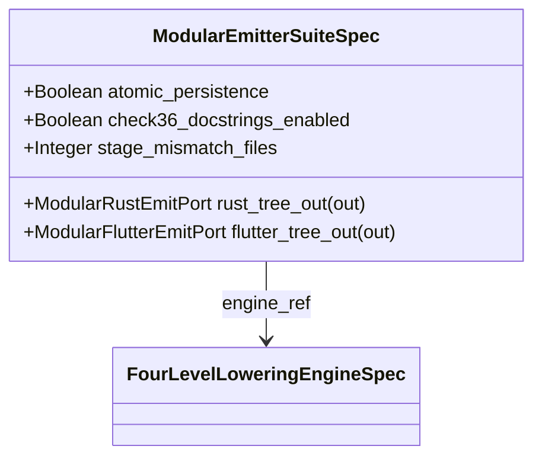

| Attribute | Specification Detail |
| :--- | :--- |
| **Issue ID** | TBD |
| **Title** | Feature 35: [BP 07 Self Hosting 4 Level Modular Multi File Code Generator Blueprint] ModularEmitterSuiteSpec |
| **Type** | feature |
| **Parent Epic** | [EPIC-07-BP_07_Self_Hosting_4_Level_Modular_Multi_File_Code_Generator_Blueprint](../epics/EPIC-07-BP_07_Self_Hosting_4_Level_Modular_Multi_File_Code_Generator_Blueprint.md) |
| **Interface Type** | Physical / Structural / Internal Bus |
| **Schema Containers** | `BP_07_Self_Hosting_4_Level_Modular_Multi_File_Code_Generator_Blueprint::ModularEmitterSuiteSpec` |
| **Generation Mode** | subagent |
| **Specification Source** | [schema/model.sysml](../../schema/model.sysml) |

# Feature 35: [BP 07 Self Hosting 4 Level Modular Multi File Code Generator Blueprint] ModularEmitterSuiteSpec

## UML Class Diagram



## Interface Requirements
### 1. Test Data Shape
```json
{
  "$schema": "https://json-schema.org/draft/2020-12/schema",
  "title": "ModularEmitterSuiteSpecPayloadSchema",
  "type": "object",
  "properties": {
    "part": {
      "type": "string",
      "const": "ModularEmitterSuiteSpec"
    },
    "status": {
      "type": "string",
      "enum": ["nominal", "degraded", "fault"]
    },
    "atomic_persistence": {
      "type": "boolean",
      "x-sysml-type": "Boolean",
      "description": "Declared attribute atomic_persistence (Boolean)",
      "default": true
    },
    "check36_docstrings_enabled": {
      "type": "boolean",
      "x-sysml-type": "Boolean",
      "description": "Declared attribute check36_docstrings_enabled (Boolean)",
      "default": true
    },
    "stage_mismatch_files": {
      "type": "integer",
      "x-sysml-type": "Integer",
      "description": "Declared attribute stage_mismatch_files (Integer)",
      "default": 0
    },
    "rust_tree_out": {
      "type": "object",
      "properties": {
        "direction": { "type": "string", "const": "out" },
        "port_type": { "type": "string", "const": "ModularRustEmitPort" }
      },
      "required": ["direction", "port_type"]
    },
    "flutter_tree_out": {
      "type": "object",
      "properties": {
        "direction": { "type": "string", "const": "out" },
        "port_type": { "type": "string", "const": "ModularFlutterEmitPort" }
      },
      "required": ["direction", "port_type"]
    }
  },
  "required": [
    "part",
    "status",
    "rust_tree_out",
    "flutter_tree_out"
  ],
  "x-sysml-constraints": [
    { "name": "FixedPointBootstrapParity", "expression": "stage_mismatch_files == 0" }
  ],
  "additionalProperties": false
}
```

### 2. Validation & Constraints
Declared structural attributes, boundary ports, invariants, and allocated requirements for classifier `ModularEmitterSuiteSpec`:

| AST Member Kind | Identifier | Declared Type / Direction | Default / Invariant Contract |
| :--- | :--- | :--- | :--- |
| Attribute | `atomic_persistence` | `Boolean` | Default `true` |
| Attribute | `check36_docstrings_enabled` | `Boolean` | Default `true` |
| Attribute | `stage_mismatch_files` | `Integer` | Default `0` |
| Port | `rust_tree_out` | `out ModularRustEmitPort` | Boundary interface contract |
| Port | `flutter_tree_out` | `out ModularFlutterEmitPort` | Boundary interface contract |
| Constraint | `FixedPointBootstrapParity` | Invariant | `stage_mismatch_files == 0` |

```sysml
constraint FixedPointBootstrapParity { stage_mismatch_files == 0 }
```

### 3. Visual Layout & Arrangement
Structural composition and boundary topology for classifier `ModularEmitterSuiteSpec` organize nested subparts `engine_ref : FourLevelLoweringEngineSpec` paired with boundary ports `out rust_tree_out : ModularRustEmitPort`, `out flutter_tree_out : ModularFlutterEmitPort`.

### 4. Interactive Flow & States
Operational lifecycle events and discrete state transitions for ModularEmitterSuiteSpec.

### Layer 1: Domain State & Signal Model
Classifier `ModularEmitterSuiteSpec` encapsulates typed domain state attributes `atomic_persistence : Boolean`, `check36_docstrings_enabled : Boolean`, `stage_mismatch_files : Integer` alongside operational lifecycle status.

### Layer 2: Logic & Safety State Management
Classifier `ModularEmitterSuiteSpec` governs stateless structural transition evaluation enforcing invariant obligations `FixedPointBootstrapParity`.

### Layer 3: Presentation & Actuator Interface Binding
Classifier `ModularEmitterSuiteSpec` binds external and behavioral interfaces across port `out rust_tree_out : ModularRustEmitPort`, port `out flutter_tree_out : ModularFlutterEmitPort`.

## Acceptance Criteria (BDD)
- [ ] AC-01: Given valid `ModularEmitterSuiteSpec` inputs satisfying `FixedPointBootstrapParity` (`stage_mismatch_files == 0`), When `ModularEmitterSuiteSpec` evaluates invariant `FixedPointBootstrapParity`, Then the invariant holds and verified state is committed.
- [ ] AC-02: Given boundary inputs that violate `FixedPointBootstrapParity` (`stage_mismatch_files == 0`), When `ModularEmitterSuiteSpec` evaluates invariant `FixedPointBootstrapParity`, Then `ModularEmitterSuiteSpec` rejects the invalid transition and routes a diagnostic via diagnostic port `rust_tree_out`.
- [ ] AC-03: Given nominal typed values for `atomic_persistence` (`Boolean`), `check36_docstrings_enabled` (`Boolean`), `stage_mismatch_files` (`Integer`) across `rust_tree_out` (`out ModularRustEmitPort`), `flutter_tree_out` (`out ModularFlutterEmitPort`), When `ModularEmitterSuiteSpec` executes structural interface processing, Then state and output ports conform to declared schema types.
- [ ] AC-04: Given malformed input frames across `atomic_persistence` (`Boolean`), `check36_docstrings_enabled` (`Boolean`), `stage_mismatch_files` (`Integer`) or `rust_tree_out` (`out ModularRustEmitPort`), `flutter_tree_out` (`out ModularFlutterEmitPort`), When `ModularEmitterSuiteSpec` boundary validation executes, Then `ModularEmitterSuiteSpec` rejects the malformed input via diagnostic port `rust_tree_out`.

## Source References
Formal component specifications and normative systems engineering requirements:
- System Architecture Model: `schema/model.sysml`
- Normative Systems Engineering Standard: ISO/IEC/IEEE 15288:2023 §6.4.3 Architecture Definition Process

Component behavior and interface definitions derive from `schema/model.sysml` pursuant to ISO/IEC/IEEE 15288.
