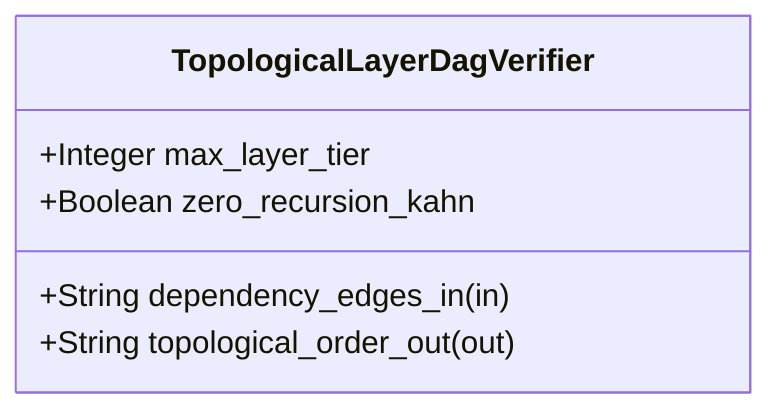

| Attribute | Specification Detail |
| :--- | :--- |
| **Issue ID** | #741 |
| **Title** | Feature 35: [BP 07 Self Hosting 4 Level Modular Multi File Code Generator Blueprint] TopologicalLayerDagVerifier |
| **Type** | feature |
| **Parent Epic** | [EPIC-07-BP_07_Self_Hosting_4_Level_Modular_Multi_File_Code_Generator_Blueprint](../epics/EPIC-07-BP_07_Self_Hosting_4_Level_Modular_Multi_File_Code_Generator_Blueprint.md) |
| **Interface Type** | Physical / Structural / Internal Bus |
| **Schema Containers** | `BP_07_Self_Hosting_4_Level_Modular_Multi_File_Code_Generator_Blueprint::TopologicalLayerDagVerifier` |
| **Generation Mode** | subagent |
| **Specification Source** | [schema/model.sysml](../../schema/model.sysml) |

# Feature 35: [BP 07 Self Hosting 4 Level Modular Multi File Code Generator Blueprint] TopologicalLayerDagVerifier

## UML Class Diagram



## Interface Requirements
### 1. Test Data Shape
```json
{
  "$schema": "https://json-schema.org/draft/2020-12/schema",
  "title": "TopologicalLayerDagVerifierPayloadSchema",
  "type": "object",
  "properties": {
    "part": {
      "type": "string",
      "const": "TopologicalLayerDagVerifier"
    },
    "status": {
      "type": "string",
      "enum": ["nominal", "degraded", "fault"]
    },
    "max_layer_tier": {
      "type": "integer",
      "x-sysml-type": "Integer",
      "description": "Declared attribute max_layer_tier (Integer)",
      "default": 3
    },
    "zero_recursion_kahn": {
      "type": "boolean",
      "x-sysml-type": "Boolean",
      "description": "Enforces iterative work-queue Kahn topological sorting without call-stack recursion. [unit: flag]",
      "default": true
    },
    "dependency_edges_in": {
      "type": "object",
      "properties": {
        "direction": { "type": "string", "const": "in" },
        "port_type": { "type": "string", "const": "String" }
      },
      "required": ["direction", "port_type"]
    },
    "topological_order_out": {
      "type": "object",
      "properties": {
        "direction": { "type": "string", "const": "out" },
        "port_type": { "type": "string", "const": "String" }
      },
      "required": ["direction", "port_type"]
    }
  },
  "required": [
    "part",
    "status",
    "dependency_edges_in",
    "topological_order_out"
  ],
  "additionalProperties": false
}
```

### 2. Validation & Constraints
Declared structural attributes, boundary ports, invariants, and allocated requirements for classifier `TopologicalLayerDagVerifier`:

| AST Member Kind | Identifier | Declared Type / Direction | Default / Invariant Contract |
| :--- | :--- | :--- | :--- |
| Attribute | `max_layer_tier` | `Integer` | Default `3` |
| Attribute | `zero_recursion_kahn` | `Boolean` | Default `true` |
| Port | `dependency_edges_in` | `in String` | Boundary interface contract |
| Port | `topological_order_out` | `out String` | Boundary interface contract |

### 3. Visual Layout & Arrangement
Structural composition and boundary topology for classifier `TopologicalLayerDagVerifier` organize no nested subparts declared in schema paired with boundary ports `in dependency_edges_in : String`, `out topological_order_out : String`.

### 4. Interactive Flow & States
Operational lifecycle events and discrete state transitions for TopologicalLayerDagVerifier.

### Layer 1: Domain State & Signal Model
Classifier `TopologicalLayerDagVerifier` encapsulates typed domain state attributes `max_layer_tier : Integer` (default `3`, modeling `Presentation = 0`, `Application = 1`, `Domain = 2`, `Infrastructure = 3`) and `zero_recursion_kahn : Boolean` (default `true`) alongside operational lifecycle status. Under **Contract A (100% Normative OMG SysML v2.0 + KerML 1.0 Grammar Coverage -- Zero 16-Construct Caps)**, `TopologicalLayerDagVerifier` extracts directed dependency edges and `@Layer` (`metadata def` / `@Metadata` / `#user_keyword` alongside `#hazard`, `#risk`, `#capability`, `#rt_loop`, `#dal`, `#fls` and backward-compatible `hazard def`/`risk def`/`capability def`) annotations across all OMG SysML v2.0 and KerML 1.0 constructs (`package`/`library package`/`standard library package`, `import`, `part def`/`part`, `item def`/`item`, `attribute def`/`attribute`, `enum def`/`enum`, `port def`/`port` `in`/`out`/`inout`/`~`, `connection def`/`connection`, `interface def`/`interface`, `flow def`/`flow`, `allocation def`/`allocation`, `occurrence def`/`occurrence`, `action def`/`action`, `state def`/`state`, `calc def`/`calc`, `constraint def`/`constraint`, `requirement def`/`requirement`, `concern def`/`concern`, `use case def`/`use case`, `analysis def`/`analysis`, `verification def`/`verification`, `test case def`/`test case`, `interaction def`/`interaction`, `view def`/`view`, `viewpoint def`/`viewpoint`, `rendering def`/`rendering`, `variation`/`variant`, and KerML specialization/multiplicity/expressions) parsed via `deap_core::sysml_cst` (`logos` + `rowan` + `salsa` + `ariadne`).

### Layer 2: Logic & Safety State Management
Classifier `TopologicalLayerDagVerifier` governs stateless structural transition evaluation executing `verify_dag_and_layers(node_layers, edges)` via an iterative work-queue Kahn topological sort (`O(|V| + |E|)`, `zero_recursion_kahn = true`) and checking strict downward architectural layer monotonicity (`layer(u) <= layer(v)` for every directed dependency `u -> v` under `Invariant_REQ_0607_SC_02`). Under **Contract B (Official Rust Compiler & Deterministic Fixed-Point Codegen Stack -- Zero Hand-Rolled Scanners)** and the **3-Layer Definition of Done (DoD)**, implementation is bounded inside `< 380` exec SLOC submodules (`./crates/compile-sysml/src/modular_codegen/` and `./crates/deap-core/src/rust_cst/`) feeding `proc-macro2` + `quote::quote!` + `syn::parse2::<syn::File>` + `prettyplease::unparse` deterministic Stage-1 == Stage-2 SHA-256 codegen while explicitly deleting legacy hand-rolled scanners and monolithic string-concatenation codegen templates in `./crates/compile-sysml/src/driver.rs` (`-450+` SLOC) and `./crates/compile-sysml/src/flutter_codegen.rs` (`-650+` SLOC).

### Layer 3: Presentation & Actuator Interface Binding
Classifier `TopologicalLayerDagVerifier` binds external and behavioral interfaces across ingress port `in dependency_edges_in : String` and egress port `out topological_order_out : String`, delivering a verified topological node ordering or rejecting cycles (`E0702`) and upward layer imports (`E0703`) fail-closed before any filesystem write occurs.

### Associated Use Cases & User Stories

#### Associated Use Cases
- None allocated (structural subsystem component)

#### Associated User Stories
- [ ] #794 - [User Story 45: verify dag and layers](../user-stories/US-45-verify_dag_and_layers.md)
- [ ] #795 - [User Story 46: partition and hoist](../user-stories/US-46-partition_and_hoist.md)
- [ ] #796 - [User Story 47: synthesize module tokens](../user-stories/US-47-synthesize_module_tokens.md)
- [ ] #797 - [User Story 48: build syn file](../user-stories/US-48-build_syn_file.md)
- [ ] #798 - [User Story 49: format pretty syn file](../user-stories/US-49-format_pretty_syn_file.md)
- [ ] #799 - [User Story 50: emit modular rust tree](../user-stories/US-50-emit_modular_rust_tree.md)
- [ ] #800 - [User Story 51: emit modular_flutter_tree](../user-stories/US-51-emit_modular_flutter_tree.md)
- [ ] #801 - [User Story 52: verify fixed point digest](../user-stories/US-52-verify_fixed_point_digest.md)

## Acceptance Criteria (BDD)
- [ ] AC-01: Given valid `TopologicalLayerDagVerifier` initialization inputs for `max_layer_tier` (`Integer`), `zero_recursion_kahn` (`Boolean`) (no additional constraints specified in schema), When `TopologicalLayerDagVerifier` commits typed domain state, Then declared state attributes hold verified values.
- [ ] AC-02: Given malformed or out-of-domain input values for `max_layer_tier` (`Integer`), `zero_recursion_kahn` (`Boolean`), When `TopologicalLayerDagVerifier` validates incoming state updates, Then `TopologicalLayerDagVerifier` rejects the invalid state update and emits a diagnostic via diagnostic port `topological_order_out`.
- [ ] AC-03: Given nominal signal arrival across `dependency_edges_in` (`in String`), `topological_order_out` (`out String`), When `TopologicalLayerDagVerifier` processes the declared interface transaction, Then output state conforms to the structural classifier contract.
- [ ] AC-04: Given an invalid or unrecognized interface frame across `dependency_edges_in` (`in String`), `topological_order_out` (`out String`), When `TopologicalLayerDagVerifier` boundary validation executes, Then `TopologicalLayerDagVerifier` refuses the malformed frame via diagnostic port `topological_order_out` and preserves prior verified state.

## Source References
Formal component specifications and normative systems engineering requirements:
- System Architecture Model: `schema/model.sysml`
- Normative Systems Engineering Standard: ISO/IEC/IEEE 15288:2023 §6.4.3 Architecture Definition Process

Component behavior and interface definitions derive from `schema/model.sysml` pursuant to ISO/IEC/IEEE 15288.
