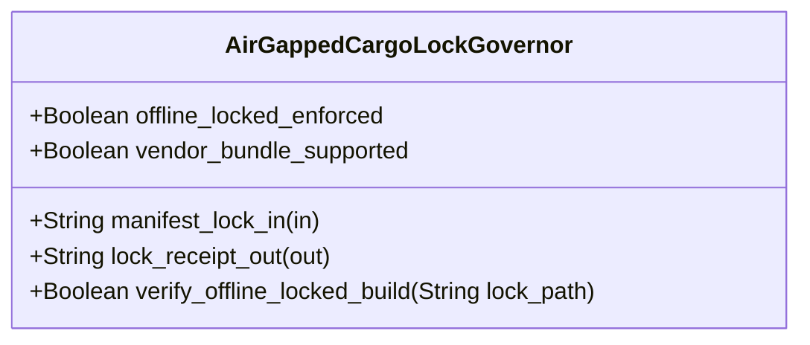

| Attribute | Specification Detail |
| :--- | :--- |
| **Issue ID** | #834 |
| **Title** | Feature 36: [BP 08 Lossless Rust CST Codemod Engine and Unified rustc Compatible JSON Diagnostics] AirGappedCargoLockGovernor |
| **Type** | feature |
| **Parent Epic** | [EPIC-08-BP_08_Lossless_Rust_CST_Codemod_Engine_and_Unified_rustc_Compatible_JSON_Diagnostics](../epics/EPIC-08-BP_08_Lossless_Rust_CST_Codemod_Engine_and_Unified_rustc_Compatible_JSON_Diagnostics.md) |
| **Interface Type** | Physical / Structural / Internal Bus |
| **Schema Containers** | `BP_08_Lossless_Rust_CST_Codemod_Engine_and_Unified_rustc_Compatible_JSON_Diagnostics::AirGappedCargoLockGovernor` |
| **Generation Mode** | subagent |
| **Specification Source** | [schema/model.sysml](../../schema/model.sysml) |

# Feature 36: [BP 08 Lossless Rust CST Codemod Engine and Unified rustc Compatible JSON Diagnostics] AirGappedCargoLockGovernor

## UML Class Diagram



## Interface Requirements
### 1. Test Data Shape
```json
{
  "$schema": "https://json-schema.org/draft/2020-12/schema",
  "title": "AirGappedCargoLockGovernorPayloadSchema",
  "type": "object",
  "properties": {
    "part": {
      "type": "string",
      "const": "AirGappedCargoLockGovernor"
    },
    "status": {
      "type": "string",
      "enum": ["nominal", "degraded", "fault"]
    },
    "offline_locked_enforced": {
      "type": "boolean",
      "x-sysml-type": "Boolean",
      "description": "Declared attribute offline_locked_enforced (Boolean)",
      "default": true
    },
    "vendor_bundle_supported": {
      "type": "boolean",
      "x-sysml-type": "Boolean",
      "description": "Supports deterministic `cargo vendor` source bundling for zero-network air-gapped DO-330 TQL-4 build runners. [unit: flag]",
      "default": true
    },
    "manifest_lock_in": {
      "type": "object",
      "properties": {
        "direction": { "type": "string", "const": "in" },
        "port_type": { "type": "string", "const": "String" }
      },
      "required": ["direction", "port_type"]
    },
    "lock_receipt_out": {
      "type": "object",
      "properties": {
        "direction": { "type": "string", "const": "out" },
        "port_type": { "type": "string", "const": "String" }
      },
      "required": ["direction", "port_type"]
    }
  },
  "required": [
    "part",
    "status",
    "manifest_lock_in",
    "lock_receipt_out"
  ],
  "additionalProperties": false
}
```

### 2. Validation & Constraints
Declared structural attributes, boundary ports, invariants, and allocated requirements for classifier `AirGappedCargoLockGovernor`:

| AST Member Kind | Identifier | Declared Type / Direction | Default / Invariant Contract |
| :--- | :--- | :--- | :--- |
| Attribute | `offline_locked_enforced` | `Boolean` | Default `true` |
| Attribute | `vendor_bundle_supported` | `Boolean` | Default `true` |
| Port | `manifest_lock_in` | `in String` | Boundary interface contract |
| Port | `lock_receipt_out` | `out String` | Boundary interface contract |
| Constraint | `Invariant_REQ_0608_SC_01` | Invariant (`REQ-0608 (REQ_0608_BP_08_Lossless_Rust_CST_Codemod_Engine_and_Unified_rustc_Compatible_JSON_Diagnostics)`) | Declared structural invariant |
| Constraint | `Invariant_REQ_0608_SC_03` | Invariant (`REQ-0608 (REQ_0608_BP_08_Lossless_Rust_CST_Codemod_Engine_and_Unified_rustc_Compatible_JSON_Diagnostics)`) | Declared structural invariant |
| Constraint | `Invariant_REQ_0608_SC_02` | Invariant (`REQ-0608 (REQ_0608_BP_08_Lossless_Rust_CST_Codemod_Engine_and_Unified_rustc_Compatible_JSON_Diagnostics)`) | Declared structural invariant |
| Constraint | `Invariant_REQ_0608_SC_04_REQ_0608` | Invariant (`REQ-0608 (REQ_0608_BP_08_Lossless_Rust_CST_Codemod_Engine_and_Unified_rustc_Compatible_JSON_Diagnostics)`) | Declared structural invariant |
| Requirement | `REQ-0608 (REQ_0608_BP_08_Lossless_Rust_CST_Codemod_Engine_and_Unified_rustc_Compatible_JSON_Diagnostics)` | Allocated Requirement | LosslessRustCstAndJsonDiagnosticsEngine (**REQ-0608** / BP-08 / DEAP-BP-DET-08, UUIDv5 6ba7b810-9dad-11d1-80b4-00c04fd430c8, Class P linear syntax-tree traversal and byte-span splicing complexity, governed by DO-178C Level A, DO-330 TQL-4, ISO 26262 ASIL D, and ECSS-E-ST-40C) replaces approximately 19,700+ lines of hand-rolled line/char/string scanners with the official `cargo-lock`, `cargo_metadata`, `cargo-util-schemas`, `cargo-platform`, `toml_edit`, `ra_ap_syntax`, `ra_ap_vfs`, `ra_ap_paths`, `ra_ap_line_index`, `ra_ap_text_edit`, `rowan`, `camino`, `ignore`, `pulldown-cmark`, and `pulldown-cmark-to-cmark` crate stack across `< 380`-SLOC submodules. |

```sysml
constraint Invariant_REQ_0608_SC_01 {}
constraint Invariant_REQ_0608_SC_03 {}
constraint Invariant_REQ_0608_SC_02 {}
constraint Invariant_REQ_0608_SC_04_REQ_0608 {}
```

### 3. Visual Layout & Arrangement
Structural composition and boundary topology for classifier `AirGappedCargoLockGovernor` organize no nested subparts declared in schema paired with boundary ports `in manifest_lock_in : String`, `out lock_receipt_out : String`.

### 4. Interactive Flow & States
Operational lifecycle events and discrete state transitions for `AirGappedCargoLockGovernor` across `BP_08_Lossless_Rust_CST_Codemod_Engine_and_Unified_rustc_Compatible_JSON_Diagnostics_LifecycleState`.

### Layer 1: Domain State & Signal Model
Classifier `AirGappedCargoLockGovernor` encapsulates typed domain state attributes `offline_locked_enforced : Boolean`, `vendor_bundle_supported : Boolean` alongside parsed `cargo_lock::Lockfile` dependency graphs, `cargo_metadata::Metadata` package manifests, `cargo_util_schemas` / `cargo_platform` target predicates, and `toml_edit::DocumentMut` lossless TOML AST nodes. Upholds **Contract A** by preserving full OMG SysML v2.0 + KerML 1.0 Definition and Usage symmetry (`package`, `library package`, `standard library package`, `import`, `metadata def` / `@Metadata` / `#capability` / `#hazard` / `#risk` / `#rt_loop` / `#dal` / `#fls`, `part def`/`part`, `item def`/`item`, `attribute def`/`attribute`, `enum def`/`enum`, `port def`/`port`, `interface def`/`interface`, `connection def`/`connection`, `flow def`/`flow`, `allocation def`/`allocation`, `occurrence def`/`occurrence`, `action def`/`action`, `state def`/`state`, `calc def`/`calc`, `constraint def`/`constraint`, `requirement def`/`requirement`, `concern def`/`concern`, `use case def`/`use case`, `analysis def`/`analysis`, `verification def`/`verification`, `test case def`/`test case`, `interaction def`/`interaction`, `view def`/`view`, `viewpoint def`/`viewpoint`, `rendering def`/`rendering`, `variation`/`variant`, and KerML specialization/expressions with zero 16-construct caps).

### Layer 2: Logic & Safety State Management
Classifier `AirGappedCargoLockGovernor` governs stateless structural transition evaluation enforcing invariant obligations `Invariant_REQ_0608_SC_01`, `Invariant_REQ_0608_SC_03`, `Invariant_REQ_0608_SC_02`, `Invariant_REQ_0608_SC_04_REQ_0608` and constraints `C_CST_01..C_CST_06` under **Contract B** (`cargo-lock`, `cargo_metadata`, `cargo-util-schemas`, `cargo-platform`, `toml_edit`, `ra_ap_syntax`, `ra_ap_vfs`, `ra_ap_paths`, `ra_ap_line_index`, `ra_ap_text_edit`, `rowan`, `camino`, `ignore`, `pulldown-cmark`, `pulldown-cmark-to-cmark`). Bounds implementation strictly within `< 380`-SLOC submodules (`crates/deap-core/src/rust_cst/`, `crates/deap-core/src/json_diag/`, `crates/compile-sysml/src/codemod/`) and enforces explicit net-negative deletion of ~19,700+ lines of hand-rolled scanners (retiring `crates/deap-core/src/workspace.rs` (356 lines), `crates/deap-core/src/rust_cst.rs` (599 lines), `crates/compile-sysml/src/docstring.rs` (549 lines), `crates/verify-baseline/src/checks/docstring_tier_rules.rs` (729 lines), `crates/verify-baseline/src/checks/structural.rs` (980 lines), and `crates/verify-baseline/src/ratchet_table.rs`).

### Layer 3: Presentation & Actuator Interface Binding
Classifier `AirGappedCargoLockGovernor` binds external and behavioral interfaces across port `in manifest_lock_in : String`, port `out lock_receipt_out : String`, and operation `+verify_offline_locked_build(in lock_path: String) : Boolean`, emitting deterministic `SupplyChainReceipt` payloads or fail-closed single-line `rustc`-compatible NDJSON diagnostics (`DEAP-E0804`, `reason: "compiler-message"`).

### Associated Use Cases & User Stories

#### Associated Use Cases
- [ ] #767 - [Use Case 38: Lossless Red Green CST Roundtrip and Exact DEAP v2 0 AST Metrics Extraction](../use-cases/UC-38-Lossless_Red_Green_CST_Roundtrip_and_Exact_DEAP_v2_0_AST_Metrics_Extraction.md) (verifies lossless `ra_ap_syntax` + `rowan` CST roundtrip and DEAP v2.0 AST metrics under `Invariant_REQ_0608_SC_01`)
- [ ] #768 - [Use Case 39: Deterministic B Tree Map Item Inventory and Atomic Module Extraction with Check 37 Path Rewriting](../use-cases/UC-39-Deterministic_BTreeMap_Item_Inventory_and_Atomic_Module_Extraction_with_Check_37_Path_Rewriting.md) (validates deterministic `BTreeMap` item inventory and atomic module extraction with `pulldown-cmark` Check 37 path rewriting)
- [ ] #769 - [Use Case 40: Fail Closed Rejection on Span Collisions Missing Symbols or Post Splice Syntax Errors](../use-cases/UC-40-Fail_Closed_Rejection_on_Span_Collisions_Missing_Symbols_or_Post_Splice_Syntax_Errors.md) (enforces fail-closed rejection and `DEAP-E0801..E0803` NDJSON diagnostics under `Invariant_REQ_0608_SC_02`)
- [ ] #770 - [Use Case 41: Lossless Tier B C Docblock Compaction Skipping Self Hosted Generated Modules](../use-cases/UC-41-Lossless_Tier_B_C_Docblock_Compaction_Skipping_Self_Hosted_Generated_Modules.md) (compacts `DocTier::RustTierBC` docblocks to 2 lines under `C_CST_06` while skipping `generated/`)
- [ ] #771 - [Use Case 42: Structured Codegen Boundary Preserving Stage 1 to Stage 2 Metacircular SHA 256 Fixed Point](../use-cases/UC-42-Structured_Codegen_Boundary_Preserving_Stage_1_to_Stage_2_Metacircular_SHA_256_Fixed_Point.md) (verifies `SHA-256(Stage 1) == SHA-256(Stage 2)` fixed-point identity under `Invariant_REQ_0608_SC_03`)
- [ ] #772 - [Use Case 43: Unified rustc Compatible Single Line JSON Diagnostics and Machine Applicable Auto Fix Across All Five CLIs](../use-cases/UC-43-Unified_rustc_Compatible_Single_Line_JSON_Diagnostics_and_MachineApplicable_Auto_Fix_Across_All_Five_CLIs.md) (enforces single-line NDJSON diagnostics and disjoint `MachineApplicable` auto-fixes under `Invariant_REQ_0608_SC_04_REQ_0608`)
- [ ] #773 - [Use Case 44: Air Gapped Offline Cargo Lock Reproducibility and Twelve Gate Blueprint Conformance](../use-cases/UC-44-Air_Gapped_Offline_Cargo_Lock_Reproducibility_and_Twelve_Gate_Blueprint_Conformance.md) (directly realizes air-gapped `--offline --locked` `Cargo.lock` verification and 12-gate blueprint conformance on `AirGappedCargoLockGovernor`)

#### Associated User Stories
- [ ] #803 - [User Story 53: verify offline locked build](../user-stories/US-53-verify_offline_locked_build.md) (invokes `verify_offline_locked_build(lock_path)` on `AirGappedCargoLockGovernor` via `cargo-lock` and `cargo_metadata`)
- [ ] #804 - [User Story 54: list rust items](../user-stories/US-54-list_rust_items.md) (enumerates `BTreeMap`-ordered `RustItemInventory` via `ra_ap_syntax` and `rowan`)
- [ ] #805 - [User Story 55: extract rust module](../user-stories/US-55-extract_rust_module.md) (extracts submodules atomically via `ra_ap_text_edit` and rewrites Check 37 paths via `pulldown-cmark`)
- [ ] #806 - [User Story 56: verify stage fixed point](../user-stories/US-56-verify_stage_fixed_point.md) (verifies Stage-1/Stage-2 SHA-256 fixed-point parity via `syn`, `quote`, and `prettyplease`)
- [ ] #807 - [User Story 57: format ndjson line](../user-stories/US-57-format_ndjson_line.md) (serializes single-line `rustc`-compatible NDJSON diagnostics via `ra_ap_line_index`)
- [ ] #808 - [User Story 58: analyze metrics](../user-stories/US-58-analyze_metrics.md) (evaluates DEAP v2.0 AST metrics `C_CST_01..C_CST_06` via `ra_ap_syntax`)

## Acceptance Criteria (BDD)
- [ ] AC-01: Given valid `AirGappedCargoLockGovernor` inputs satisfying `Invariant_REQ_0608_SC_01` [Req `REQ-0608 (REQ_0608_BP_08_Lossless_Rust_CST_Codemod_Engine_and_Unified_rustc_Compatible_JSON_Diagnostics)`], When `AirGappedCargoLockGovernor` evaluates invariant `Invariant_REQ_0608_SC_01`, Then the invariant holds and verified state is committed.
- [ ] AC-02: Given boundary inputs that violate `Invariant_REQ_0608_SC_01` [Req `REQ-0608 (REQ_0608_BP_08_Lossless_Rust_CST_Codemod_Engine_and_Unified_rustc_Compatible_JSON_Diagnostics)`], When `AirGappedCargoLockGovernor` evaluates invariant `Invariant_REQ_0608_SC_01`, Then `AirGappedCargoLockGovernor` rejects the invalid transition and routes a diagnostic via diagnostic port `lock_receipt_out`.
- [ ] AC-03: Given valid `AirGappedCargoLockGovernor` inputs satisfying `Invariant_REQ_0608_SC_03` [Req `REQ-0608 (REQ_0608_BP_08_Lossless_Rust_CST_Codemod_Engine_and_Unified_rustc_Compatible_JSON_Diagnostics)`], When `AirGappedCargoLockGovernor` evaluates invariant `Invariant_REQ_0608_SC_03`, Then the invariant holds and verified state is committed.
- [ ] AC-04: Given boundary inputs that violate `Invariant_REQ_0608_SC_03` [Req `REQ-0608 (REQ_0608_BP_08_Lossless_Rust_CST_Codemod_Engine_and_Unified_rustc_Compatible_JSON_Diagnostics)`], When `AirGappedCargoLockGovernor` evaluates invariant `Invariant_REQ_0608_SC_03`, Then `AirGappedCargoLockGovernor` rejects the invalid transition and routes a diagnostic via diagnostic port `lock_receipt_out`.
- [ ] AC-05: Given valid `AirGappedCargoLockGovernor` inputs satisfying `Invariant_REQ_0608_SC_02` [Req `REQ-0608 (REQ_0608_BP_08_Lossless_Rust_CST_Codemod_Engine_and_Unified_rustc_Compatible_JSON_Diagnostics)`], When `AirGappedCargoLockGovernor` evaluates invariant `Invariant_REQ_0608_SC_02`, Then the invariant holds and verified state is committed.
- [ ] AC-06: Given boundary inputs that violate `Invariant_REQ_0608_SC_02` [Req `REQ-0608 (REQ_0608_BP_08_Lossless_Rust_CST_Codemod_Engine_and_Unified_rustc_Compatible_JSON_Diagnostics)`], When `AirGappedCargoLockGovernor` evaluates invariant `Invariant_REQ_0608_SC_02`, Then `AirGappedCargoLockGovernor` rejects the invalid transition and routes a diagnostic via diagnostic port `lock_receipt_out`.
- [ ] AC-07: Given valid `AirGappedCargoLockGovernor` inputs satisfying `Invariant_REQ_0608_SC_04_REQ_0608` [Req `REQ-0608 (REQ_0608_BP_08_Lossless_Rust_CST_Codemod_Engine_and_Unified_rustc_Compatible_JSON_Diagnostics)`], When `AirGappedCargoLockGovernor` evaluates invariant `Invariant_REQ_0608_SC_04_REQ_0608`, Then the invariant holds and verified state is committed.
- [ ] AC-08: Given boundary inputs that violate `Invariant_REQ_0608_SC_04_REQ_0608` [Req `REQ-0608 (REQ_0608_BP_08_Lossless_Rust_CST_Codemod_Engine_and_Unified_rustc_Compatible_JSON_Diagnostics)`], When `AirGappedCargoLockGovernor` evaluates invariant `Invariant_REQ_0608_SC_04_REQ_0608`, Then `AirGappedCargoLockGovernor` rejects the invalid transition and routes a diagnostic via diagnostic port `lock_receipt_out`.
- [ ] AC-09: Given nominal typed values for `offline_locked_enforced` (`Boolean`), `vendor_bundle_supported` (`Boolean`) across `manifest_lock_in` (`in String`), `lock_receipt_out` (`out String`), When `AirGappedCargoLockGovernor` executes structural interface processing, Then state and output ports conform to declared schema types.
- [ ] AC-10: Given malformed input frames across `offline_locked_enforced` (`Boolean`), `vendor_bundle_supported` (`Boolean`) or `manifest_lock_in` (`in String`), `lock_receipt_out` (`out String`), When `AirGappedCargoLockGovernor` boundary validation executes, Then `AirGappedCargoLockGovernor` rejects the malformed input via diagnostic port `lock_receipt_out`.

## Source References
Formal component specifications and normative systems engineering requirements:
- System Architecture Model: `schema/model.sysml`
- Normative Systems Engineering Standard: ISO/IEC/IEEE 15288:2023 §6.4.3 Architecture Definition Process

Component behavior and interface definitions derive from `schema/model.sysml` pursuant to ISO/IEC/IEEE 15288.
