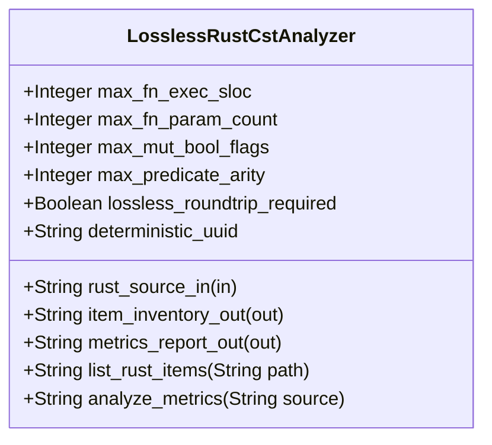

| Attribute | Specification Detail |
| :--- | :--- |
| **Issue ID** | #835 |
| **Title** | Feature 37: [BP 08 Lossless Rust CST Codemod Engine and Unified rustc Compatible JSON Diagnostics] LosslessRustCstAnalyzer |
| **Type** | feature |
| **Parent Epic** | [EPIC-08-BP_08_Lossless_Rust_CST_Codemod_Engine_and_Unified_rustc_Compatible_JSON_Diagnostics](../epics/EPIC-08-BP_08_Lossless_Rust_CST_Codemod_Engine_and_Unified_rustc_Compatible_JSON_Diagnostics.md) |
| **Interface Type** | Physical / Structural / Internal Bus |
| **Schema Containers** | `BP_08_Lossless_Rust_CST_Codemod_Engine_and_Unified_rustc_Compatible_JSON_Diagnostics::LosslessRustCstAnalyzer` |
| **Generation Mode** | subagent |
| **Specification Source** | [schema/model.sysml](../../schema/model.sysml) |

# Feature 37: [BP 08 Lossless Rust CST Codemod Engine and Unified rustc Compatible JSON Diagnostics] LosslessRustCstAnalyzer

## UML Class Diagram



## Interface Requirements
### 1. Test Data Shape
```json
{
  "$schema": "https://json-schema.org/draft/2020-12/schema",
  "title": "LosslessRustCstAnalyzerPayloadSchema",
  "type": "object",
  "properties": {
    "part": {
      "type": "string",
      "const": "LosslessRustCstAnalyzer"
    },
    "status": {
      "type": "string",
      "enum": ["nominal", "degraded", "fault"]
    },
    "max_fn_exec_sloc": {
      "type": "integer",
      "x-sysml-type": "Integer",
      "description": "Declared attribute max_fn_exec_sloc (Integer)",
      "default": 50
    },
    "max_fn_param_count": {
      "type": "integer",
      "x-sysml-type": "Integer",
      "description": "Upper bound on formal parameters per Rust callable excluding `self`, `&self`, and `&mut self` receivers. [unit: params]",
      "default": 5
    },
    "max_mut_bool_flags": {
      "type": "integer",
      "x-sysml-type": "Integer",
      "description": "Permitted count of mutable boolean local state flags (`let mut flag: bool`) within a single function body. [unit: flags]",
      "default": 0
    },
    "max_predicate_arity": {
      "type": "integer",
      "x-sysml-type": "Integer",
      "description": "Maximum boolean operator clause count permitted in a single unhoisted compound predicate expression. [unit: clauses]",
      "default": 3
    },
    "lossless_roundtrip_required": {
      "type": "boolean",
      "x-sysml-type": "Boolean",
      "description": "Requires root `rowan` GreenNode byte projection to equal the input UTF-8 `.rs` source buffer bit-for-bit. [unit: flag]",
      "default": true
    },
    "deterministic_uuid": {
      "type": "string",
      "x-sysml-type": "String",
      "description": "Canonical deterministic blueprint component identifier (`DEAP-BP-DET-08`). [unit: uuidv5]",
      "default": "6ba7b810-9dad-11d1-80b4-00c04fd430c8"
    },
    "rust_source_in": {
      "type": "object",
      "properties": {
        "direction": { "type": "string", "const": "in" },
        "port_type": { "type": "string", "const": "String" }
      },
      "required": ["direction", "port_type"]
    },
    "item_inventory_out": {
      "type": "object",
      "properties": {
        "direction": { "type": "string", "const": "out" },
        "port_type": { "type": "string", "const": "String" }
      },
      "required": ["direction", "port_type"]
    },
    "metrics_report_out": {
      "type": "object",
      "properties": {
        "direction": { "type": "string", "const": "out" },
        "port_type": { "type": "string", "const": "String" }
      },
      "required": ["direction", "port_type"]
    }
  },
  "required": [
    "part",
    "status",
    "rust_source_in",
    "item_inventory_out",
    "metrics_report_out"
  ],
  "additionalProperties": false
}
```

### 2. Validation & Constraints
Declared structural attributes, boundary ports, invariants, and allocated requirements for classifier `LosslessRustCstAnalyzer`:

| AST Member Kind | Identifier | Declared Type / Direction | Default / Invariant Contract |
| :--- | :--- | :--- | :--- |
| Attribute | `max_fn_exec_sloc` | `Integer` | Default `50` |
| Attribute | `max_fn_param_count` | `Integer` | Default `5` |
| Attribute | `max_mut_bool_flags` | `Integer` | Default `0` |
| Attribute | `max_predicate_arity` | `Integer` | Default `3` |
| Attribute | `lossless_roundtrip_required` | `Boolean` | Default `true` |
| Attribute | `deterministic_uuid` | `String` | Default `"6ba7b810-9dad-11d1-80b4-00c04fd430c8"` |
| Port | `rust_source_in` | `in String` | Boundary interface contract |
| Port | `item_inventory_out` | `out String` | Boundary interface contract |
| Port | `metrics_report_out` | `out String` | Boundary interface contract |
| Constraint | `C_CST_01` | `max_fn_exec_sloc >= 1 and max_fn_exec_sloc <= 50` | Bounds per-function executable SLOC excluding comments, docblocks, attributes, and `cfg(test)` modules |
| Constraint | `C_CST_02` | `max_fn_param_count >= 0 and max_fn_param_count <= 5` | Bounds formal parameter count per callable excluding `self`, `&self`, and `&mut self` receivers |
| Constraint | `C_CST_03` | `max_mut_bool_flags >= 0 and max_mut_bool_flags <= 0` | Prohibits `let mut flag: bool` local state flags and bounds compound boolean predicates (`max_predicate_arity <= 3`) |
| Constraint | `Invariant_REQ_0608_SC_01` | Invariant (`REQ-0608`) | Root `rowan::GreenNode` byte projection equals input UTF-8 `.rs` buffer bit-for-bit |
| Requirement | `REQ-0608` | Allocated Requirement | `REQ_0608_BP_08_Lossless_Rust_CST_Codemod_Engine_and_Unified_rustc_Compatible_JSON_Diagnostics` (`DEAP-BP-DET-08`) |

### 3. Visual Layout & Arrangement
Structural composition and boundary topology for classifier `LosslessRustCstAnalyzer` organize `< 380`-SLOC submodules (`crates/deap-core/src/rust_cst/{mod,vfs,parse,items,extract_module,doc_edit,diagnostics_ndjson}.rs`) paired with boundary ports `in rust_source_in : String`, `out item_inventory_out : String`, `out metrics_report_out : String`.

### 4. Interactive Flow & States
Operational lifecycle events and discrete state transitions for `LosslessRustCstAnalyzer` (`Idle -> ParsingLosslessCst -> AnalyzingMetricsAndTiers`).

### Layer 1: Domain State & Signal Model
Classifier `LosslessRustCstAnalyzer` encapsulates typed domain state attributes `max_fn_exec_sloc : Integer`, `max_fn_param_count : Integer`, `max_mut_bool_flags : Integer`, `max_predicate_arity : Integer`, `lossless_roundtrip_required : Boolean`, `deterministic_uuid : String` alongside `ra_ap_syntax::SourceFile` / `rowan::GreenNode` Red/Green syntax trees, `ra_ap_vfs::Vfs` virtual file buffers, `ra_ap_paths::AbsPathBuf` / `camino::Utf8PathBuf` paths, `ra_ap_line_index::LineIndex` UTF-8 line/column tables, `BTreeMap`-ordered `RustItemInventory` (`DocTier::RustTierA` / `DocTier::RustTierBC`), and `DeapV2AstMetrics`. Upholds **Contract A** across the full OMG SysML v2.0 + KerML 1.0 textual grammar (`package`, `library package`, `standard library package`, `import`, `metadata def` / `@Metadata` / `#capability` / `#hazard` / `#risk` / `#rt_loop` / `#dal` / `#fls`, `part def`/`part`, `item def`/`item`, `attribute def`/`attribute`, `enum def`/`enum`, `port def`/`port`, `interface def`/`interface`, `connection def`/`connection`, `flow def`/`flow`, `allocation def`/`allocation`, `occurrence def`/`occurrence`, `action def`/`action`, `state def`/`state`, `calc def`/`calc`, `constraint def`/`constraint`, `requirement def`/`requirement`, `concern def`/`concern`, `use case def`/`use case`, `analysis def`/`analysis`, `verification def`/`verification`, `test case def`/`test case`, `interaction def`/`interaction`, `view def`/`view`, `viewpoint def`/`viewpoint`, `rendering def`/`rendering`, `variation`/`variant`, and KerML specialization/expressions with zero 16-construct caps).

### Layer 2: Logic & Safety State Management
Classifier `LosslessRustCstAnalyzer` governs lossless CST parsing (`ra_ap_syntax::SourceFile::parse`) and typed AST visitor evaluation (`ra_ap_syntax::ast::{MatchExpr, MatchArmList, CallExpr, MethodCallExpr, TryExpr, Fn, HasDocComments, HasAttrs}`) enforcing `C_CST_01` (`1 <= max_fn_exec_sloc <= 50`), `C_CST_02` (`0 <= max_fn_param_count <= 5`), `C_CST_03` (`max_mut_bool_flags == 0`), and `Invariant_REQ_0608_SC_01` under **Contract B** (`ra_ap_syntax`, `ra_ap_vfs`, `ra_ap_paths`, `ra_ap_line_index`, `ra_ap_text_edit`, `rowan`, `camino`, `ignore`, `cargo-lock`, `cargo_metadata`, `cargo-util-schemas`, `cargo-platform`, `toml_edit`, `pulldown-cmark`, `pulldown-cmark-to-cmark`). Decomposes implementation strictly into `< 380`-SLOC submodules (`crates/deap-core/src/rust_cst/{mod,vfs,parse,items,extract_module,doc_edit,diagnostics_ndjson}.rs`) and executes explicit net-negative deletion of ~19,700+ lines of hand-rolled scanners (deleting `crates/deap-core/src/rust_cst.rs` (599 lines), `crates/compile-sysml/src/docstring.rs` (549 lines), `crates/verify-baseline/src/checks/docstring_tier_rules.rs` (729 lines), `crates/verify-baseline/src/checks/structural.rs` (980 lines), `crates/deap-core/src/workspace.rs` (356 lines), and `crates/verify-baseline/src/ratchet_table.rs`).

### Layer 3: Presentation & Actuator Interface Binding
Classifier `LosslessRustCstAnalyzer` binds external and behavioral interfaces across port `in rust_source_in : String`, port `out item_inventory_out : String`, port `out metrics_report_out : String`, and operations `+list_rust_items(in path: String) : String` and `+analyze_metrics(in source: String) : String`.

### Associated Use Cases & User Stories

#### Associated Use Cases
- [ ] #767 - [Use Case 38: Lossless Red Green CST Roundtrip and Exact DEAP v2 0 AST Metrics Extraction](../use-cases/UC-38-Lossless_Red_Green_CST_Roundtrip_and_Exact_DEAP_v2_0_AST_Metrics_Extraction.md) (directly exercises `LosslessRustCstAnalyzer` `ra_ap_syntax` + `rowan` roundtrip verification, `DocTier` classification, and `DeapV2AstMetrics` extraction)
- [ ] #768 - [Use Case 39: Deterministic B Tree Map Item Inventory and Atomic Module Extraction with Check 37 Path Rewriting](../use-cases/UC-39-Deterministic_BTreeMap_Item_Inventory_and_Atomic_Module_Extraction_with_Check_37_Path_Rewriting.md) (invokes `list_rust_items` on `LosslessRustCstAnalyzer` to produce deterministic `BTreeMap` item spans for module extraction)
- [ ] #769 - [Use Case 40: Fail Closed Rejection on Span Collisions Missing Symbols or Post Splice Syntax Errors](../use-cases/UC-40-Fail_Closed_Rejection_on_Span_Collisions_Missing_Symbols_or_Post_Splice_Syntax_Errors.md) (verifies post-splice CST syntax errors via `LosslessRustCstAnalyzer`)
- [ ] #770 - [Use Case 41: Lossless Tier B C Docblock Compaction Skipping Self Hosted Generated Modules](../use-cases/UC-41-Lossless_Tier_B_C_Docblock_Compaction_Skipping_Self_Hosted_Generated_Modules.md) (classifies `DocTier::RustTierA` vs `DocTier::RustTierBC` items via `LosslessRustCstAnalyzer`)

#### Associated User Stories
- [ ] #803 - [User Story 53: Verify Offline Locked Build](../user-stories/US-53-verify_offline_locked_build.md) (coordinates workspace verification with `LosslessRustCstAnalyzer` invariant gates)
- [ ] #804 - [User Story 54: List Rust Items](../user-stories/US-54-list_rust_items.md) (directly invokes `list_rust_items(path)` on `LosslessRustCstAnalyzer`)
- [ ] #805 - [User Story 55: Extract Rust Module](../user-stories/US-55-extract_rust_module.md) (queries `LosslessRustCstAnalyzer` item spans and post-splice CST parse validation)
- [ ] #806 - [User Story 56: Verify Stage Fixed Point](../user-stories/US-56-verify_stage_fixed_point.md) (verifies CST structural invariants alongside Stage-1/Stage-2 fixed-point digests)
- [ ] #807 - [User Story 57: Format Ndjson Line](../user-stories/US-57-format_ndjson_line.md) (projects `ra_ap_line_index::LineIndex` byte/line/col spans from `LosslessRustCstAnalyzer` into single-line NDJSON diagnostics)
- [ ] #808 - [User Story 58: Analyze Metrics](../user-stories/US-58-analyze_metrics.md) (directly invokes `analyze_metrics(source)` on `LosslessRustCstAnalyzer` enforcing `C_CST_01..C_CST_03`)

## Acceptance Criteria (BDD)
- [ ] AC-01: Given valid `LosslessRustCstAnalyzer` initialization inputs for `max_fn_exec_sloc` (`Integer`), `max_fn_param_count` (`Integer`), `max_mut_bool_flags` (`Integer`), `max_predicate_arity` (`Integer`), `lossless_roundtrip_required` (`Boolean`), `deterministic_uuid` (`String`) (no additional constraints specified in schema), When `LosslessRustCstAnalyzer` commits typed domain state, Then declared state attributes hold verified values.
- [ ] AC-02: Given malformed or out-of-domain input values for `max_fn_exec_sloc` (`Integer`), `max_fn_param_count` (`Integer`), `max_mut_bool_flags` (`Integer`), `max_predicate_arity` (`Integer`), `lossless_roundtrip_required` (`Boolean`), `deterministic_uuid` (`String`), When `LosslessRustCstAnalyzer` validates incoming state updates, Then `LosslessRustCstAnalyzer` rejects the invalid state update and emits a diagnostic via diagnostic port `item_inventory_out`.
- [ ] AC-03: Given nominal signal arrival across `rust_source_in` (`in String`), `item_inventory_out` (`out String`), `metrics_report_out` (`out String`), When `LosslessRustCstAnalyzer` processes the declared interface transaction, Then output state conforms to the structural classifier contract.
- [ ] AC-04: Given an invalid or unrecognized interface frame across `rust_source_in` (`in String`), `item_inventory_out` (`out String`), `metrics_report_out` (`out String`), When `LosslessRustCstAnalyzer` boundary validation executes, Then `LosslessRustCstAnalyzer` refuses the malformed frame via diagnostic port `item_inventory_out` and preserves prior verified state.

## Source References
Formal component specifications and normative systems engineering requirements:
- System Architecture Model: `schema/model.sysml`
- Normative Systems Engineering Standard: ISO/IEC/IEEE 15288:2023 §6.4.3 Architecture Definition Process

Component behavior and interface definitions derive from `schema/model.sysml` pursuant to ISO/IEC/IEEE 15288.
