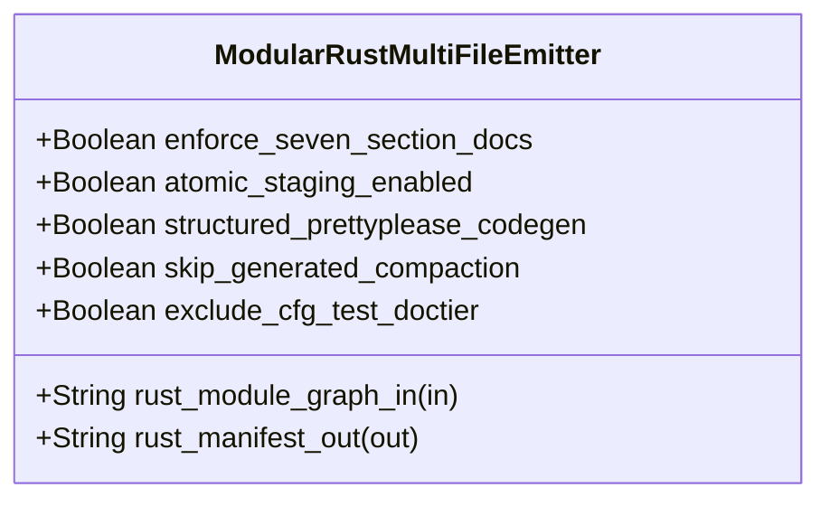

| Attribute | Specification Detail |
| :--- | :--- |
| **Issue ID** | TBD |
| **Title** | Feature 38: [BP 07 Self Hosting 4 Level Modular Multi File Code Generator Blueprint] ModularRustMultiFileEmitter |
| **Type** | feature |
| **Parent Epic** | [EPIC-07-BP_07_Self_Hosting_4_Level_Modular_Multi_File_Code_Generator_Blueprint](../epics/EPIC-07-BP_07_Self_Hosting_4_Level_Modular_Multi_File_Code_Generator_Blueprint.md) |
| **Interface Type** | Physical / Structural / Internal Bus |
| **Schema Containers** | `BP_07_Self_Hosting_4_Level_Modular_Multi_File_Code_Generator_Blueprint::ModularRustMultiFileEmitter` |
| **Generation Mode** | subagent |
| **Specification Source** | [schema/model.sysml](../../schema/model.sysml) |

# Feature 38: [BP 07 Self Hosting 4 Level Modular Multi File Code Generator Blueprint] ModularRustMultiFileEmitter

## UML Class Diagram



## Interface Requirements
### 1. Test Data Shape
```json
{
  "$schema": "https://json-schema.org/draft/2020-12/schema",
  "title": "ModularRustMultiFileEmitterPayloadSchema",
  "type": "object",
  "properties": {
    "part": {
      "type": "string",
      "const": "ModularRustMultiFileEmitter"
    },
    "status": {
      "type": "string",
      "enum": ["nominal", "degraded", "fault"]
    },
    "enforce_seven_section_docs": {
      "type": "boolean",
      "x-sysml-type": "Boolean",
      "description": "Declared attribute enforce_seven_section_docs (Boolean)",
      "default": true
    },
    "atomic_staging_enabled": {
      "type": "boolean",
      "x-sysml-type": "Boolean",
      "description": "Verifies in-memory `ModularityBounds` across all units prior to `write_atomic` commit. [unit: flag]",
      "default": true
    },
    "structured_prettyplease_codegen": {
      "type": "boolean",
      "x-sysml-type": "Boolean",
      "description": "Formats `quote` `TokenStream` ASTs deterministically via `syn::parse2` and `prettyplease::unparse` preserving `E0705` Stage-1 == Stage-2 SHA-256 identity. [unit: flag]",
      "default": true
    },
    "skip_generated_compaction": {
      "type": "boolean",
      "x-sysml-type": "Boolean",
      "description": "Excludes `crates/compile-sysml/src/modular_codegen/generated/` from Tier B/C docblock compaction to preserve `E0705` fixed-point parity. [unit: flag]",
      "default": true
    },
    "exclude_cfg_test_doctier": {
      "type": "boolean",
      "x-sysml-type": "Boolean",
      "description": "Excludes `#[cfg(test)]` modules from production `DocTier` bounds while classifying `DocTier::RustTierA` and `DocTier::RustTierBC`. [unit: flag]",
      "default": true
    },
    "rust_module_graph_in": {
      "type": "object",
      "properties": {
        "direction": { "type": "string", "const": "in" },
        "port_type": { "type": "string", "const": "String" }
      },
      "required": ["direction", "port_type"]
    },
    "rust_manifest_out": {
      "type": "object",
      "properties": {
        "direction": { "type": "string", "const": "out" },
        "port_type": { "type": "string", "const": "String" }
      },
      "required": ["direction", "port_type"]
    }
  },
  "required": [
    "part",
    "status",
    "rust_module_graph_in",
    "rust_manifest_out"
  ],
  "additionalProperties": false
}
```

### 2. Validation & Constraints
Declared structural attributes, boundary ports, invariants, and allocated requirements for classifier `ModularRustMultiFileEmitter`:

| AST Member Kind | Identifier | Declared Type / Direction | Default / Invariant Contract |
| :--- | :--- | :--- | :--- |
| Attribute | `enforce_seven_section_docs` | `Boolean` | Default `true` |
| Attribute | `atomic_staging_enabled` | `Boolean` | Default `true` |
| Attribute | `structured_prettyplease_codegen` | `Boolean` | Default `true` |
| Attribute | `skip_generated_compaction` | `Boolean` | Default `true` |
| Attribute | `exclude_cfg_test_doctier` | `Boolean` | Default `true` |
| Port | `rust_module_graph_in` | `in String` | Boundary interface contract |
| Port | `rust_manifest_out` | `out String` | Boundary interface contract |

### 3. Visual Layout & Arrangement
Structural composition and boundary topology for classifier `ModularRustMultiFileEmitter` organize no nested subparts declared in schema paired with boundary ports `in rust_module_graph_in : String`, `out rust_manifest_out : String`.

### 4. Interactive Flow & States
Operational lifecycle events and discrete state transitions for ModularRustMultiFileEmitter.

### Layer 1: Domain State & Signal Model
Classifier `ModularRustMultiFileEmitter` encapsulates typed domain state attributes `enforce_seven_section_docs : Boolean`, `atomic_staging_enabled : Boolean`, `structured_prettyplease_codegen : Boolean`, `skip_generated_compaction : Boolean`, `exclude_cfg_test_doctier : Boolean` alongside operational lifecycle status.

### Layer 2: Logic & Safety State Management
Classifier `ModularRustMultiFileEmitter` governs stateless structural transition evaluation enforcing no additional invariant guards declared in schema.

### Layer 3: Presentation & Actuator Interface Binding
Classifier `ModularRustMultiFileEmitter` binds external and behavioral interfaces across port `in rust_module_graph_in : String`, port `out rust_manifest_out : String`.

## Acceptance Criteria (BDD)
- [ ] AC-01: Given valid `ModularRustMultiFileEmitter` initialization inputs for `enforce_seven_section_docs` (`Boolean`), `atomic_staging_enabled` (`Boolean`), `structured_prettyplease_codegen` (`Boolean`), `skip_generated_compaction` (`Boolean`), `exclude_cfg_test_doctier` (`Boolean`) (no additional constraints specified in schema), When `ModularRustMultiFileEmitter` commits typed domain state, Then declared state attributes hold verified values.
- [ ] AC-02: Given malformed or out-of-domain input values for `enforce_seven_section_docs` (`Boolean`), `atomic_staging_enabled` (`Boolean`), `structured_prettyplease_codegen` (`Boolean`), `skip_generated_compaction` (`Boolean`), `exclude_cfg_test_doctier` (`Boolean`), When `ModularRustMultiFileEmitter` validates incoming state updates, Then `ModularRustMultiFileEmitter` rejects the invalid state update and emits a diagnostic via diagnostic port `rust_manifest_out`.
- [ ] AC-03: Given nominal signal arrival across `rust_module_graph_in` (`in String`), `rust_manifest_out` (`out String`), When `ModularRustMultiFileEmitter` processes the declared interface transaction, Then output state conforms to the structural classifier contract.
- [ ] AC-04: Given an invalid or unrecognized interface frame across `rust_module_graph_in` (`in String`), `rust_manifest_out` (`out String`), When `ModularRustMultiFileEmitter` boundary validation executes, Then `ModularRustMultiFileEmitter` refuses the malformed frame via diagnostic port `rust_manifest_out` and preserves prior verified state.

## Source References
Formal component specifications and normative systems engineering requirements:
- System Architecture Model: `schema/model.sysml`
- Normative Systems Engineering Standard: ISO/IEC/IEEE 15288:2023 §6.4.3 Architecture Definition Process

Component behavior and interface definitions derive from `schema/model.sysml` pursuant to ISO/IEC/IEEE 15288.
