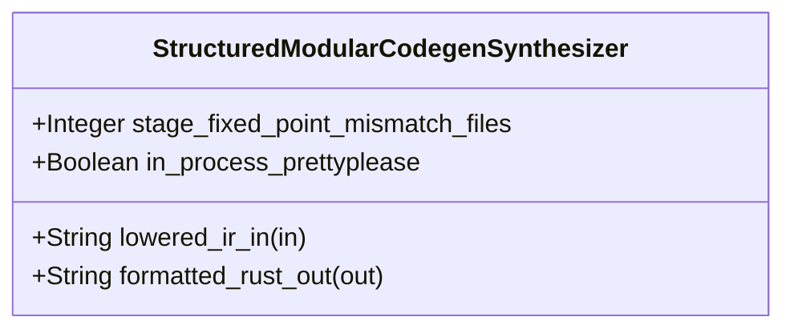

| Attribute | Specification Detail |
| :--- | :--- |
| **Issue ID** | #744 |
| **Title** | Feature 38: [BP 08 Lossless Rust CST Codemod Engine and Unified rustc Compatible JSON Diagnostics] StructuredModularCodegenSynthesizer |
| **Type** | feature |
| **Parent Epic** | [EPIC-08-BP_08_Lossless_Rust_CST_Codemod_Engine_and_Unified_rustc_Compatible_JSON_Diagnostics](../epics/EPIC-08-BP_08_Lossless_Rust_CST_Codemod_Engine_and_Unified_rustc_Compatible_JSON_Diagnostics.md) |
| **Interface Type** | Physical / Structural / Internal Bus |
| **Schema Containers** | `BP_08_Lossless_Rust_CST_Codemod_Engine_and_Unified_rustc_Compatible_JSON_Diagnostics::StructuredModularCodegenSynthesizer` |
| **Generation Mode** | subagent |
| **Specification Source** | [schema/model.sysml](../../schema/model.sysml) |

# Feature 38: [BP 08 Lossless Rust CST Codemod Engine and Unified rustc Compatible JSON Diagnostics] StructuredModularCodegenSynthesizer

## UML Class Diagram



## Interface Requirements
### 1. Test Data Shape
```json
{
  "$schema": "https://json-schema.org/draft/2020-12/schema",
  "title": "StructuredModularCodegenSynthesizerPayloadSchema",
  "type": "object",
  "properties": {
    "part": {
      "type": "string",
      "const": "StructuredModularCodegenSynthesizer"
    },
    "status": {
      "type": "string",
      "enum": ["nominal", "degraded", "fault"]
    },
    "stage_fixed_point_mismatch_files": {
      "type": "integer",
      "x-sysml-type": "Integer",
      "description": "Declared attribute stage_fixed_point_mismatch_files (Integer)",
      "default": 0
    },
    "in_process_prettyplease": {
      "type": "boolean",
      "x-sysml-type": "Boolean",
      "description": "Formats `quote` `TokenStream` ASTs deterministically via `syn::parse2` and `prettyplease::unparse` without external subprocesses. [unit: flag]",
      "default": true
    },
    "lowered_ir_in": {
      "type": "object",
      "properties": {
        "direction": { "type": "string", "const": "in" },
        "port_type": { "type": "string", "const": "String" }
      },
      "required": ["direction", "port_type"]
    },
    "formatted_rust_out": {
      "type": "object",
      "properties": {
        "direction": { "type": "string", "const": "out" },
        "port_type": { "type": "string", "const": "String" }
      },
      "required": ["direction", "port_type"]
    }
  },
  "required": [
    "part",
    "status",
    "lowered_ir_in",
    "formatted_rust_out"
  ],
  "additionalProperties": false
}
```

### 2. Validation & Constraints
Declared structural attributes, boundary ports, invariants, and allocated requirements for classifier `StructuredModularCodegenSynthesizer`:

| AST Member Kind | Identifier | Declared Type / Direction | Default / Invariant Contract |
| :--- | :--- | :--- | :--- |
| Attribute | `stage_fixed_point_mismatch_files` | `Integer` | Default `0` |
| Attribute | `in_process_prettyplease` | `Boolean` | Default `true` |
| Port | `lowered_ir_in` | `in String` | Boundary interface contract |
| Port | `formatted_rust_out` | `out String` | Boundary interface contract |

### 3. Visual Layout & Arrangement
Structural composition and boundary topology for classifier `StructuredModularCodegenSynthesizer` organize no nested subparts declared in schema paired with boundary ports `in lowered_ir_in : String`, `out formatted_rust_out : String`.

### 4. Interactive Flow & States
Operational lifecycle events and discrete state transitions for StructuredModularCodegenSynthesizer.

### Layer 1: Domain State & Signal Model
Classifier `StructuredModularCodegenSynthesizer` encapsulates typed domain state attributes `stage_fixed_point_mismatch_files : Integer`, `in_process_prettyplease : Boolean` alongside operational lifecycle status.

### Layer 2: Logic & Safety State Management
Classifier `StructuredModularCodegenSynthesizer` governs stateless structural transition evaluation enforcing no additional invariant guards declared in schema.

### Layer 3: Presentation & Actuator Interface Binding
Classifier `StructuredModularCodegenSynthesizer` binds external and behavioral interfaces across port `in lowered_ir_in : String`, port `out formatted_rust_out : String`.

## Acceptance Criteria (BDD)
- [ ] AC-01: Given valid `StructuredModularCodegenSynthesizer` initialization inputs for `stage_fixed_point_mismatch_files` (`Integer`), `in_process_prettyplease` (`Boolean`) (no additional constraints specified in schema), When `StructuredModularCodegenSynthesizer` commits typed domain state, Then declared state attributes hold verified values.
- [ ] AC-02: Given malformed or out-of-domain input values for `stage_fixed_point_mismatch_files` (`Integer`), `in_process_prettyplease` (`Boolean`), When `StructuredModularCodegenSynthesizer` validates incoming state updates, Then `StructuredModularCodegenSynthesizer` rejects the invalid state update and emits a diagnostic via diagnostic port `formatted_rust_out`.
- [ ] AC-03: Given nominal signal arrival across `lowered_ir_in` (`in String`), `formatted_rust_out` (`out String`), When `StructuredModularCodegenSynthesizer` processes the declared interface transaction, Then output state conforms to the structural classifier contract.
- [ ] AC-04: Given an invalid or unrecognized interface frame across `lowered_ir_in` (`in String`), `formatted_rust_out` (`out String`), When `StructuredModularCodegenSynthesizer` boundary validation executes, Then `StructuredModularCodegenSynthesizer` refuses the malformed frame via diagnostic port `formatted_rust_out` and preserves prior verified state.

## Source References
Formal component specifications and normative systems engineering requirements:
- System Architecture Model: `schema/model.sysml`
- Normative Systems Engineering Standard: ISO/IEC/IEEE 15288:2023 §6.4.3 Architecture Definition Process

Component behavior and interface definitions derive from `schema/model.sysml` pursuant to ISO/IEC/IEEE 15288.
