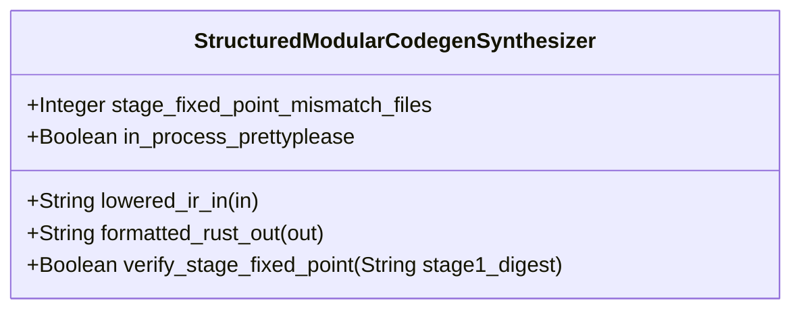

| Attribute | Specification Detail |
| :--- | :--- |
| **Issue ID** | #836 |
| **Title** | Feature 38: [BP 08 Lossless Rust CST Codemod Engine and Unified rustc Compatible JSON Diagnostics] StructuredModularCodegenSynthesizer |
| **Type** | feature |
| **Parent Epic** | [EPIC-08-BP_08_Lossless_Rust_CST_Codemod_Engine_and_Unified_rustc_Compatible_JSON_Diagnostics](../epics/EPIC-08-BP_08_Lossless_Rust_CST_Codemod_Engine_and_Unified_rustc_Compatible_JSON_Diagnostics.md) |
| **Interface Type** | Physical / Structural / Internal Bus |
| **Schema Containers** | `BP_08_Lossless_Rust_CST_Codemod_Engine_and_Unified_rustc_Compatible_JSON_Diagnostics::StructuredModularCodegenSynthesizer` |
| **Generation Mode** | subagent |
| **Specification Source** | [schema/model.sysml](../../schema/model.sysml) |

# Feature 38: [BP 08 Lossless Rust CST Codemod Engine and Unified rustc Compatible JSON Diagnostics] StructuredModularCodegenSynthesizer

## UML Class Diagram



## Interface Requirements
### 1. Test Data Shape
```json
{
  "$schema": "https://json-schema.org/draft/2020-12/schema",
  "title": "StructuredModularCodegenSynthesizerPayloadSchema",
  "type": "object",
  "properties": {
    "part": {
      "type": "string",
      "const": "StructuredModularCodegenSynthesizer"
    },
    "status": {
      "type": "string",
      "enum": ["nominal", "degraded", "fault"]
    },
    "stage_fixed_point_mismatch_files": {
      "type": "integer",
      "x-sysml-type": "Integer",
      "description": "Declared attribute stage_fixed_point_mismatch_files (Integer)",
      "default": 0
    },
    "in_process_prettyplease": {
      "type": "boolean",
      "x-sysml-type": "Boolean",
      "description": "Formats `quote` `TokenStream` ASTs deterministically via `syn::parse2` and `prettyplease::unparse` without external subprocesses. [unit: flag]",
      "default": true
    },
    "lowered_ir_in": {
      "type": "object",
      "properties": {
        "direction": { "type": "string", "const": "in" },
        "port_type": { "type": "string", "const": "String" }
      },
      "required": ["direction", "port_type"]
    },
    "formatted_rust_out": {
      "type": "object",
      "properties": {
        "direction": { "type": "string", "const": "out" },
        "port_type": { "type": "string", "const": "String" }
      },
      "required": ["direction", "port_type"]
    }
  },
  "required": [
    "part",
    "status",
    "lowered_ir_in",
    "formatted_rust_out"
  ],
  "additionalProperties": false
}
```

### 2. Validation & Constraints
Declared structural attributes, boundary ports, invariants, and allocated requirements for classifier `StructuredModularCodegenSynthesizer`:

| AST Member Kind | Identifier | Declared Type / Direction | Default / Invariant Contract |
| :--- | :--- | :--- | :--- |
| Attribute | `stage_fixed_point_mismatch_files` | `Integer` | Default `0` |
| Attribute | `in_process_prettyplease` | `Boolean` | Default `true` |
| Port | `lowered_ir_in` | `in String` | Boundary interface contract |
| Port | `formatted_rust_out` | `out String` | Boundary interface contract |
| Constraint | `C_CST_04` | `stage_fixed_point_mismatch_files >= 0 and stage_fixed_point_mismatch_files <= 0` | Enforces `SHA-256(Stage 1) == SHA-256(Stage 2)` across all generated Rust compilation units |
| Constraint | `Invariant_REQ_0608_SC_03` | Invariant (`REQ-0608`) | Metacircular Stage-1/Stage-2 fixed-point identity and strict separation between `prettyplease` codegen and `ra_ap_syntax` codemods |
| Requirement | `REQ-0608` | Allocated Requirement | `REQ_0608_BP_08_Lossless_Rust_CST_Codemod_Engine_and_Unified_rustc_Compatible_JSON_Diagnostics` (`DEAP-BP-DET-08`) |

### 3. Visual Layout & Arrangement
Structural composition and boundary topology for classifier `StructuredModularCodegenSynthesizer` organize `< 380`-SLOC submodules (`crates/compile-sysml/src/modular_codegen/`) paired with boundary ports `in lowered_ir_in : String`, `out formatted_rust_out : String`.

### 4. Interactive Flow & States
Operational lifecycle events and discrete state transitions for `StructuredModularCodegenSynthesizer` (`RewritingCheck37Paths -> VerifyingSelfHostFixedPoint -> VerifiedClean`).

### Layer 1: Domain State & Signal Model
Classifier `StructuredModularCodegenSynthesizer` encapsulates typed domain state attributes `stage_fixed_point_mismatch_files : Integer`, `in_process_prettyplease : Boolean` alongside `proc_macro2::TokenStream` IR buffers, `syn::File` AST structures, and Stage-1/Stage-2 SHA-256 tree manifests. Upholds **Contract A** across the full OMG SysML v2.0 + KerML 1.0 textual grammar (`package`, `library package`, `standard library package`, `import`, `metadata def` / `@Metadata` / `#capability` / `#hazard` / `#risk` / `#rt_loop` / `#dal` / `#fls`, `part def`/`part`, `item def`/`item`, `attribute def`/`attribute`, `enum def`/`enum`, `port def`/`port`, `interface def`/`interface`, `connection def`/`connection`, `flow def`/`flow`, `allocation def`/`allocation`, `occurrence def`/`occurrence`, `action def`/`action`, `state def`/`state`, `calc def`/`calc`, `constraint def`/`constraint`, `requirement def`/`requirement`, `concern def`/`concern`, `use case def`/`use case`, `analysis def`/`analysis`, `verification def`/`verification`, `test case def`/`test case`, `interaction def`/`interaction`, `view def`/`view`, `viewpoint def`/`viewpoint`, `rendering def`/`rendering`, `variation`/`variant`, and KerML specialization/expressions with zero 16-construct caps).

### Layer 2: Logic & Safety State Management
Classifier `StructuredModularCodegenSynthesizer` governs deterministic AST lowering via `syn`, `proc-macro2`, `quote`, and in-process `prettyplease::unparse` enforcing `C_CST_04` (`stage_fixed_point_mismatch_files == 0`) and `Invariant_REQ_0608_SC_03` under **Contract B** (`cargo-lock`, `cargo_metadata`, `cargo-util-schemas`, `cargo-platform`, `toml_edit`, `ra_ap_syntax`, `ra_ap_vfs`, `ra_ap_paths`, `ra_ap_line_index`, `ra_ap_text_edit`, `rowan`, `camino`, `ignore`, `pulldown-cmark`, `pulldown-cmark-to-cmark`, `syn`, `proc-macro2`, `quote`, `prettyplease`). Bounds implementation strictly within `< 380`-SLOC submodules (`crates/compile-sysml/src/modular_codegen/`) and enforces explicit net-negative deletion of ~19,700+ lines of hand-rolled scanners.

### Layer 3: Presentation & Actuator Interface Binding
Classifier `StructuredModularCodegenSynthesizer` binds external and behavioral interfaces across port `in lowered_ir_in : String`, port `out formatted_rust_out : String`, and operation `+verify_stage_fixed_point(in stage1_digest: String) : Boolean`.

### Associated Use Cases & User Stories

#### Associated Use Cases
- [ ] #771 - [Use Case 42: Structured Codegen Boundary Preserving Stage 1 to Stage 2 Metacircular SHA 256 Fixed Point](../use-cases/UC-42-Structured_Codegen_Boundary_Preserving_Stage_1_to_Stage_2_Metacircular_SHA_256_Fixed_Point.md) (directly exercises `StructuredModularCodegenSynthesizer` `syn` + `quote` + `prettyplease` codegen and `SHA-256(Stage 1) == SHA-256(Stage 2)` verification)
- [ ] #770 - [Use Case 41: Lossless Tier B C Docblock Compaction Skipping Self Hosted Generated Modules](../use-cases/UC-41-Lossless_Tier_B_C_Docblock_Compaction_Skipping_Self_Hosted_Generated_Modules.md) (preserves Stage-1 `generated/` fixed-point modules emitted by `StructuredModularCodegenSynthesizer`)

#### Associated User Stories
- [ ] #806 - [User Story 56: Verify Stage Fixed Point](../user-stories/US-56-verify_stage_fixed_point.md) (directly invokes `verify_stage_fixed_point(stage1_digest)` on `StructuredModularCodegenSynthesizer`)

## Acceptance Criteria (BDD)
- [ ] AC-01: Given valid `StructuredModularCodegenSynthesizer` initialization inputs for `stage_fixed_point_mismatch_files` (`Integer`), `in_process_prettyplease` (`Boolean`) (no additional constraints specified in schema), When `StructuredModularCodegenSynthesizer` commits typed domain state, Then declared state attributes hold verified values.
- [ ] AC-02: Given malformed or out-of-domain input values for `stage_fixed_point_mismatch_files` (`Integer`), `in_process_prettyplease` (`Boolean`), When `StructuredModularCodegenSynthesizer` validates incoming state updates, Then `StructuredModularCodegenSynthesizer` rejects the invalid state update and emits a diagnostic via diagnostic port `formatted_rust_out`.
- [ ] AC-03: Given nominal signal arrival across `lowered_ir_in` (`in String`), `formatted_rust_out` (`out String`), When `StructuredModularCodegenSynthesizer` processes the declared interface transaction, Then output state conforms to the structural classifier contract.
- [ ] AC-04: Given an invalid or unrecognized interface frame across `lowered_ir_in` (`in String`), `formatted_rust_out` (`out String`), When `StructuredModularCodegenSynthesizer` boundary validation executes, Then `StructuredModularCodegenSynthesizer` refuses the malformed frame via diagnostic port `formatted_rust_out` and preserves prior verified state.

## Source References
Formal component specifications and normative systems engineering requirements:
- System Architecture Model: `schema/model.sysml`
- Normative Systems Engineering Standard: ISO/IEC/IEEE 15288:2023 §6.4.3 Architecture Definition Process

Component behavior and interface definitions derive from `schema/model.sysml` pursuant to ISO/IEC/IEEE 15288.
