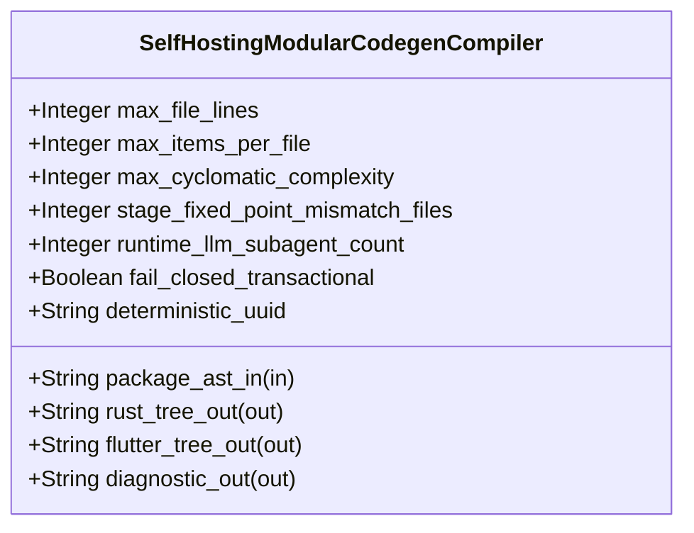

| Attribute | Specification Detail |
| :--- | :--- |
| **Issue ID** | TBD |
| **Title** | Feature 39: [BP 07 Self Hosting 4 Level Modular Multi File Code Generator Blueprint] SelfHostingModularCodegenCompiler |
| **Type** | feature |
| **Parent Epic** | [EPIC-07-BP_07_Self_Hosting_4_Level_Modular_Multi_File_Code_Generator_Blueprint](../epics/EPIC-07-BP_07_Self_Hosting_4_Level_Modular_Multi_File_Code_Generator_Blueprint.md) |
| **Interface Type** | Physical / Structural / Internal Bus |
| **Schema Containers** | `BP_07_Self_Hosting_4_Level_Modular_Multi_File_Code_Generator_Blueprint::SelfHostingModularCodegenCompiler` |
| **Generation Mode** | subagent |
| **Specification Source** | [schema/model.sysml](../../schema/model.sysml) |

# Feature 39: [BP 07 Self Hosting 4 Level Modular Multi File Code Generator Blueprint] SelfHostingModularCodegenCompiler

## UML Class Diagram



## Interface Requirements
### 1. Test Data Shape
```json
{
  "$schema": "https://json-schema.org/draft/2020-12/schema",
  "title": "SelfHostingModularCodegenCompilerPayloadSchema",
  "type": "object",
  "properties": {
    "part": {
      "type": "string",
      "const": "SelfHostingModularCodegenCompiler"
    },
    "status": {
      "type": "string",
      "enum": ["nominal", "degraded", "fault"]
    },
    "max_file_lines": {
      "type": "integer",
      "x-sysml-type": "Integer",
      "description": "Declared attribute max_file_lines (Integer)",
      "default": 400
    },
    "max_items_per_file": {
      "type": "integer",
      "x-sysml-type": "Integer",
      "description": "Upper bound on top-level type, trait, or function declarations per compilation unit. [unit: items]",
      "default": 12
    },
    "max_cyclomatic_complexity": {
      "type": "integer",
      "x-sysml-type": "Integer",
      "description": "Upper bound on McCabe cyclomatic complexity per generated or hand-authored function. [unit: vG]",
      "default": 8
    },
    "stage_fixed_point_mismatch_files": {
      "type": "integer",
      "x-sysml-type": "Integer",
      "description": "Count of Stage-1 versus Stage-2 SHA-256 file digest mismatches permitted at bootstrap verification. [unit: files]",
      "default": 0
    },
    "runtime_llm_subagent_count": {
      "type": "integer",
      "x-sysml-type": "Integer",
      "description": "Mandatory zero runtime LLM or subagent invocation count during deterministic compilation. [unit: count]",
      "default": 0
    },
    "fail_closed_transactional": {
      "type": "boolean",
      "x-sysml-type": "Boolean",
      "description": "Aborts all filesystem writes whenever any DAG, layer, or bounds invariant fails. [unit: flag]",
      "default": true
    },
    "deterministic_uuid": {
      "type": "string",
      "x-sysml-type": "String",
      "description": "Canonical deterministic blueprint component identifier (`DEAP-BP-DET-07`). [unit: uuidv5]",
      "default": "6ba7b810-9dad-11d1-80b4-00c04fd430c7"
    },
    "package_ast_in": {
      "type": "object",
      "properties": {
        "direction": { "type": "string", "const": "in" },
        "port_type": { "type": "string", "const": "String" }
      },
      "required": ["direction", "port_type"]
    },
    "rust_tree_out": {
      "type": "object",
      "properties": {
        "direction": { "type": "string", "const": "out" },
        "port_type": { "type": "string", "const": "String" }
      },
      "required": ["direction", "port_type"]
    },
    "flutter_tree_out": {
      "type": "object",
      "properties": {
        "direction": { "type": "string", "const": "out" },
        "port_type": { "type": "string", "const": "String" }
      },
      "required": ["direction", "port_type"]
    },
    "diagnostic_out": {
      "type": "object",
      "properties": {
        "direction": { "type": "string", "const": "out" },
        "port_type": { "type": "string", "const": "String" }
      },
      "required": ["direction", "port_type"]
    }
  },
  "required": [
    "part",
    "status",
    "package_ast_in",
    "rust_tree_out",
    "flutter_tree_out",
    "diagnostic_out"
  ],
  "additionalProperties": false
}
```

### 2. Validation & Constraints
Declared structural attributes, boundary ports, invariants, and allocated requirements for classifier `SelfHostingModularCodegenCompiler`:

| AST Member Kind | Identifier | Declared Type / Direction | Default / Invariant Contract |
| :--- | :--- | :--- | :--- |
| Attribute | `max_file_lines` | `Integer` | Default `400` |
| Attribute | `max_items_per_file` | `Integer` | Default `12` |
| Attribute | `max_cyclomatic_complexity` | `Integer` | Default `8` |
| Attribute | `stage_fixed_point_mismatch_files` | `Integer` | Default `0` |
| Attribute | `runtime_llm_subagent_count` | `Integer` | Default `0` |
| Attribute | `fail_closed_transactional` | `Boolean` | Default `true` |
| Attribute | `deterministic_uuid` | `String` | Default `"6ba7b810-9dad-11d1-80b4-00c04fd430c7"` |
| Port | `package_ast_in` | `in String` | Boundary interface contract |
| Port | `rust_tree_out` | `out String` | Boundary interface contract |
| Port | `flutter_tree_out` | `out String` | Boundary interface contract |
| Port | `diagnostic_out` | `out String` | Boundary interface contract |

### 3. Visual Layout & Arrangement
Structural composition and boundary topology for classifier `SelfHostingModularCodegenCompiler` organize no nested subparts declared in schema paired with boundary ports `in package_ast_in : String`, `out rust_tree_out : String`, `out flutter_tree_out : String`, `out diagnostic_out : String`.

### 4. Interactive Flow & States
Operational lifecycle events and discrete state transitions for SelfHostingModularCodegenCompiler.

### Layer 1: Domain State & Signal Model
Classifier `SelfHostingModularCodegenCompiler` encapsulates typed domain state attributes `max_file_lines : Integer`, `max_items_per_file : Integer`, `max_cyclomatic_complexity : Integer`, `stage_fixed_point_mismatch_files : Integer`, `runtime_llm_subagent_count : Integer`, `fail_closed_transactional : Boolean`, `deterministic_uuid : String` alongside operational lifecycle status.

### Layer 2: Logic & Safety State Management
Classifier `SelfHostingModularCodegenCompiler` governs stateless structural transition evaluation enforcing no additional invariant guards declared in schema.

### Layer 3: Presentation & Actuator Interface Binding
Classifier `SelfHostingModularCodegenCompiler` binds external and behavioral interfaces across port `in package_ast_in : String`, port `out rust_tree_out : String`, port `out flutter_tree_out : String`, port `out diagnostic_out : String`.

## Acceptance Criteria (BDD)
- [ ] AC-01: Given valid `SelfHostingModularCodegenCompiler` initialization inputs for `max_file_lines` (`Integer`), `max_items_per_file` (`Integer`), `max_cyclomatic_complexity` (`Integer`), `stage_fixed_point_mismatch_files` (`Integer`), `runtime_llm_subagent_count` (`Integer`), `fail_closed_transactional` (`Boolean`), `deterministic_uuid` (`String`) (no additional constraints specified in schema), When `SelfHostingModularCodegenCompiler` commits typed domain state, Then declared state attributes hold verified values.
- [ ] AC-02: Given malformed or out-of-domain input values for `max_file_lines` (`Integer`), `max_items_per_file` (`Integer`), `max_cyclomatic_complexity` (`Integer`), `stage_fixed_point_mismatch_files` (`Integer`), `runtime_llm_subagent_count` (`Integer`), `fail_closed_transactional` (`Boolean`), `deterministic_uuid` (`String`), When `SelfHostingModularCodegenCompiler` validates incoming state updates, Then `SelfHostingModularCodegenCompiler` rejects the invalid state update and emits a diagnostic via diagnostic port `rust_tree_out`.
- [ ] AC-03: Given nominal signal arrival across `package_ast_in` (`in String`), `rust_tree_out` (`out String`), `flutter_tree_out` (`out String`), `diagnostic_out` (`out String`), When `SelfHostingModularCodegenCompiler` processes the declared interface transaction, Then output state conforms to the structural classifier contract.
- [ ] AC-04: Given an invalid or unrecognized interface frame across `package_ast_in` (`in String`), `rust_tree_out` (`out String`), `flutter_tree_out` (`out String`), `diagnostic_out` (`out String`), When `SelfHostingModularCodegenCompiler` boundary validation executes, Then `SelfHostingModularCodegenCompiler` refuses the malformed frame via diagnostic port `rust_tree_out` and preserves prior verified state.

## Source References
Formal component specifications and normative systems engineering requirements:
- System Architecture Model: `schema/model.sysml`
- Normative Systems Engineering Standard: ISO/IEC/IEEE 15288:2023 §6.4.3 Architecture Definition Process

Component behavior and interface definitions derive from `schema/model.sysml` pursuant to ISO/IEC/IEEE 15288.
