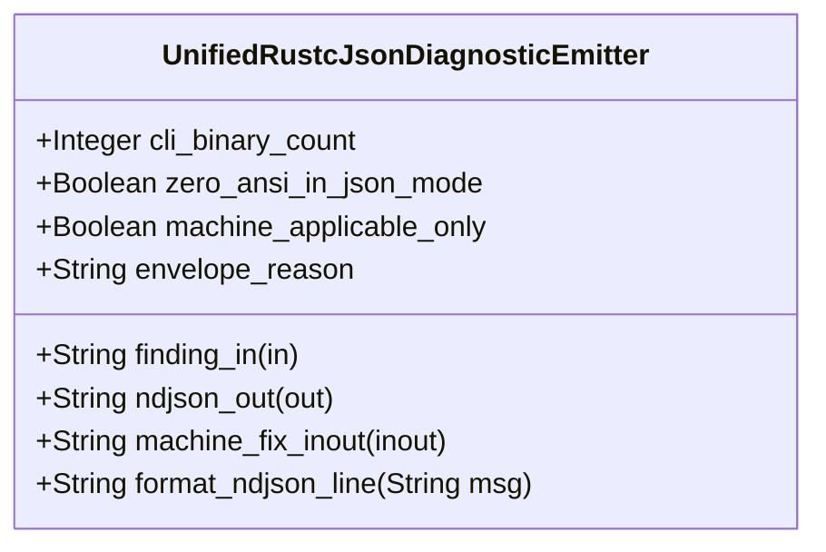

| Attribute | Specification Detail |
| :--- | :--- |
| **Issue ID** | #837 |
| **Title** | Feature 39: [BP 08 Lossless Rust CST Codemod Engine and Unified rustc Compatible JSON Diagnostics] UnifiedRustcJsonDiagnosticEmitter |
| **Type** | feature |
| **Parent Epic** | [EPIC-08-BP_08_Lossless_Rust_CST_Codemod_Engine_and_Unified_rustc_Compatible_JSON_Diagnostics](../epics/EPIC-08-BP_08_Lossless_Rust_CST_Codemod_Engine_and_Unified_rustc_Compatible_JSON_Diagnostics.md) (#853) |
| **Interface Type** | Physical / Structural / Internal Bus |
| **Schema Containers** | `BP_08_Lossless_Rust_CST_Codemod_Engine_and_Unified_rustc_Compatible_JSON_Diagnostics::UnifiedRustcJsonDiagnosticEmitter` |
| **Generation Mode** | subagent |
| **Specification Source** | [schema/model.sysml](../../schema/model.sysml) |

# Feature 39: [BP 08 Lossless Rust CST Codemod Engine and Unified rustc Compatible JSON Diagnostics] UnifiedRustcJsonDiagnosticEmitter

## UML Class Diagram



## Interface Requirements
### 1. Test Data Shape
```json
{
  "$schema": "https://json-schema.org/draft/2020-12/schema",
  "title": "UnifiedRustcJsonDiagnosticEmitterPayloadSchema",
  "type": "object",
  "properties": {
    "part": {
      "type": "string",
      "const": "UnifiedRustcJsonDiagnosticEmitter"
    },
    "status": {
      "type": "string",
      "enum": ["nominal", "degraded", "fault"]
    },
    "cli_binary_count": {
      "type": "integer",
      "x-sysml-type": "Integer",
      "description": "Declared attribute cli_binary_count (Integer)",
      "default": 5
    },
    "zero_ansi_in_json_mode": {
      "type": "boolean",
      "x-sysml-type": "Boolean",
      "description": "Suppresses all ANSI escape sequences and multi-line unstructured banner logs when `--message-format=json` is active. [unit: flag]",
      "default": true
    },
    "machine_applicable_only": {
      "type": "boolean",
      "x-sysml-type": "Boolean",
      "description": "Restricts `--apply-machine-fixes` exclusively to disjoint child suggestions tagged `\"MachineApplicable\"`. [unit: flag]",
      "default": true
    },
    "envelope_reason": {
      "type": "string",
      "x-sysml-type": "String",
      "description": "Canonical top-level JSON discriminator matching `rustc` and `cargo check --message-format=json`. [unit: schema]",
      "default": "compiler-message"
    },
    "finding_in": {
      "type": "object",
      "properties": {
        "direction": { "type": "string", "const": "in" },
        "port_type": { "type": "string", "const": "String" }
      },
      "required": ["direction", "port_type"]
    },
    "ndjson_out": {
      "type": "object",
      "properties": {
        "direction": { "type": "string", "const": "out" },
        "port_type": { "type": "string", "const": "String" }
      },
      "required": ["direction", "port_type"]
    },
    "machine_fix_inout": {
      "type": "object",
      "properties": {
        "direction": { "type": "string", "const": "inout" },
        "port_type": { "type": "string", "const": "String" }
      },
      "required": ["direction", "port_type"]
    }
  },
  "required": [
    "part",
    "status",
    "finding_in",
    "ndjson_out",
    "machine_fix_inout"
  ],
  "additionalProperties": false
}
```

### 2. Validation & Constraints
Declared structural attributes, boundary ports, invariants, and allocated requirements for classifier `UnifiedRustcJsonDiagnosticEmitter`:

| AST Member Kind | Identifier | Declared Type / Direction | Default / Invariant Contract |
| :--- | :--- | :--- | :--- |
| Attribute | `cli_binary_count` | `Integer` | Default `5` |
| Attribute | `zero_ansi_in_json_mode` | `Boolean` | Default `true` |
| Attribute | `machine_applicable_only` | `Boolean` | Default `true` |
| Attribute | `envelope_reason` | `String` | Default `"compiler-message"` |
| Port | `finding_in` | `in String` | Boundary interface contract |
| Port | `ndjson_out` | `out String` | Boundary interface contract |
| Port | `machine_fix_inout` | `inout String` | Boundary interface contract |
| Constraint | `C_CST_05` | `runtime_llm_token_count >= 0 and runtime_llm_token_count <= 0` | Enforces zero runtime LLM token usage during diagnostic formatting and `--apply-machine-fixes` execution |
| Constraint | `Invariant_REQ_0608_SC_04_REQ_0608` | Invariant (`REQ-0608`) | Every CLI emits strictly single-line `rustc`-compatible NDJSON (`reason: "compiler-message"`) with zero ANSI escape sequences |
| Requirement | `REQ-0608` | Allocated Requirement | `REQ_0608_BP_08_Lossless_Rust_CST_Codemod_Engine_and_Unified_rustc_Compatible_JSON_Diagnostics` (`DEAP-BP-DET-08`) |

### 3. Visual Layout & Arrangement
Structural composition and boundary topology for classifier `UnifiedRustcJsonDiagnosticEmitter` organize `< 380`-SLOC submodules (`crates/deap-core/src/json_diag/` and `crates/deap-core/src/rust_cst/diagnostics_ndjson.rs`) paired with boundary ports `in finding_in : String`, `out ndjson_out : String`, `inout machine_fix_inout : String`.

### 4. Interactive Flow & States
Operational lifecycle events and discrete state transitions for `UnifiedRustcJsonDiagnosticEmitter` (`ValidatingDisjointSpans -> EmittingJsonDiagnostics`, `SplicingAndFormatting -> EmittingJsonDiagnostics`, `VerifyingSelfHostFixedPoint -> EmittingJsonDiagnostics`).

### Layer 1: Domain State & Signal Model
Classifier `UnifiedRustcJsonDiagnosticEmitter` encapsulates typed domain state attributes `cli_binary_count : Integer`, `zero_ansi_in_json_mode : Boolean`, `machine_applicable_only : Boolean`, `envelope_reason : String` alongside `RustcJsonEnvelope` (`reason: "compiler-message"`), `RustcDiagnosticMessage`, `RustcDiagnosticCode` (`DEAP-E*`), `RustcDiagnosticSpan` (`byte_start`, `byte_end`, `line_start`, `line_end`, `column_start`, `column_end` computed via `ra_ap_line_index::LineIndex`), and `suggestion_applicability` (`"MachineApplicable"` vs `"MaybeIncorrect"`). Upholds **Contract A** across the full OMG SysML v2.0 + KerML 1.0 textual grammar (with zero 16-construct caps).

### Layer 2: Logic & Safety State Management
Classifier `UnifiedRustcJsonDiagnosticEmitter` governs single-line NDJSON serialization (`serde_json::to_string`) and reverse-byte-order `ra_ap_text_edit::TextEdit` auto-fix application enforcing `C_CST_05` (`runtime_llm_token_count == 0`) and `Invariant_REQ_0608_SC_04_REQ_0608` under **Contract B** (`cargo-lock`, `cargo_metadata`, `cargo-util-schemas`, `cargo-platform`, `toml_edit`, `ra_ap_syntax`, `ra_ap_vfs`, `ra_ap_paths`, `ra_ap_line_index`, `ra_ap_text_edit`, `rowan`, `camino`, `ignore`, `pulldown-cmark`, `pulldown-cmark-to-cmark`). Bounds implementation strictly within `< 380`-SLOC submodules (`crates/deap-core/src/json_diag/`, `crates/deap-core/src/rust_cst/diagnostics_ndjson.rs`) and executes explicit net-negative deletion of ~19,700+ lines of hand-rolled scanners and unstructured multi-line diagnostic formatters.

### Layer 3: Presentation & Actuator Interface Binding
Classifier `UnifiedRustcJsonDiagnosticEmitter` binds external and behavioral interfaces across port `in finding_in : String`, port `out ndjson_out : String`, port `inout machine_fix_inout : String`, structural connector `BP_08_CodemodToDiagnosticEmitterConnection`, and operation `+format_ndjson_line(in msg: String) : String` across all 5 CLI binaries (`compile-sysml`, `verify-baseline`, `ingest-sysml`, `assemble-conops`, `reconcile-backlog`).

### Associated Use Cases & User Stories

#### Associated Use Cases
- [ ] #772 - [Use Case 43: Unified rustc Compatible Single Line JSON Diagnostics and Machine Applicable Auto Fix Across All Five CLIs](../use-cases/UC-43-Unified_rustc_Compatible_Single_Line_JSON_Diagnostics_and_MachineApplicable_Auto_Fix_Across_All_Five_CLIs.md) (directly exercises `UnifiedRustcJsonDiagnosticEmitter` single-line NDJSON emission and `--apply-machine-fixes` across all 5 CLIs)
- [ ] #769 - [Use Case 40: Fail Closed Rejection on Span Collisions Missing Symbols or Post Splice Syntax Errors](../use-cases/UC-40-Fail_Closed_Rejection_on_Span_Collisions_Missing_Symbols_or_Post_Splice_Syntax_Errors.md) (emits `DEAP-E0801`, `DEAP-E0802`, and `DEAP-E0803` single-line NDJSON diagnostics via `UnifiedRustcJsonDiagnosticEmitter`)

#### Associated User Stories
- [ ] #807 - [User Story 57: Format Ndjson Line](../user-stories/US-57-format_ndjson_line.md) (directly invokes `format_ndjson_line(msg)` on `UnifiedRustcJsonDiagnosticEmitter`)

## Acceptance Criteria (BDD)
- [ ] AC-01: Given valid `UnifiedRustcJsonDiagnosticEmitter` initialization inputs for `cli_binary_count` (`Integer`), `zero_ansi_in_json_mode` (`Boolean`), `machine_applicable_only` (`Boolean`), `envelope_reason` (`String`) (no additional constraints specified in schema), When `UnifiedRustcJsonDiagnosticEmitter` commits typed domain state, Then declared state attributes hold verified values.
- [ ] AC-02: Given malformed or out-of-domain input values for `cli_binary_count` (`Integer`), `zero_ansi_in_json_mode` (`Boolean`), `machine_applicable_only` (`Boolean`), `envelope_reason` (`String`), When `UnifiedRustcJsonDiagnosticEmitter` validates incoming state updates, Then `UnifiedRustcJsonDiagnosticEmitter` rejects the invalid state update and emits a diagnostic via diagnostic port `ndjson_out`.
- [ ] AC-03: Given nominal signal arrival across `finding_in` (`in String`), `ndjson_out` (`out String`), `machine_fix_inout` (`inout String`), When `UnifiedRustcJsonDiagnosticEmitter` processes the declared interface transaction, Then output state conforms to the structural classifier contract.
- [ ] AC-04: Given an invalid or unrecognized interface frame across `finding_in` (`in String`), `ndjson_out` (`out String`), `machine_fix_inout` (`inout String`), When `UnifiedRustcJsonDiagnosticEmitter` boundary validation executes, Then `UnifiedRustcJsonDiagnosticEmitter` refuses the malformed frame via diagnostic port `ndjson_out` and preserves prior verified state.

## Source References
Formal component specifications and normative systems engineering requirements:
- System Architecture Model: `schema/model.sysml`
- Normative Systems Engineering Standard: ISO/IEC/IEEE 15288:2023 §6.4.3 Architecture Definition Process

Component behavior and interface definitions derive from `schema/model.sysml` pursuant to ISO/IEC/IEEE 15288.
