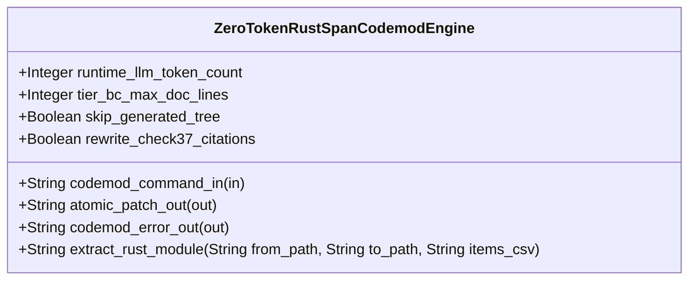

| Attribute | Specification Detail |
| :--- | :--- |
| **Issue ID** | #838 |
| **Title** | Feature 40: [BP 08 Lossless Rust CST Codemod Engine and Unified rustc Compatible JSON Diagnostics] ZeroTokenRustSpanCodemodEngine |
| **Type** | feature |
| **Parent Epic** | [EPIC-08-BP_08_Lossless_Rust_CST_Codemod_Engine_and_Unified_rustc_Compatible_JSON_Diagnostics](../epics/EPIC-08-BP_08_Lossless_Rust_CST_Codemod_Engine_and_Unified_rustc_Compatible_JSON_Diagnostics.md) |
| **Interface Type** | Physical / Structural / Internal Bus |
| **Schema Containers** | `BP_08_Lossless_Rust_CST_Codemod_Engine_and_Unified_rustc_Compatible_JSON_Diagnostics::ZeroTokenRustSpanCodemodEngine` |
| **Generation Mode** | subagent |
| **Specification Source** | [schema/model.sysml](../../schema/model.sysml) |

# Feature 40: [BP 08 Lossless Rust CST Codemod Engine and Unified rustc Compatible JSON Diagnostics] ZeroTokenRustSpanCodemodEngine

## UML Class Diagram



## Interface Requirements
### 1. Test Data Shape
```json
{
  "$schema": "https://json-schema.org/draft/2020-12/schema",
  "title": "ZeroTokenRustSpanCodemodEnginePayloadSchema",
  "type": "object",
  "properties": {
    "part": {
      "type": "string",
      "const": "ZeroTokenRustSpanCodemodEngine"
    },
    "status": {
      "type": "string",
      "enum": ["nominal", "degraded", "fault"]
    },
    "runtime_llm_token_count": {
      "type": "integer",
      "x-sysml-type": "Integer",
      "description": "Declared attribute runtime_llm_token_count (Integer)",
      "default": 0
    },
    "tier_bc_max_doc_lines": {
      "type": "integer",
      "x-sysml-type": "Integer",
      "description": "Target compacted docstring line count (`/// ` + `/// Realises: [REQ-*]`) on `DocTier::RustTierBC` items. [unit: lines]",
      "default": 2
    },
    "skip_generated_tree": {
      "type": "boolean",
      "x-sysml-type": "Boolean",
      "description": "Excludes `crates/compile-sysml/src/modular_codegen/generated/` from `--compact-tier-bc` docstring rewriting. [unit: flag]",
      "default": true
    },
    "rewrite_check37_citations": {
      "type": "boolean",
      "x-sysml-type": "Boolean",
      "description": "Deterministically updates `.rs` citations to `/mod.rs` across `docs/architecture/blueprints/ *.md` and `README.md`. [unit: flag]",
      "default": true
    },
    "codemod_command_in": {
      "type": "object",
      "properties": {
        "direction": { "type": "string", "const": "in" },
        "port_type": { "type": "string", "const": "String" }
      },
      "required": ["direction", "port_type"]
    },
    "atomic_patch_out": {
      "type": "object",
      "properties": {
        "direction": { "type": "string", "const": "out" },
        "port_type": { "type": "string", "const": "String" }
      },
      "required": ["direction", "port_type"]
    },
    "codemod_error_out": {
      "type": "object",
      "properties": {
        "direction": { "type": "string", "const": "out" },
        "port_type": { "type": "string", "const": "String" }
      },
      "required": ["direction", "port_type"]
    }
  },
  "required": [
    "part",
    "status",
    "codemod_command_in",
    "atomic_patch_out",
    "codemod_error_out"
  ],
  "additionalProperties": false
}
```

### 2. Validation & Constraints
Declared structural attributes, boundary ports, invariants, and allocated requirements for classifier `ZeroTokenRustSpanCodemodEngine`:

| AST Member Kind | Identifier | Declared Type / Direction | Default / Invariant Contract |
| :--- | :--- | :--- | :--- |
| Attribute | `runtime_llm_token_count` | `Integer` | Default `0` |
| Attribute | `tier_bc_max_doc_lines` | `Integer` | Default `2` |
| Attribute | `skip_generated_tree` | `Boolean` | Default `true` |
| Attribute | `rewrite_check37_citations` | `Boolean` | Default `true` |
| Port | `codemod_command_in` | `in String` | Boundary interface contract |
| Port | `atomic_patch_out` | `out String` | Boundary interface contract |
| Port | `codemod_error_out` | `out String` | Boundary interface contract |
| Constraint | `C_CST_05` | `runtime_llm_token_count >= 0 and runtime_llm_token_count <= 0` | Enforces zero runtime LLM token consumption across all CST codemod operations |
| Constraint | `C_CST_06` | `tier_bc_max_doc_lines >= 2 and tier_bc_max_doc_lines <= 2` | Bounds compacted `DocTier::RustTierBC` docstrings to 2 lines (`/// <summary>` + `/// Realises: (REQ-*)`) |
| Constraint | `Invariant_REQ_0608_SC_02` | Invariant (`REQ-0608`) | Pairwise `TextRange` disjointness, UTF-8 boundary alignment, and zero post-splice `ra_ap_syntax` CST parse errors |
| Requirement | `REQ-0608` | Allocated Requirement | `REQ_0608_BP_08_Lossless_Rust_CST_Codemod_Engine_and_Unified_rustc_Compatible_JSON_Diagnostics` (`DEAP-BP-DET-08`) |

### 3. Visual Layout & Arrangement
Structural composition and boundary topology for classifier `ZeroTokenRustSpanCodemodEngine` organize `< 380`-SLOC submodules (`crates/deap-core/src/rust_cst/{extract_module,doc_edit}.rs` and `crates/compile-sysml/src/codemod/`) paired with boundary ports `in codemod_command_in : String`, `out atomic_patch_out : String`, `out codemod_error_out : String`.

### 4. Interactive Flow & States
Operational lifecycle events and discrete state transitions for `ZeroTokenRustSpanCodemodEngine` (`AnalyzingMetricsAndTiers -> ValidatingDisjointSpans -> SplicingAndFormatting -> RewritingCheck37Paths`).

### Layer 1: Domain State & Signal Model
Classifier `ZeroTokenRustSpanCodemodEngine` encapsulates typed domain state attributes `runtime_llm_token_count : Integer`, `tier_bc_max_doc_lines : Integer`, `skip_generated_tree : Boolean`, `rewrite_check37_citations : Boolean` alongside `SpanSpliceEdit` (`ra_ap_text_edit::TextEdit` + `rowan::TextRange`) transactions and `pulldown-cmark` CommonMark AST event streams. Upholds **Contract A** across the full OMG SysML v2.0 + KerML 1.0 textual grammar (with zero 16-construct caps).

### Layer 2: Logic & Safety State Management
Classifier `ZeroTokenRustSpanCodemodEngine` governs deterministic reverse-byte-order `TextRange` splicing, `--extract-rust-module` extraction, `--compact-tier-bc` docstring compaction, and lossless `pulldown-cmark` + `pulldown-cmark-to-cmark` Check 37 path rewriting enforcing `C_CST_05` (`runtime_llm_token_count == 0`), `C_CST_06` (`tier_bc_max_doc_lines == 2`), and `Invariant_REQ_0608_SC_02` under **Contract B** (`cargo-lock`, `cargo_metadata`, `cargo-util-schemas`, `cargo-platform`, `toml_edit`, `ra_ap_syntax`, `ra_ap_vfs`, `ra_ap_paths`, `ra_ap_line_index`, `ra_ap_text_edit`, `rowan`, `camino`, `ignore`, `pulldown-cmark`, `pulldown-cmark-to-cmark`). Bounds implementation strictly within `< 380`-SLOC submodules (`crates/deap-core/src/rust_cst/{extract_module,doc_edit}.rs`, `crates/compile-sysml/src/codemod/`) and enforces explicit net-negative deletion of ~19,700+ lines of hand-rolled scanners (retiring `crates/compile-sysml/src/docstring.rs` (549 lines) and `crates/deap-core/src/rust_cst.rs` (599 lines)).

### Layer 3: Presentation & Actuator Interface Binding
Classifier `ZeroTokenRustSpanCodemodEngine` binds external and behavioral interfaces across port `in codemod_command_in : String`, port `out atomic_patch_out : String`, port `out codemod_error_out : String`, structural connector `BP_08_CodemodToDiagnosticEmitterConnection`, and operation `+extract_rust_module(in from_path: String, in to_path: String, in items_csv: String) : String`.

### Associated Use Cases & User Stories

#### Associated Use Cases
- [ ] #768 - [Use Case 39: Deterministic B Tree Map Item Inventory and Atomic Module Extraction with Check 37 Path Rewriting](../use-cases/UC-39-Deterministic_BTreeMap_Item_Inventory_and_Atomic_Module_Extraction_with_Check_37_Path_Rewriting.md) (directly exercises `ZeroTokenRustSpanCodemodEngine` `--extract-rust-module` and `pulldown-cmark` Check 37 citation rewriting)
- [ ] #769 - [Use Case 40: Fail Closed Rejection on Span Collisions Missing Symbols or Post Splice Syntax Errors](../use-cases/UC-40-Fail_Closed_Rejection_on_Span_Collisions_Missing_Symbols_or_Post_Splice_Syntax_Errors.md) (enforces fail-closed transaction rollback on `ZeroTokenRustSpanCodemodEngine` when spans collide or syntax fails)
- [ ] #770 - [Use Case 41: Lossless Tier B C Docblock Compaction Skipping Self Hosted Generated Modules](../use-cases/UC-41-Lossless_Tier_B_C_Docblock_Compaction_Skipping_Self_Hosted_Generated_Modules.md) (directly exercises `ZeroTokenRustSpanCodemodEngine` `--compact-tier-bc` with `skip_generated_tree = true`)

#### Associated User Stories
- [ ] #805 - [User Story 55: Extract Rust Module](../user-stories/US-55-extract_rust_module.md) (directly invokes `extract_rust_module(from_path, to_path, items_csv)` on `ZeroTokenRustSpanCodemodEngine`)

## Acceptance Criteria (BDD)
- [ ] AC-01: Given valid `ZeroTokenRustSpanCodemodEngine` initialization inputs for `runtime_llm_token_count` (`Integer`), `tier_bc_max_doc_lines` (`Integer`), `skip_generated_tree` (`Boolean`), `rewrite_check37_citations` (`Boolean`) (no additional constraints specified in schema), When `ZeroTokenRustSpanCodemodEngine` commits typed domain state, Then declared state attributes hold verified values.
- [ ] AC-02: Given malformed or out-of-domain input values for `runtime_llm_token_count` (`Integer`), `tier_bc_max_doc_lines` (`Integer`), `skip_generated_tree` (`Boolean`), `rewrite_check37_citations` (`Boolean`), When `ZeroTokenRustSpanCodemodEngine` validates incoming state updates, Then `ZeroTokenRustSpanCodemodEngine` rejects the invalid state update and emits a diagnostic via diagnostic port `atomic_patch_out`.
- [ ] AC-03: Given nominal signal arrival across `codemod_command_in` (`in String`), `atomic_patch_out` (`out String`), `codemod_error_out` (`out String`), When `ZeroTokenRustSpanCodemodEngine` processes the declared interface transaction, Then output state conforms to the structural classifier contract.
- [ ] AC-04: Given an invalid or unrecognized interface frame across `codemod_command_in` (`in String`), `atomic_patch_out` (`out String`), `codemod_error_out` (`out String`), When `ZeroTokenRustSpanCodemodEngine` boundary validation executes, Then `ZeroTokenRustSpanCodemodEngine` refuses the malformed frame via diagnostic port `atomic_patch_out` and preserves prior verified state.

## Source References
Formal component specifications and normative systems engineering requirements:
- System Architecture Model: `schema/model.sysml`
- Normative Systems Engineering Standard: ISO/IEC/IEEE 15288:2023 §6.4.3 Architecture Definition Process

Component behavior and interface definitions derive from `schema/model.sysml` pursuant to ISO/IEC/IEEE 15288.
