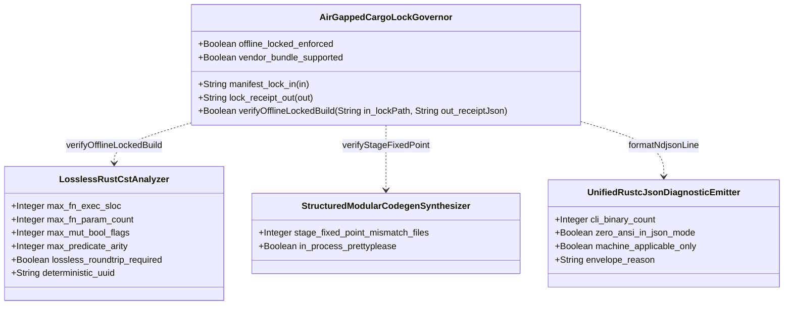
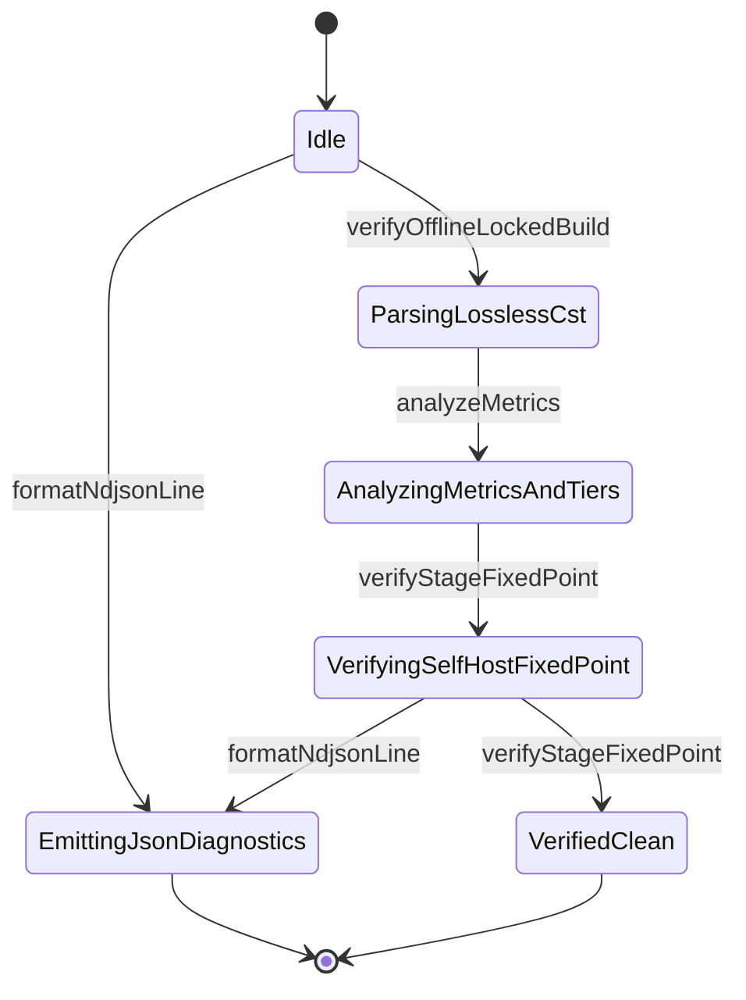

| Attribute | Specification Detail |
| :--- | :--- |
| **Issue ID** | TBD |
| **Title** | Feature 41: [BP 08 Lossless Rust CST Codemod Engine and Unified rustc Compatible JSON Diagnostics] AirGappedCargoLockGovernor |
| **Type** | feature |
| **Parent Epic** | [EPIC-08-BP_08_Lossless_Rust_CST_Codemod_Engine_and_Unified_rustc_Compatible_JSON_Diagnostics](../epics/EPIC-08-BP_08_Lossless_Rust_CST_Codemod_Engine_and_Unified_rustc_Compatible_JSON_Diagnostics.md) |
| **Interface Type** | Physical / Structural / Internal Bus |
| **Schema Containers** | `BP_08_Lossless_Rust_CST_Codemod_Engine_and_Unified_rustc_Compatible_JSON_Diagnostics::AirGappedCargoLockGovernor` |
| **Generation Mode** | subagent |
| **Specification Source** | [schema/model.sysml](../../schema/model.sysml) |

# Feature 41: [BP 08 Lossless Rust CST Codemod Engine and Unified rustc Compatible JSON Diagnostics] AirGappedCargoLockGovernor

## Parent Epic
- Parent Epic: [EPIC-08-BP_08_Lossless_Rust_CST_Codemod_Engine_and_Unified_rustc_Compatible_JSON_Diagnostics](../epics/EPIC-08-BP_08_Lossless_Rust_CST_Codemod_Engine_and_Unified_rustc_Compatible_JSON_Diagnostics.md) -- Enforces deterministic air-gapped `Cargo.lock` `--offline --locked` dependency pinning, lightweight CST/codegen crate closure auditing, and supply-chain verification receipts prior to lossless Rust CST analysis and codemod execution.
- Traceable User Story: [US-51-verifyOfflineLockedBuild.md](../user-stories/US-51-verifyOfflineLockedBuild.md) (`action def verifyOfflineLockedBuild`).
- Traceable System Use Case: [UC-44-Air_Gapped_Offline_Cargo_Lock_Reproducibility_and_Twelve_Gate_Blueprint_Conformance.md](../use-cases/UC-44-Air_Gapped_Offline_Cargo_Lock_Reproducibility_and_Twelve_Gate_Blueprint_Conformance.md) (`UC_AC_07_Air_Gapped_Offline_Cargo_Lock_Reproducibility_and_Twelve_Gate_Blueprint_Conformance`).

## Description
`AirGappedCargoLockGovernor` satisfies **REQ-0608** (`BP-08` / `DEAP-BP-DET-08`, UUIDv5 `6ba7b810-9dad-11d1-80b4-00c04fd430c8`, Class P linear syntax-tree traversal and lockfile audit complexity, governed by IEEE 29148-2018, RFC 2119, DO-178C Level A, DO-330 TQL-4, ISO 26262 ASIL D, and ECSS-E-ST-40C). It acts as the fail-closed supply-chain pre-flight gatekeeper across all six workspace crates (`crates/deap-core`, `crates/compile-sysml`, `crates/verify-baseline`, `crates/ingest-sysml`, `crates/assemble-conops`, and `crates/reconcile-backlog`).

Before any downstream concrete syntax tree (CST) parsing (`LosslessRustCstAnalyzer`), byte-span splicing (`ZeroTokenRustSpanCodemodEngine`), self-hosted modular code generation (`StructuredModularCodegenSynthesizer`), or diagnostic auto-fix transaction (`UnifiedRustcJsonDiagnosticEmitter`) executes, `AirGappedCargoLockGovernor` enforces four deterministic supply-chain contracts:

1. **Air-Gapped `--offline --locked` Dependency Pinning & Lightweight AST Closure**: Audits workspace `Cargo.toml` and `Cargo.lock` snapshots ingested via `manifest_lock_in` (`CargoTomlAndLockfile` protocol) to guarantee reproducible `--offline --locked` builds and `cargo vendor` offline directory bundle readiness (`offline_locked_enforced == true`, `vendor_bundle_supported == true`). Explicitly verifies exact version and checksum pinning for the lightweight syntax and structured-codegen crate set (`ra_ap_syntax`, `rowan`, `syn`, `quote`, `prettyplease`) while fail-closed rejecting heavy semantic compiler crates (`ra_ap_hir`, `ra_ap_hir_def`, `ra_ap_hir_ty`, `ra_ap_ide`) from the stable workspace dependency graph.
2. **Reproducible SHA-256 Lockfile & Package Checksum Audit**: Computes a deterministic workspace `Cargo.lock` SHA-256 digest and verifies that every external registry `[[package]]` entry carries a canonical 64-hex-digit lowercase SHA-256 `checksum`, zero wildcard version specifiers, and zero unpinned git branch or floating revision sources (`FM-BP08-001`, **SC-BP08-01**).
3. **TOCTOU-Free Pre-Flight Lifecycle Ordering**: Seals an immutable `CargoLockSnapshot` and emits a verified `SupplyChainVerificationReceipt` on `lock_receipt_out` (`reply_SupplyChainVerificationReceipt`) before permitting `LosslessRustCstAnalyzer` or any of the five workspace CLI binaries (`cli_binary_count == 5` binaries) to proceed (`FM-BP08-002`, **SC-BP08-02**).
4. **Bounded Modularity & Single-Line `rustc`-Compatible NDJSON Diagnostics**: Constrains the governor implementation module (anchored in `crates/deap-core/src/workspace.rs` and wired into `crates/deap-core/src/diagnostics.rs`, `crates/verify-baseline/src/blueprint_gate.rs`, and `crates/verify-baseline/src/runner.rs`) strictly below `< 380` SLOC of production executable code (excluding `cfg(test)` conditional test blocks), with every function obeying `<= 50` SLOC executable lines (**C_CST_01**, within the `<= 80` SLOC total-function ceiling), `<= 5` params non-receiver arity (**C_CST_02**), `0` flags mutable `bool` locals (**C_CST_03**), and `MAX_AST_DEPTH = 64` levels cycle-safe dependency traversal (`FM-BP08-003`, **SC-BP08-03**). Any violation aborts fail-closed with non-zero exit status and emits a single-line, zero-ANSI `reason: "compiler-message"` NDJSON diagnostic (`**DEAP-E0804**`) under `--message-format=json` (`FM-BP08-004`, **SC-BP08-04**).

### Mathematical Formulations of Reproducible Lockfile Verification and Modularity Bounds

$$
\begin{aligned}
V_{\text{lock}}(M, L) &\iff (P_{\text{req}} \subseteq P_{L}) \land (P_{L} \cap P_{\text{forbid}} = \emptyset) \land \forall p \in P_{\text{ext}}(L), \quad \lvert h_{256}(p) \rvert = 64 \\
B_{\text{mod}}(U) &\iff L_{\text{exec}}(U \setminus U_{\text{test}}) < 380 \land \forall f \in F(U \setminus U_{\text{test}}), \quad (L_{\text{exec}}(f) \le 50) \land (a(f) \le 5) \land (b_{\text{mut}}(f) = 0) \\
D_{\text{walk}}(G_{L}) &\le D_{\max} \land \forall d_{j} \in \mathcal{D}_{\text{ndjson}}, \quad c(d_{j}, \text{0x0A}) = 0 \land c(d_{j}, \text{0x1B}) = 0 \\
T_{\text{gov}}(N, M) &= O(N + M \log M), \quad S_{\text{gov}}(N, M) = O(N + M), \quad K_{\text{LLM}} = 0
\end{aligned}
$$

- Parameter Definitions & Engineering Units:
- $M, L$: Immutable workspace `Cargo.toml` manifest buffer and `Cargo.lock` lockfile buffer ingested on `manifest_lock_in` (unit: UTF-8 `bytes`).
- $P_{L}$: `BTreeSet`-ordered set of resolved `[[package]]` crate identifiers in $L$ (unit: `packages`).
- $P_{\text{req}}$: Required lightweight CST and structured-codegen crate set `{"ra_ap_syntax", "rowan", "syn", "quote", "prettyplease"}` (unit: `packages`).
- $P_{\text{forbid}}$: Forbidden heavy semantic analysis crate set `{"ra_ap_hir", "ra_ap_hir_def", "ra_ap_hir_ty", "ra_ap_ide"}` excluded from stable workspace builds (unit: `packages`).
- $P_{\text{ext}}(L)$: External registry packages in $L$ requiring pinned SHA-256 `checksum` digests $h_{256}(p)$ of exact hexadecimal length `64` hex digits (unit: `hex digits`).
- $L_{\text{exec}}(U \setminus U_{\text{test}})$: Production executable source lines of code in target compilation unit $U$ excluding `cfg(test)` conditional test items, strictly bounded below `< 380` SLOC (unit: `SLOC`).
- $L_{\text{exec}}(f), a(f), b_{\text{mut}}(f)$: Per-function executable lines (`<= 50` SLOC per **C_CST_01**, satisfying `<= 80` SLOC), non-receiver formal parameter count (`<= 5` params per **C_CST_02**), and mutable boolean flag count (`0` flags per **C_CST_03**) across production functions $F(U \setminus U_{\text{test}})$ (units: `SLOC`, `params`, `flags`).
- $D_{\text{walk}}(G_{L}), D_{\max}$: Dependency and syntax traversal depth over lockfile package graph $G_{L}$, bounded by $D_{\max} = 64$ levels (`MAX_AST_DEPTH = 64`, unit: `levels`).
- $c(d_{j}, \text{0x0A}), c(d_{j}, \text{0x1B})$: Embedded newline (`0x0A`) and ANSI escape (`0x1B`) byte counts inside each serialized NDJSON diagnostic record $d_{j} \in \mathcal{D}_{\text{ndjson}}$, both strictly `0` bytes per `Invariant_REQ_0608_SC_04_REQ_0608` (unit: `bytes`).
- $T_{\text{gov}}(N, M), S_{\text{gov}}(N, M), K_{\text{LLM}}$: Time complexity over $N$ manifest/lockfile bytes and $M$ resolved package entries, linear memory bound, and runtime LLM token consumption (`0` tokens per **C_CST_05**).

## UML Class Diagram



## Interface Requirements
### 1. Test Data Shape
```json
{
  "$schema": "https://json-schema.org/draft/2020-12/schema",
  "title": "AirGappedCargoLockGovernorPayloadSchema",
  "type": "object",
  "properties": {
    "part": {
      "type": "string",
      "const": "AirGappedCargoLockGovernor"
    },
    "status": {
      "type": "string",
      "enum": ["nominal", "degraded", "fault"]
    },
    "offline_locked_enforced": {
      "type": "boolean",
      "x-sysml-type": "Boolean",
      "description": "Mandates reproducible --offline --locked workspace builds against pinned Cargo.lock dependency checksums. [unit: flag]",
      "const": true
    },
    "vendor_bundle_supported": {
      "type": "boolean",
      "x-sysml-type": "Boolean",
      "description": "Supports deterministic cargo vendor source bundling for zero-network air-gapped DO-330 TQL-4 build runners. [unit: flag]",
      "const": true
    },
    "manifest_lock_in": {
      "type": "object",
      "properties": {
        "direction": { "type": "string", "const": "in" },
        "port_type": { "type": "string", "const": "String" },
        "protocol": { "type": "string", "const": "CargoTomlAndLockfile" },
        "cargo_toml_path": { "type": "string", "const": "Cargo.toml" },
        "cargo_lock_path": { "type": "string", "const": "Cargo.lock" },
        "pinned_ast_crates": {
          "type": "array",
          "items": {
            "type": "string",
            "enum": ["ra_ap_syntax", "rowan", "syn", "quote", "prettyplease"]
          },
          "uniqueItems": true
        },
        "forbidden_heavy_crates": {
          "type": "array",
          "items": {
            "type": "string",
            "enum": ["ra_ap_hir", "ra_ap_hir_def", "ra_ap_hir_ty", "ra_ap_ide"]
          },
          "maxItems": 0
        }
      },
      "required": ["direction", "port_type", "protocol", "cargo_toml_path", "cargo_lock_path"]
    },
    "lock_receipt_out": {
      "type": "object",
      "properties": {
        "direction": { "type": "string", "const": "out" },
        "port_type": { "type": "string", "const": "String" },
        "protocol": { "type": "string", "const": "SupplyChainVerificationReceipt" },
        "cargo_lock_sha256": {
          "type": "string",
          "minLength": 64,
          "maxLength": 64
        },
        "verified_workspace_crates": {
          "type": "integer",
          "const": 6
        },
        "ndjson_diagnostic_reason": {
          "type": "string",
          "const": "compiler-message"
        }
      },
      "required": ["direction", "port_type", "protocol", "cargo_lock_sha256", "verified_workspace_crates"]
    }
  },
  "required": [
    "part",
    "status",
    "offline_locked_enforced",
    "vendor_bundle_supported",
    "manifest_lock_in",
    "lock_receipt_out"
  ],
  "additionalProperties": false
}
```

### 2. Validation & Constraints
Declared structural attributes, boundary ports, operations, invariants, and allocated requirements for classifier `AirGappedCargoLockGovernor`:

| AST Member Kind | Identifier | Declared Type / Direction | Default / Invariant Contract |
| :--- | :--- | :--- | :--- |
| Attribute | `offline_locked_enforced` | `Boolean` (`[unit: flag]`) | Immutable `true`; fail-closed `**DEAP-E0804**` if `false` (`FM-BP08-001`) |
| Attribute | `vendor_bundle_supported` | `Boolean` (`[unit: flag]`) | Immutable `true`; validates `cargo vendor` offline source replacement readiness (`FM-BP08-001`) |
| Port | `manifest_lock_in` (`manifest_lock_in_flow`) | `in String` (`CargoTomlAndLockfile`) | Workspace `Cargo.toml` and `Cargo.lock` snapshot buffer bounded by byte ceiling and UTF-8 integrity |
| Port | `lock_receipt_out` (`lock_receipt_out_flow`) | `out String` (`SupplyChainVerificationReceipt`) | Atomic verified supply-chain receipt or single-line zero-ANSI `compiler-message` NDJSON (`**DEAP-E0804**`) |
| Action | `verifyOfflineLockedBuild` | `in lockPath: String, out receiptJson: String` | Executes SHA-256 lockfile audit, lightweight crate closure check, and `--offline --locked` workspace verification ([US-51-verifyOfflineLockedBuild.md](../user-stories/US-51-verifyOfflineLockedBuild.md)) |
| Assert Constraint | `C_CST_01` (`max_fn_exec_sloc`) | `Real` (`[unit: SLOC]`) | `1 <= max_fn_exec_sloc <= 50` SLOC (satisfies `<= 80` SLOC total-function ceiling; target module `< 380` SLOC) |
| Assert Constraint | `C_CST_02` (`max_fn_param_count`) | `Real` (`[unit: params]`) | `0 <= max_fn_param_count <= 5` params excluding `self`, `&self`, and `&mut self` receivers |
| Assert Constraint | `C_CST_03` (`max_mut_bool_flags`) | `Real` (`[unit: flags]`) | `max_mut_bool_flags == 0` flags (zero `let mut flag: bool` local state variables) |
| Assert Constraint | `C_CST_04` (`stage_fixed_point_mismatch_files`) | `Real` (`[unit: files]`) | `stage_fixed_point_mismatch_files == 0` files across pinned `syn` + `quote` + `prettyplease` codegen |
| Assert Constraint | `C_CST_05` (`runtime_llm_token_count`) | `Real` (`[unit: tokens]`) | `runtime_llm_token_count == 0` tokens across deterministic lockfile auditing and CST codemods |
| Assert Constraint | `C_CST_06` (`tier_bc_max_doc_lines`) | `Real` (`[unit: lines]`) | `tier_bc_max_doc_lines == 2` lines on `DocTier::RustTierBC` private and `pub(crate)` helpers |
| Constraint | `Invariant_REQ_0608_SC_01` | Invariant (`**REQ-0608**`) | Lossless Red/Green byte round-trip, `cfg(test)`-excluded `ProductionExecSloc`, `ExecSloc <= 50` SLOC, `Params <= 5` params, `MutBools == 0` flags |
| Constraint | `Invariant_REQ_0608_SC_02` | Invariant (`**REQ-0608**`) | Deterministic in-process `prettyplease::unparse(syn::parse2(quote(M)))` preserving `SHA-256(Stage 1) == SHA-256(Stage 2)` |
| Constraint | `Invariant_REQ_0608_SC_03` | Invariant (`**REQ-0608**`) | `DisjointValid` UTF-8 `is_char_boundary` byte intervals and `AdmissibleCommit` zero post-splice syntax errors |
| Constraint | `Invariant_REQ_0608_SC_04_REQ_0608` | Invariant (`**REQ-0608**`) | Single-line NDJSON (`count(0x0A) == 0` bytes, `count(0x1B) == 0` bytes), `O(N + M log M)` time, `O(N + M)` space, `K_LLM == 0` tokens |
| Requirement | `**REQ-0608**` (`REQ_0608_BP_08_Lossless_Rust_CST_Codemod_Engine_and_Unified_rustc_Compatible_JSON_Diagnostics`) | Allocated Requirement | Satisfied by `AirGappedCargoLockGovernor`; verified by `AC_01`..`AC_07` across all 6 workspace crates |

#### Air-Gapped Dependency Pinning & Heavy-Crate Exclusion Policy
| Dependency Crate | Policy Classification | Pinning & Checksum Requirement | Architectural Rationale (`BP-08`) |
| :--- | :--- | :--- | :--- |
| `ra_ap_syntax` | Required (`Pinned Allowlist`) | Exact `Cargo.lock` semver + 64-hex-digit SHA-256 `checksum` | Lossless concrete syntax tree (`SourceFile::parse`) without semantic database overhead |
| `rowan` | Required (`Pinned Allowlist`) | Exact `Cargo.lock` semver + 64-hex-digit SHA-256 `checksum` | Immutable Green/Red syntax tree storage satisfying `Invariant_REQ_0608_SC_01` byte fidelity |
| `syn` | Required (`Pinned Allowlist`) | Exact `Cargo.lock` semver + 64-hex-digit SHA-256 `checksum` | In-process `syn::parse2` AST validation for self-hosted modular codegen (`Invariant_REQ_0608_SC_02`) |
| `quote` | Required (`Pinned Allowlist`) | Exact `Cargo.lock` semver + 64-hex-digit SHA-256 `checksum` | Quasi-quoted `TokenStream` emission preserving Stage-1 == Stage-2 fixed-point parity |
| `prettyplease` | Required (`Pinned Allowlist`) | Exact `Cargo.lock` semver + 64-hex-digit SHA-256 `checksum` | Deterministic in-process Rust AST unparsing without external subprocesses (`in_process_prettyplease == true`) |
| `ra_ap_hir`, `ra_ap_hir_def`, `ra_ap_hir_ty`, `ra_ap_ide` | Forbidden (`Fail-Closed Denylist`) | Must have `0` packages in workspace `Cargo.lock` (`**DEAP-E0804**` on presence) | Eliminates multi-hundred-crate semantic analysis bloat, compile-time explosion, and air-gapped vendor archive bloat |

#### Logical Interface Contracts ([ICD_01_SYSTEM_INTERFACE_MATRIX.md](../interfaces/ICD_01_SYSTEM_INTERFACE_MATRIX.md) & [ICD_02_MASTER_SIGNAL_DICTIONARY.md](../interfaces/ICD_02_MASTER_SIGNAL_DICTIONARY.md))
| ICD Signal / Flow | Source -> Target | Direction & Type | Protocol Identifier | Determinism & Boundary Validation Guard |
| :--- | :--- | :--- | :--- | :--- |
| `manifest_lock_in_flow` (`manifest_lock_in`) | Workspace Filesystem -> `AirGappedCargoLockGovernor` | `in String` | `CargoTomlAndLockfile` | Strict UTF-8 validation, explicit byte-length ceiling, canonical workspace-relative `Cargo.toml` and `Cargo.lock` paths (rejecting `..`, leading `/`, NUL bytes, and symlinks) |
| `verifyOfflineLockedBuild` | `AirGappedCargoLockGovernor` -> `LosslessRustCstAnalyzer` | Interaction Request | `CargoTomlAndLockfile` | Pre-flight lifecycle barrier blocking `ParsingLosslessCst` until `--offline --locked` and SHA-256 package audit succeed |
| `reply_SupplyChainVerificationReceipt` (`lock_receipt_out_flow`) | `LosslessRustCstAnalyzer` / `AirGappedCargoLockGovernor` -> Downstream Gatekeeper | `out String` | `SupplyChainVerificationReceipt` | Emitted atomically only after all 6 workspace crates (`deap-core`, `compile-sysml`, `verify-baseline`, `ingest-sysml`, `assemble-conops`, `reconcile-backlog`) pass `--offline --locked` verification |

#### Component Failure Mode & Safety Constraint Matrix ([FAILURE_MODE_REGISTRY.md](../research/FAILURE_MODE_REGISTRY.md))
| FM ID | Universal Failure Dimension | Trigger Condition on `AirGappedCargoLockGovernor` | Fail-Closed Diagnostic & Safety Constraint |
| :--- | :--- | :--- | :--- |
| `FM-BP08-001` | `(1) Input/Boundary & Malformed Syntax` | `offline_locked_enforced == false` or `vendor_bundle_supported == false`, missing/malformed `Cargo.toml` or `Cargo.lock` on `manifest_lock_in`, unpinned git/wildcard specifiers, non-64-hex SHA-256 `checksum`, or presence of forbidden `ra_ap_hir` crates | `**DEAP-E0804**` / `**SC-BP08-01**` -- Enforce immutable `true` flags, 64-hex-digit lowercase SHA-256 checksum validation, heavy-HIR denylist, and `--offline --locked` resolution; abort fail-closed |
| `FM-BP08-002` | `(2) State/Concurrency & Ordering` | Dispatching `LosslessRustCstAnalyzer` or CLI codemod passes before `verifyOfflineLockedBuild` seals `reply_SupplyChainVerificationReceipt`, or concurrent TOCTOU mutation of `Cargo.toml`, `Cargo.lock`, or `cargo vendor` directory | `**DEAP-E0804**` / `**SC-BP08-02**` -- Seal immutable `CargoLockSnapshot` with pre- and post-check SHA-256 digest verification and block CST entry points until receipt sealing completes |
| `FM-BP08-003` | `(3) Resource/Depth/Arithmetic Exhaustion` | Oversized `Cargo.toml`/`Cargo.lock` buffers, cyclic or >64-level `[[package]]` dependency chains, or integer overflow on package counts and archive byte totals | `**DEAP-E0804**` / `**SC-BP08-03**` -- Enforce buffer byte ceilings, iterative `BTreeSet`-visited dependency walks capped at `MAX_AST_DEPTH = 64` levels, `.get()` indexing, and `checked_add`/`saturating_add` counters |
| `FM-BP08-004` | `(4) Output/Serialization & Partial-Write Integrity` | Premature or partial `SupplyChainVerificationReceipt` on `lock_receipt_out` before all 6 workspace crates verify clean, or embedded `0x0A`/`0x1B` bytes in `--message-format=json` error output | `**DEAP-E0804**` / `**SC-BP08-04**` -- Gate receipt emission on 6-crate workspace verification and serialize lockfile failures as single-line zero-ANSI `compiler-message` NDJSON objects |

```sysml
constraint Invariant_REQ_0608_SC_01 {}
constraint Invariant_REQ_0608_SC_03 {}
constraint Invariant_REQ_0608_SC_02 {}
constraint Invariant_REQ_0608_SC_04_REQ_0608 {}
```

### 3. Visual Layout & Arrangement
Structural composition and boundary topology for classifier `AirGappedCargoLockGovernor` organize zero nested subparts declared in schema paired with boundary ports `in manifest_lock_in : String` (`CargoTomlAndLockfile`) and `out lock_receipt_out : String` (`SupplyChainVerificationReceipt`). Within the compiler workspace architecture (`crates/deap-core/src/workspace.rs`, `crates/deap-core/src/source_ast.rs`, `crates/deap-core/src/diagnostics.rs`, `crates/deap-core/src/sysml_ast/mod.rs`, `crates/verify-baseline/src/blueprint_gate.rs`, and `crates/verify-baseline/src/runner.rs`), `AirGappedCargoLockGovernor` exposes total, typed service operations with explicit `in`/`out` parameter directions and `<= 5` params formal arity (**C_CST_02**):

- `+verifyOfflineLockedBuild(in lockPath: String, out receiptJson: String) -> Boolean`: Validates canonical workspace `Cargo.toml` and `Cargo.lock` snapshot integrity, verifies `--offline --locked` dependency resolution across all 6 workspace crates, and serializes `SupplyChainVerificationReceipt`.
- `+auditPinnedCrateClosure(in lockBuffer: String, out verifiedPackages: Integer) -> Boolean`: Parses `[[package]]` entries into a deterministic `BTreeMap`, verifies presence and 64-hex SHA-256 pinning of `ra_ap_syntax`, `rowan`, `syn`, `quote`, and `prettyplease`, and rejects `ra_ap_hir` or unpinned dependencies.
- `+validateVendorBundleReadiness(in workspaceRoot: String, out vendorReady: Boolean) -> Boolean`: Audits `.cargo/config.toml` and vendored crate checksum files when an offline `cargo vendor` bundle is present, guaranteeing zero network socket fallback.
- `+formatLockFailureNdjson(in errorCode: String, in byteStart: Integer, in byteEnd: Integer, out ndjsonLine: String) -> Boolean`: Formats a single-line `rustc`-compatible `compiler-message` NDJSON record (`**DEAP-E0804**`) free of `0x0A` and `0x1B` bytes.

### 4. Interactive Flow & States
Operational lifecycle events and discrete fail-closed state transitions for `AirGappedCargoLockGovernor` gating `BP_08_Lossless_Rust_CST_Codemod_Engine_and_Unified_rustc_Compatible_JSON_Diagnostics_LifecycleState`:



- **Pre-Flight Supply-Chain Gate (`Idle` -> `ParsingLosslessCst` vs `Idle` -> `EmittingJsonDiagnostics`)**: `verifyOfflineLockedBuild` audits `Cargo.toml` and `Cargo.lock` (`FM-BP08-001`..`FM-BP08-004`) prior to `ParsingLosslessCst`. Any malformed manifest, missing 64-hex SHA-256 package `checksum`, forbidden `ra_ap_hir` crate, TOCTOU lockfile drift, or depth/overflow breach transitions directly to `EmittingJsonDiagnostics` (`formatNdjsonLine`, `**DEAP-E0804**`) and terminates fail-closed without entering CST or codemod stages.

### Layer 1: Domain State & Signal Model
Classifier `AirGappedCargoLockGovernor` is implemented under `#![forbid(unsafe_code)]` in `crates/deap-core/src/workspace.rs` and `crates/deap-core/src/error.rs` using pure immutable domain value types:
- `AirGappedCargoLockGovernorConfig`: Enforces `offline_locked_enforced: bool` (`true`) and `vendor_bundle_supported: bool` (`true`) validated at construction.
- `PinnedPackageRecord` and `CargoLockSnapshot`: Represent every resolved `[[package]]` entry (`name`, `version`, `source`, `sha256_checksum`, `dependencies`) stored exclusively in deterministic `BTreeMap<(String, String), PinnedPackageRecord>` and `BTreeSet<String>` collections (zero `HashMap` or `HashSet` non-determinism), paired with pre-computed 64-hex-digit SHA-256 digests of `Cargo.toml` and `Cargo.lock`.
- `SupplyChainVerificationReceipt`: Typed receipt DTO encoding `cargo_lock_sha256`, `verified_workspace_crates` (`6` crates), `pinned_ast_crates`, and `vendor_bundle_ready`.
- `CargoLockGovernorError`: Exhaustive typed error enum (`DisabledGovernorFlag`, `PathTraversalOrSymlinkRejected`, `BufferByteCeilingExceeded`, `MalformedLockfileSyntax`, `UnpinnedOrWildcardDependency`, `InvalidSha256ChecksumFormat`, `ForbiddenHeavyHirDependency`, `DependencyDepthOrCycleExceeded`, `ManifestToLockToctouDrift`, `OfflineLockedCheckFailed`) carrying exact UTF-8 byte spans -- strictly zero `Result<T, String>` return types.

### Layer 2: Logic & Safety State Management
Classifier `AirGappedCargoLockGovernor` governs stateless, total transition evaluation enforcing `Invariant_REQ_0608_SC_01`, `Invariant_REQ_0608_SC_02`, `Invariant_REQ_0608_SC_03`, and `Invariant_REQ_0608_SC_04_REQ_0608` plus `**SC-BP08-01**`..`**SC-BP08-04**`:
- **Modularity & Function Complexity Bounds**: The target module remains strictly `< 380` SLOC of production executable code (excluding `cfg(test)` conditional test blocks). Every production function is a total function with `<= 50` SLOC executable lines (**C_CST_01**, within the `<= 80` SLOC ceiling), `<= 5` params non-receiver arity (**C_CST_02**), `0` flags mutable `bool` locals (**C_CST_03**), and `<= 3` clauses per unhoisted boolean predicate (`max_predicate_arity == 3` clauses).
- **Panic-Free Indexing, Arithmetic & Bounded Traversal**: Zero `.unwrap()`, `.expect()`, `panic!()`, or direct `[i]` slice indexing; all collection and byte-slice lookups use fallible `.get()` and `str::is_char_boundary`. Package counters, byte offsets, and checksum tallies use checked or saturating integer arithmetic (`checked_add`, `saturating_add`). Dependency graph cycle and depth validation executes iteratively with a `BTreeSet` visited guard capped at `MAX_AST_DEPTH = 64` levels (`FM-BP08-003`).
- **Immutable Snapshot & Pre-Flight Ordering**: Captures `Cargo.toml` and `Cargo.lock` SHA-256 digests before and after `--offline --locked` resolution to trap TOCTOU mutations (`FM-BP08-002`) and blocks `LosslessRustCstAnalyzer` invocation until `SupplyChainVerificationReceipt` is sealed.

### Layer 3: Presentation & Actuator Interface Binding
Classifier `AirGappedCargoLockGovernor` binds external CLI and diagnostic interfaces across `in manifest_lock_in : String` (`CargoTomlAndLockfile`) and `out lock_receipt_out : String` (`SupplyChainVerificationReceipt`):
- **Workspace CLI Pre-Flight & Blueprint Gate Binding**: Integrates into `crates/verify-baseline/src/blueprint_gate.rs` (`./target/release/verify-baseline check-blueprint`) and `crates/verify-baseline/src/runner.rs`, invoking `cargo check --workspace --offline --locked` with zero network access across all 5 CLI binaries (`compile-sysml`, `verify-baseline`, `ingest-sysml`, `assemble-conops`, `reconcile-backlog`) and shared library `deap-core`.
- **Unified `--message-format=json` NDJSON Serialization**: Routes every `CargoLockGovernorError` through `crates/deap-core/src/diagnostics.rs` as an atomic, single-line `rustc`-compatible JSON object (`"reason": "compiler-message"`, `"message": {"code": {"code": "DEAP-E0804"}, "level": "error", "spans": [...]}`) verified free of raw newline (`0x0A`) and ANSI escape (`0x1B`) bytes (`FM-BP08-004`, `Invariant_REQ_0608_SC_04_REQ_0608`) under an exclusive line-atomic stdout write.

## Micro-Task Decomposition (Target Module < 380 Exec SLOC)
Each child implementation micro-task linked to [US-51-verifyOfflineLockedBuild.md](../user-stories/US-51-verifyOfflineLockedBuild.md) and [UC-44-Air_Gapped_Offline_Cargo_Lock_Reproducibility_and_Twelve_Gate_Blueprint_Conformance.md](../use-cases/UC-44-Air_Gapped_Offline_Cargo_Lock_Reproducibility_and_Twelve_Gate_Blueprint_Conformance.md) obeys RED-GREEN-REFACTOR Rust `test`-annotated unit TDD, `<= 50` SLOC per function (`<= 80` SLOC max micro-task ceiling), and `<= 5` params formal arity, summing to `<= 255` SLOC production executable lines (`< 380` SLOC module ceiling):

| Micro-Task ID | DoD Layer | Target Crate Anchor | Max Exec SLOC | Max Params | Atomic Deliverable & Rust Unit Test RED-GREEN-REFACTOR Verification Scope |
| :--- | :--- | :--- | :--- | :--- | :--- |
| `MT-41-01` | Layer 1 | `crates/deap-core/src/error.rs` & `crates/deap-core/src/workspace.rs` | `<= 45` SLOC | `<= 4` params | Define `#![forbid(unsafe_code)]` `AirGappedCargoLockGovernorConfig`, `PinnedPackageRecord`, `BTreeMap`-backed `CargoLockSnapshot`, `SupplyChainVerificationReceipt`, and typed `CargoLockGovernorError` enum (zero `Result<T, String>`); unit-test immutable flag guards (`FM-BP08-001`). |
| `MT-41-02` | Layer 2 | `crates/deap-core/src/workspace.rs` | `<= 60` SLOC | `<= 4` params | Implement bounded `Cargo.toml` / `Cargo.lock` snapshot reader and lexical `[[package]]` parser using `.get()` indexing, `checked_add` byte/package counters, and 64-hex-digit lowercase SHA-256 `checksum` validation; unit-test malformed syntax and byte-ceiling traps (`FM-BP08-001`, `FM-BP08-003`). |
| `MT-41-03` | Layer 2 | `crates/deap-core/src/workspace.rs` | `<= 55` SLOC | `<= 4` params | Implement lightweight crate allowlist (`ra_ap_syntax`, `rowan`, `syn`, `quote`, `prettyplease`), heavy-HIR denylist (`ra_ap_hir`, `ra_ap_hir_def`, `ra_ap_hir_ty`, `ra_ap_ide`), and iterative `BTreeSet` dependency walk capped at `MAX_AST_DEPTH = 64` levels; unit-test cycle, depth-65, and `ra_ap_hir` rejection (`FM-BP08-001`, `FM-BP08-003`). |
| `MT-41-04` | Layer 2 | `crates/deap-core/src/workspace.rs` | `<= 50` SLOC | `<= 5` params | Implement `verify_offline_locked_build` (`verifyOfflineLockedBuild` in [US-51-verifyOfflineLockedBuild.md](../user-stories/US-51-verifyOfflineLockedBuild.md)) with pre/post SHA-256 TOCTOU drift detection and `cargo vendor` `.cargo/config.toml` offline readiness check; unit-test isolated temp-dir fixtures (`FM-BP08-002`). |
| `MT-41-05` | Layer 3 | `crates/deap-core/src/diagnostics.rs` & `crates/verify-baseline/src/blueprint_gate.rs` | `<= 45` SLOC | `<= 5` params | Bind `SupplyChainVerificationReceipt` emission on `lock_receipt_out` and single-line zero-ANSI `--message-format=json` `**DEAP-E0804**` NDJSON serialization (`0x0A`/`0x1B`-free); unit-test atomic receipt gating across all 6 workspace crates (`FM-BP08-004`). |

## Acceptance Criteria (BDD)
- [ ] AC-01: Given valid `AirGappedCargoLockGovernor` inputs satisfying `Invariant_REQ_0608_SC_01` [Req `REQ-0608 (REQ_0608_BP_08_Lossless_Rust_CST_Codemod_Engine_and_Unified_rustc_Compatible_JSON_Diagnostics)`], When `AirGappedCargoLockGovernor` evaluates invariant `Invariant_REQ_0608_SC_01` across its `#![forbid(unsafe_code)]` implementation module excluding `cfg(test)` conditional test blocks, Then module executable size is `< 380` SLOC, every function obeys `ExecSloc <= 50` SLOC (**C_CST_01**, within `<= 80` SLOC), non-receiver `Params <= 5` params (**C_CST_02**), `MutBools == 0` flags (**C_CST_03**), and `0` occurrences of `Result<T, String>`.
- [ ] AC-02: Given boundary inputs that violate `Invariant_REQ_0608_SC_01` [Req `REQ-0608 (REQ_0608_BP_08_Lossless_Rust_CST_Codemod_Engine_and_Unified_rustc_Compatible_JSON_Diagnostics)`], When `AirGappedCargoLockGovernor` evaluates invariant `Invariant_REQ_0608_SC_01`, Then `AirGappedCargoLockGovernor` rejects the invalid transition fail-closed and routes a single-line diagnostic via `lock_receipt_out`.
- [ ] AC-03: Given valid `AirGappedCargoLockGovernor` inputs satisfying `Invariant_REQ_0608_SC_03` [Req `REQ-0608 (REQ_0608_BP_08_Lossless_Rust_CST_Codemod_Engine_and_Unified_rustc_Compatible_JSON_Diagnostics)`] across canonical workspace-relative `Cargo.toml` and `Cargo.lock` buffers, When `AirGappedCargoLockGovernor` evaluates `Invariant_REQ_0608_SC_03` using fallible `.get()` indexing and `str::is_char_boundary`, Then disjoint UTF-8 span bounds hold and verified state is committed.
- [ ] AC-04: Given boundary inputs that violate `Invariant_REQ_0608_SC_03` [Req `REQ-0608 (REQ_0608_BP_08_Lossless_Rust_CST_Codemod_Engine_and_Unified_rustc_Compatible_JSON_Diagnostics)`] or `FM-BP08-001` (`offline_locked_enforced == false`, `vendor_bundle_supported == false`, path traversal, or malformed TOML syntax on `manifest_lock_in`), When `AirGappedCargoLockGovernor` evaluates `Invariant_REQ_0608_SC_03` and **SC-BP08-01**, Then execution aborts fail-closed with `**DEAP-E0804**` via `lock_receipt_out`.
- [ ] AC-05: Given valid `AirGappedCargoLockGovernor` inputs satisfying `Invariant_REQ_0608_SC_02` [Req `REQ-0608 (REQ_0608_BP_08_Lossless_Rust_CST_Codemod_Engine_and_Unified_rustc_Compatible_JSON_Diagnostics)`] where `Cargo.lock` pins `ra_ap_syntax`, `rowan`, `syn`, `quote`, and `prettyplease` with exact semver versions and 64-hex-digit lowercase SHA-256 `checksum` digests, When `AirGappedCargoLockGovernor` evaluates `Invariant_REQ_0608_SC_02`, Then deterministic in-process codegen parity (`stage_fixed_point_mismatch_files == 0` files, **C_CST_04**) holds and verified state is committed.
- [ ] AC-06: Given boundary inputs that violate `Invariant_REQ_0608_SC_02` [Req `REQ-0608 (REQ_0608_BP_08_Lossless_Rust_CST_Codemod_Engine_and_Unified_rustc_Compatible_JSON_Diagnostics)`] or `FM-BP08-001` via unpinned wildcard/git specifiers, a non-64-hex-digit SHA-256 `checksum`, or presence of any forbidden heavy semantic crate (`ra_ap_hir`, `ra_ap_hir_def`, `ra_ap_hir_ty`, `ra_ap_ide`) in `Cargo.lock`, When `auditPinnedCrateClosure` evaluates **SC-BP08-01**, Then `AirGappedCargoLockGovernor` rejects the lockfile fail-closed and emits `**DEAP-E0804**` via `lock_receipt_out`.
- [ ] AC-07: Given valid `AirGappedCargoLockGovernor` inputs satisfying `Invariant_REQ_0608_SC_04_REQ_0608` [Req `REQ-0608 (REQ_0608_BP_08_Lossless_Rust_CST_Codemod_Engine_and_Unified_rustc_Compatible_JSON_Diagnostics)`], When `AirGappedCargoLockGovernor` traverses `[[package]]` edges via iterative `BTreeSet` visited tracking capped at `MAX_AST_DEPTH = 64` levels with `checked_add`/`saturating_add` arithmetic, Then execution completes in `O(N + M log M)` time and `O(N + M)` space with `runtime_llm_token_count == 0` tokens (**C_CST_05**) and `0` bytes of embedded `0x0A` or `0x1B` inside NDJSON records.
- [ ] AC-08: Given boundary inputs that violate `Invariant_REQ_0608_SC_04_REQ_0608` [Req `REQ-0608 (REQ_0608_BP_08_Lossless_Rust_CST_Codemod_Engine_and_Unified_rustc_Compatible_JSON_Diagnostics)`] or `FM-BP08-003` / `FM-BP08-004` (cyclic or >64-level dependency graph, byte/counter ceiling breach, or `--message-format=json` error serialization), When `AirGappedCargoLockGovernor` evaluates **SC-BP08-03** and **SC-BP08-04**, Then traversal terminates without panic and emits a single-line `reason: "compiler-message"` JSON diagnostic (`**DEAP-E0804**`) containing `0` bytes of `0x0A` internal newlines or `0x1B` ANSI escapes via `lock_receipt_out`.
- [ ] AC-09: Given workspace `Cargo.toml` and `Cargo.lock` populated for offline resolution alongside `docs/designs/blueprint-08-rust-analyzer-cst-refactoring-and-json-diagnostics.sysml` ([US-51-verifyOfflineLockedBuild.md](../user-stories/US-51-verifyOfflineLockedBuild.md), `UC_AC_07`), When `verifyOfflineLockedBuild` executes `--offline --locked` verification across all `6` crates (`deap-core`, `compile-sysml`, `verify-baseline`, `ingest-sysml`, `assemble-conops`, `reconcile-backlog`), Then resolution succeeds without network access (`cargo vendor`-compatible) and atomically seals `SupplyChainVerificationReceipt` on `lock_receipt_out`, whereas any out-of-order `LosslessRustCstAnalyzer` call, TOCTOU lockfile drift (`FM-BP08-002`, **SC-BP08-02**), or partial-crate failure (`FM-BP08-004`, **SC-BP08-04**) aborts fail-closed with `**DEAP-E0804**` and zero partial receipts.

## Specification Context (Verbatim)
Verbatim SysML v2 structural and behavioral specification extracted from `docs/designs/blueprint-08-rust-analyzer-cst-refactoring-and-json-diagnostics.sysml`:

```sysml
doc /* verifyOfflineLockedBuild(lockPath) */
action def verifyOfflineLockedBuild;

use case def UC_AC_07_Air_Gapped_Offline_Cargo_Lock_Reproducibility_and_Twelve_Gate_Blueprint_Conformance {
    subject AirGappedCargoLockGovernor;
    objective "Air Gapped Offline Cargo Lock Reproducibility and Twelve Gate Blueprint Conformance";
}

interaction def BP_08_Lossless_Rust_CST_Codemod_Engine_and_Unified_rustc_Compatible_JSON_Diagnostics_SequenceInteraction {
    lifeline AirGappedCargoLockGovernor : AirGappedCargoLockGovernor;
    lifeline LosslessRustCstAnalyzer : LosslessRustCstAnalyzer;
    message verifyOfflineLockedBuild from AirGappedCargoLockGovernor to LosslessRustCstAnalyzer;
    message reply_SupplyChainVerificationReceipt from LosslessRustCstAnalyzer to AirGappedCargoLockGovernor;
}

doc /* Mandates reproducible `--offline --locked` workspace builds against pinned `Cargo.lock` dependency checksums. [unit: flag] */
part def AirGappedCargoLockGovernor {
    attribute offline_locked_enforced : Boolean = true;
    doc /* Supports deterministic `cargo vendor` source bundling for zero-network air-gapped DO-330 TQL-4 build runners. [unit: flag] */
    attribute vendor_bundle_supported : Boolean = true;
    doc /* Reads workspace `Cargo.toml` and `Cargo.lock` crate versions and SHA-256 package checksums. [protocol: CargoTomlAndLockfile] */
    port in manifest_lock_in : String {
        flow in manifest_lock_in_flow : String;
    }
    doc /* Emits verified offline dependency lock and vendoring readiness status. [protocol: SupplyChainVerificationReceipt] */
    port out lock_receipt_out : String {
        flow out lock_receipt_out_flow : String;
    }
}
```

## Source References
Formal component specifications and normative systems engineering requirements:
- System Architecture Model: [schema/model.sysml](../../schema/model.sysml) (`BP_08_Lossless_Rust_CST_Codemod_Engine_and_Unified_rustc_Compatible_JSON_Diagnostics::AirGappedCargoLockGovernor`)
- Blueprint SysML v2 Specification: `docs/designs/blueprint-08-rust-analyzer-cst-refactoring-and-json-diagnostics.sysml` (Lines 1-186)
- Parent Epic Specification: [EPIC-08-BP_08_Lossless_Rust_CST_Codemod_Engine_and_Unified_rustc_Compatible_JSON_Diagnostics.md](../epics/EPIC-08-BP_08_Lossless_Rust_CST_Codemod_Engine_and_Unified_rustc_Compatible_JSON_Diagnostics.md)
- Linked User Story & Use Case: [US-51-verifyOfflineLockedBuild.md](../user-stories/US-51-verifyOfflineLockedBuild.md), [UC-44-Air_Gapped_Offline_Cargo_Lock_Reproducibility_and_Twelve_Gate_Blueprint_Conformance.md](../use-cases/UC-44-Air_Gapped_Offline_Cargo_Lock_Reproducibility_and_Twelve_Gate_Blueprint_Conformance.md)
- Logical Interface Control Documents: [ICD_01_SYSTEM_INTERFACE_MATRIX.md](../interfaces/ICD_01_SYSTEM_INTERFACE_MATRIX.md), [ICD_02_MASTER_SIGNAL_DICTIONARY.md](../interfaces/ICD_02_MASTER_SIGNAL_DICTIONARY.md)
- Pre-STPA Component Failure Mode Research: [FAILURE_MODE_REGISTRY.md](../research/FAILURE_MODE_REGISTRY.md) (`FM-BP08-001`..`FM-BP08-004`)
- Compiler Implementation Anchors: `crates/deap-core/src/workspace.rs`, `crates/deap-core/src/source_ast.rs`, `crates/deap-core/src/diagnostics.rs`, `crates/deap-core/src/error.rs`, `crates/deap-core/src/sysml_ast/mod.rs`, `crates/verify-baseline/src/blueprint_gate.rs`, `crates/verify-baseline/src/runner.rs`
- Normative Systems Engineering & Tool Qualification Standards: ISO/IEC/IEEE 15288:2023 Section 6.4.3 Architecture Definition Process, IEEE 29148-2018, RTCA DO-178C Level A, and RTCA DO-330 TQL-4

Component behavior and interface definitions derive from `schema/model.sysml` pursuant to ISO/IEC/IEEE 15288.
