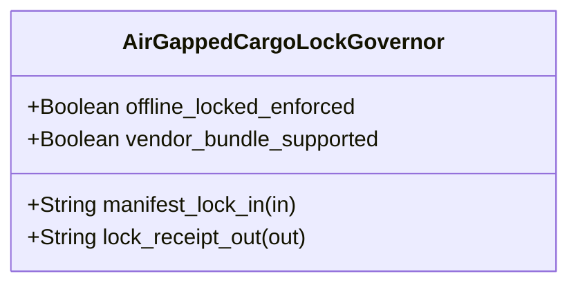

| Attribute | Specification Detail |
| :--- | :--- |
| **Issue ID** | TBD |
| **Title** | Feature 41: [BP 08 Lossless Rust CST Codemod Engine and Unified rustc Compatible JSON Diagnostics] AirGappedCargoLockGovernor |
| **Type** | feature |
| **Parent Epic** | [EPIC-08-BP_08_Lossless_Rust_CST_Codemod_Engine_and_Unified_rustc_Compatible_JSON_Diagnostics](../epics/EPIC-08-BP_08_Lossless_Rust_CST_Codemod_Engine_and_Unified_rustc_Compatible_JSON_Diagnostics.md) |
| **Interface Type** | Physical / Structural / Internal Bus |
| **Schema Containers** | `BP_08_Lossless_Rust_CST_Codemod_Engine_and_Unified_rustc_Compatible_JSON_Diagnostics::AirGappedCargoLockGovernor` |
| **Generation Mode** | subagent |
| **Specification Source** | [schema/model.sysml](../../schema/model.sysml) |

# Feature 41: [BP 08 Lossless Rust CST Codemod Engine and Unified rustc Compatible JSON Diagnostics] AirGappedCargoLockGovernor

## UML Class Diagram



## Interface Requirements
### 1. Test Data Shape
```json
{
  "$schema": "https://json-schema.org/draft/2020-12/schema",
  "title": "AirGappedCargoLockGovernorPayloadSchema",
  "type": "object",
  "properties": {
    "part": {
      "type": "string",
      "const": "AirGappedCargoLockGovernor"
    },
    "status": {
      "type": "string",
      "enum": ["nominal", "degraded", "fault"]
    },
    "offline_locked_enforced": {
      "type": "boolean",
      "x-sysml-type": "Boolean",
      "description": "Declared attribute offline_locked_enforced (Boolean)",
      "default": true
    },
    "vendor_bundle_supported": {
      "type": "boolean",
      "x-sysml-type": "Boolean",
      "description": "Supports deterministic `cargo vendor` source bundling for zero-network air-gapped DO-330 TQL-4 build runners. [unit: flag]",
      "default": true
    },
    "manifest_lock_in": {
      "type": "object",
      "properties": {
        "direction": { "type": "string", "const": "in" },
        "port_type": { "type": "string", "const": "String" }
      },
      "required": ["direction", "port_type"]
    },
    "lock_receipt_out": {
      "type": "object",
      "properties": {
        "direction": { "type": "string", "const": "out" },
        "port_type": { "type": "string", "const": "String" }
      },
      "required": ["direction", "port_type"]
    }
  },
  "required": [
    "part",
    "status",
    "manifest_lock_in",
    "lock_receipt_out"
  ],
  "additionalProperties": false
}
```

### 2. Validation & Constraints
Declared structural attributes, boundary ports, invariants, and allocated requirements for classifier `AirGappedCargoLockGovernor`:

| AST Member Kind | Identifier | Declared Type / Direction | Default / Invariant Contract |
| :--- | :--- | :--- | :--- |
| Attribute | `offline_locked_enforced` | `Boolean` | Default `true` |
| Attribute | `vendor_bundle_supported` | `Boolean` | Default `true` |
| Port | `manifest_lock_in` | `in String` | Boundary interface contract |
| Port | `lock_receipt_out` | `out String` | Boundary interface contract |
| Constraint | `Invariant_REQ_0608_SC_01` | Invariant (`REQ-0608 (REQ_0608_BP_08_Lossless_Rust_CST_Codemod_Engine_and_Unified_rustc_Compatible_JSON_Diagnostics)`) | Declared structural invariant |
| Constraint | `Invariant_REQ_0608_SC_03` | Invariant (`REQ-0608 (REQ_0608_BP_08_Lossless_Rust_CST_Codemod_Engine_and_Unified_rustc_Compatible_JSON_Diagnostics)`) | Declared structural invariant |
| Constraint | `Invariant_REQ_0608_SC_02` | Invariant (`REQ-0608 (REQ_0608_BP_08_Lossless_Rust_CST_Codemod_Engine_and_Unified_rustc_Compatible_JSON_Diagnostics)`) | Declared structural invariant |
| Constraint | `Invariant_REQ_0608_SC_04_REQ_0608` | Invariant (`REQ-0608 (REQ_0608_BP_08_Lossless_Rust_CST_Codemod_Engine_and_Unified_rustc_Compatible_JSON_Diagnostics)`) | Declared structural invariant |
| Requirement | `REQ-0608 (REQ_0608_BP_08_Lossless_Rust_CST_Codemod_Engine_and_Unified_rustc_Compatible_JSON_Diagnostics)` | Allocated Requirement | LosslessRustCstAndJsonDiagnosticsEngine (**REQ-0608** / BP-08 / DEAP-BP-DET-08, UUIDv5 6ba7b810-9dad-11d1-80b4-00c04fd430c8, Class P linear syntax-tree traversal and byte-span splicing complexity, governed by DO-178C Level A, DO-330 TQL-4, ISO 26262 ASIL D, and ECSS-E-ST-40C) replaces approximately |

```sysml
constraint Invariant_REQ_0608_SC_01 {}
constraint Invariant_REQ_0608_SC_03 {}
constraint Invariant_REQ_0608_SC_02 {}
constraint Invariant_REQ_0608_SC_04_REQ_0608 {}
```

### 3. Visual Layout & Arrangement
Structural composition and boundary topology for classifier `AirGappedCargoLockGovernor` organize no nested subparts declared in schema paired with boundary ports `in manifest_lock_in : String`, `out lock_receipt_out : String`.

### 4. Interactive Flow & States
Operational lifecycle events and discrete state transitions for AirGappedCargoLockGovernor.

### Layer 1: Domain State & Signal Model
Classifier `AirGappedCargoLockGovernor` encapsulates typed domain state attributes `offline_locked_enforced : Boolean`, `vendor_bundle_supported : Boolean` alongside operational lifecycle status.

### Layer 2: Logic & Safety State Management
Classifier `AirGappedCargoLockGovernor` governs stateless structural transition evaluation enforcing invariant obligations `Invariant_REQ_0608_SC_01`, `Invariant_REQ_0608_SC_03`, `Invariant_REQ_0608_SC_02`, `Invariant_REQ_0608_SC_04_REQ_0608`.

### Layer 3: Presentation & Actuator Interface Binding
Classifier `AirGappedCargoLockGovernor` binds external and behavioral interfaces across port `in manifest_lock_in : String`, port `out lock_receipt_out : String`.

## Acceptance Criteria (BDD)
- [ ] AC-01: Given valid `AirGappedCargoLockGovernor` inputs satisfying `Invariant_REQ_0608_SC_01` [Req `REQ-0608 (REQ_0608_BP_08_Lossless_Rust_CST_Codemod_Engine_and_Unified_rustc_Compatible_JSON_Diagnostics)`], When `AirGappedCargoLockGovernor` evaluates invariant `Invariant_REQ_0608_SC_01`, Then the invariant holds and verified state is committed.
- [ ] AC-02: Given boundary inputs that violate `Invariant_REQ_0608_SC_01` [Req `REQ-0608 (REQ_0608_BP_08_Lossless_Rust_CST_Codemod_Engine_and_Unified_rustc_Compatible_JSON_Diagnostics)`], When `AirGappedCargoLockGovernor` evaluates invariant `Invariant_REQ_0608_SC_01`, Then `AirGappedCargoLockGovernor` rejects the invalid transition and routes a diagnostic via diagnostic port `lock_receipt_out`.
- [ ] AC-03: Given valid `AirGappedCargoLockGovernor` inputs satisfying `Invariant_REQ_0608_SC_03` [Req `REQ-0608 (REQ_0608_BP_08_Lossless_Rust_CST_Codemod_Engine_and_Unified_rustc_Compatible_JSON_Diagnostics)`], When `AirGappedCargoLockGovernor` evaluates invariant `Invariant_REQ_0608_SC_03`, Then the invariant holds and verified state is committed.
- [ ] AC-04: Given boundary inputs that violate `Invariant_REQ_0608_SC_03` [Req `REQ-0608 (REQ_0608_BP_08_Lossless_Rust_CST_Codemod_Engine_and_Unified_rustc_Compatible_JSON_Diagnostics)`], When `AirGappedCargoLockGovernor` evaluates invariant `Invariant_REQ_0608_SC_03`, Then `AirGappedCargoLockGovernor` rejects the invalid transition and routes a diagnostic via diagnostic port `lock_receipt_out`.
- [ ] AC-05: Given valid `AirGappedCargoLockGovernor` inputs satisfying `Invariant_REQ_0608_SC_02` [Req `REQ-0608 (REQ_0608_BP_08_Lossless_Rust_CST_Codemod_Engine_and_Unified_rustc_Compatible_JSON_Diagnostics)`], When `AirGappedCargoLockGovernor` evaluates invariant `Invariant_REQ_0608_SC_02`, Then the invariant holds and verified state is committed.
- [ ] AC-06: Given boundary inputs that violate `Invariant_REQ_0608_SC_02` [Req `REQ-0608 (REQ_0608_BP_08_Lossless_Rust_CST_Codemod_Engine_and_Unified_rustc_Compatible_JSON_Diagnostics)`], When `AirGappedCargoLockGovernor` evaluates invariant `Invariant_REQ_0608_SC_02`, Then `AirGappedCargoLockGovernor` rejects the invalid transition and routes a diagnostic via diagnostic port `lock_receipt_out`.
- [ ] AC-07: Given valid `AirGappedCargoLockGovernor` inputs satisfying `Invariant_REQ_0608_SC_04_REQ_0608` [Req `REQ-0608 (REQ_0608_BP_08_Lossless_Rust_CST_Codemod_Engine_and_Unified_rustc_Compatible_JSON_Diagnostics)`], When `AirGappedCargoLockGovernor` evaluates invariant `Invariant_REQ_0608_SC_04_REQ_0608`, Then the invariant holds and verified state is committed.
- [ ] AC-08: Given boundary inputs that violate `Invariant_REQ_0608_SC_04_REQ_0608` [Req `REQ-0608 (REQ_0608_BP_08_Lossless_Rust_CST_Codemod_Engine_and_Unified_rustc_Compatible_JSON_Diagnostics)`], When `AirGappedCargoLockGovernor` evaluates invariant `Invariant_REQ_0608_SC_04_REQ_0608`, Then `AirGappedCargoLockGovernor` rejects the invalid transition and routes a diagnostic via diagnostic port `lock_receipt_out`.
- [ ] AC-09: Given nominal typed values for `offline_locked_enforced` (`Boolean`), `vendor_bundle_supported` (`Boolean`) across `manifest_lock_in` (`in String`), `lock_receipt_out` (`out String`), When `AirGappedCargoLockGovernor` executes structural interface processing, Then state and output ports conform to declared schema types.
- [ ] AC-10: Given malformed input frames across `offline_locked_enforced` (`Boolean`), `vendor_bundle_supported` (`Boolean`) or `manifest_lock_in` (`in String`), `lock_receipt_out` (`out String`), When `AirGappedCargoLockGovernor` boundary validation executes, Then `AirGappedCargoLockGovernor` rejects the malformed input via diagnostic port `lock_receipt_out`.

## Source References
Formal component specifications and normative systems engineering requirements:
- System Architecture Model: `schema/model.sysml`
- Normative Systems Engineering Standard: ISO/IEC/IEEE 15288:2023 §6.4.3 Architecture Definition Process

Component behavior and interface definitions derive from `schema/model.sysml` pursuant to ISO/IEC/IEEE 15288.
