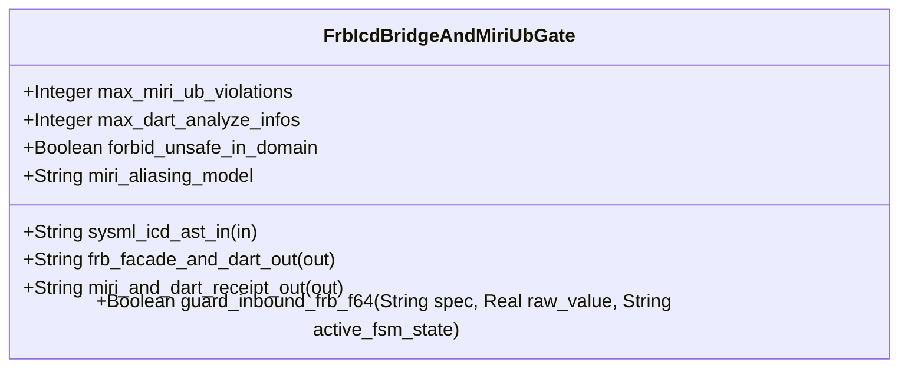

| Attribute | Specification Detail |
| :--- | :--- |
| **Issue ID** | #839 |
| **Title** | Feature 41: [BP 09 Multi Stage Compiler and Formal Verification Gatekeeper] FrbIcdBridgeAndMiriUbGate |
| **Type** | feature |
| **Parent Epic** | [EPIC-09-BP_09_Multi_Stage_Compiler_and_Formal_Verification_Gatekeeper](../epics/EPIC-09-BP_09_Multi_Stage_Compiler_and_Formal_Verification_Gatekeeper.md) (#854) |
| **Interface Type** | Physical / Structural / Internal Bus |
| **Schema Containers** | `BP_09_Multi_Stage_Compiler_and_Formal_Verification_Gatekeeper::FrbIcdBridgeAndMiriUbGate` |
| **Generation Mode** | subagent |
| **Specification Source** | [schema/model.sysml](../../schema/model.sysml) |

# Feature 41: [BP 09 Multi Stage Compiler and Formal Verification Gatekeeper] FrbIcdBridgeAndMiriUbGate

## Description
`FrbIcdBridgeAndMiriUbGate` specifies the Stage 3 `flutter_rust_bridge` FFI Boundary Guard and Miri Tree Borrows Undefined-Behavior Gate within `BP_09_Multi_Stage_Compiler_and_Formal_Verification_Gatekeeper` (**REQ-0609** / `BP-09` / `DEAP-BP-DET-09`).
- **Contract A (100% OMG SysML v2.0 + KerML 1.0 Grammar Coverage)**: Ingests full Definition and Usage symmetry across all normative OMG SysML v2.0 and KerML 1.0 constructs (`package`/`library package`/`standard library package`, `import`, `metadata def`/`metadata`/`@Metadata`/`#user_keyword` (`#hazard`, `#risk`, `#capability`, `#rt_loop`, `#dal`, `#fls` and legacy `hazard def`/`risk def`/`capability def`), `part def`/`part`, `item def`/`item`, `attribute def`/`attribute`, `enum def`/`enum`, `port def`/`port` (`in`, `out`, `inout`, `~`), `connection def`/`connection`, `interface def`/`interface`, `flow def`/`flow`, `allocation def`/`allocation`, `occurrence def`/`occurrence`, `action def`/`action`, `state def`/`state`, `calc def`/`calc`, `constraint def`/`constraint`, `requirement def`/`requirement`, `concern def`/`concern`, `use case def`/`use case`, `analysis def`/`analysis`, `verification def`/`verification`, `test case def`/`test case`, `interaction def`/`interaction`, `view def`/`view`, `viewpoint def`/`viewpoint`, `rendering def`/`rendering`, `variation`/`variant`, and KerML specialization/multiplicity/expressions `:`, `:>`, `:>>`, `::>`, `~`, `[lo..hi]`, `implies`, `xor`, `??`, `->`, `collect`, `select`, `forAll`, `exists`, `ISQ`/`SI`/`ScalarValues`) with zero 16-construct artificial caps.
- **Contract B (100% Official Rust Compiler & Formal Verification Stack, Zero Hand-Rolled Scanners)**: Operates in the 5-Stage formal verification pipeline (Stage 1 `cargo clippy --message-format=json` -> Stage 2 isolated `./lints/deap-dylint-mir/` -> Stage 3 `cargo +nightly miri test` under `MIRIFLAGS="-Zmiri-tree-borrows"` + `flutter_rust_bridge` FFI synthesis via `syn` + `proc-macro2` + `quote` + `prettyplease` + `deap_core::dart_cst` (`logos` + `rowan`) -> Stage 4 `cargo kani` `outer kani::proof` -> Stage 5 Ferrocene qualification) with dynamic runtime `PATH` discovery across macOS, Linux, and Windows and zero hand-rolled string/line/char-by-char scanners.

## UML Class Diagram



## Interface Requirements
### 1. Test Data Shape
```json
{
  "$schema": "https://json-schema.org/draft/2020-12/schema",
  "title": "FrbIcdBridgeAndMiriUbGatePayloadSchema",
  "type": "object",
  "properties": {
    "part": {
      "type": "string",
      "const": "FrbIcdBridgeAndMiriUbGate"
    },
    "status": {
      "type": "string",
      "enum": ["nominal", "degraded", "fault"]
    },
    "max_miri_ub_violations": {
      "type": "integer",
      "x-sysml-type": "Integer",
      "description": "Declared attribute max_miri_ub_violations (Integer)",
      "default": 0
    },
    "max_dart_analyze_infos": {
      "type": "integer",
      "x-sysml-type": "Integer",
      "description": "Permitted static analysis errors, warnings, or info findings under `dart analyze --fatal-infos`. [unit: diagnostics]",
      "default": 0
    },
    "forbid_unsafe_in_domain": {
      "type": "boolean",
      "x-sysml-type": "Boolean",
      "description": "Enforces `#![forbid(unsafe_code)]` across all pure domain, lowering, and FSM crates outside isolated FFI/HAL bridges. [unit: flag]",
      "default": true
    },
    "miri_aliasing_model": {
      "type": "string",
      "x-sysml-type": "String",
      "description": "Active Miri pointer-provenance and aliasing operational semantics flag enforced on FFI and ring-buffer test suites. [unit: flag]",
      "default": "-Zmiri-tree-borrows"
    },
    "sysml_icd_ast_in": {
      "type": "object",
      "properties": {
        "direction": { "type": "string", "const": "in" },
        "port_type": { "type": "string", "const": "String" }
      },
      "required": ["direction", "port_type"]
    },
    "frb_facade_and_dart_out": {
      "type": "object",
      "properties": {
        "direction": { "type": "string", "const": "out" },
        "port_type": { "type": "string", "const": "String" }
      },
      "required": ["direction", "port_type"]
    },
    "miri_and_dart_receipt_out": {
      "type": "object",
      "properties": {
        "direction": { "type": "string", "const": "out" },
        "port_type": { "type": "string", "const": "String" }
      },
      "required": ["direction", "port_type"]
    }
  },
  "required": [
    "part",
    "status",
    "sysml_icd_ast_in",
    "frb_facade_and_dart_out",
    "miri_and_dart_receipt_out"
  ],
  "additionalProperties": false
}
```

### 2. Validation & Constraints
Declared structural attributes, boundary ports, invariants, and allocated requirements for classifier `FrbIcdBridgeAndMiriUbGate`:

| AST Member Kind | Identifier | Declared Type / Direction | Default / Invariant Contract |
| :--- | :--- | :--- | :--- |
| Attribute | `max_miri_ub_violations` | `Integer` | Default `0` (`C_VER_04: max_miri_ub_violations == 0`) |
| Attribute | `max_dart_analyze_infos` | `Integer` | Default `0` (`dart analyze --fatal-infos` zero findings) |
| Attribute | `forbid_unsafe_in_domain` | `Boolean` | Default `true` (`#![forbid(unsafe_code)]` across pure domain crates) |
| Attribute | `miri_aliasing_model` | `String` | Default `"-Zmiri-tree-borrows"` |
| Operation | `guard_inbound_frb_f64` | `in spec: String, in raw_value: Real, in active_fsm_state: String, return Boolean` | Enforces IEEE 754 `is_finite()`, closed `[min..max]` interval bounds, and `state def` operational mode preconditions (`DEAP-E0903`) |
| Port | `sysml_icd_ast_in` | `in String` | Boundary interface contract |
| Port | `frb_facade_and_dart_out` | `out String` | Boundary interface contract |
| Port | `miri_and_dart_receipt_out` | `out String` | Boundary interface contract |
| Constraint | `C_VER_04` | `max_miri_ub_violations >= 0 and max_miri_ub_violations <= 0` | Zero Miri Tree Borrows undefined-behavior violations |
| Constraint | `C_VER_07` | `max_module_exec_sloc >= 1 and max_module_exec_sloc <= 380` | Submodule executable SLOC ceiling (`< 380` SLOC verified via `ra_ap_syntax`) |
| Constraint | `Invariant_REQ_0609_SC_01` | Invariant (`REQ-0609 (REQ_0609_BP_09_Multi_Stage_Compiler_and_Formal_Verification_Gatekeeper)`) | Stage 1 universal stable Clippy total-function and `clippy.toml` threshold enforcement |
| Constraint | `Invariant_REQ_0609_SC_02` | Invariant (`REQ-0609 (REQ_0609_BP_09_Multi_Stage_Compiler_and_Formal_Verification_Gatekeeper)`) | Stage 2 isolated `./lints/deap-dylint-mir/` MIR zero-allocation and `REQ-*` digest binding enforcement |
| Constraint | `Invariant_REQ_0609_SC_03` | Invariant (`REQ-0609 (REQ_0609_BP_09_Multi_Stage_Compiler_and_Formal_Verification_Gatekeeper)`) | Stage 3 `flutter_rust_bridge` FFI boundary guard, `#![forbid(unsafe_code)]` domain isolation, and Miri `-Zmiri-tree-borrows` zero-UB enforcement |
| Constraint | `Invariant_REQ_0609_SC_04` | Invariant (`REQ-0609 (REQ_0609_BP_09_Multi_Stage_Compiler_and_Formal_Verification_Gatekeeper)`) | Stage 4 deterministic Kani `outer kani::proof` synthesis (`syn`+`proc-macro2`+`quote`+`prettyplease`) and CBMC `UNSAT` verification |
| Constraint | `Invariant_REQ_0609_SC_05` | Invariant (`REQ-0609 (REQ_0609_BP_09_Multi_Stage_Compiler_and_Formal_Verification_Gatekeeper)`) | Cross-platform runtime `PATH` discovery, `< 380`-SLOC submodule modularity, and fail-closed qualification |
| Requirement | `REQ-0609 (REQ_0609_BP_09_Multi_Stage_Compiler_and_Formal_Verification_Gatekeeper)` | Allocated Requirement | MultiStageFormalVerificationGatekeeper (**REQ-0609** / `BP-09` / `DEAP-BP-DET-09`, UUIDv5 `6ba7b810-9dad-11d1-80b4-00c04fd430c9`, governed by DO-178C Level A, DO-330 TQL-4, DO-333 Formal Methods Supplement, ISO 26262-6 ASIL D, and IEC 61508-3 SIL 4) |

```sysml
constraint Invariant_REQ_0609_SC_01 {}
constraint Invariant_REQ_0609_SC_02 {}
constraint Invariant_REQ_0609_SC_03 {}
constraint Invariant_REQ_0609_SC_04 {}
constraint Invariant_REQ_0609_SC_05 {}
```

### 3. Visual Layout & Arrangement
Structural composition and boundary topology for classifier `FrbIcdBridgeAndMiriUbGate` organize no nested subparts declared in schema paired with boundary ports `in sysml_icd_ast_in : String`, `out frb_facade_and_dart_out : String`, `out miri_and_dart_receipt_out : String`.

### 4. Interactive Flow & States
Operational lifecycle events and discrete state transitions for `FrbIcdBridgeAndMiriUbGate` within `BP_09_Multi_Stage_Compiler_and_Formal_Verification_Gatekeeper_LifecycleState` (`RunningStage3FrbAndMiri -> RunningStage4KaniCbmc` on `stage3FrbMiriAndDartVerified`; `RunningStage3FrbAndMiri -> FailedClosedJsonDiagnostic` on `rejectMiriTreeBorrowsOrDartFatalInfo`).

### Layer 1: Domain State & Signal Model
Classifier `FrbIcdBridgeAndMiriUbGate` encapsulates typed domain state attributes `max_miri_ub_violations : Integer`, `max_dart_analyze_infos : Integer`, `forbid_unsafe_in_domain : Boolean`, `miri_aliasing_model : String` alongside `IcdSignalGuardSpec` and `StageGateReceipt` records derived from full Contract A OMG SysML v2.0 + KerML 1.0 `port def`/`port`, `item def`/`item`, `flow def`/`flow`, `state def`/`state`, and `constraint def`/`constraint` AST nodes (`deap_core::sysml_cst` via `logos` + `rowan` + `salsa` + `ariadne`).

### Layer 2: Logic & Safety State Management
Classifier `FrbIcdBridgeAndMiriUbGate` governs stateless structural transition evaluation enforcing invariant obligations `Invariant_REQ_0609_SC_01`, `Invariant_REQ_0609_SC_02`, `Invariant_REQ_0609_SC_03`, `Invariant_REQ_0609_SC_04`, `Invariant_REQ_0609_SC_05`, `C_VER_04`, and `C_VER_07`. Synthesizes `#![forbid(unsafe_code)]` domain modules and `flutter_rust_bridge` FFI guards (`guard_inbound_frb_f64`) via `syn` + `proc-macro2` + `quote` + `prettyplease`, verifies Dart bindings via `deap_core::dart_cst` (`logos` + `rowan`) and `dart analyze --fatal-infos`, and executes `cargo +nightly miri test` under `-Zmiri-tree-borrows` inside `< 380`-SLOC submodules (`./crates/compile-sysml/src/frb_guard/` and `./crates/verify-baseline/src/formal_gates/`) while explicitly deleting legacy hand-rolled FFI/Dart string scanners and unguarded FFI emitters.

### Layer 3: Presentation & Actuator Interface Binding
Classifier `FrbIcdBridgeAndMiriUbGate` binds external and behavioral interfaces across port `in sysml_icd_ast_in : String`, port `out frb_facade_and_dart_out : String`, and port `out miri_and_dart_receipt_out : String`, emitting deterministic single-line NDJSON diagnostics (`DEAP-E0903`) on boundary, `dart analyze`, or Miri Tree Borrows violations.

### Associated Use Cases & User Stories

#### Associated Use Cases
- [ ] #774 - [Use Case 45: Stage 1 Universal Stable Clippy Total Function and clippy toml Threshold Enforcement](../use-cases/UC-45-Stage_1_Universal_Stable_Clippy_Total_Function_and_clippy_toml_Threshold_Enforcement.md) (Coordinates Stage 1 total-function and `undocumented_unsafe_blocks` prerequisites before Stage 3 FFI promotion)
- [ ] #775 - [Use Case 46: Stage 2 Isolated Nightly Dylint MIR Zero Allocation Proof on Real Time Control Loops](../use-cases/UC-46-Stage_2_Isolated_Nightly_Dylint_MIR_Zero_Allocation_Proof_on_Real_Time_Control_Loops.md) (Coordinates Stage 2 `#rt_loop` zero-allocation proofs preceding Stage 3 FFI and Miri evaluation)
- [ ] #776 - [Use Case 47: Stage 2 Compile Time MIR Requirement Binding Verification Against Active SysML Digests](../use-cases/UC-47-Stage_2_Compile_Time_MIR_Requirement_Binding_Verification_Against_Active_SysML_Digests.md) (Coordinates Stage 2 `REQ-*` SysML digest verification preceding Stage 3 FFI synthesis)
- [ ] #777 - [Use Case 48: Stage 3 Deterministic flutter_rust_bridge FFI Synthesis with Fail Closed ICD Boundary Guards](../use-cases/UC-48-Stage_3_Deterministic_flutter_rust_bridge_FFI_Synthesis_with_Fail_Closed_ICD_Boundary_Guards.md) (Directly realizes Stage 3 `#![forbid(unsafe_code)]` domain synthesis, `guard_inbound_frb_f64` FFI boundary checks, and `dart analyze --fatal-infos`)
- [ ] #778 - [Use Case 49: Stage 3 Miri Tree Borrows Abstract Machine Undefined Behavior Rejection on FFI and Ring Buffer Bridges](../use-cases/UC-49-Stage_3_Miri_Tree_Borrows_Abstract_Machine_Undefined_Behavior_Rejection_on_FFI_and_Ring_Buffer_Bridges.md) (Directly realizes Stage 3 `cargo +nightly miri test` under `-Zmiri-tree-borrows` across FFI and SPSC ring-buffer bridges)
- [ ] #779 - [Use Case 50: Stage 4 Deterministic Kani CBMC Proof Synthesis and STPA Unsafe Control Action Falsification](../use-cases/UC-50-Stage_4_Deterministic_Kani_CBMC_Proof_Synthesis_and_STPA_Unsafe_Control_Action_Falsification.md) (Promotes verified Stage 3 FFI/Miri artifacts to Stage 4 Kani CBMC proof synthesis)
- [ ] #780 - [Use Case 51: Cross Platform Toolchain Discovery Modular Submodule Layout and Fail Closed Qualification Gate](../use-cases/UC-51-Cross_Platform_Toolchain_Discovery_Modular_Submodule_Layout_and_Fail_Closed_Qualification_Gate.md) (Enforces `< 380`-SLOC submodule modularity and cross-platform `miri`/`dart` runtime `PATH` discovery)

#### Associated User Stories
- [ ] #813 - [User Story 63: Guard Inbound Frb F64](../user-stories/US-63-guard_inbound_frb_f64.md) (Executes `guard_inbound_frb_f64(spec, raw_value, active_fsm_state)` across inbound `flutter_rust_bridge` FFI entrypoints)
- [ ] #815 - [User Story 65: Evaluate Four Stage Gatekeeper](../user-stories/US-65-evaluate_four_stage_gatekeeper.md) (Consolidates Stage 3 Miri and `dart analyze` receipts into the 4-stage gatekeeper verdict)

## Acceptance Criteria (BDD)
- [ ] AC-01: Given valid `FrbIcdBridgeAndMiriUbGate` inputs satisfying `Invariant_REQ_0609_SC_01` [Req `REQ-0609 (REQ_0609_BP_09_Multi_Stage_Compiler_and_Formal_Verification_Gatekeeper)`], When `FrbIcdBridgeAndMiriUbGate` evaluates invariant `Invariant_REQ_0609_SC_01`, Then the invariant holds and verified state is committed.
- [ ] AC-02: Given boundary inputs that violate `Invariant_REQ_0609_SC_01` [Req `REQ-0609 (REQ_0609_BP_09_Multi_Stage_Compiler_and_Formal_Verification_Gatekeeper)`], When `FrbIcdBridgeAndMiriUbGate` evaluates invariant `Invariant_REQ_0609_SC_01`, Then `FrbIcdBridgeAndMiriUbGate` rejects the invalid transition and routes a diagnostic via diagnostic port `frb_facade_and_dart_out`.
- [ ] AC-03: Given valid `FrbIcdBridgeAndMiriUbGate` inputs satisfying `Invariant_REQ_0609_SC_02` [Req `REQ-0609 (REQ_0609_BP_09_Multi_Stage_Compiler_and_Formal_Verification_Gatekeeper)`], When `FrbIcdBridgeAndMiriUbGate` evaluates invariant `Invariant_REQ_0609_SC_02`, Then the invariant holds and verified state is committed.
- [ ] AC-04: Given boundary inputs that violate `Invariant_REQ_0609_SC_02` [Req `REQ-0609 (REQ_0609_BP_09_Multi_Stage_Compiler_and_Formal_Verification_Gatekeeper)`], When `FrbIcdBridgeAndMiriUbGate` evaluates invariant `Invariant_REQ_0609_SC_02`, Then `FrbIcdBridgeAndMiriUbGate` rejects the invalid transition and routes a diagnostic via diagnostic port `frb_facade_and_dart_out`.
- [ ] AC-05: Given valid `FrbIcdBridgeAndMiriUbGate` inputs satisfying `Invariant_REQ_0609_SC_03` [Req `REQ-0609 (REQ_0609_BP_09_Multi_Stage_Compiler_and_Formal_Verification_Gatekeeper)`], When `FrbIcdBridgeAndMiriUbGate` evaluates invariant `Invariant_REQ_0609_SC_03`, Then the invariant holds and verified state is committed.
- [ ] AC-06: Given boundary inputs that violate `Invariant_REQ_0609_SC_03` [Req `REQ-0609 (REQ_0609_BP_09_Multi_Stage_Compiler_and_Formal_Verification_Gatekeeper)`], When `FrbIcdBridgeAndMiriUbGate` evaluates invariant `Invariant_REQ_0609_SC_03`, Then `FrbIcdBridgeAndMiriUbGate` rejects the invalid transition and routes a diagnostic via diagnostic port `frb_facade_and_dart_out`.
- [ ] AC-07: Given valid `FrbIcdBridgeAndMiriUbGate` state satisfying composite invariants (`Invariant_REQ_0609_SC_04` [Req `REQ-0609 (REQ_0609_BP_09_Multi_Stage_Compiler_and_Formal_Verification_Gatekeeper)`]; `Invariant_REQ_0609_SC_05` [Req `REQ-0609 (REQ_0609_BP_09_Multi_Stage_Compiler_and_Formal_Verification_Gatekeeper)`]), When `FrbIcdBridgeAndMiriUbGate` evaluates the remaining invariant conjunction, Then all declared invariants hold and verified state is committed.
- [ ] AC-08: Given input state that violates any invariant in (`Invariant_REQ_0609_SC_04` [Req `REQ-0609 (REQ_0609_BP_09_Multi_Stage_Compiler_and_Formal_Verification_Gatekeeper)`]; `Invariant_REQ_0609_SC_05` [Req `REQ-0609 (REQ_0609_BP_09_Multi_Stage_Compiler_and_Formal_Verification_Gatekeeper)`]), When `FrbIcdBridgeAndMiriUbGate` evaluates the composite guard, Then `FrbIcdBridgeAndMiriUbGate` rejects the invalid state transition and routes a diagnostic via diagnostic port `frb_facade_and_dart_out`.
- [ ] AC-09: Given nominal typed values for `max_miri_ub_violations` (`Integer`), `max_dart_analyze_infos` (`Integer`), `forbid_unsafe_in_domain` (`Boolean`), `miri_aliasing_model` (`String`) across `sysml_icd_ast_in` (`in String`), `frb_facade_and_dart_out` (`out String`), `miri_and_dart_receipt_out` (`out String`), When `FrbIcdBridgeAndMiriUbGate` executes structural interface processing, Then state and output ports conform to declared schema types.
- [ ] AC-10: Given malformed input frames across `max_miri_ub_violations` (`Integer`), `max_dart_analyze_infos` (`Integer`), `forbid_unsafe_in_domain` (`Boolean`), `miri_aliasing_model` (`String`) or `sysml_icd_ast_in` (`in String`), `frb_facade_and_dart_out` (`out String`), `miri_and_dart_receipt_out` (`out String`), When `FrbIcdBridgeAndMiriUbGate` boundary validation executes, Then `FrbIcdBridgeAndMiriUbGate` rejects the malformed input via diagnostic port `frb_facade_and_dart_out`.

## Source References
Formal component specifications and normative systems engineering requirements:
- System Architecture Model: `schema/model.sysml`
- Engineering Design Blueprint: `./docs/designs/blueprint-09-clippy-dylint-miri-kani-formal-verification-gate.md`
- Normative Systems Engineering Standard: ISO/IEC/IEEE 15288:2023 §6.4.3 Architecture Definition Process

Component behavior and interface definitions derive from `schema/model.sysml` pursuant to ISO/IEC/IEEE 15288.
