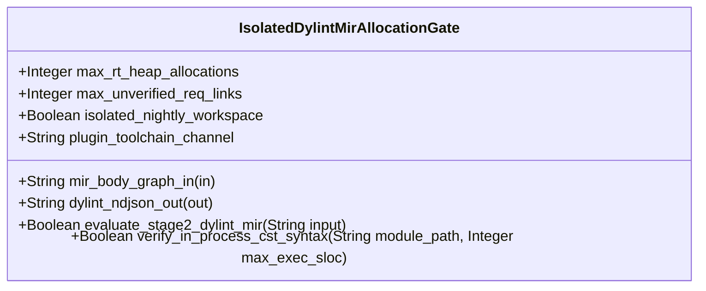

| Attribute | Specification Detail |
| :--- | :--- |
| **Issue ID** | #840 |
| **Title** | Feature 42: [BP 09 Multi Stage Compiler and Formal Verification Gatekeeper] IsolatedDylintMirAllocationGate |
| **Type** | feature |
| **Parent Epic** | [EPIC-09-BP_09_Multi_Stage_Compiler_and_Formal_Verification_Gatekeeper](../epics/EPIC-09-BP_09_Multi_Stage_Compiler_and_Formal_Verification_Gatekeeper.md) (#854) |
| **Interface Type** | Physical / Structural / Internal Bus |
| **Schema Containers** | `BP_09_Multi_Stage_Compiler_and_Formal_Verification_Gatekeeper::IsolatedDylintMirAllocationGate` |
| **Generation Mode** | subagent |
| **Specification Source** | [schema/model.sysml](../../schema/model.sysml) |

# Feature 42: [BP 09 Multi Stage Compiler and Formal Verification Gatekeeper] IsolatedDylintMirAllocationGate

## Description
`IsolatedDylintMirAllocationGate` specifies the Stage 2 Isolated Nightly Dylint MIR Zero-Allocation and Requirement-Binding Verification Gate within `BP_09_Multi_Stage_Compiler_and_Formal_Verification_Gatekeeper` (**REQ-0609** / `BP-09` / `DEAP-BP-DET-09`).
- **Contract A (100% OMG SysML v2.0 + KerML 1.0 Grammar Coverage)**: Evaluates `#rt_loop` / `@RtLoop`, `#dal` / `@Dal`, `#fls` / `@Fls`, `#hazard`, `#risk`, and `#capability` metadata usages (`metadata def` / `metadata` / `@Metadata` / `#user_keyword` plus backward-compatible `hazard def` / `risk def` / `capability def`) and `requirement def`/`requirement` (`subject`, `actor`, `stakeholder`, `framed concern`, `satisfy ... by ...`) digests across the full OMG SysML v2.0 and KerML 1.0 textual grammar with Definition and Usage symmetry and zero 16-construct artificial caps.
- **Contract B (Isolated `./lints/deap-dylint-mir/` Nightly MIR Plugin & Official Rust Compiler Stack, Zero Hand-Rolled Scanners)**: Houses `#![feature(rustc_private)]`, `rustc_lint`, and `rustc_middle::mir::Body` call/drop terminator graph analysis inside a standalone nightly workspace at `./lints/deap-dylint-mir/` that is explicitly excluded from the root stable `Cargo.toml` workspace members, paired with in-process `ra_ap_syntax` (`SourceFile::parse`, `Edition::Edition2024`) CST submodule SLOC verification (`< 380` SLOC) and dynamic runtime `PATH` discovery (`std::env::consts::{DLL_PREFIX, DLL_SUFFIX, EXE_SUFFIX}`, `camino::Utf8Path`) with zero hand-rolled string/line/char-by-char scanners.

## UML Class Diagram



## Interface Requirements
### 1. Test Data Shape
```json
{
  "$schema": "https://json-schema.org/draft/2020-12/schema",
  "title": "IsolatedDylintMirAllocationGatePayloadSchema",
  "type": "object",
  "properties": {
    "part": {
      "type": "string",
      "const": "IsolatedDylintMirAllocationGate"
    },
    "status": {
      "type": "string",
      "enum": ["nominal", "degraded", "fault"]
    },
    "max_rt_heap_allocations": {
      "type": "integer",
      "x-sysml-type": "Integer",
      "description": "Declared attribute max_rt_heap_allocations (Integer)",
      "default": 0
    },
    "max_unverified_req_links": {
      "type": "integer",
      "x-sysml-type": "Integer",
      "description": "Permitted dangling `outer realises(\"REQ-*\")` or doc-contract requirement identifiers absent from compiled `.sysml` digests. [unit: links]",
      "default": 0
    },
    "isolated_nightly_workspace": {
      "type": "boolean",
      "x-sysml-type": "Boolean",
      "description": "Isolates `rustc_lint` and `rustc_middle::mir` plugin manifest from stable workspace `Cargo.toml`. [unit: flag]",
      "default": true
    },
    "plugin_toolchain_channel": {
      "type": "string",
      "x-sysml-type": "String",
      "description": "Pinned nightly `rustc_private` toolchain channel executing the standalone Dylint MIR analysis library. [unit: toolchain]",
      "default": "nightly-pinned"
    },
    "mir_body_graph_in": {
      "type": "object",
      "properties": {
        "direction": { "type": "string", "const": "in" },
        "port_type": { "type": "string", "const": "String" }
      },
      "required": ["direction", "port_type"]
    },
    "dylint_ndjson_out": {
      "type": "object",
      "properties": {
        "direction": { "type": "string", "const": "out" },
        "port_type": { "type": "string", "const": "String" }
      },
      "required": ["direction", "port_type"]
    }
  },
  "required": [
    "part",
    "status",
    "mir_body_graph_in",
    "dylint_ndjson_out"
  ],
  "additionalProperties": false
}
```

### 2. Validation & Constraints
Declared structural attributes, boundary ports, invariants, and allocated requirements for classifier `IsolatedDylintMirAllocationGate`:

| AST Member Kind | Identifier | Declared Type / Direction | Default / Invariant Contract |
| :--- | :--- | :--- | :--- |
| Attribute | `max_rt_heap_allocations` | `Integer` | Default `0` (`C_VER_03: max_rt_heap_allocations == 0`) |
| Attribute | `max_unverified_req_links` | `Integer` | Default `0` (Zero dangling `REQ-*` bindings against `.digest.json`) |
| Attribute | `isolated_nightly_workspace` | `Boolean` | Default `true` (`./lints/deap-dylint-mir/` excluded from root stable `Cargo.toml`) |
| Attribute | `plugin_toolchain_channel` | `String` | Default `"nightly-pinned"` |
| Operation | `evaluate_stage2_dylint_mir` | `in input: String, return Boolean` | Evaluates transitive `rustc_middle::mir::Body` allocation closure (`DEAP-E0901`) and `REQ-*` SysML digest bindings (`DEAP-E0902`) |
| Operation | `verify_in_process_cst_syntax` | `in module_path: String, in max_exec_sloc: Integer, return Boolean` | Enforces lossless `ra_ap_syntax` CST parse integrity and `max_exec_sloc <= 380` (`C_VER_07`, `DEAP-E0905`) |
| Port | `mir_body_graph_in` | `in String` | Boundary interface contract |
| Port | `dylint_ndjson_out` | `out String` | Boundary interface contract |
| Constraint | `C_VER_03` | `max_rt_heap_allocations >= 0 and max_rt_heap_allocations <= 0` | Zero transitive heap allocations in `#rt_loop` control loops |
| Constraint | `C_VER_07` | `max_module_exec_sloc >= 1 and max_module_exec_sloc <= 380` | Submodule executable SLOC ceiling (`< 380` SLOC verified via `ra_ap_syntax`) |
| Constraint | `Invariant_REQ_0609_SC_02` | Invariant (`REQ-0609 (REQ_0609_BP_09_Multi_Stage_Compiler_and_Formal_Verification_Gatekeeper)`) | Stage 2 isolated `./lints/deap-dylint-mir/` MIR zero-allocation and `REQ-*` digest binding enforcement |
| Requirement | `REQ-0609 (REQ_0609_BP_09_Multi_Stage_Compiler_and_Formal_Verification_Gatekeeper)` | Allocated Requirement | MultiStageFormalVerificationGatekeeper (**REQ-0609** / `BP-09` / `DEAP-BP-DET-09`, UUIDv5 `6ba7b810-9dad-11d1-80b4-00c04fd430c9`, governed by DO-178C Level A, DO-330 TQL-4, and DO-333 Formal Methods Supplement) |

### 3. Visual Layout & Arrangement
Structural composition and boundary topology for classifier `IsolatedDylintMirAllocationGate` organize no nested subparts declared in schema paired with boundary ports `in mir_body_graph_in : String`, `out dylint_ndjson_out : String`.

### 4. Interactive Flow & States
Operational lifecycle events and discrete state transitions for `IsolatedDylintMirAllocationGate` within `BP_09_Multi_Stage_Compiler_and_Formal_Verification_Gatekeeper_LifecycleState` (`RunningStage2DylintMir -> RunningStage3FrbAndMiri` on `stage2ZeroRtAllocVerified`; `RunningStage2DylintMir -> FailedClosedJsonDiagnostic` on `rejectMirHeapAllocOrDanglingReq`).

### Layer 1: Domain State & Signal Model
Classifier `IsolatedDylintMirAllocationGate` encapsulates typed domain state attributes `max_rt_heap_allocations : Integer`, `max_unverified_req_links : Integer`, `isolated_nightly_workspace : Boolean`, `plugin_toolchain_channel : String` alongside `Stage2MirEvalInput` and `MirCallEdge` call-graph models derived from full Contract A OMG SysML v2.0 + KerML 1.0 `#rt_loop` metadata usages and `requirement def`/`requirement` `.digest.json` artifacts.

### Layer 2: Logic & Safety State Management
Classifier `IsolatedDylintMirAllocationGate` governs stateless structural transition evaluation enforcing `C_VER_03`, `C_VER_07`, and `Invariant_REQ_0609_SC_02`. Traverses `rustc_middle::mir::Body` basic-block `TerminatorKind::Call` and `TerminatorKind::Drop` graphs inside the excluded standalone nightly plugin workspace `./lints/deap-dylint-mir/` (`#![feature(rustc_private)]`) and validates submodule CST syntax and `< 380` executable SLOC ceilings in `./crates/verify-baseline/src/formal_gates/` via `ra_ap_syntax` while explicitly deleting legacy hand-rolled source/attribute string scanners.

### Layer 3: Presentation & Actuator Interface Binding
Classifier `IsolatedDylintMirAllocationGate` binds external and behavioral interfaces across port `in mir_body_graph_in : String` and port `out dylint_ndjson_out : String`, emitting single-line NDJSON diagnostics (`DEAP-E0901` on `#rt_loop` heap allocation or drop glue; `DEAP-E0902` on dangling `REQ-*` requirement links).

### Associated Use Cases & User Stories

#### Associated Use Cases
- [ ] #775 - [Use Case 46: Stage 2 Isolated Nightly Dylint MIR Zero Allocation Proof on Real Time Control Loops](../use-cases/UC-46-Stage_2_Isolated_Nightly_Dylint_MIR_Zero_Allocation_Proof_on_Real_Time_Control_Loops.md) (Realizes Stage 2 transitive `rustc_middle::mir::Body` zero-allocation proofs inside excluded `./lints/deap-dylint-mir/`)
- [ ] #776 - [Use Case 47: Stage 2 Compile Time MIR Requirement Binding Verification Against Active SysML Digests](../use-cases/UC-47-Stage_2_Compile_Time_MIR_Requirement_Binding_Verification_Against_Active_SysML_Digests.md) (Realizes Stage 2 HIR/MIR `DefId` `REQ-*` binding checks against compiled SysML `.digest.json` inventories)
- [ ] #780 - [Use Case 51: Cross Platform Toolchain Discovery Modular Submodule Layout and Fail Closed Qualification Gate](../use-cases/UC-51-Cross_Platform_Toolchain_Discovery_Modular_Submodule_Layout_and_Fail_Closed_Qualification_Gate.md) (Enforces `< 380`-SLOC submodule modularity via `verify_in_process_cst_syntax` and cross-platform `dylint` discovery)

#### Associated User Stories
- [ ] #811 - [User Story 61: Evaluate Stage2 Dylint Mir](../user-stories/US-61-evaluate_stage2_dylint_mir.md) (Executes `evaluate_stage2_dylint_mir(input)` over MIR call/drop graphs and `REQ-*` digest sets)
- [ ] #812 - [User Story 62: Verify In Process Cst Syntax](../user-stories/US-62-verify_in_process_cst_syntax.md) (Executes `verify_in_process_cst_syntax(module_path, max_exec_sloc)` via lossless `ra_ap_syntax`)

## Acceptance Criteria (BDD)
- [ ] AC-01: Given valid `IsolatedDylintMirAllocationGate` initialization inputs for `max_rt_heap_allocations` (`Integer`), `max_unverified_req_links` (`Integer`), `isolated_nightly_workspace` (`Boolean`), `plugin_toolchain_channel` (`String`) satisfying `C_VER_03` and `C_VER_07`, When `IsolatedDylintMirAllocationGate` commits typed domain state, Then declared state attributes hold verified values and `./lints/deap-dylint-mir/` remains isolated from the root stable `Cargo.toml`.
- [ ] AC-02: Given malformed or out-of-domain input values for `max_rt_heap_allocations` (`Integer`), `max_unverified_req_links` (`Integer`), `isolated_nightly_workspace` (`Boolean`), `plugin_toolchain_channel` (`String`), When `IsolatedDylintMirAllocationGate` validates incoming state updates, Then `IsolatedDylintMirAllocationGate` rejects the invalid state update and emits a diagnostic (`DEAP-E0901` or `DEAP-E0902`) via diagnostic port `dylint_ndjson_out`.
- [ ] AC-03: Given nominal signal arrival across `mir_body_graph_in` (`in String`), `dylint_ndjson_out` (`out String`), When `IsolatedDylintMirAllocationGate` processes the declared interface transaction, Then output state conforms to the structural classifier contract.
- [ ] AC-04: Given an invalid or unrecognized interface frame across `mir_body_graph_in` (`in String`), `dylint_ndjson_out` (`out String`), When `IsolatedDylintMirAllocationGate` boundary validation executes, Then `IsolatedDylintMirAllocationGate` refuses the malformed frame via diagnostic port `dylint_ndjson_out` and preserves prior verified state.

## Source References
Formal component specifications and normative systems engineering requirements:
- System Architecture Model: `schema/model.sysml`
- Engineering Design Blueprint: `./docs/designs/blueprint-09-clippy-dylint-miri-kani-formal-verification-gate.md`
- Normative Systems Engineering Standard: ISO/IEC/IEEE 15288:2023 §6.4.3 Architecture Definition Process

Component behavior and interface definitions derive from `schema/model.sysml` pursuant to ISO/IEC/IEEE 15288.
