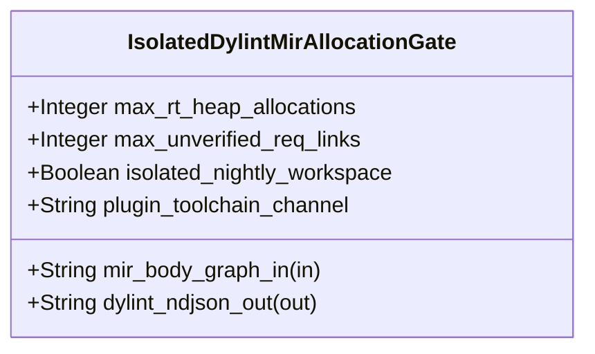

| Attribute | Specification Detail |
| :--- | :--- |
| **Issue ID** | #748 |
| **Title** | Feature 42: [BP 09 Multi Stage Compiler and Formal Verification Gatekeeper] IsolatedDylintMirAllocationGate |
| **Type** | feature |
| **Parent Epic** | [EPIC-09-BP_09_Multi_Stage_Compiler_and_Formal_Verification_Gatekeeper](../epics/EPIC-09-BP_09_Multi_Stage_Compiler_and_Formal_Verification_Gatekeeper.md) |
| **Interface Type** | Physical / Structural / Internal Bus |
| **Schema Containers** | `BP_09_Multi_Stage_Compiler_and_Formal_Verification_Gatekeeper::IsolatedDylintMirAllocationGate` |
| **Generation Mode** | subagent |
| **Specification Source** | [schema/model.sysml](../../schema/model.sysml) |

# Feature 42: [BP 09 Multi Stage Compiler and Formal Verification Gatekeeper] IsolatedDylintMirAllocationGate

## UML Class Diagram



## Interface Requirements
### 1. Test Data Shape
```json
{
  "$schema": "https://json-schema.org/draft/2020-12/schema",
  "title": "IsolatedDylintMirAllocationGatePayloadSchema",
  "type": "object",
  "properties": {
    "part": {
      "type": "string",
      "const": "IsolatedDylintMirAllocationGate"
    },
    "status": {
      "type": "string",
      "enum": ["nominal", "degraded", "fault"]
    },
    "max_rt_heap_allocations": {
      "type": "integer",
      "x-sysml-type": "Integer",
      "description": "Declared attribute max_rt_heap_allocations (Integer)",
      "default": 0
    },
    "max_unverified_req_links": {
      "type": "integer",
      "x-sysml-type": "Integer",
      "description": "Permitted dangling `outer realises(\"REQ-*\")` or doc-contract requirement identifiers absent from compiled `.sysml` digests. [unit: links]",
      "default": 0
    },
    "isolated_nightly_workspace": {
      "type": "boolean",
      "x-sysml-type": "Boolean",
      "description": "Isolates `rustc_lint` and `rustc_middle::mir` plugin manifest from stable workspace `Cargo.toml`. [unit: flag]",
      "default": true
    },
    "plugin_toolchain_channel": {
      "type": "string",
      "x-sysml-type": "String",
      "description": "Pinned nightly `rustc_private` toolchain channel executing the standalone Dylint MIR analysis library. [unit: toolchain]",
      "default": "nightly-pinned"
    },
    "mir_body_graph_in": {
      "type": "object",
      "properties": {
        "direction": { "type": "string", "const": "in" },
        "port_type": { "type": "string", "const": "String" }
      },
      "required": ["direction", "port_type"]
    },
    "dylint_ndjson_out": {
      "type": "object",
      "properties": {
        "direction": { "type": "string", "const": "out" },
        "port_type": { "type": "string", "const": "String" }
      },
      "required": ["direction", "port_type"]
    }
  },
  "required": [
    "part",
    "status",
    "mir_body_graph_in",
    "dylint_ndjson_out"
  ],
  "additionalProperties": false
}
```

### 2. Validation & Constraints
Declared structural attributes, boundary ports, invariants, and allocated requirements for classifier `IsolatedDylintMirAllocationGate`:

| AST Member Kind | Identifier | Declared Type / Direction | Default / Invariant Contract |
| :--- | :--- | :--- | :--- |
| Attribute | `max_rt_heap_allocations` | `Integer` | Default `0` |
| Attribute | `max_unverified_req_links` | `Integer` | Default `0` |
| Attribute | `isolated_nightly_workspace` | `Boolean` | Default `true` |
| Attribute | `plugin_toolchain_channel` | `String` | Default `"nightly-pinned"` |
| Port | `mir_body_graph_in` | `in String` | Boundary interface contract |
| Port | `dylint_ndjson_out` | `out String` | Boundary interface contract |

### 3. Visual Layout & Arrangement
Structural composition and boundary topology for classifier `IsolatedDylintMirAllocationGate` organize no nested subparts declared in schema paired with boundary ports `in mir_body_graph_in : String`, `out dylint_ndjson_out : String`.

### 4. Interactive Flow & States
Operational lifecycle events and discrete state transitions for IsolatedDylintMirAllocationGate.

### Layer 1: Domain State & Signal Model
Classifier `IsolatedDylintMirAllocationGate` encapsulates typed domain state attributes `max_rt_heap_allocations : Integer`, `max_unverified_req_links : Integer`, `isolated_nightly_workspace : Boolean`, `plugin_toolchain_channel : String` alongside operational lifecycle status.

### Layer 2: Logic & Safety State Management
Classifier `IsolatedDylintMirAllocationGate` governs stateless structural transition evaluation enforcing no additional invariant guards declared in schema.

### Layer 3: Presentation & Actuator Interface Binding
Classifier `IsolatedDylintMirAllocationGate` binds external and behavioral interfaces across port `in mir_body_graph_in : String`, port `out dylint_ndjson_out : String`.

## Acceptance Criteria (BDD)
- [ ] AC-01: Given valid `IsolatedDylintMirAllocationGate` initialization inputs for `max_rt_heap_allocations` (`Integer`), `max_unverified_req_links` (`Integer`), `isolated_nightly_workspace` (`Boolean`), `plugin_toolchain_channel` (`String`) (no additional constraints specified in schema), When `IsolatedDylintMirAllocationGate` commits typed domain state, Then declared state attributes hold verified values.
- [ ] AC-02: Given malformed or out-of-domain input values for `max_rt_heap_allocations` (`Integer`), `max_unverified_req_links` (`Integer`), `isolated_nightly_workspace` (`Boolean`), `plugin_toolchain_channel` (`String`), When `IsolatedDylintMirAllocationGate` validates incoming state updates, Then `IsolatedDylintMirAllocationGate` rejects the invalid state update and emits a diagnostic via diagnostic port `dylint_ndjson_out`.
- [ ] AC-03: Given nominal signal arrival across `mir_body_graph_in` (`in String`), `dylint_ndjson_out` (`out String`), When `IsolatedDylintMirAllocationGate` processes the declared interface transaction, Then output state conforms to the structural classifier contract.
- [ ] AC-04: Given an invalid or unrecognized interface frame across `mir_body_graph_in` (`in String`), `dylint_ndjson_out` (`out String`), When `IsolatedDylintMirAllocationGate` boundary validation executes, Then `IsolatedDylintMirAllocationGate` refuses the malformed frame via diagnostic port `dylint_ndjson_out` and preserves prior verified state.

## Source References
Formal component specifications and normative systems engineering requirements:
- System Architecture Model: `schema/model.sysml`
- Normative Systems Engineering Standard: ISO/IEC/IEEE 15288:2023 §6.4.3 Architecture Definition Process

Component behavior and interface definitions derive from `schema/model.sysml` pursuant to ISO/IEC/IEEE 15288.
