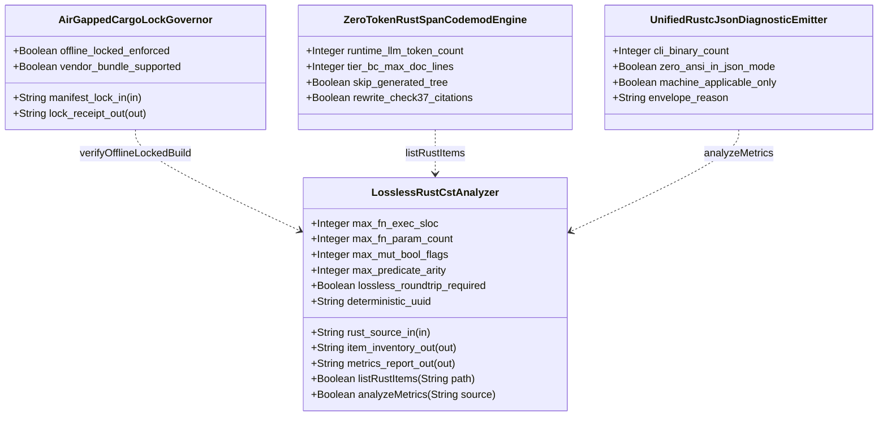
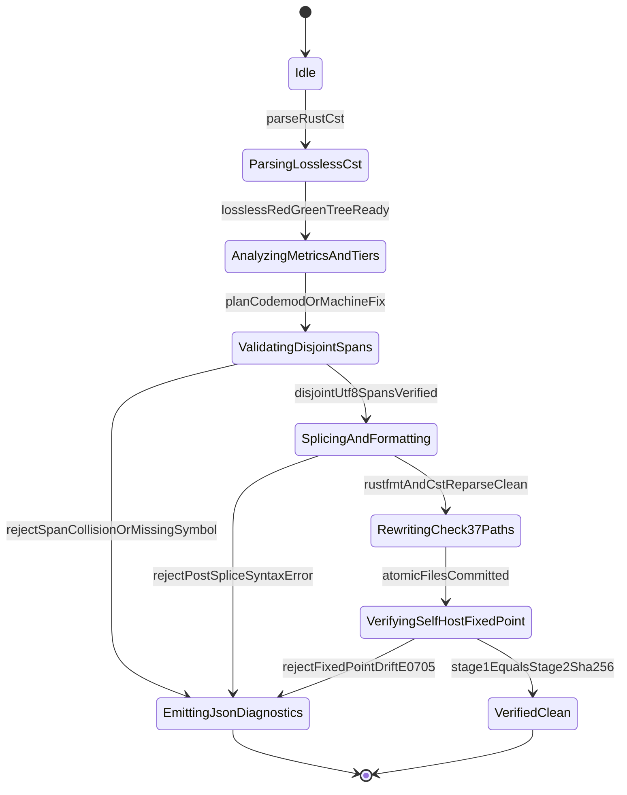

| Attribute | Specification Detail |
| :--- | :--- |
| **Issue ID** | TBD |
| **Title** | Feature 42: [BP 08 Lossless Rust CST Codemod Engine and Unified rustc Compatible JSON Diagnostics] LosslessRustCstAnalyzer |
| **Type** | feature |
| **Parent Epic** | [EPIC-08-BP_08_Lossless_Rust_CST_Codemod_Engine_and_Unified_rustc_Compatible_JSON_Diagnostics](../epics/EPIC-08-BP_08_Lossless_Rust_CST_Codemod_Engine_and_Unified_rustc_Compatible_JSON_Diagnostics.md) |
| **Interface Type** | Physical / Structural / Internal Bus |
| **Schema Containers** | `BP_08_Lossless_Rust_CST_Codemod_Engine_and_Unified_rustc_Compatible_JSON_Diagnostics::LosslessRustCstAnalyzer` |
| **Generation Mode** | subagent |
| **Specification Source** | [schema/model.sysml](../../schema/model.sysml) |

# Feature 42: [BP 08 Lossless Rust CST Codemod Engine and Unified rustc Compatible JSON Diagnostics] LosslessRustCstAnalyzer

## Parent Epic & Architectural Traceability
- **Parent Epic**: [EPIC-08-BP_08_Lossless_Rust_CST_Codemod_Engine_and_Unified_rustc_Compatible_JSON_Diagnostics](../epics/EPIC-08-BP_08_Lossless_Rust_CST_Codemod_Engine_and_Unified_rustc_Compatible_JSON_Diagnostics.md) -- Supplies the lossless `ra_ap_syntax` and `rowan` Red-Green Concrete Syntax Tree (CST) foundation, `cfg(test)`-excluded `DocTier` classifier, and deterministic DEAP v2.0 `v2_metrics` analyzer required by zero-token span codemods and unified `rustc`-compatible NDJSON diagnostics (**REQ-0608** / `BP-08` / `DEAP-BP-DET-08`).
- **SysML v2 Blueprint SSOT**: `docs/designs/blueprint-08-rust-analyzer-cst-refactoring-and-json-diagnostics.sysml` (`part def LosslessRustCstAnalyzer`, UUIDv5 `6ba7b810-9dad-11d1-80b4-00c04fd430c8`, constraints **C_CST_01**..**C_CST_06**, invariant `Invariant_REQ_0608_SC_01`).
- **Allocated Behavioral Specifications**:
  - Primary Metrics User Story: [US-56-analyzeMetrics.md](../user-stories/US-56-analyzeMetrics.md) (`action def analyzeMetrics`)
  - Item Inventory User Story: [US-52-listRustItems.md](../user-stories/US-52-listRustItems.md) (`action def listRustItems`)
  - Verification Use Case: [UC-38-Lossless_Red_Green_CST_Roundtrip_and_Exact_DEAP_v2_0_AST_Metrics_Extraction.md](../use-cases/UC-38-Lossless_Red_Green_CST_Roundtrip_and_Exact_DEAP_v2_0_AST_Metrics_Extraction.md) (`AC_01`)
- **Logical Interface & Failure Mode Contracts**:
  - System Interface Matrix: [ICD_01_SYSTEM_INTERFACE_MATRIX.md](../interfaces/ICD_01_SYSTEM_INTERFACE_MATRIX.md) (`rust_source_in`, `item_inventory_out`, `metrics_report_out`)
  - Master Signal Dictionary: [ICD_02_MASTER_SIGNAL_DICTIONARY.md](../interfaces/ICD_02_MASTER_SIGNAL_DICTIONARY.md) (`Utf8RustSourceBuffer`, `BTreeOrderedItemInventory`, `DeapV2AstMetricsReport`)
  - Component Failure Mode Registry: [FAILURE_MODE_REGISTRY.md](../research/FAILURE_MODE_REGISTRY.md) (`FM-BP08-005`, `FM-BP08-006`, `FM-BP08-007`, `FM-BP08-008`)
- **Target Crate & Module Anchor**: `crates/deap-core/src/source_ast.rs` (aligned with multi-file AST directory conventions in `crates/deap-core/src/sysml_ast/mod.rs`, diagnostic envelopes in `crates/deap-core/src/diagnostics.rs` and `crates/deap-core/src/error.rs`, and downstream consumers in `crates/compile-sysml/src/cli.rs`, `crates/compile-sysml/src/docstring.rs`, and `crates/verify-baseline/src/audit_code.rs`). Every implementation module in `LosslessRustCstAnalyzer` MUST stay strictly below `< 380` production executable `SLOC` (`500` executable `SLOC` hard module ceiling).

## Description
`LosslessRustCstAnalyzer` (`BP-08` / **REQ-0608**) replaces ad-hoc line-oriented lexical heuristics with a deterministic, air-gapped, full-fidelity Rust Concrete Syntax Tree (CST) parser, `DocTier` classifier, and DEAP v2.0 `v2_metrics` structural analyzer built on `ra_ap_syntax` and `rowan` Red-Green syntax trees.

The classifier enforces four core structural invariants:
1. **Lossless Red-Green CST Parsing & Depth Ceiling (`MAX_AST_DEPTH = 64`)**: Raw UTF-8 `.rs` buffers arriving on `rust_source_in` (`Utf8RustSourceBuffer`) are parsed via `ra_ap_syntax::SourceFile::parse` into an immutable `rowan::GreenNode` and typed `SyntaxNode` Red-tree projection while retaining 100% of lexical trivia (whitespace, `//` and `/* ... */` comments, outer `///` and inner `//!` docblocks, `ast::Attr` outer `doc` / `rt_loop` / `cfg(test)` / `test` attributes, `#![forbid(unsafe_code)]` inner crate attributes, raw string literals containing braces, and macro token trees). Root `GreenNode` token concatenation MUST equal the input byte buffer bit-for-bit (`lossless_roundtrip_required == true`), syntax error lists MUST be empty (`DEAP-E0803` on parse errors), and every CST walk enforces an explicit iterative/bounded nesting limit of `MAX_AST_DEPTH = 64` (`DEAP-E0804` on depth breach).
2. **Subtree-Scoped `cfg(test)` Exclusion & `DocTier` (Tier A / B / C) Classification**: Any CST `mod`, `fn`, `impl`, or item carrying an `ast::Attr` matching `cfg(test)` or `test` (including all descendant syntax nodes inside a `cfg(test)` module subtree) is deterministically pruned from production `DocTier` audits and `production_exec_sloc` accumulation while preserving production attributes such as `rt_loop`. Production items outside `crates/compile-sysml/src/modular_codegen/generated/` are classified into:
   - **Tier A (`DocTier::RustTierA`)**: Crate/module root headers (`lib.rs`, `main.rs`, `mod.rs` inner `//!` safety headers), crate-public API items (`pub fn`, `pub struct`, `pub enum`, `pub trait`, `pub type` exported at crate boundaries), and `rt_loop` real-time entrypoints requiring full 7-section Check-36 DO-178C safety docstrings.
   - **Tier B (`DocTier::RustTierB`, coalesced under `DocTier::RustTierBC` for `C_CST_06`)**: Crate-internal `pub(crate)`, `pub(super)`, and `pub(in ...)` items governed by **C_CST_06** (`tier_bc_max_doc_lines == 2`: `/// <1-line summary>` plus `/// Realises: [REQ-*]`).
   - **Tier C (`DocTier::RustTierC`, coalesced under `DocTier::RustTierBC` for `C_CST_06`)**: Module-private helper functions, structs, enums, and private `impl` methods governed by **C_CST_06** (`<= 2` doc lines maximum when carrying `/// Realises: [REQ-*]`, prohibiting 28-line 7-section docstring inflation on private helpers).
3. **Deterministic CST `v2_metrics` Extraction (`analyzeMetrics`)**: Evaluates production CST subtrees (`T_red \ T_test`) to compute:
   - **Executable SLOC**: Distinct 1-based source lines covered by non-trivia CST tokens (excluding `WHITESPACE`, line/block/doc `COMMENT` tokens, `ast::Attr` outer/inner attribute-only metadata lines, and blank lines). Enforces **C_CST_01** (`1 <= max_fn_exec_sloc <= 50` executable `SLOC` per refactored/synthesized BP-08 function), the workspace total-function ceiling (`<= 80` executable `SLOC` per function), the target module budget (`< 380` `production_exec_sloc`), and the hard module ceiling (`<= 500` `production_exec_sloc`).
   - **Callable Parameter Arity (**C_CST_02**)**: Counts formal `ast::Param` nodes in `ast::ParamList` while stripping `ast::SelfParam` receivers (`self`, `&self`, `&mut self`), enforcing `0 <= param_count <= 5`.
   - **Boolean Flag & Predicate Hygiene (**C_CST_03** & `max_predicate_arity`)**: Rejects mutable boolean local state flags (`let mut flag: bool` or boolean-initialized `let mut` bindings; `max_mut_bool_flags == 0`), flags positional `bool` parameter types in callable signatures (`has_bool_param`), and bounds unhoisted compound `&&` / `||` boolean predicates to `max_predicate_arity <= 3` clauses.
   - **Stringly-Typed Error Return Detection (`Result<T, String>`)**: Inspects `ast::RetType` generic type arguments on production `ast::Fn` items to flag `Result<T, String>` return signatures (`returns_result_string == true`), enforcing typed error enums across all crate APIs.
4. **Deterministic `BTreeMap` Item Inventory (`listRustItems`)**: Emits `BTreeOrderedItemInventory` on `item_inventory_out` keyed by `(byte_start, identifier)` in a `BTreeMap`, pairing each AST item with its complete outer `///` / `ast::Attr` `doc` docblock and outer `ast::Attr` `TextRange` verified on UTF-8 character boundaries (`str::is_char_boundary`).

### Mathematical Formulations of Lossless CST Roundtrip and DEAP v2.0 Metrics Invariants

$$
\begin{aligned}
\mathrm{Lossless}(S) &\iff \bigoplus_{i=1}^{k} \mathrm{bytes}(t_i) = S \land \sum_{i=1}^{k} \lvert \mathrm{range}(t_i) \rvert = \lvert S \rvert \\
D_{\mathrm{tree}}(T_{\mathrm{red}}(S)) &= \max_{v \in V(T_{\mathrm{red}}(S))} \mathrm{depth}(v) \le D_{\max} \\
L_{\mathrm{prod}}(S) &= \lvert \{ \ell \in \mathrm{Lines}(S) \mid \exists t \in \tau(T_{\mathrm{red}}(S) \setminus T_{\mathrm{test}}), \; \mathrm{kind}(t) \notin \mathcal{K}_{\mathrm{triv}} \land \ell \cap \mathrm{lines}(t) \neq \emptyset \} \rvert \\
\forall f \in \mathrm{Fns}(T_{\mathrm{red}}(S) \setminus T_{\mathrm{test}}), \quad L_{\mathrm{fn}}(f) &\le L_{\mathrm{fn},\max} \land \lvert P(f) \setminus R_{\mathrm{self}} \rvert \le P_{\max} \land B_{\mathrm{mut}}(f) = 0 \land A_{\mathrm{pred}}(f) \le A_{\max}
\end{aligned}
$$

- Parameter Definitions & Engineering Units:
- `S`: Input UTF-8 Rust source buffer ingested via `rust_source_in`, measured in `bytes` (`|S| >= 0`).
- `t_i`: Leaf lexical token `i` (`1 <= i <= k`) in the root `rowan::GreenNode` full-fidelity CST token sequence, with contiguous UTF-8 byte interval `range(t_i)`.
- `T_red(S)`: Typed `ra_ap_syntax` Red syntax tree projected from `S`, with vertex set `V(T_red(S))`.
- `T_test`: Union of CST subtrees rooted at any `ast::HasAttrs` item carrying outer `cfg(test)` or `test` attributes, excluded from production SLOC and `DocTier` accumulators.
- `D_tree` / `D_max`: Observed CST syntax-node nesting depth versus hard traversal ceiling `D_max = 64` AST levels (`MAX_AST_DEPTH = 64`, `FM-BP08-007`).
- `K_triv`: Non-executable CST trivia token-kind set (`WHITESPACE`, line/block/doc `COMMENT`, and standalone attribute metadata lines).
- `L_prod(S)`: Module-level `production_exec_sloc` measured in executable `SLOC` (target module budget `< 380` `SLOC`; hard module ceiling `<= 500` `SLOC`).
- `L_fn(f)` / `L_fn,max`: Per-callable executable line count measured in `SLOC`, bounded by `L_fn,max = 50` `SLOC` under **C_CST_01** (`1 <= max_fn_exec_sloc <= 50`) and `<= 80` `SLOC` under the workspace total-function ceiling.
- `P(f)` / `R_self` / `P_max`: Formal parameter list of callable `f` excluding receiver set `R_self = {self, &self, &mut self}`, bounded by `P_max = 5` `params` (**C_CST_02**).
- `B_mut(f)`: Count of mutable boolean local bindings (`let mut flag: bool`) inside callable `f`, fixed at `0` `flags` (**C_CST_03**).
- `A_pred(f)` / `A_max`: Maximum unhoisted compound boolean operator clause count inside callable `f`, bounded by `A_max = 3` `clauses` (`max_predicate_arity = 3`).

## UML Class Diagram



## Interface Requirements
### 1. Test Data Shape
```json
{
  "$schema": "https://json-schema.org/draft/2020-12/schema",
  "title": "LosslessRustCstAnalyzerPayloadSchema",
  "type": "object",
  "properties": {
    "part": {
      "type": "string",
      "const": "LosslessRustCstAnalyzer"
    },
    "status": {
      "type": "string",
      "enum": ["nominal", "degraded", "fault"]
    },
    "max_fn_exec_sloc": {
      "type": "integer",
      "x-sysml-type": "Integer",
      "description": "Upper bound on executable lines of code per Rust function excluding comments, docblocks, attributes, and blank lines. [unit: SLOC]",
      "minimum": 1,
      "maximum": 50,
      "default": 50
    },
    "max_fn_param_count": {
      "type": "integer",
      "x-sysml-type": "Integer",
      "description": "Upper bound on formal parameters per Rust callable excluding `self`, `&self`, and `&mut self` receivers. [unit: params]",
      "minimum": 0,
      "maximum": 5,
      "default": 5
    },
    "max_mut_bool_flags": {
      "type": "integer",
      "x-sysml-type": "Integer",
      "description": "Permitted count of mutable boolean local state flags (`let mut flag: bool`) within a single function body. [unit: flags]",
      "const": 0,
      "default": 0
    },
    "max_predicate_arity": {
      "type": "integer",
      "x-sysml-type": "Integer",
      "description": "Maximum boolean operator clause count permitted in a single unhoisted compound predicate expression. [unit: clauses]",
      "const": 3,
      "default": 3
    },
    "lossless_roundtrip_required": {
      "type": "boolean",
      "x-sysml-type": "Boolean",
      "description": "Requires root `rowan` GreenNode byte projection to equal the input UTF-8 `.rs` source buffer bit-for-bit. [unit: flag]",
      "const": true,
      "default": true
    },
    "deterministic_uuid": {
      "type": "string",
      "x-sysml-type": "String",
      "description": "Canonical deterministic blueprint component identifier (`DEAP-BP-DET-08`). [unit: uuidv5]",
      "const": "6ba7b810-9dad-11d1-80b4-00c04fd430c8",
      "default": "6ba7b810-9dad-11d1-80b4-00c04fd430c8"
    },
    "rust_source_in": {
      "type": "object",
      "properties": {
        "direction": { "type": "string", "const": "in" },
        "port_type": { "type": "string", "const": "String" },
        "protocol": { "type": "string", "const": "Utf8RustSourceBuffer" }
      },
      "required": ["direction", "port_type"]
    },
    "item_inventory_out": {
      "type": "object",
      "properties": {
        "direction": { "type": "string", "const": "out" },
        "port_type": { "type": "string", "const": "String" },
        "protocol": { "type": "string", "const": "BTreeOrderedItemInventory" }
      },
      "required": ["direction", "port_type"]
    },
    "metrics_report_out": {
      "type": "object",
      "properties": {
        "direction": { "type": "string", "const": "out" },
        "port_type": { "type": "string", "const": "String" },
        "protocol": { "type": "string", "const": "DeapV2AstMetricsReport" }
      },
      "required": ["direction", "port_type"]
    }
  },
  "required": [
    "part",
    "status",
    "rust_source_in",
    "item_inventory_out",
    "metrics_report_out"
  ],
  "additionalProperties": false
}
```

### 2. Validation & Constraints
Declared structural attributes, boundary ports, invariants, `DocTier` classification rules, and failure-mode contracts for classifier `LosslessRustCstAnalyzer`:

#### 2.1 SysML v2 AST Attributes, Ports & Structural Thresholds
| AST Member Kind | Identifier | Declared Type / Direction | Default / Invariant Contract |
| :--- | :--- | :--- | :--- |
| Attribute | `max_fn_exec_sloc` | `Integer` (`SLOC`) | Default `50`; **C_CST_01** enforces `1 <= max_fn_exec_sloc <= 50` (with `<= 80` `SLOC` workspace total-function ceiling) |
| Attribute | `max_fn_param_count` | `Integer` (`params`) | Default `5`; **C_CST_02** enforces `0 <= max_fn_param_count <= 5` excluding `self`, `&self`, `&mut self` |
| Attribute | `max_mut_bool_flags` | `Integer` (`flags`) | Default `0`; **C_CST_03** enforces `max_mut_bool_flags == 0` (`let mut flag: bool` forbidden; positional `bool` params flagged) |
| Attribute | `max_predicate_arity` | `Integer` (`clauses`) | Default `3`; unhoisted compound `&&` / `||` predicates exceeding `3` clauses flagged |
| Attribute | `lossless_roundtrip_required` | `Boolean` (`flag`) | Default `true`; `Invariant_REQ_0608_SC_01` requires `GreenNode` byte concatenation `== rust_source_in` |
| Attribute | `deterministic_uuid` | `String` (`uuidv5`) | Default `"6ba7b810-9dad-11d1-80b4-00c04fd430c8"` (`DEAP-BP-DET-08`) |
| Constant | `MAX_AST_DEPTH` | `usize` (`levels`) | Fixed ceiling `64` (`FM-BP08-007`); CST depth `> 64` aborts fail-closed with `DEAP-E0804` |
| Threshold | `module_exec_sloc_budget` | `usize` (`SLOC`) | Target `< 380` `production_exec_sloc` per `.rs` module; hard workspace module ceiling `<= 500` `production_exec_sloc` |
| Constraint | `returns_result_string` | `Boolean` (`flag`) | Flags any production `fn` returning `Result<T, String>` (`0` permitted in `LosslessRustCstAnalyzer` APIs) |
| Port | `rust_source_in` | `in String` | `rust_source_in_flow` (`Utf8RustSourceBuffer` protocol, strict UTF-8 & zero syntax errors) |
| Port | `item_inventory_out` | `out String` | `item_inventory_out_flow` (`BTreeOrderedItemInventory` protocol, `BTreeMap` span-ordered) |
| Port | `metrics_report_out` | `out String` | `metrics_report_out_flow` (`DeapV2AstMetricsReport` protocol, atomic zero-error emission) |

#### 2.2 ICD Logical Interface & Signal Dictionary Bindings
Per [ICD_01_SYSTEM_INTERFACE_MATRIX.md](../interfaces/ICD_01_SYSTEM_INTERFACE_MATRIX.md) and [ICD_02_MASTER_SIGNAL_DICTIONARY.md](../interfaces/ICD_02_MASTER_SIGNAL_DICTIONARY.md), `LosslessRustCstAnalyzer` participates in three deterministic sequence exchanges (`BP_08_..._SequenceInteraction`):
1. **Supply-Chain Precondition Gate**: `AirGappedCargoLockGovernor` dispatches `verifyOfflineLockedBuild(in lockPath: String, out receipt: String)` and seals `reply_SupplyChainVerificationReceipt` before `LosslessRustCstAnalyzer` accepts CST work (`FM-BP08-002`, `FM-BP08-006`).
2. **Item Inventory Exchange (`item_inventory_out`)**: `ZeroTokenRustSpanCodemodEngine` invokes `listRustItems(in path: String, out inventory: String)` and receives `reply_RustItemInventory` conforming to `BTreeOrderedItemInventory` (`BTreeMap<(u32, String), RustCstItemDescriptor>` with leading `///` / `ast::Attr` `doc` and outer `ast::Attr` `TextRange` spans verified via `str::is_char_boundary`).
3. **Metrics & Diagnostics Exchange (`metrics_report_out`)**: `UnifiedRustcJsonDiagnosticEmitter` invokes `analyzeMetrics(in source: String, out report: String)` and receives `reply_DeapV2AstMetrics` conforming to `DeapV2AstMetricsReport` (`production_exec_sloc`, per-`fn` `exec_sloc`, receiver-excluded `param_count`, `mut_bool_flag_count`, `has_bool_param`, `max_clause_arity`, `returns_result_string`, and `cfg(test)`-excluded `DocTier`).

#### 2.3 `cfg(test)`-Excluded `DocTier` (Tier A / B / C) Classification Contract
| Classification Tier | Visibility & Scope Selector | `cfg(test)` / `test` Attribute Rule | Required Docstring Contract |
| :--- | :--- | :--- | :--- |
| `DocTier::RustTierA` | Crate/module roots (`lib.rs`, `main.rs`, `mod.rs` inner `//!` header), crate-public API items (`pub fn`, `pub struct`, `pub enum`, `pub trait`, `pub type`), and `rt_loop` items | Excluded if enclosed inside a `cfg(test)` module or carrying a `test` attribute | Mandatory 7-section Check-36 DO-178C safety docstring (`Summary`, `Preconditions`, `Postconditions`, `Invariant`, `Failure Modes`, `Side Effects`, `Realises: [REQ-*]`) |
| `DocTier::RustTierB` (`RustTierBC`) | Crate-internal items (`pub(crate)`, `pub(super)`, `pub(in ...)` items and methods) outside `crates/compile-sysml/src/modular_codegen/generated/` | Excluded if enclosed inside a `cfg(test)` module or carrying a `test` attribute | **C_CST_06** (`tier_bc_max_doc_lines == 2`): `/// <1-line summary>` + `/// Realises: [REQ-*]` |
| `DocTier::RustTierC` (`RustTierBC`) | Module-private items (default private `fn`, `struct`, `enum`, private `impl` helpers) outside `crates/compile-sysml/src/modular_codegen/generated/` | Excluded if enclosed inside a `cfg(test)` module or carrying a `test` attribute | **C_CST_06** (`<= 2` doc lines maximum when carrying `/// Realises: [REQ-*]`; zero 28-line 7-section boilerplate) |
| `TestExcluded` | Any `mod` or item carrying `ast::Attr` `cfg(test)` or `test` (and all descendant CST nodes) | Pruned deterministically (`T_red \ T_test`) | Excluded from `DocTier` enforcement and `production_exec_sloc` / **C_CST_01**..**C_CST_03** production accumulators |

Canonical CST outer (`# [attr]`) and inner (`#![attr]`) attribute token forms recognized during `ParsingLosslessCst` and `AnalyzingMetricsAndTiers`:

```rust
#![forbid(unsafe_code)]

/// Tier A public API (requires 7-section Check-36 DO-178C safety docstring).
# [rt_loop]
pub fn analyze_cst_step(source: &str) -> Result<usize, CstAnalysisError> {
    Ok(source.len())
}

/// Tier B internal helper compacted to 2 lines under C_CST_06.
/// Realises: [REQ-0608]
pub(crate) fn count_params_excluding_self(raw_count: usize) -> usize {
    raw_count
}

# [cfg(test)]
mod tests {
    # [test]
    fn excluded_from_production_exec_sloc_and_doctier() {}
}
```

#### 2.4 Failure Mode & Safety Constraint Contract (`FM-BP08-005..008`)
Bound directly from [FAILURE_MODE_REGISTRY.md](../research/FAILURE_MODE_REGISTRY.md) across all four failure categories:

| Failure Mode ID | Failure Category | Triggering Fault Condition | Diagnostic & Fail-Closed Mitigation Contract |
| :--- | :--- | :--- | :--- |
| `FM-BP08-005` | `(1) Input/Boundary & Malformed Syntax` | Non-UTF-8 or NUL-corrupted buffer on `rust_source_in`, non-empty `SourceFile::parse` `errors()`, `lossless_roundtrip_required == false`, mutated `deterministic_uuid`, or out-of-envelope **C_CST_01**..**C_CST_03** / `max_predicate_arity` thresholds | `DEAP-E0803` / `SC-BP08-05` -- Validate strict UTF-8 `Utf8RustSourceBuffer`, enforce **C_CST_01**..**C_CST_03**, `max_predicate_arity == 3`, `lossless_roundtrip_required == true`, and canonical UUIDv5; abort fail-closed on parse errors or `GreenNode` byte mismatch |
| `FM-BP08-006` | `(2) State/Concurrency & Ordering` | Entering `AnalyzingMetricsAndTiers` before `ParsingLosslessCst` seals `losslessRedGreenTreeReady`, hash-map ordering drift, or `cfg(test)` / `test` attribute lexical scope leakage into `DocTier` and `production_exec_sloc` (or misclassifying `rt_loop` attributes and `self` receivers) | `DEAP-E0801` / `SC-BP08-06` -- Gate analysis strictly behind `losslessRedGreenTreeReady` over immutable `rowan` Green trees, prune `cfg(test)` and `test` attribute subtrees, strip `self`/`&self`/`&mut self`, and order all inventories in a `BTreeMap` |
| `FM-BP08-007` | `(3) Resource/Depth/Arithmetic Exhaustion` | Nested Rust blocks, macros, or boolean expressions exceeding `MAX_AST_DEPTH = 64`, or unchecked integer addition/subtraction overflowing `TextRange` offsets, `production_exec_sloc`, `exec_sloc`, `param_count`, mutable `bool`, or predicate clause counters | `DEAP-E0804` / `SC-BP08-07` -- Enforce iterative/bounded CST traversal capped at `MAX_AST_DEPTH = 64` and `checked_add` / `checked_sub` / `saturating_add` arithmetic on all spans and metric counters; abort fail-closed on depth breach or overflow |
| `FM-BP08-008` | `(4) Output/Serialization & Partial-Write Integrity` | Root `GreenNode` byte divergence from `rust_source_in`, non-UTF-8-boundary or truncated leading `///` / `ast::Attr` `doc` / outer `ast::Attr` `TextRange` spans on `item_inventory_out`, or partial `DeapV2AstMetricsReport` omitting `DocTier` or `Result<T, String>` flags on `metrics_report_out` | `DEAP-E0802` / `SC-BP08-08` -- Assert bit-for-bit `GreenNode` round-trip equality and `str::is_char_boundary` outer-attribute/docblock span completeness in memory before atomic zero-error emission on `item_inventory_out` and `metrics_report_out` |

### 3. Visual Layout & Arrangement
Structural composition and Check-37 workspace module topology for `LosslessRustCstAnalyzer` organize stateless CST parsing, `DocTier` classification, and `v2_metrics` extraction around `crates/deap-core/src/source_ast.rs` (following the multi-module directory discipline established in `crates/deap-core/src/sysml_ast/mod.rs`), paired with diagnostic types in `crates/deap-core/src/diagnostics.rs` and `crates/deap-core/src/error.rs`, CLI flags in `crates/compile-sysml/src/cli.rs` and `crates/compile-sysml/src/docstring.rs`, and baseline enforcement in `crates/verify-baseline/src/audit_code.rs`. Each target `.rs` file is strictly budgeted to `< 380` `production_exec_sloc` (`500` `SLOC` hard ceiling), with boundary ports `in rust_source_in : String`, `out item_inventory_out : String`, and `out metrics_report_out : String`.

### 4. Interactive Flow & States
Operational lifecycle events and discrete state transitions for `LosslessRustCstAnalyzer` within `BP_08_Lossless_Rust_CST_Codemod_Engine_and_Unified_rustc_Compatible_JSON_Diagnostics_LifecycleState`:



Typed SysML `action def` behavioral operations bound to `LosslessRustCstAnalyzer`:
- `+listRustItems(in path: String, out item_inventory_out: String) -> Result<BTreeMap<(u32, String), RustCstItemDescriptor>, CstAnalysisError>`: Parses `path` via `ParsingLosslessCst` and emits `BTreeOrderedItemInventory` with span-paired outer `///` / `ast::Attr` `doc` and outer `ast::Attr` `TextRange` bounds and `cfg(test)`-excluded `DocTier` tags ([US-52-listRustItems.md](../user-stories/US-52-listRustItems.md)).
- `+analyzeMetrics(in source: String, out metrics_report_out: String) -> Result<DeapV2AstMetricsReport, CstAnalysisError>`: Evaluates `production_exec_sloc` (`< 380` target / `500` ceiling), per-`fn` `exec_sloc` (**C_CST_01** `<= 50` / `<= 80` total-function ceiling), receiver-excluded `param_count` (**C_CST_02** `<= 5`), `mut_bool_flag_count` (**C_CST_03** `== 0`), `has_bool_param`, `max_clause_arity` (`<= 3`), and `returns_result_string` ([US-56-analyzeMetrics.md](../user-stories/US-56-analyzeMetrics.md)).

### Layer 1: Domain State & Signal Model
Classifier `LosslessRustCstAnalyzer` encapsulates typed domain state attributes (`max_fn_exec_sloc : Integer = 50`, `max_fn_param_count : Integer = 5`, `max_mut_bool_flags : Integer = 0`, `max_predicate_arity : Integer = 3`, `lossless_roundtrip_required : Boolean = true`, `deterministic_uuid : String = "6ba7b810-9dad-11d1-80b4-00c04fd430c8"`) alongside immutable domain DTOs (`DocTier`, `RustItemKind`, `RustCstItemDescriptor`, `FnCstMetricsRecord`, `DeapV2AstMetricsReport`) and a closed typed error enum `CstAnalysisError` (`MissingItemOrScopeViolation` -> `DEAP-E0801`, `SpanBoundaryOrRoundtripMismatch` -> `DEAP-E0802`, `MalformedRustSyntaxOrThresholdConfig` -> `DEAP-E0803`, `AstDepthOrArithmeticExhaustion` -> `DEAP-E0804`). All public and internal APIs forbid `Result<T, String>` (`0` stringly-typed error returns) and store symbol inventories and executable line sets exclusively in deterministic `BTreeMap` and `BTreeSet` containers (`0` `HashMap`/`HashSet` instances).

### Layer 2: Logic & Safety State Management
Classifier `LosslessRustCstAnalyzer` enforces total-function execution under `#![forbid(unsafe_code)]` with zero `.unwrap()`, zero `.expect()`, zero `panic!`, and zero direct `[idx]` slice indexing -- all buffer and slice lookups use `.get()` paired with `str::is_char_boundary` checks. Every syntax-tree traversal over `ra_ap_syntax` and `rowan` enforces `MAX_AST_DEPTH = 64` via explicit depth tracking, and all byte-offset, SLOC, arity, boolean-flag, and predicate-clause accumulators use `checked_add`, `checked_sub`, and `saturating_add` arithmetic (`FM-BP08-007`). Every production function in `LosslessRustCstAnalyzer` obeys `<= 50` executable `SLOC` (**C_CST_01**, within the `<= 80` `SLOC` total-function ceiling), `<= 5` parameters excluding `self`/`&self`/`&mut self` (**C_CST_02**), `0` mutable `bool` flags (**C_CST_03**), `<= 3` predicate clauses, and `< 380` module `production_exec_sloc`, while pruning `cfg(test)` and `test` attribute subtrees prior to `DocTier` and `v2_metrics` evaluation.

### Layer 3: Presentation & Actuator Interface Binding
Classifier `LosslessRustCstAnalyzer` binds `in rust_source_in : String`, `out item_inventory_out : String`, and `out metrics_report_out : String` directly to `compile-sysml` (`--list-rust-items <PATH>`, `--extract-rust-module`, `--compact-tier-bc` in `crates/compile-sysml/src/cli.rs`), `verify-baseline` (`audit-code` in `crates/verify-baseline/src/audit_code.rs`), and `UnifiedRustcJsonDiagnosticEmitter` (`crates/deap-core/src/diagnostics.rs`) across all 5 workspace CLIs (`compile-sysml`, `verify-baseline`, `ingest-sysml`, `assemble-conops`, `reconcile-backlog`). When `--message-format=json` is active, every CST syntax error, `MAX_AST_DEPTH` breach, `DocTier` breach, or `v2_metrics` violation is emitted to standard output as a single-line, zero-ANSI (`0x1B` count `== 0`, embedded `0x0A` count `== 0`) `rustc`-compatible NDJSON object carrying `"reason": "compiler-message"`, `"code": { "code": "DEAP-E080x" }`, exact 0-based UTF-8 `byte_start`/`byte_end` and 1-based line/column spans, and `"suggestion_applicability"` (`"MachineApplicable"` or `"MaybeIncorrect"`).

## Micro-Task Decomposition (<= 80 Exec SLOC Atomic Units)
Atomic TDD implementation micro-tasks realizing `LosslessRustCstAnalyzer` and [US-56-analyzeMetrics.md](../user-stories/US-56-analyzeMetrics.md) (with inventory support for [US-52-listRustItems.md](../user-stories/US-52-listRustItems.md)), keeping every function `<= 50` executable `SLOC` (**C_CST_01**, hard ceiling `<= 80` `SLOC`), `<= 5` parameters (**C_CST_02**), and target module size `< 380` executable `SLOC` (`500` `SLOC` hard ceiling):

| Micro-Task ID | DoD Layer | Target Anchor Path | Linked User Story | Max Fn Budget | Atomic Scope & Verification Contract |
| :--- | :--- | :--- | :--- | :--- | :--- |
| `MT-42-01` | Layer 1 (Domain State & Data Model) | `crates/deap-core/src/source_ast.rs` | [US-56-analyzeMetrics.md](../user-stories/US-56-analyzeMetrics.md) | `<= 45` exec `SLOC`, `<= 4` params | Define `DocTier` (`RustTierA`, `RustTierB`, `RustTierC`, `TestExcluded`), `RustCstItemDescriptor`, `FnCstMetricsRecord`, `DeapV2AstMetricsReport`, analyzer threshold config validator (**C_CST_01**..**C_CST_03**, `max_predicate_arity == 3`), and typed `CstAnalysisError` (`DEAP-E0801`..`DEAP-E0804`) using `BTreeMap`/`BTreeSet` and `0` `Result<T, String>` signatures |
| `MT-42-02` | Layer 2 (Logic & State Management) | `crates/deap-core/src/source_ast.rs` | [US-56-analyzeMetrics.md](../user-stories/US-56-analyzeMetrics.md) | `<= 50` exec `SLOC`, `<= 4` params | Implement lossless `ra_ap_syntax::SourceFile::parse` loader, bit-for-bit `rowan::GreenNode` byte round-trip verifier (`Invariant_REQ_0608_SC_01`), `str::is_char_boundary` span guard, and iterative/bounded `MAX_AST_DEPTH = 64` CST walker with `.get()` and `checked_add` (`FM-BP08-005`, `FM-BP08-007`, `FM-BP08-008`) |
| `MT-42-03` | Layer 2 (Logic & State Management) | `crates/deap-core/src/source_ast.rs` | [US-52-listRustItems.md](../user-stories/US-52-listRustItems.md), [US-56-analyzeMetrics.md](../user-stories/US-56-analyzeMetrics.md) | `<= 50` exec `SLOC`, `<= 5` params | Implement subtree-scoped `cfg(test)` and `test` attribute exclusion (`T_red \ T_test`), `DocTier` Tier A/B/C visibility classifier (preserving `rt_loop`), and `BTreeMap`-ordered `listRustItems` span-paired `///` / `ast::Attr` `doc` / outer `ast::Attr` extractor (`FM-BP08-006`) |
| `MT-42-04` | Layer 2 (Logic & State Management) | `crates/deap-core/src/source_ast.rs` | [US-56-analyzeMetrics.md](../user-stories/US-56-analyzeMetrics.md) | `<= 50` exec `SLOC`, `<= 5` params | Implement `analyzeMetrics` (`v2_metrics`) computing non-trivia `production_exec_sloc` (`< 380` target / `500` ceiling), per-`fn` `exec_sloc` (`<= 50` **C_CST_01** / `<= 80` ceiling), receiver-excluded `param_count` (`<= 5` **C_CST_02**), `mut_bool_flag_count` (`== 0` **C_CST_03**), `has_bool_param`, `max_clause_arity` (`<= 3`), and `Result<T, String>` return detection via `checked_add`/`saturating_add` |
| `MT-42-05` | Layer 3 (Presentation & CLI NDJSON Binding) | `crates/deap-core/src/diagnostics.rs`, `crates/compile-sysml/src/cli.rs`, `crates/verify-baseline/src/audit_code.rs` | [US-56-analyzeMetrics.md](../user-stories/US-56-analyzeMetrics.md) | `<= 45` exec `SLOC`, `<= 5` params | Bind `listRustItems` and `analyzeMetrics` outputs into `--list-rust-items`, `verify-baseline` `audit-code`, and single-line zero-ANSI `--message-format=json` `compiler-message` NDJSON diagnostics (`DEAP-E0801`..`DEAP-E0804`) with Rust unit/mutation RED-GREEN-REFACTOR test coverage |

## Acceptance Criteria (BDD)
- [ ] **AC-01 (Lossless Red-Green CST Roundtrip & Full Trivia Preservation -- `Invariant_REQ_0608_SC_01`)**: **Given** a valid UTF-8 Rust `.rs` source buffer on `rust_source_in` containing inner `//!` and outer `///` docblocks, inline `//` and block `/* ... */` comments, raw strings `r#"..."#` containing braces and comment tokens, `rt_loop` outer attributes, and `cfg(test)` modules, **When** `LosslessRustCstAnalyzer` executes `ParsingLosslessCst` via `ra_ap_syntax::SourceFile::parse`, **Then** `parse.errors()` is empty, the root `rowan::GreenNode` token byte projection equals the input buffer bit-for-bit (`lossless_roundtrip_required == true`), and `losslessRedGreenTreeReady` transitions the analyzer to `AnalyzingMetricsAndTiers`.
- [ ] **AC-02 (Subtree-Scoped `cfg(test)` Exclusion & `DocTier` Tier A/B/C Classification)**: **Given** a Rust module containing crate-root `//!` headers, a `pub fn` API and `rt_loop` entrypoint, a `pub(crate) fn` internal helper, a private `fn` helper, and a `cfg(test)` `mod tests` block containing `test`-annotated functions exceeding `50` `SLOC`, **When** `LosslessRustCstAnalyzer` classifies `DocTier` and computes `production_exec_sloc`, **Then** `pub` / crate-root / `rt_loop` items classify as `DocTier::RustTierA`, `pub(crate)` items classify as `DocTier::RustTierB` (`RustTierBC`, **C_CST_06** `2`-line contract), private helpers classify as `DocTier::RustTierC` (`RustTierBC`), and 100% of `cfg(test)` and `test`-annotated subtrees are excluded from `production_exec_sloc` and production `DocTier` violations.
- [ ] **AC-03 (Deterministic CST `v2_metrics` SLOC, Arity, `bool`-Flag, Predicate & `Result<T, String>` Analysis -- [US-56-analyzeMetrics.md](../user-stories/US-56-analyzeMetrics.md))**: **Given** a production Rust fixture containing methods with `&self` and `&mut self` receivers plus `5` formal parameters, a callable with `6` non-receiver parameters, a function exceeding `50` executable `SLOC` (and a second exceeding the `80` `SLOC` total-function ceiling), a module exceeding the `< 380` target `production_exec_sloc` budget (and `500` `SLOC` ceiling), a `let mut flag: bool = false` local binding, a `fn` taking a `bool` parameter, a `4`-clause `&&`/`||` predicate, and a `pub fn` returning `Result<usize, String>`, **When** `analyzeMetrics` evaluates the CST, **Then** `DeapV2AstMetricsReport` accurately excludes `&self`/`&mut self` from the `5`-parameter callable, flags the `6`-parameter callable (**C_CST_02**), reports exact non-trivia `exec_sloc` (**C_CST_01** `<= 50`, ceiling `<= 80`) and module `production_exec_sloc` (`< 380` target / `500` ceiling), flags `mut_bool_flag_count > 0` (**C_CST_03**), sets `has_bool_param == true`, flags `max_clause_arity == 4 > 3`, and sets `returns_result_string == true`.
- [ ] **AC-04 (Deterministic `BTreeMap` Item Inventory & Leading Attribute/Docblock Span Pairing -- [US-52-listRustItems.md](../user-stories/US-52-listRustItems.md))**: **Given** a Rust module containing multiple structs, enums, and functions preceded by multi-line `///` docblocks and `derive(Debug)` outer `ast::Attr` nodes, **When** `listRustItems` emits `BTreeOrderedItemInventory` on `item_inventory_out`, **Then** items are ordered deterministically in `BTreeMap` span sequence and each item's `[full_byte_start, full_byte_end)` `TextRange` encompasses 100% of its leading outer docblocks and outer attributes on verified UTF-8 character boundaries (`str::is_char_boundary`).
- [ ] **AC-05 (Failure Pillar I Input/Boundary Failsafe -- `FM-BP08-005` / `DEAP-E0803` / `SC-BP08-05`)**: **Given** an incomplete or syntactically malformed `.rs` buffer (such as a trailing incomplete expression), a NUL/non-UTF-8 byte stream on `rust_source_in`, or an out-of-envelope configuration (`max_fn_exec_sloc > 50` `SLOC`, `max_fn_param_count > 5` `params`, `max_mut_bool_flags != 0` `flags`, or `lossless_roundtrip_required == false`), **When** `LosslessRustCstAnalyzer` validates boundary inputs, **Then** execution fails closed with `CstAnalysisError::MalformedRustSyntaxOrThresholdConfig` (`DEAP-E0803`) without emitting partial inventories or relaxed metric reports.
- [ ] **AC-06 (Failure Pillar II State/Ordering Failsafe -- `FM-BP08-006` / `DEAP-E0801` / `SC-BP08-06`)**: **Given** an out-of-order invocation attempting `analyzeMetrics` or `listRustItems` prior to `verifyOfflineLockedBuild` supply-chain receipt or before `ParsingLosslessCst` seals `losslessRedGreenTreeReady`, **When** lifecycle guard validation runs, **Then** `LosslessRustCstAnalyzer` rejects the transition fail-closed with `DEAP-E0801` and preserves immutable prior state.
- [ ] **AC-07 (Failure Pillar III Resource/Depth/Arithmetic Failsafe -- `FM-BP08-007` / `DEAP-E0804` / `SC-BP08-07`)**: **Given** a pathologically nested Rust fixture whose block, macro, or expression syntax depth exceeds `MAX_AST_DEPTH = 64` levels (reaching `65` levels), **When** `LosslessRustCstAnalyzer` traverses the CST using `.get()` and `checked_add`, **Then** traversal aborts deterministically at `65` levels with `CstAnalysisError::AstDepthOrArithmeticExhaustion` (`DEAP-E0804`) without call-stack overflow or integer counter wraparound.
- [ ] **AC-08 (Failure Pillar IV Output/NDJSON Integrity Failsafe -- `FM-BP08-008` / `DEAP-E0802` / `SC-BP08-08`)**: **Given** any CST parse, span-boundary, depth, or `v2_metrics` failure evaluated under `--message-format=json`, **When** `LosslessRustCstAnalyzer` forwards findings to `UnifiedRustcJsonDiagnosticEmitter`, **Then** standard output receives a single-line, zero-ANSI (`0x1B` byte count `== 0`, embedded `0x0A` byte count `== 0`) JSON line with `"reason": "compiler-message"`, `"code": { "code": "DEAP-E080x" }`, exact UTF-8 `byte_start`/`byte_end` and 1-based line/column coordinates, and zero partial records written to `item_inventory_out` or `metrics_report_out`.

## Specification Context (Verbatim)
Verbatim normative SysML v2 structural and invariant declarations from `docs/designs/blueprint-08-rust-analyzer-cst-refactoring-and-json-diagnostics.sysml`:

```sysml
    assert constraint C_CST_01 {
        max_fn_exec_sloc >= 1 and max_fn_exec_sloc <= 50;
    }
    assert constraint C_CST_02 {
        max_fn_param_count >= 0 and max_fn_param_count <= 5;
    }
    assert constraint C_CST_03 {
        max_mut_bool_flags >= 0 and max_mut_bool_flags <= 0;
    }
    assert constraint C_CST_06 {
        tier_bc_max_doc_lines >= 2 and tier_bc_max_doc_lines <= 2;
    }
    doc /* Upper bound on executable lines of code per Rust function excluding comments, docblocks, attributes, and blank lines. [unit: SLOC] */
    part def LosslessRustCstAnalyzer {
        attribute max_fn_exec_sloc : Integer = 50;
        doc /* Upper bound on formal parameters per Rust callable excluding `self`, `&self`, and `&mut self` receivers. [unit: params] */
        attribute max_fn_param_count : Integer = 5;
        doc /* Permitted count of mutable boolean local state flags (`let mut flag: bool`) within a single function body. [unit: flags] */
        attribute max_mut_bool_flags : Integer = 0;
        doc /* Maximum boolean operator clause count permitted in a single unhoisted compound predicate expression. [unit: clauses] */
        attribute max_predicate_arity : Integer = 3;
        doc /* Requires root `rowan` GreenNode byte projection to equal the input UTF-8 `.rs` source buffer bit-for-bit. [unit: flag] */
        attribute lossless_roundtrip_required : Boolean = true;
        doc /* Canonical deterministic blueprint component identifier (`DEAP-BP-DET-08`). [unit: uuidv5] */
        attribute deterministic_uuid : String = "6ba7b810-9dad-11d1-80b4-00c04fd430c8";
        doc /* Receives raw `.rs` UTF-8 bytes for lossless `ra_ap_syntax::SourceFile::parse` Red/Green tree construction. [protocol: Utf8RustSourceBuffer] */
        port in rust_source_in : String {
            flow in rust_source_in_flow : String;
        }
        doc /* Emits deterministic `BTreeMap`-ordered AST item descriptors with `TextRange` byte/line spans and `DocTier`. [protocol: BTreeOrderedItemInventory] */
        port out item_inventory_out : String {
            flow out item_inventory_out_flow : String;
        }
        doc /* Emits `production_exec_sloc`, per-`fn` `exec_sloc`, `param_count`, mutable bool count, predicate arity, and `Result` flags. [protocol: DeapV2AstMetricsReport] */
        port out metrics_report_out : String {
            flow out metrics_report_out_flow : String;
        }
    }
```

## Source References
Formal component specifications and normative systems engineering requirements:
- Structural Schema: [schema/model.sysml](../../schema/model.sysml) (Clause: `package BP_08_Lossless_Rust_CST_Codemod_Engine_and_Unified_rustc_Compatible_JSON_Diagnostics::LosslessRustCstAnalyzer`)
- Blueprint SysML v2 Specification: `docs/designs/blueprint-08-rust-analyzer-cst-refactoring-and-json-diagnostics.sysml` (Clause: `REQ-0608`, `C_CST_01`..`C_CST_06`, `Invariant_REQ_0608_SC_01`)
- Logical Interface Specifications: [ICD_01_SYSTEM_INTERFACE_MATRIX.md](../interfaces/ICD_01_SYSTEM_INTERFACE_MATRIX.md) and [ICD_02_MASTER_SIGNAL_DICTIONARY.md](../interfaces/ICD_02_MASTER_SIGNAL_DICTIONARY.md) (Clause: `LosslessRustCstAnalyzer` Boundary Ports & Signal Flows)
- Component Failure Mode Registry: [FAILURE_MODE_REGISTRY.md](../research/FAILURE_MODE_REGISTRY.md) (Clause: `FM-BP08-005`..`FM-BP08-008`, `SC-BP08-05`..`SC-BP08-08`)
- Allocated User Stories & Use Cases: [US-56-analyzeMetrics.md](../user-stories/US-56-analyzeMetrics.md), [US-52-listRustItems.md](../user-stories/US-52-listRustItems.md), and [UC-38-Lossless_Red_Green_CST_Roundtrip_and_Exact_DEAP_v2_0_AST_Metrics_Extraction.md](../use-cases/UC-38-Lossless_Red_Green_CST_Roundtrip_and_Exact_DEAP_v2_0_AST_Metrics_Extraction.md)
- Normative Systems Engineering Standards: ISO/IEC/IEEE 15288:2023 Section 6.4.3 Architecture Definition Process; ISO/IEC/IEEE 29148:2018; DO-178C Level A / DO-330 TQL-4

Component behavior and interface definitions derive from `schema/model.sysml` pursuant to ISO/IEC/IEEE 15288.
