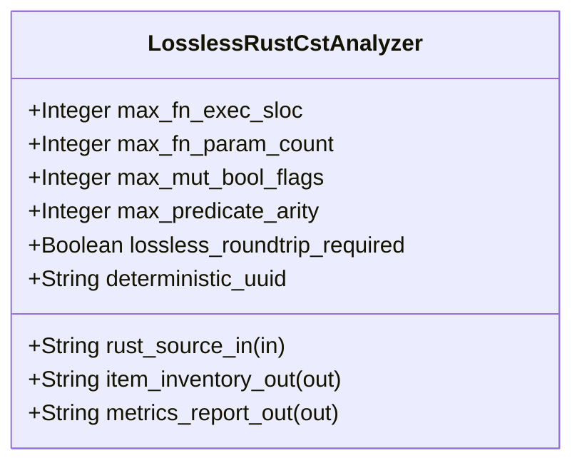

| Attribute | Specification Detail |
| :--- | :--- |
| **Issue ID** | TBD |
| **Title** | Feature 42: [BP 08 Lossless Rust CST Codemod Engine and Unified rustc Compatible JSON Diagnostics] LosslessRustCstAnalyzer |
| **Type** | feature |
| **Parent Epic** | [EPIC-08-BP_08_Lossless_Rust_CST_Codemod_Engine_and_Unified_rustc_Compatible_JSON_Diagnostics](../epics/EPIC-08-BP_08_Lossless_Rust_CST_Codemod_Engine_and_Unified_rustc_Compatible_JSON_Diagnostics.md) |
| **Interface Type** | Physical / Structural / Internal Bus |
| **Schema Containers** | `BP_08_Lossless_Rust_CST_Codemod_Engine_and_Unified_rustc_Compatible_JSON_Diagnostics::LosslessRustCstAnalyzer` |
| **Generation Mode** | subagent |
| **Specification Source** | [schema/model.sysml](../../schema/model.sysml) |

# Feature 42: [BP 08 Lossless Rust CST Codemod Engine and Unified rustc Compatible JSON Diagnostics] LosslessRustCstAnalyzer

## UML Class Diagram



## Interface Requirements
### 1. Test Data Shape
```json
{
  "$schema": "https://json-schema.org/draft/2020-12/schema",
  "title": "LosslessRustCstAnalyzerPayloadSchema",
  "type": "object",
  "properties": {
    "part": {
      "type": "string",
      "const": "LosslessRustCstAnalyzer"
    },
    "status": {
      "type": "string",
      "enum": ["nominal", "degraded", "fault"]
    },
    "max_fn_exec_sloc": {
      "type": "integer",
      "x-sysml-type": "Integer",
      "description": "Declared attribute max_fn_exec_sloc (Integer)",
      "default": 50
    },
    "max_fn_param_count": {
      "type": "integer",
      "x-sysml-type": "Integer",
      "description": "Upper bound on formal parameters per Rust callable excluding `self`, `&self`, and `&mut self` receivers. [unit: params]",
      "default": 5
    },
    "max_mut_bool_flags": {
      "type": "integer",
      "x-sysml-type": "Integer",
      "description": "Permitted count of mutable boolean local state flags (`let mut flag: bool`) within a single function body. [unit: flags]",
      "default": 0
    },
    "max_predicate_arity": {
      "type": "integer",
      "x-sysml-type": "Integer",
      "description": "Maximum boolean operator clause count permitted in a single unhoisted compound predicate expression. [unit: clauses]",
      "default": 3
    },
    "lossless_roundtrip_required": {
      "type": "boolean",
      "x-sysml-type": "Boolean",
      "description": "Requires root `rowan` GreenNode byte projection to equal the input UTF-8 `.rs` source buffer bit-for-bit. [unit: flag]",
      "default": true
    },
    "deterministic_uuid": {
      "type": "string",
      "x-sysml-type": "String",
      "description": "Canonical deterministic blueprint component identifier (`DEAP-BP-DET-08`). [unit: uuidv5]",
      "default": "6ba7b810-9dad-11d1-80b4-00c04fd430c8"
    },
    "rust_source_in": {
      "type": "object",
      "properties": {
        "direction": { "type": "string", "const": "in" },
        "port_type": { "type": "string", "const": "String" }
      },
      "required": ["direction", "port_type"]
    },
    "item_inventory_out": {
      "type": "object",
      "properties": {
        "direction": { "type": "string", "const": "out" },
        "port_type": { "type": "string", "const": "String" }
      },
      "required": ["direction", "port_type"]
    },
    "metrics_report_out": {
      "type": "object",
      "properties": {
        "direction": { "type": "string", "const": "out" },
        "port_type": { "type": "string", "const": "String" }
      },
      "required": ["direction", "port_type"]
    }
  },
  "required": [
    "part",
    "status",
    "rust_source_in",
    "item_inventory_out",
    "metrics_report_out"
  ],
  "additionalProperties": false
}
```

### 2. Validation & Constraints
Declared structural attributes, boundary ports, invariants, and allocated requirements for classifier `LosslessRustCstAnalyzer`:

| AST Member Kind | Identifier | Declared Type / Direction | Default / Invariant Contract |
| :--- | :--- | :--- | :--- |
| Attribute | `max_fn_exec_sloc` | `Integer` | Default `50` |
| Attribute | `max_fn_param_count` | `Integer` | Default `5` |
| Attribute | `max_mut_bool_flags` | `Integer` | Default `0` |
| Attribute | `max_predicate_arity` | `Integer` | Default `3` |
| Attribute | `lossless_roundtrip_required` | `Boolean` | Default `true` |
| Attribute | `deterministic_uuid` | `String` | Default `"6ba7b810-9dad-11d1-80b4-00c04fd430c8"` |
| Port | `rust_source_in` | `in String` | Boundary interface contract |
| Port | `item_inventory_out` | `out String` | Boundary interface contract |
| Port | `metrics_report_out` | `out String` | Boundary interface contract |

### 3. Visual Layout & Arrangement
Structural composition and boundary topology for classifier `LosslessRustCstAnalyzer` organize no nested subparts declared in schema paired with boundary ports `in rust_source_in : String`, `out item_inventory_out : String`, `out metrics_report_out : String`.

### 4. Interactive Flow & States
Operational lifecycle events and discrete state transitions for LosslessRustCstAnalyzer.

### Layer 1: Domain State & Signal Model
Classifier `LosslessRustCstAnalyzer` encapsulates typed domain state attributes `max_fn_exec_sloc : Integer`, `max_fn_param_count : Integer`, `max_mut_bool_flags : Integer`, `max_predicate_arity : Integer`, `lossless_roundtrip_required : Boolean`, `deterministic_uuid : String` alongside operational lifecycle status.

### Layer 2: Logic & Safety State Management
Classifier `LosslessRustCstAnalyzer` governs stateless structural transition evaluation enforcing no additional invariant guards declared in schema.

### Layer 3: Presentation & Actuator Interface Binding
Classifier `LosslessRustCstAnalyzer` binds external and behavioral interfaces across port `in rust_source_in : String`, port `out item_inventory_out : String`, port `out metrics_report_out : String`.

## Acceptance Criteria (BDD)
- [ ] AC-01: Given valid `LosslessRustCstAnalyzer` initialization inputs for `max_fn_exec_sloc` (`Integer`), `max_fn_param_count` (`Integer`), `max_mut_bool_flags` (`Integer`), `max_predicate_arity` (`Integer`), `lossless_roundtrip_required` (`Boolean`), `deterministic_uuid` (`String`) (no additional constraints specified in schema), When `LosslessRustCstAnalyzer` commits typed domain state, Then declared state attributes hold verified values.
- [ ] AC-02: Given malformed or out-of-domain input values for `max_fn_exec_sloc` (`Integer`), `max_fn_param_count` (`Integer`), `max_mut_bool_flags` (`Integer`), `max_predicate_arity` (`Integer`), `lossless_roundtrip_required` (`Boolean`), `deterministic_uuid` (`String`), When `LosslessRustCstAnalyzer` validates incoming state updates, Then `LosslessRustCstAnalyzer` rejects the invalid state update and emits a diagnostic via diagnostic port `item_inventory_out`.
- [ ] AC-03: Given nominal signal arrival across `rust_source_in` (`in String`), `item_inventory_out` (`out String`), `metrics_report_out` (`out String`), When `LosslessRustCstAnalyzer` processes the declared interface transaction, Then output state conforms to the structural classifier contract.
- [ ] AC-04: Given an invalid or unrecognized interface frame across `rust_source_in` (`in String`), `item_inventory_out` (`out String`), `metrics_report_out` (`out String`), When `LosslessRustCstAnalyzer` boundary validation executes, Then `LosslessRustCstAnalyzer` refuses the malformed frame via diagnostic port `item_inventory_out` and preserves prior verified state.

## Source References
Formal component specifications and normative systems engineering requirements:
- System Architecture Model: `schema/model.sysml`
- Normative Systems Engineering Standard: ISO/IEC/IEEE 15288:2023 §6.4.3 Architecture Definition Process

Component behavior and interface definitions derive from `schema/model.sysml` pursuant to ISO/IEC/IEEE 15288.
