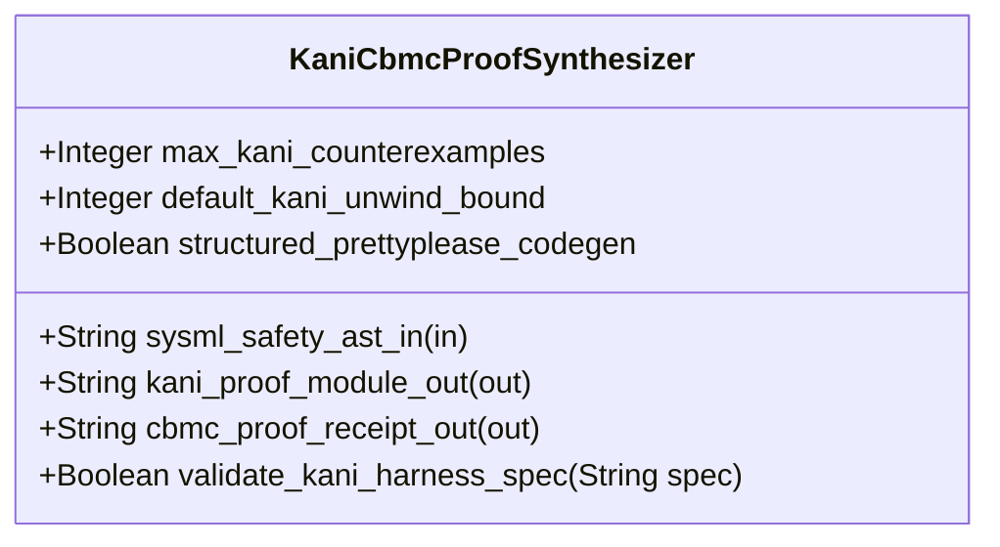

| Attribute | Specification Detail |
| :--- | :--- |
| **Issue ID** | #749 |
| **Title** | Feature 43: [BP 09 Multi Stage Compiler and Formal Verification Gatekeeper] KaniCbmcProofSynthesizer |
| **Type** | feature |
| **Parent Epic** | [EPIC-09-BP_09_Multi_Stage_Compiler_and_Formal_Verification_Gatekeeper](../epics/EPIC-09-BP_09_Multi_Stage_Compiler_and_Formal_Verification_Gatekeeper.md) |
| **Interface Type** | Physical / Structural / Internal Bus |
| **Schema Containers** | `BP_09_Multi_Stage_Compiler_and_Formal_Verification_Gatekeeper::KaniCbmcProofSynthesizer` |
| **Generation Mode** | subagent |
| **Specification Source** | [schema/model.sysml](../../schema/model.sysml) |

# Feature 43: [BP 09 Multi Stage Compiler and Formal Verification Gatekeeper] KaniCbmcProofSynthesizer

## Description
`KaniCbmcProofSynthesizer` specifies the Stage 4 Deterministic Kani CBMC Proof Harness Synthesizer and STPA Unsafe Control Action Falsification Gate within `BP_09_Multi_Stage_Compiler_and_Formal_Verification_Gatekeeper` (**REQ-0609** / `BP-09` / `DEAP-BP-DET-09`).
- **Contract A (100% OMG SysML v2.0 + KerML 1.0 Grammar Coverage)**: Lowers `constraint def`/`constraint` (`assert`, `assume`, `require`), `calc def`/`calc` (`return`), `port def`/`port` (`in`, `out`, `inout`, `~`), `state def`/`state` (`exhibit`, `parallel`, `entry`, `do`, `exit`, `transition first ... accept ... if ... do ... then ...`), `action def`/`action`, `requirement def`/`requirement`, `verification def`/`verification` (`verify requirement`), `test case def`/`test case`, `#hazard`/`#risk`/`#dal`/`#fls`/`#rt_loop` metadata usages, and KerML expressions (`implies`, `xor`, `??`, `->`, `collect`, `select`, `forAll`, `exists`, `[lo..hi]`, `ISQ`/`SI`/`ScalarValues`) across the full OMG SysML v2.0 and KerML 1.0 grammar with zero 16-construct artificial caps.
- **Contract B (Deterministic `#[kani::proof]` Synthesis via `syn` + `proc-macro2` + `quote` + `prettyplease`, Zero Hand-Rolled Scanners)**: Synthesizes byte-deterministic `#[cfg(kani)]` `#[kani::proof]` and `#[kani::unwind(N)]` proof harnesses using `syn` + `proc-macro2` + `quote` + `prettyplease` (with zero raw `format!` string-template harness concatenation and zero hand-rolled scanners) and executes `cargo kani` discovered dynamically via cross-platform runtime `PATH` probing (`std::env::consts::EXE_SUFFIX`, `camino::Utf8Path`).

## UML Class Diagram



## Interface Requirements
### 1. Test Data Shape
```json
{
  "$schema": "https://json-schema.org/draft/2020-12/schema",
  "title": "KaniCbmcProofSynthesizerPayloadSchema",
  "type": "object",
  "properties": {
    "part": {
      "type": "string",
      "const": "KaniCbmcProofSynthesizer"
    },
    "status": {
      "type": "string",
      "enum": ["nominal", "degraded", "fault"]
    },
    "max_kani_counterexamples": {
      "type": "integer",
      "x-sysml-type": "Integer",
      "description": "Declared attribute max_kani_counterexamples (Integer)",
      "default": 0
    },
    "default_kani_unwind_bound": {
      "type": "integer",
      "x-sysml-type": "Integer",
      "description": "Deterministic loop unwinding ceiling emitted into `outer kani::unwind(N)` when AST loops carry finite static bounds. [unit: iterations]",
      "default": 16
    },
    "structured_prettyplease_codegen": {
      "type": "boolean",
      "x-sysml-type": "Boolean",
      "description": "Emits `outer cfg(kani)` proof modules via `syn` + `quote` + `prettyplease` without raw string-template concatenation. [unit: flag]",
      "default": true
    },
    "sysml_safety_ast_in": {
      "type": "object",
      "properties": {
        "direction": { "type": "string", "const": "in" },
        "port_type": { "type": "string", "const": "String" }
      },
      "required": ["direction", "port_type"]
    },
    "kani_proof_module_out": {
      "type": "object",
      "properties": {
        "direction": { "type": "string", "const": "out" },
        "port_type": { "type": "string", "const": "String" }
      },
      "required": ["direction", "port_type"]
    },
    "cbmc_proof_receipt_out": {
      "type": "object",
      "properties": {
        "direction": { "type": "string", "const": "out" },
        "port_type": { "type": "string", "const": "String" }
      },
      "required": ["direction", "port_type"]
    }
  },
  "required": [
    "part",
    "status",
    "sysml_safety_ast_in",
    "kani_proof_module_out",
    "cbmc_proof_receipt_out"
  ],
  "additionalProperties": false
}
```

### 2. Validation & Constraints
Declared structural attributes, boundary ports, invariants, and allocated requirements for classifier `KaniCbmcProofSynthesizer`:

| AST Member Kind | Identifier | Declared Type / Direction | Default / Invariant Contract |
| :--- | :--- | :--- | :--- |
| Attribute | `max_kani_counterexamples` | `Integer` | Default `0` (`C_VER_05: max_kani_counterexamples == 0`) |
| Attribute | `default_kani_unwind_bound` | `Integer` | Default `16` (`C_VER_06: 1 <= default_kani_unwind_bound <= 64`) |
| Attribute | `structured_prettyplease_codegen` | `Boolean` | Default `true` (`syn` + `proc-macro2` + `quote` + `prettyplease` AST synthesis) |
| Operation | `validate_kani_harness_spec` | `in spec: String, return Boolean` | Validates non-empty `kani::assume(...)` precondition domains, STPA `UCA-*` assertions, and `C_VER_06` unwind bounds (`DEAP-E0904`) |
| Port | `sysml_safety_ast_in` | `in String` | Boundary interface contract |
| Port | `kani_proof_module_out` | `out String` | Boundary interface contract |
| Port | `cbmc_proof_receipt_out` | `out String` | Boundary interface contract |
| Constraint | `C_VER_05` | `max_kani_counterexamples >= 0 and max_kani_counterexamples <= 0` | Zero reachable CBMC counterexample traces (`UNSAT`) |
| Constraint | `C_VER_06` | `default_kani_unwind_bound >= 1 and default_kani_unwind_bound <= 64` | Bounded CBMC loop unwinding ceiling |
| Constraint | `C_VER_07` | `max_module_exec_sloc >= 1 and max_module_exec_sloc <= 380` | Submodule executable SLOC ceiling (`< 380` SLOC verified via `ra_ap_syntax`) |
| Constraint | `Invariant_REQ_0609_SC_04` | Invariant (`REQ-0609 (REQ_0609_BP_09_Multi_Stage_Compiler_and_Formal_Verification_Gatekeeper)`) | Stage 4 deterministic Kani `#[kani::proof]` synthesis and CBMC `UNSAT` proof verification |
| Requirement | `REQ-0609 (REQ_0609_BP_09_Multi_Stage_Compiler_and_Formal_Verification_Gatekeeper)` | Allocated Requirement | MultiStageFormalVerificationGatekeeper (**REQ-0609** / `BP-09` / `DEAP-BP-DET-09`, UUIDv5 `6ba7b810-9dad-11d1-80b4-00c04fd430c9`, governed by DO-178C Level A, DO-330 TQL-4, and DO-333 Formal Methods Supplement) |

### 3. Visual Layout & Arrangement
Structural composition and boundary topology for classifier `KaniCbmcProofSynthesizer` organize no nested subparts declared in schema paired with boundary ports `in sysml_safety_ast_in : String`, `out kani_proof_module_out : String`, `out cbmc_proof_receipt_out : String`.

### 4. Interactive Flow & States
Operational lifecycle events and discrete state transitions for `KaniCbmcProofSynthesizer` within `BP_09_Multi_Stage_Compiler_and_Formal_Verification_Gatekeeper_LifecycleState` (`RunningStage4KaniCbmc -> VerifiedAllFourStages` on `stage4AllSafetyProofsUnsat`; `RunningStage4KaniCbmc -> FailedClosedJsonDiagnostic` on `rejectKaniCbmcCounterexample`).

### Layer 1: Domain State & Signal Model
Classifier `KaniCbmcProofSynthesizer` encapsulates typed domain state attributes `max_kani_counterexamples : Integer`, `default_kani_unwind_bound : Integer`, `structured_prettyplease_codegen : Boolean` alongside `KaniProofHarnessSpec` records derived from full Contract A OMG SysML v2.0 + KerML 1.0 `constraint def`/`constraint`, `port def`/`port`, `state def`/`state`, and STPA `UCA-*` / `SC-*` safety invariants.

### Layer 2: Logic & Safety State Management
Classifier `KaniCbmcProofSynthesizer` governs stateless structural transition evaluation enforcing `C_VER_05`, `C_VER_06`, `C_VER_07`, and `Invariant_REQ_0609_SC_04`. Validates `KaniProofHarnessSpec` via `validate_kani_harness_spec` and lowers `#[cfg(kani)]` `#[kani::proof]` and `#[kani::unwind(N)]` proof harnesses (`kani::any()`, `kani::assume(...)`, `assert!(...)`) via `syn` + `proc-macro2` + `quote` + `prettyplease` inside `< 380`-SLOC submodules (`./crates/compile-sysml/src/kani_synth/` and `./crates/verify-baseline/src/formal_gates/`) while explicitly deleting legacy raw `format!` string-template harness emitters and hand-rolled scanners.

### Layer 3: Presentation & Actuator Interface Binding
Classifier `KaniCbmcProofSynthesizer` binds external and behavioral interfaces across port `in sysml_safety_ast_in : String`, port `out kani_proof_module_out : String`, and port `out cbmc_proof_receipt_out : String`, emitting byte-deterministic `#[cfg(kani)]` Rust modules and single-line NDJSON diagnostics (`DEAP-E0904`) on harness validation or CBMC counterexample (`SAT`) failures.

### Associated Use Cases & User Stories

#### Associated Use Cases
- [ ] #778 - [Use Case 50: Stage 4 Deterministic Kani CBMC Proof Synthesis and STPA Unsafe Control Action Falsification](../use-cases/UC-50-Stage_4_Deterministic_Kani_CBMC_Proof_Synthesis_and_STPA_Unsafe_Control_Action_Falsification.md) (Realizes Stage 4 `syn` + `proc-macro2` + `quote` + `prettyplease` `#[kani::proof]` synthesis and CBMC STPA `UCA-*` falsification)
- [ ] #779 - [Use Case 51: Cross Platform Toolchain Discovery Modular Submodule Layout and Fail Closed Qualification Gate](../use-cases/UC-51-Cross_Platform_Toolchain_Discovery_Modular_Submodule_Layout_and_Fail_Closed_Qualification_Gate.md) (Enforces `< 380`-SLOC submodule modularity in `./crates/compile-sysml/src/kani_synth/` and cross-platform `cargo-kani` runtime `PATH` discovery)

#### Associated User Stories
- [ ] #813 - [User Story 64: validate kani harness spec](../user-stories/US-64-validate_kani_harness_spec.md) (Executes `validate_kani_harness_spec(spec)` and synthesizes `#[kani::proof]` harnesses via `syn` + `proc-macro2` + `quote` + `prettyplease`)
- [ ] #814 - [User Story 65: evaluate four stage gatekeeper](../user-stories/US-65-evaluate_four_stage_gatekeeper.md) (Verifies Stage 4 CBMC `UNSAT` proof receipts in the consolidated gatekeeper evaluation)

## Acceptance Criteria (BDD)
- [ ] AC-01: Given valid `KaniCbmcProofSynthesizer` initialization inputs for `max_kani_counterexamples` (`Integer`), `default_kani_unwind_bound` (`Integer`), `structured_prettyplease_codegen` (`Boolean`) satisfying `C_VER_05`, `C_VER_06`, and `C_VER_07`, When `KaniCbmcProofSynthesizer` commits typed domain state, Then declared state attributes hold verified values and `#[cfg(kani)]` `#[kani::proof]` modules are formatted via `syn` + `proc-macro2` + `quote` + `prettyplease`.
- [ ] AC-02: Given malformed or out-of-domain input values for `max_kani_counterexamples` (`Integer`), `default_kani_unwind_bound` (`Integer`), `structured_prettyplease_codegen` (`Boolean`), When `KaniCbmcProofSynthesizer` validates incoming state updates, Then `KaniCbmcProofSynthesizer` rejects the invalid state update and emits a diagnostic (`DEAP-E0904`) via diagnostic port `kani_proof_module_out`.
- [ ] AC-03: Given nominal signal arrival across `sysml_safety_ast_in` (`in String`), `kani_proof_module_out` (`out String`), `cbmc_proof_receipt_out` (`out String`), When `KaniCbmcProofSynthesizer` processes the declared interface transaction, Then output state conforms to the structural classifier contract.
- [ ] AC-04: Given an invalid or unrecognized interface frame across `sysml_safety_ast_in` (`in String`), `kani_proof_module_out` (`out String`), `cbmc_proof_receipt_out` (`out String`), When `KaniCbmcProofSynthesizer` boundary validation executes, Then `KaniCbmcProofSynthesizer` refuses the malformed frame via diagnostic port `kani_proof_module_out` and preserves prior verified state.

## Source References
Formal component specifications and normative systems engineering requirements:
- System Architecture Model: `schema/model.sysml`
- Engineering Design Blueprint: `./docs/designs/blueprint-09-clippy-dylint-miri-kani-formal-verification-gate.md`
- Normative Systems Engineering Standard: ISO/IEC/IEEE 15288:2023 §6.4.3 Architecture Definition Process

Component behavior and interface definitions derive from `schema/model.sysml` pursuant to ISO/IEC/IEEE 15288.
