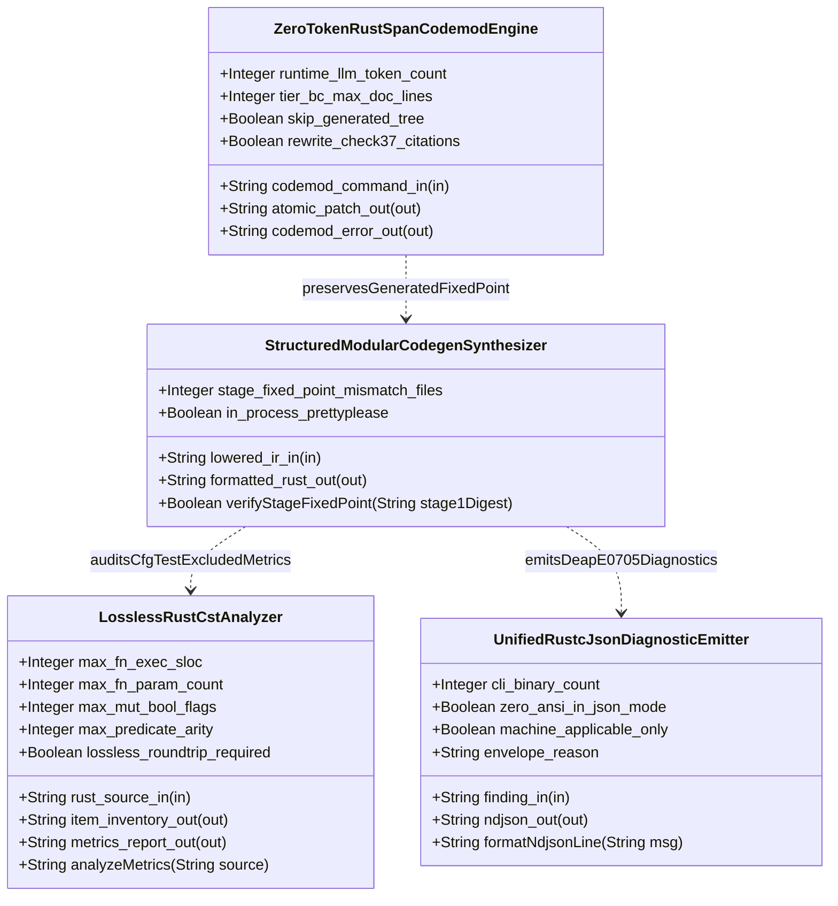
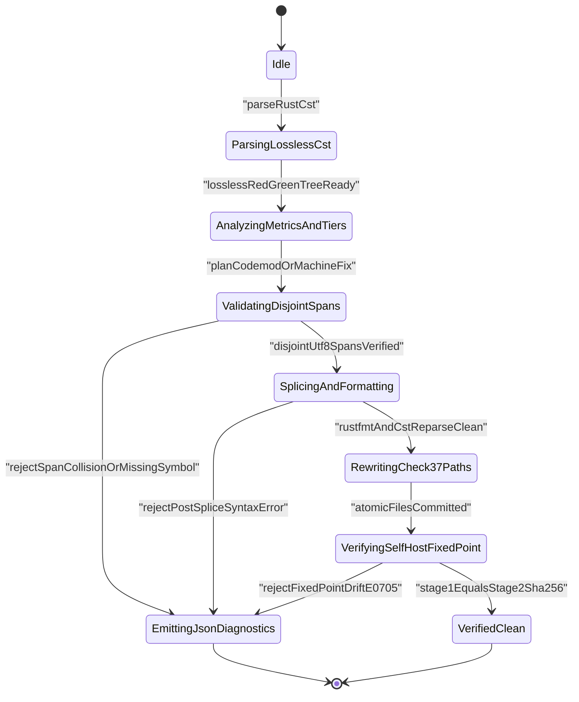

| Attribute | Specification Detail |
| :--- | :--- |
| **Issue ID** | TBD |
| **Title** | Feature 43: [BP 08 Lossless Rust CST Codemod Engine and Unified rustc Compatible JSON Diagnostics] StructuredModularCodegenSynthesizer |
| **Type** | feature |
| **Parent Epic** | [EPIC-08-BP_08_Lossless_Rust_CST_Codemod_Engine_and_Unified_rustc_Compatible_JSON_Diagnostics](../epics/EPIC-08-BP_08_Lossless_Rust_CST_Codemod_Engine_and_Unified_rustc_Compatible_JSON_Diagnostics.md) |
| **Interface Type** | Physical / Structural / Internal Bus |
| **Schema Containers** | `BP_08_Lossless_Rust_CST_Codemod_Engine_and_Unified_rustc_Compatible_JSON_Diagnostics::StructuredModularCodegenSynthesizer` |
| **Generation Mode** | subagent |
| **Specification Source** | [schema/model.sysml](../../schema/model.sysml) |

# Feature 43: [BP 08 Lossless Rust CST Codemod Engine and Unified rustc Compatible JSON Diagnostics] StructuredModularCodegenSynthesizer

## Parent Epic
- [ ] [EPIC-08-BP_08_Lossless_Rust_CST_Codemod_Engine_and_Unified_rustc_Compatible_JSON_Diagnostics](../epics/EPIC-08-BP_08_Lossless_Rust_CST_Codemod_Engine_and_Unified_rustc_Compatible_JSON_Diagnostics.md) (Allocates `StructuredModularCodegenSynthesizer` as the **REQ-0608** / **BP-08** to **REQ-0607** / **BP-07** AST emission boundary enforcing in-process `quote` + `syn::parse2` + `prettyplease::unparse` synthesis, `E0705` inner-attribute ordering, `crates/compile-sysml/src/modular_codegen/generated/` compaction-skip isolation, `cfg(test)`-excluded `DocTier` preservation, and Stage-1 to Stage-2 metacircular SHA-256 fixed-point verification)

## Description
`StructuredModularCodegenSynthesizer` defines the deterministic AST code-synthesis and metacircular self-hosting verification boundary connecting **BP-08** (`BP_08_Lossless_Rust_CST_Codemod_Engine_and_Unified_rustc_Compatible_JSON_Diagnostics`, **REQ-0608**) with the **BP-07** 4-level modular lowering pipeline (`BP_07_Self_Hosting_4_Level_Modular_Multi_File_Code_Generator_Blueprint`, **REQ-0607**) across `crates/compile-sysml/src/modular_codegen/emitters/rust_emitter.rs`, `crates/compile-sysml/src/modular_codegen/mod.rs`, `crates/compile-sysml/src/docstring.rs`, and `crates/deap-core/src/source_ast.rs`.

The component ingests 4-level lowered `ModuleGraph` intermediate representations (`LoweredModuleGraphIr` over `in lowered_ir_in : String`), lowers each bounded compilation unit into structured `proc_macro2` / `quote` token streams with crate- and module-level inner attributes (`syn::AttrStyle::Inner`, including `#![doc = "..."]` / `//!` Check-36 7-section DO-178C headers and `#![forbid(unsafe_code)]`) hoisted strictly into `syn::File::attrs` ahead of outer-attributed `syn::File::items` to prevent `rustc` `E0705` inner-attribute placement errors and **DEAP-E0705** AST emission drift, validates every unit in-process via `syn::parse2::<syn::File>` (`in_process_prettyplease == true`, zero external subprocesses, bounded by `MAX_AST_DEPTH = 64`), and formats canonical Rust compilation units (`PrettypleaseRustUnit` over `out formatted_rust_out : String`) via `prettyplease::unparse`. It simultaneously enforces the `--compact-tier-bc` directory-compaction firewall skipping `crates/compile-sysml/src/modular_codegen/generated/` (`skip_generated_tree == true`), preserves `cfg(test)`-excluded `DocTier` (`DocTier::RustTierA` 7-section public contracts vs `DocTier::RustTierBC` 2-line `/// <summary>` + `/// Realises: [REQ-*]` contracts) and `< 380` production executable SLOC module budgets, and verifies Stage-1 to Stage-2 metacircular SHA-256 fixed-point tree identity (`stage_fixed_point_mismatch_files == 0`, **C_CST_04** / **C_MOD_04**), realized behaviorally by [`US-54-verifyStageFixedPoint.md`](../user-stories/US-54-verifyStageFixedPoint.md).

### Mathematical Formulations of Deterministic AST Emission and Stage Fixed-Point Parity

$$
\begin{aligned}
E_{\mathrm{mod}}(M) &= U_{\mathrm{pretty}}(P_{\mathrm{syn}}(Q_{\mathrm{tok}}(A_{\mathrm{inner}}(M) \oplus I_{\mathrm{outer}}(M)))) \\
U_{\mathrm{pretty}}(P_{\mathrm{syn}}(E_{\mathrm{mod}}(M))) &= E_{\mathrm{mod}}(M) \\
\Delta_{\mathrm{mismatch}}(T_{1}, T_{2}) &= \lvert \{ p \in \Pi(T_{1}) \cup \Pi(T_{2}) \mid H_{256}(T_{1}, p) \neq H_{256}(T_{2}, p) \} \rvert = 0 \\
L_{\mathrm{exec}}(S) &= \lvert \{ \ell \in \Lambda(S) \mid \exists t \in \tau(R(S) \setminus R_{\mathrm{test}}(S)), \quad \kappa(t) \notin K_{\mathrm{trivia}} \land \ell \cap \lambda(t) \neq \emptyset \} \rvert < 380
\end{aligned}
$$

- Parameter Definitions & Engineering Units:
- $M$: Canonical `BTreeMap`-ordered 4-level lowered `ModuleGraph` compilation unit descriptor received on `lowered_ir_in` (`LoweredModuleGraphIr` protocol).
- $A_{\mathrm{inner}}(M)$: Ordered sequence of inner attributes (`syn::AttrStyle::Inner`, `//!` Check-36 7-section module headers and `#![forbid(unsafe_code)]`) partitioned strictly ahead of $I_{\mathrm{outer}}(M)$ into `syn::File::attrs` to preserve `E0705` inner-attribute ordering.
- $I_{\mathrm{outer}}(M)$: Lexically `BTreeMap`-ordered sequence of outer-attributed `syn::Item` declarations (`use`, `mod`, `struct`, `enum`, `trait`, `impl`, `fn`) bounded to `[1..12]` `items` per generated compilation unit (**C_MOD_02**).
- $Q_{\mathrm{tok}}, P_{\mathrm{syn}}, U_{\mathrm{pretty}}$: In-process `quote` token-stream lowering, `syn::parse2::<syn::File>` AST validation (nesting depth bounded by `MAX_AST_DEPTH = 64`), and `prettyplease::unparse` canonical formatter (`in_process_prettyplease == true` `flag`, `0` external subprocesses, `0` runtime LLM `tokens` per **C_CST_05**).
- $E_{\mathrm{mod}}(M)$: Idempotent formatted UTF-8 Rust compilation unit emitted on `formatted_rust_out` (`PrettypleaseRustUnit` protocol), bounded to `[50..400]` physical `LOC` (**C_MOD_01**) and McCabe cyclomatic complexity `[1..8]` `vG` (**C_MOD_03**).
- $T_{1}, T_{2}$: Stage-1 committed tree under `crates/compile-sysml/src/modular_codegen/generated/` (protected from `--compact-tier-bc` rewriting by `skip_generated_tree == true`) and Stage-2 freshly synthesized tree compiled from `.pipeline/upstream/schema/modular_codegen.sysml`.
- $\Pi(T), H_{256}(T, p), \Delta_{\mathrm{mismatch}}(T_{1}, T_{2})$: Normalized relative path set $\Pi(T)$, per-file 256-bit SHA-256 digest $H_{256}(T, p)$, and mismatch file count $\Delta_{\mathrm{mismatch}}(T_{1}, T_{2}) = 0$ `files` (`stage_fixed_point_mismatch_files == 0`, **C_CST_04** and **C_MOD_04**).
- $R(S), R_{\mathrm{test}}(S), K_{\mathrm{trivia}}, L_{\mathrm{exec}}(S)$: Lossless `ra_ap_syntax` + `rowan` Red syntax tree $R(S)$, excluded `cfg(test)` module and `test` function outer-attributed subtree projection $R_{\mathrm{test}}(S)$, trivia token kinds $K_{\mathrm{trivia}}$ (whitespace, comments, docblocks, attributes), and production executable line count $L_{\mathrm{exec}}(S) < 380$ `SLOC` per target module (with per-callable executable body `[1..50]` `SLOC` under **C_CST_01** within the `<= 80` `SLOC` workspace ceiling, `[0..5]` formal `params` excluding receiver under **C_CST_02**, and `0` mutable boolean `flags` under **C_CST_03**).

## UML Class Diagram



## Interface Requirements
### 1. Test Data Shape
```json
{
  "$schema": "https://json-schema.org/draft/2020-12/schema",
  "title": "StructuredModularCodegenSynthesizerPayloadSchema",
  "type": "object",
  "properties": {
    "part": {
      "type": "string",
      "const": "StructuredModularCodegenSynthesizer"
    },
    "status": {
      "type": "string",
      "enum": ["nominal", "degraded", "fault"]
    },
    "stage_fixed_point_mismatch_files": {
      "type": "integer",
      "x-sysml-type": "Integer",
      "minimum": 0,
      "maximum": 0,
      "description": "Permitted Stage-1 versus Stage-2 SHA-256 file digest mismatch count across self-hosted modular codegen (E0705 / C_CST_04). [unit: files]",
      "default": 0
    },
    "in_process_prettyplease": {
      "type": "boolean",
      "x-sysml-type": "Boolean",
      "const": true,
      "description": "Formats quote TokenStream ASTs deterministically via syn::parse2 and prettyplease::unparse without external subprocesses. [unit: flag]",
      "default": true
    },
    "skip_generated_tree": {
      "type": "boolean",
      "const": true,
      "description": "Excludes crates/compile-sysml/src/modular_codegen/generated/ from --compact-tier-bc docstring rewriting. [unit: flag]",
      "default": true
    },
    "max_ast_depth": {
      "type": "integer",
      "minimum": 1,
      "maximum": 64,
      "default": 64
    },
    "target_module_max_exec_sloc": {
      "type": "integer",
      "minimum": 1,
      "maximum": 379,
      "default": 379
    },
    "lowered_ir_in": {
      "type": "object",
      "properties": {
        "direction": { "type": "string", "const": "in" },
        "port_type": { "type": "string", "const": "String" },
        "protocol": { "type": "string", "const": "LoweredModuleGraphIr" },
        "flow": { "type": "string", "const": "lowered_ir_in_flow" }
      },
      "required": ["direction", "port_type", "protocol", "flow"],
      "additionalProperties": false
    },
    "formatted_rust_out": {
      "type": "object",
      "properties": {
        "direction": { "type": "string", "const": "out" },
        "port_type": { "type": "string", "const": "String" },
        "protocol": { "type": "string", "const": "PrettypleaseRustUnit" },
        "flow": { "type": "string", "const": "formatted_rust_out_flow" }
      },
      "required": ["direction", "port_type", "protocol", "flow"],
      "additionalProperties": false
    }
  },
  "required": [
    "part",
    "status",
    "stage_fixed_point_mismatch_files",
    "in_process_prettyplease",
    "lowered_ir_in",
    "formatted_rust_out"
  ],
  "additionalProperties": false
}
```

### 2. Validation & Constraints
Declared structural attributes, boundary ports, closed-world AST invariants, [`ICD_01_SYSTEM_INTERFACE_MATRIX.md`](../interfaces/ICD_01_SYSTEM_INTERFACE_MATRIX.md) / [`ICD_02_MASTER_SIGNAL_DICTIONARY.md`](../interfaces/ICD_02_MASTER_SIGNAL_DICTIONARY.md) contracts, and [`FAILURE_MODE_REGISTRY.md`](../research/FAILURE_MODE_REGISTRY.md) mitigations for classifier `StructuredModularCodegenSynthesizer`:

| AST Member / Invariant Kind | Identifier | Declared Type / Direction / Unit | Closed-World Bound / Invariant Contract |
| :--- | :--- | :--- | :--- |
| Attribute | `stage_fixed_point_mismatch_files` | `Integer` (`files`) | Default `0`; **C_CST_04** / **C_MOD_04** exact range `[0..0]` (`stage_fixed_point_mismatch_files == 0`) |
| Attribute | `in_process_prettyplease` | `Boolean` (`flag`) | Default `true`; mandatory `true` (in-process `quote` -> `syn::parse2` -> `prettyplease::unparse`, `0` external subprocesses) |
| Port (`ICD_01` / `ICD_02`) | `lowered_ir_in` (`lowered_ir_in_flow`) | `in String` (`LoweredModuleGraphIr`) | Receives 4-level DAG-verified `BTreeMap`-ordered `ModuleGraph` descriptors inside `crates/compile-sysml/src/modular_codegen/` |
| Port (`ICD_01` / `ICD_02`) | `formatted_rust_out` (`formatted_rust_out_flow`) | `out String` (`PrettypleaseRustUnit`) | Emits deterministic formatted Rust units preserving `E0705` inner-attribute ordering and Stage-1 == Stage-2 SHA-256 identity |
| Action (`BP-08` AST) | `verifyStageFixedPoint(stage1Digest)` | `in String`, `out Integer` (`files`) | Compares `BTreeMap<RelativeModulePath, Sha256Digest>` across Stage-1 (`modular_codegen/generated/`) and isolated Stage-2 output |
| Boundary Constraint (`BP-08`) | `C_CST_06` & `skip_generated_tree` | `Integer` (`lines`) / `Boolean` (`flag`) | `--compact-tier-bc` compacts non-generated `DocTier::RustTierBC` docblocks to `[2..2]` `lines` while unconditionally skipping `crates/compile-sysml/src/modular_codegen/generated/` (`skip_generated_tree == true`) |
| Boundary Constraint (`BP-08`) | `C_CST_01`..`C_CST_03` & `C_CST_05` | `SLOC`, `params`, `flags`, `tokens` | `max_fn_exec_sloc` in `[1..50]` (within `<= 80` `SLOC` workspace ceiling), `max_fn_param_count` in `[0..5]` excluding `self`/`&self`/`&mut self`, `max_mut_bool_flags == 0`, `runtime_llm_token_count == 0`, target module `< 380` production exec `SLOC` |
| Boundary Constraint (`BP-07`) | `C_MOD_01`..`C_MOD_05` | `LOC`, `items`, `vG`, `files`, `count` | Generated units obey `50 <= max_file_lines <= 400` `LOC` (barrel/leaf split ceiling `<= 400`), `1 <= max_items_per_file <= 12` `items`, `1 <= max_cyclomatic_complexity <= 8` `vG`, `runtime_llm_subagent_count == 0` |
| Traversal Ceiling (`FM-BP08-011`) | `MAX_AST_DEPTH` | `Integer` (`depth`) | Explicit AST/CST token-tree nesting bound `MAX_AST_DEPTH = 64` across `quote`, `syn::parse2`, and `ra_ap_syntax` / `rowan` walks |
| Diagnostic Contract (`SC-04`) | `DEAP-E0705` / `DEAP-E0803` / `DEAP-E0804` | Single-line `compiler-message` NDJSON | `--message-format=json` emits `0` embedded newline (`0x0A`) bytes and `0` ANSI escape (`0x1B`) bytes on fail-closed rejection |

#### Logical Interface & Signal Dictionary Contracts (`ICD_01` & `ICD_02`)
1. **Inbound Lowered IR Interface (`lowered_ir_in` / `lowered_ir_in_flow`, Protocol `LoweredModuleGraphIr`, [`ICD_01_SYSTEM_INTERFACE_MATRIX.md`](../interfaces/ICD_01_SYSTEM_INTERFACE_MATRIX.md) & [`ICD_02_MASTER_SIGNAL_DICTIONARY.md`](../interfaces/ICD_02_MASTER_SIGNAL_DICTIONARY.md))**:
   - **Producer-to-Consumer Contract**: Produced by **BP-07** `FourLevelAstPartitionerAndHoister` (`crates/compile-sysml/src/modular_codegen/lowering/mod.rs`) lowering SysML v2 AST nodes defined in `crates/deap-core/src/sysml_ast/mod.rs` after `TopologicalLayerDagVerifier` seals acyclic layer monotonicity (`importer_tier >= imported_tier` across tiers `1..3`); consumed by `StructuredModularCodegenSynthesizer` (`crates/compile-sysml/src/modular_codegen/emitters/rust_emitter.rs`).
   - **Signal Validation Guards**: Every `CompilationUnit` relative path MUST be normalized, workspace-relative, free of `..` traversal, leading `/`, symlinks, or NUL bytes, and strictly confined within the target output root (`crates/compile-sysml/src/modular_codegen/generated/` for self-hosting Stage-1/Stage-2 parity).
2. **Outbound Formatted Unit Interface (`formatted_rust_out` / `formatted_rust_out_flow`, Protocol `PrettypleaseRustUnit`, [`ICD_01_SYSTEM_INTERFACE_MATRIX.md`](../interfaces/ICD_01_SYSTEM_INTERFACE_MATRIX.md) & [`ICD_02_MASTER_SIGNAL_DICTIONARY.md`](../interfaces/ICD_02_MASTER_SIGNAL_DICTIONARY.md))**:
   - **Inner-Attribute `E0705` Ordering Invariant**: Module-level inner attributes (`syn::AttrStyle::Inner`, such as `//!` Check-36 7-section safety docstrings and `#![forbid(unsafe_code)]`) MUST be emitted exclusively inside `syn::File::attrs` prior to the first `syn::Item` in `syn::File::items`. Emitting an inner attribute after any outer item or inside non-header token positions is rejected fail-closed before unparsing.
   - **Round-Trip Idempotence & Atomic Commit**: Every formatted buffer $U = \text{prettyplease::unparse}(\text{syn::parse2}(T))$ MUST satisfy $\text{prettyplease::unparse}(\text{syn::parse2}(U)) == U$ in memory, pass `cfg(test)`-excluded `DocTier` and modularity bounds checks, and commit exclusively through isolated temp-directory staging with stale-file pruning and atomic rename (`write_atomic`).

#### Component Failure Mode Mitigation Contract (`FAILURE_MODE_REGISTRY.md`)

| FM ID | Failure Dimension | Trigger Condition | Fail-Closed Mitigation & Diagnostic Binding |
| :--- | :--- | :--- | :--- |
| `FM-BP08-009` (cross-bound: `FM-BP07-017`, `FM-BP07-029`) | `(1) Input/Boundary & Malformed Syntax` | `stage_fixed_point_mismatch_files != 0`, `in_process_prettyplease == false`, malformed `LoweredModuleGraphIr` on `lowered_ir_in`, relative path escaping `crates/compile-sysml/src/modular_codegen/generated/`, misplaced `E0705` inner attributes, or `quote` `TokenStream` failing `syn::parse2`. | Reject fail-closed with **DEAP-E0803** / **SC-BP08-09**; enforce `in_process_prettyplease == true`, canonical path confinement, `syn::File::attrs` inner-attribute partitioning, and mandatory `syn::parse2` AST validation before `prettyplease::unparse`, transitioning directly to `EmittingJsonDiagnostics` with zero filesystem writes. |
| `FM-BP08-010` (cross-bound: `FM-BP07-002`, `FM-BP07-018`, `FM-BP07-030`, `FM-BP07-034`) | `(2) State/Concurrency & Ordering` | Entering `VerifyingSelfHostFixedPoint` (`verifyStageFixedPoint`) before `atomicFilesCommitted`, `--compact-tier-bc` rewriting `///` / `doc` attribute headers under `crates/compile-sysml/src/modular_codegen/generated/`, `cfg(test)` outer-attribute scope leakage across sibling production `DocTier` items, or non-deterministic map ordering permuting `quote` items. | Reject fail-closed with **DEAP-E0705** / **SC-BP08-10**; gate `verifyStageFixedPoint` strictly behind `atomicFilesCommitted`, enforce unconditional `crates/compile-sysml/src/modular_codegen/generated/` skip during `--compact-tier-bc` (`skip_generated_tree == true`), isolate `cfg(test)` module and `test` function CST subtrees before `DocTier` accounting, and key all AST maps via `BTreeMap` / `BTreeSet`. |
| `FM-BP08-011` (cross-bound: `FM-BP07-019`, `FM-BP07-031`, `FM-BP07-035`) | `(3) Resource/Depth/Arithmetic Exhaustion` | Deeply nested `quote` token trees or oversized `///` / `doc` attribute blocks exceeding `MAX_AST_DEPTH = 64` or `prettyplease::unparse` per-unit buffer ceilings, or integer overflow on `stage_fixed_point_mismatch_files`, SLOC, or SHA-256 byte counters. | Reject fail-closed with **DEAP-E0804** / **SC-BP08-11**; enforce iterative/bounded token-tree depth checks (`MAX_AST_DEPTH = 64`), per-unit **C_MOD_01**..**C_MOD_03** pre- and post-render ceilings, and `checked_add` / `checked_sub` / `saturating_add` integer arithmetic across all counters. |
| `FM-BP08-012` (cross-bound: `FM-BP07-020`, `FM-BP07-032`, `FM-BP07-036`) | `(4) Output/Serialization & Partial-Write Integrity` | Non-idempotent `quote` -> `syn::parse2` -> `prettyplease::unparse` round-trip or broken compaction skip inducing Stage-1 != Stage-2 SHA-256 drift (`stage_fixed_point_mismatch_files > 0`), partial/orphan `.rs` writes on `formatted_rust_out`, or multi-line/ANSI-polluted `E0705` diagnostics. | Reject fail-closed with **DEAP-E0705** / **SC-BP08-12**; stage Stage-2 outputs in an auto-cleaned temp directory, verify `SHA-256(Stage 1) == SHA-256(Stage 2)` across 100% of paths prior to atomic swap, and emit strictly single-line `0x0A`-free, `0x1B`-free `compiler-message` NDJSON on `rejectFixedPointDriftE0705`. |

### 3. Visual Layout & Arrangement
Structural composition, module boundary partitioning, and typed logical operations for classifier `StructuredModularCodegenSynthesizer`:
- **Boundary Topology**: `StructuredModularCodegenSynthesizer` owns zero nested subparts and communicates exclusively across boundary ports `in lowered_ir_in : String` (`LoweredModuleGraphIr`) and `out formatted_rust_out : String` (`PrettypleaseRustUnit`), orchestrated within `crates/compile-sysml/src/modular_codegen/mod.rs` and `crates/compile-sysml/src/modular_codegen/emitters/rust_emitter.rs`.
- **Modularity & Compaction Firewall Topology**:
  - Hand-authored synthesizer and codemod modules (`crates/compile-sysml/src/modular_codegen/emitters/rust_emitter.rs`, `crates/compile-sysml/src/modular_codegen/mod.rs`, `crates/compile-sysml/src/docstring.rs`, `crates/deap-core/src/source_ast.rs`) MUST each remain `< 380` production executable `SLOC` (excluding `cfg(test)` outer-attributed test blocks), with every callable `<= 50` executable `SLOC` (**C_CST_01**, within the `<= 80` `SLOC` workspace limit) and `<= 5` parameters (**C_CST_02**).
  - Self-hosted generated compilation units under `crates/compile-sysml/src/modular_codegen/generated/` retain full Check-36 7-section DO-178C safety docstrings (`enforce_seven_section_docs == true`) and are strictly excluded from `compile-sysml --compact-tier-bc <DIR>` rewriting (`skip_generated_tree == true`), while non-generated `DocTier::RustTierBC` items outside `crates/compile-sysml/src/modular_codegen/generated/` compact to 2-line `/// <summary>` + `/// Realises: [REQ-*]` headers (**C_CST_06**) and `DocTier::RustTierA` public items retain 7-section docstrings.
- **Typed Logical Operations**:
  - `+synthesizePrettypleaseUnit(in loweredIrDescriptor: String, out prettypleaseRustUnit: String): Boolean` -- Partitions inner `syn::Attribute` headers ahead of outer `syn::Item` nodes, validates `MAX_AST_DEPTH = 64` and `syn::parse2::<syn::File>`, formats via `prettyplease::unparse`, and verifies round-trip idempotence.
  - `+verifyInnerAttributeOrdering(in tokenStreamUtf8: String, out e0705Clean: Boolean): Boolean` -- Verifies zero `syn::AttrStyle::Inner` attributes occur after the first outer item in any synthesized Rust unit.
  - `+shouldSkipGeneratedCompaction(in relativePath: String, out skipCompaction: Boolean): Boolean` -- Canonicalizes workspace-relative directory segments and returns `true` for any path rooted under `crates/compile-sysml/src/modular_codegen/generated/`.
  - `+auditCfgTestExcludedDocTiers(in rustSourceUtf8: String, out productionExecSloc: Integer): Boolean` -- Strips `cfg(test)` outer-attributed modules and `test` outer-attributed functions on the lossless `ra_ap_syntax` / `rowan` CST before computing `DocTier` classifications and verifying `productionExecSloc < 380`.
  - `+verifyStageFixedPoint(in stage1Digest: String, out mismatchFileCount: Integer): Boolean` -- Re-emits `.pipeline/upstream/schema/modular_codegen.sysml` into an isolated Stage-2 directory and asserts `SHA-256(Stage 1) == SHA-256(Stage 2)` (`mismatchFileCount == 0`, linked to [`US-54-verifyStageFixedPoint.md`](../user-stories/US-54-verifyStageFixedPoint.md)).

### 4. Interactive Flow & States
Operational lifecycle events and discrete state transitions for `StructuredModularCodegenSynthesizer` within the **BP-08** (`BP_08_Lossless_Rust_CST_Codemod_Engine_and_Unified_rustc_Compatible_JSON_Diagnostics_LifecycleState`) and **BP-07** (`VerifyingSelfHostFixedPoint`) state machines:



### Layer 1: Domain State & Signal Model
Classifier `StructuredModularCodegenSynthesizer` defines immutable, deterministic domain value types across `crates/compile-sysml/src/modular_codegen/domain/module_graph.rs`, `crates/compile-sysml/src/modular_codegen/domain/bounds.rs`, and `crates/deap-core/src/source_ast.rs`:
- **Typed Domain Structs & Ordered Collections**: Encapsulates `stage_fixed_point_mismatch_files: usize` (invariant `== 0`), `in_process_prettyplease: bool` (invariant `== true`), `SynthesizedRustUnit` (partitioned `inner_attrs: Vec<syn::Attribute>` with `syn::AttrStyle::Inner` strictly separated from `outer_items: Vec<syn::Item>`), `StageTreeManifest` (`BTreeMap<String, [u8; 32]>` mapping canonical relative paths to SHA-256 digests), and `DocTierInventory` (`BTreeMap<String, DocTier>` classifying non-test items into `DocTier::RustTierA` or `DocTier::RustTierBC` alongside `BTreeSet<String>` symbol sets). Randomized hash collections are strictly prohibited across all synthesis and manifest structures.
- **Typed Error Enums**: All fallible synthesis, compaction-boundary, and fixed-point operations return `Result<T, StructuredCodegenError>` backed by a closed `CodegenDiagnosticCode` enum (`DeapE0701InvalidBoundsOrPath`, `DeapE0704ResourceOrModularityBreach`, `DeapE0705FixedPointOrInnerAttrDrift`, `DeapE0801MissingAstSymbol`, `DeapE0802OverlappingSpan`, `DeapE0803SyntaxOrSynParseFailure`, `DeapE0804DepthOrArithmeticOverflow`). String-typed `Result` error variants and panicking unwraps are forbidden across production modules, and pure domain crates enforce `#![forbid(unsafe_code)]`.

### Layer 2: Logic & Safety State Management
Classifier `StructuredModularCodegenSynthesizer` enforces total, bounded, stateless AST transformation and fixed-point verification functions across `crates/compile-sysml/src/modular_codegen/emitters/rust_emitter.rs`, `crates/compile-sysml/src/docstring.rs`, and `crates/deap-core/src/source_ast.rs`:
- **Function & Module Complexity Ceilings**: Every production function is a total pure or staged-I/O function bounded to `<= 50` executable `SLOC` (**C_CST_01**, strictly satisfying the `<= 80` executable `SLOC` workspace ceiling), `<= 5` formal parameters excluding `self`/`&self`/`&mut self` (**C_CST_02**), `0` mutable `bool` local flags (**C_CST_03**), `<= 3` unhoisted boolean predicate clauses (`max_predicate_arity == 3`), and target module size `< 380` production executable `SLOC`.
- **Bounded Traversal, Safe Indexing & Checked Arithmetic**: All `quote` `TokenStream`, `syn::File`, and `ra_ap_syntax` / `rowan` CST traversals enforce `MAX_AST_DEPTH = 64` (`FM-BP08-007`, `FM-BP08-011`), access slices and maps exclusively via fallible `.get()` indexing (zero direct bracket indexing), and accumulate byte spans, line counts, item counts, cyclomatic complexity `vG`, and `stage_fixed_point_mismatch_files` via `checked_add`, `checked_sub`, and `saturating_add` guards.
- **Inner-Attribute `E0705` Ordering, Compaction Firewall & `cfg(test)` Subtree Exclusion**:
  1. `synthesize_syn_file` constructs `syn::File` by placing `//!` Check-36 7-section module doc attributes and crate/module inner attributes (`#![forbid(unsafe_code)]`) into `syn::File::attrs` before lowering `BTreeMap`-ordered items via `quote` and `syn::parse2`, formatting via `prettyplease::unparse`, and asserting `unparse(parse2(rendered)) == rendered`.
  2. `--compact-tier-bc` directory traversal evaluates `is_protected_generated_subtree(rel_path)` first and unconditionally skips `crates/compile-sysml/src/modular_codegen/generated/`, preventing Tier B/C 2-line compaction (**C_CST_06**) from mutating Stage-1 Check-36 7-section generated units.
  3. `LosslessRustCstAnalyzer` prunes every `cfg(test)` outer-attributed `ast::Module` and `test` outer-attributed `ast::Fn` subtree on the `rowan` Red tree prior to `DocTier` assignment and `production_exec_sloc` calculation, guaranteeing zero test-scope leakage into adjacent production items (`FM-BP08-006`, `FM-BP07-002`).
  4. `verify_stage_fixed_point` compiles `.pipeline/upstream/schema/modular_codegen.sysml` into an auto-cleaned temporary Stage-2 directory and performs a single-pass `BTreeMap` key-and-digest join against Stage-1 (`crates/compile-sysml/src/modular_codegen/generated/`), transitioning to `VerifiedClean` iff `stage_fixed_point_mismatch_files == 0`.

### Layer 3: Presentation & Actuator Interface Binding
Classifier `StructuredModularCodegenSynthesizer` binds CLI entrypoints, atomic filesystem persistence actuators, and `rustc`-compatible NDJSON diagnostic streams across `crates/compile-sysml/src/cli.rs`, `crates/compile-sysml/src/driver.rs`, and `crates/deap-core/src/diagnostics.rs`:
- **CLI Subcommand & Flag Bindings**: Binds `compile-sysml --emit-modular-rust <OUT_DIR> --schema <SCHEMA_PATH>` (driving `lowered_ir_in` -> `formatted_rust_out` and Stage-1/Stage-2 self-host fixed-point verification against `.pipeline/upstream/schema/modular_codegen.sysml`), `compile-sysml --compact-tier-bc <DIR>` (enforcing the `crates/compile-sysml/src/modular_codegen/generated/` skip boundary), and `--message-format=json` across all 5 workspace CLIs (`cli_binary_count == 5`).
- **Atomic Staging & Single-Line NDJSON Diagnostic Binding**: All `PrettypleaseRustUnit` writes stage complete directory trees in isolated temporary directories and commit via atomic rename (`write_atomic`) only after post-render bounds and `E0705` fixed-point checks pass. On any failure (`DEAP-E0705`, `DEAP-E0801`..`DEAP-E0804`), `UnifiedRustcJsonDiagnosticEmitter` serializes a single-line JSON record (`reason: "compiler-message"`, `message.code.code: "DEAP-E0705"` or `"DEAP-E0803"` / `"DEAP-E0804"`, exact UTF-8 0-based `byte_start`/`byte_end` and 1-based line/column spans, `0` embedded `0x0A` newline bytes, `0` `0x1B` ANSI escape bytes) under an exclusive stdout lock and exits with code `1` while leaving target directories untouched.

## Child Micro-Task Breakdown

Atomic serial TDD decomposition (`<= 50` exec `SLOC` per function under **C_CST_01** / `<= 80` exec `SLOC` workspace ceiling, `<= 5` params, target module `< 380` production exec `SLOC`), traced to [`US-54-verifyStageFixedPoint.md`](../user-stories/US-54-verifyStageFixedPoint.md):

| Micro-Task ID | Target Workspace Module (Check-37 Verified) | Bounded Responsibility & Signature Contract | Exec SLOC Budget | Linked Story / Failure Modes |
| :--- | :--- | :--- | :--- | :--- |
| `MT-43-01` | `crates/compile-sysml/src/modular_codegen/domain/module_graph.rs` | Define `StructuredCodegenError`, `CodegenDiagnosticCode` (`DEAP-E0705`, `DEAP-E0803`, `DEAP-E0804`), `SynthesizedRustUnit` separating `syn::AttrStyle::Inner` header attributes from `BTreeMap`-ordered outer items, and `StageTreeManifest` (`BTreeMap<String, [u8; 32]>`). | `<= 65` `SLOC` (module `< 380` `SLOC`) | [`US-54-verifyStageFixedPoint.md`](../user-stories/US-54-verifyStageFixedPoint.md); `FM-BP08-009`, `FM-BP08-010` |
| `MT-43-02` | `crates/compile-sysml/src/modular_codegen/emitters/rust_emitter.rs` | Implement in-process `quote` -> `syn::parse2::<syn::File>` -> `prettyplease::unparse` emitter with `MAX_AST_DEPTH = 64` guard, hoisting `//!` Check-36 7-section headers and `#![forbid(unsafe_code)]` into `syn::File::attrs` ahead of outer items (`E0705` ordering) and verifying round-trip unparse idempotence. | `<= 75` `SLOC` (`<= 50` per `fn`; module `< 380` `SLOC`) | [`US-54-verifyStageFixedPoint.md`](../user-stories/US-54-verifyStageFixedPoint.md); `FM-BP08-009`, `FM-BP08-011`, `FM-BP07-029`..`FM-BP07-032` |
| `MT-43-03` | `crates/deap-core/src/source_ast.rs` & `crates/compile-sysml/src/docstring.rs` | Enforce subtree-scoped `cfg(test)` module and `test` function CST exclusion before `DocTier` (`DocTier::RustTierA` vs `DocTier::RustTierBC`) and `production_exec_sloc` (`< 380`) evaluation, and enforce `skip_generated_tree == true` in `--compact-tier-bc` to skip `crates/compile-sysml/src/modular_codegen/generated/`. | `<= 70` `SLOC` (`<= 50` per `fn`; module `< 380` `SLOC`) | [`US-54-verifyStageFixedPoint.md`](../user-stories/US-54-verifyStageFixedPoint.md); `FM-BP08-006`, `FM-BP08-010`, `FM-BP07-002`, `FM-BP07-034` |
| `MT-43-04` | `crates/compile-sysml/src/modular_codegen/mod.rs` | Implement `verify_stage_fixed_point` lowering `.pipeline/upstream/schema/modular_codegen.sysml` into an auto-cleaned Stage-2 temp directory, computing `checked_add` mismatch counts across Stage-1 (`crates/compile-sysml/src/modular_codegen/generated/`) and Stage-2 SHA-256 manifests (`stage_fixed_point_mismatch_files == 0`). | `<= 70` `SLOC` (`<= 50` per `fn`; module `< 380` `SLOC`) | [`US-54-verifyStageFixedPoint.md`](../user-stories/US-54-verifyStageFixedPoint.md); `FM-BP08-010`, `FM-BP08-011`, `FM-BP08-012`, `FM-BP07-036` |
| `MT-43-05` | `crates/compile-sysml/src/driver.rs` & `crates/deap-core/src/diagnostics.rs` | Wire CLI `--emit-modular-rust`, `--compact-tier-bc`, and `--message-format=json` to atomic staging commit and single-line zero-ANSI `compiler-message` NDJSON `DEAP-E0705` / `DEAP-E0803` / `DEAP-E0804` diagnostics with native Rust unit-test RED-GREEN-REFACTOR fixtures. | `<= 65` `SLOC` (`<= 50` per `fn`; module `< 380` `SLOC`) | [`US-54-verifyStageFixedPoint.md`](../user-stories/US-54-verifyStageFixedPoint.md); `FM-BP08-012`, `FM-BP08-016` |

## Acceptance Criteria (BDD)
- [ ] **AC-01 (Deterministic `syn`/`quote`/`prettyplease` AST Emission & `E0705` Inner-Attribute Ordering)**: **Given** a 4-level lowered `ModuleGraph` IR descriptor on `lowered_ir_in` (`LoweredModuleGraphIr`) containing module-level inner attributes (`//!` Check-36 7-section DO-178C safety docstrings and `#![forbid(unsafe_code)]`) alongside outer-attributed `use`, `struct`, `enum`, and `fn` items bounded within `MAX_AST_DEPTH = 64` AST levels, **When** `StructuredModularCodegenSynthesizer` lowers the unit in-process (`in_process_prettyplease == true`) via `quote`, `syn::parse2::<syn::File>`, and `prettyplease::unparse`, **Then** all inner attributes reside strictly inside `syn::File::attrs` prior to the first outer item in `syn::File::items` (zero `E0705` inner-attribute ordering violations), `prettyplease::unparse(syn::parse2(output))` equals `output` bit-for-bit, and every emitted unit on `formatted_rust_out` (`PrettypleaseRustUnit`) satisfies `max_file_lines` within `50` `LOC` to `400` `LOC` (**C_MOD_01**), `max_items_per_file` within `1` `items` to `12` `items` (**C_MOD_02**), and `max_cyclomatic_complexity` `<= 8` `vG` (**C_MOD_03**).
- [ ] **AC-02 (`--compact-tier-bc` Compaction Firewall Skipping `modular_codegen/generated/`)**: **Given** an isolated temporary workspace tree containing `DocTier::RustTierA` public items with 7-section docstrings, `DocTier::RustTierBC` `pub(crate)` and private items carrying legacy 28-line 7-section docblocks with `Realises: [REQ-*]` bindings outside `generated/`, and Stage-1 self-hosted modules with Check-36 7-section docstrings inside `crates/compile-sysml/src/modular_codegen/generated/`, **When** `compile-sysml --compact-tier-bc <DIR>` executes (`skip_generated_tree == true`), **Then** `DocTier::RustTierBC` docblocks outside `crates/compile-sysml/src/modular_codegen/generated/` compact losslessly to `2` `lines` (`/// <summary>` + `/// Realises: [REQ-*]`, **C_CST_06**, `tier_bc_max_doc_lines == 2`) without mutating executable tokens, `DocTier::RustTierA` 7-section docstrings remain unchanged, and 100% of files under `crates/compile-sysml/src/modular_codegen/generated/` remain byte-for-byte untouched.
- [ ] **AC-03 (`cfg(test)`-Excluded `DocTier` & `< 380` Exec SLOC Module Budget Preservation)**: **Given** a Rust module `< 380` production executable `SLOC` containing `DocTier::RustTierA` and `DocTier::RustTierBC` items followed by an inline `cfg(test)` outer-attributed module with `test` outer-attributed unit test functions exceeding `150` `lines` of test fixtures and followed by an additional trailing production `pub fn` item, **When** `LosslessRustCstAnalyzer` and `StructuredModularCodegenSynthesizer` classify `DocTier` obligations and compute `production_exec_sloc`, **Then** the `cfg(test)` and `test` CST subtrees are excluded from both `DocTier` enforcement and `production_exec_sloc` (`< 380` `SLOC`), while the trailing production `pub fn` outside the `cfg(test)` span remains strictly subject to `DocTier::RustTierA` 7-section docstring and `<= 50` executable `SLOC` (**C_CST_01**) enforcement (`FM-BP08-006`, `FM-BP07-002`).
- [ ] **AC-04 (Stage-1 to Stage-2 Metacircular SHA-256 Fixed-Point Identity -- `US-54`)**: **Given** the authoritative self-hosting schema `.pipeline/upstream/schema/modular_codegen.sysml` and the committed Stage-1 tree under `crates/compile-sysml/src/modular_codegen/generated/`, **When** `StructuredModularCodegenSynthesizer::verifyStageFixedPoint` (`US-54`) re-synthesizes `.pipeline/upstream/schema/modular_codegen.sysml` into an isolated Stage-2 temporary directory after a workspace `--compact-tier-bc` pass, **Then** `SHA-256(Stage 1) == SHA-256(Stage 2)` holds across 100% of relative paths and file contents (`stage_fixed_point_mismatch_files == 0` `files`, **C_CST_04** / **C_MOD_04**) and the lifecycle transitions `VerifyingSelfHostFixedPoint -> VerifiedClean`.
- [ ] **AC-05 (Fail-Closed Rejection on Malformed TokenStream, Path Traversal, or `MAX_AST_DEPTH = 64` Breach -- `FM-BP08-009` & `FM-BP08-011`)**: **Given** an inbound `LoweredModuleGraphIr` unit on `lowered_ir_in` containing either a `..` path-traversing relative path escaping `crates/compile-sysml/src/modular_codegen/generated/`, an unparseable `quote` token sequence or misplaced post-item inner attribute rejected by `syn::parse2`, or an expression tree exceeding `MAX_AST_DEPTH = 64` AST levels, **When** `StructuredModularCodegenSynthesizer` executes with `--message-format=json`, **Then** synthesis aborts fail-closed before `prettyplease::unparse` or disk I/O with exit code `1`, emits a single-line zero-ANSI `compiler-message` NDJSON diagnostic (`DEAP-E0803` for syntax/path/attribute invalidity or `DEAP-E0804` for depth/overflow breach), and writes `0` `files` to the target directory.
- [ ] **AC-06 (Fail-Closed `DEAP-E0705` Single-Line NDJSON Rejection on Stage Fixed-Point Drift -- `FM-BP08-010` & `FM-BP08-012`)**: **Given** an injected `1`-`byte` formatting, item-ordering, or docblock perturbation in an isolated Stage-1 fixture copy of `crates/compile-sysml/src/modular_codegen/generated/` causing `stage_fixed_point_mismatch_files >= 1` `files`, **When** `verifyStageFixedPoint` executes under `--message-format=json`, **Then** `StructuredModularCodegenSynthesizer` transitions via `rejectFixedPointDriftE0705` to `EmittingJsonDiagnostics`, emits a single-line JSON object (`reason: "compiler-message"`, `message.code.code: "DEAP-E0705"`, `0` embedded `0x0A` `bytes`, `0` `0x1B` ANSI `bytes`) identifying the drifted relative path and expected vs actual SHA-256 digests, leaves target files unmodified, and exits with code `1`.

## Specification Context (Verbatim)

```sysml
package BP_08_Lossless_Rust_CST_Codemod_Engine_and_Unified_rustc_Compatible_JSON_Diagnostics {
    doc /* verifyStageFixedPoint(stage1Digest) */
    action def verifyStageFixedPoint;
    doc /* [unit: `files`] */
    assert constraint C_CST_04 {
        stage_fixed_point_mismatch_files >= 0 and stage_fixed_point_mismatch_files <= 0;
    }
    doc /* [unit: `lines`] */
    assert constraint C_CST_06 {
        tier_bc_max_doc_lines >= 2 and tier_bc_max_doc_lines <= 2;
    }
    doc /* \begin{aligned} \text{Emit}_{\text{modular}}(M) &= \text{prettyplease::unparse}(\text{syn::parse2}(\text{quote}(M))) \\ \text{SHA-256}(\mathcal{T}_{\text{Stage 1}}) &= \text{SHA-256}(\mathcal{T}_{\text{Stage 2}}) \iff \Delta_{\text{mismatch}}(\mathcal{T}_{\text{Stage 1}}, \mathcal{T}_{\text{Stage 2}}) = 0 \end{aligned} */
    constraint def Invariant_REQ_0608_SC_02;
    doc /* Permitted Stage-1 versus Stage-2 SHA-256 file digest mismatch count across self-hosted modular codegen (`E0705`). [unit: files] */
    part def StructuredModularCodegenSynthesizer {
        attribute stage_fixed_point_mismatch_files : Integer = 0;
        doc /* Formats `quote` `TokenStream` ASTs deterministically via `syn::parse2` and `prettyplease::unparse` without external subprocesses. [unit: flag] */
        attribute in_process_prettyplease : Boolean = true;
        doc /* Receives 4-level lowered SysML v2 `ModuleGraph` descriptors inside `crates/compile-sysml/src/modular_codegen/`. [protocol: LoweredModuleGraphIr] */
        port in lowered_ir_in : String {
            flow in lowered_ir_in_flow : String;
        }
        doc /* Emits deterministic formatted Rust compilation units preserving `E0705` Stage-1 == Stage-2 SHA-256 identity. [protocol: PrettypleaseRustUnit] */
        port out formatted_rust_out : String {
            flow out formatted_rust_out_flow : String;
        }
    }
}
```

## Source References
Formal component specifications and normative systems engineering requirements:
- Structural Schema: [schema/model.sysml](../../schema/model.sysml) (Clause: `BP_08_Lossless_Rust_CST_Codemod_Engine_and_Unified_rustc_Compatible_JSON_Diagnostics::StructuredModularCodegenSynthesizer`)
- Self-Hosting Modular Codegen Schema: [schema/modular_codegen.sysml](../../schema/modular_codegen.sysml) (Clause: `ModularCodegen::emitters::ModularEmitterSuiteSpec`)
- Engineering Blueprints: `docs/designs/blueprint-08-rust-analyzer-cst-refactoring-and-json-diagnostics.sysml` (`REQ-0608`) and `docs/designs/blueprint-07-self-hosting-modular-codegen-compiler.sysml` (`REQ-0607`)
- Logical Interface & Safety Contracts: [ICD_01_SYSTEM_INTERFACE_MATRIX.md](../interfaces/ICD_01_SYSTEM_INTERFACE_MATRIX.md), [ICD_02_MASTER_SIGNAL_DICTIONARY.md](../interfaces/ICD_02_MASTER_SIGNAL_DICTIONARY.md), [FAILURE_MODE_REGISTRY.md](../research/FAILURE_MODE_REGISTRY.md) (`FM-BP08-009`..`FM-BP08-012`), and [US-54-verifyStageFixedPoint.md](../user-stories/US-54-verifyStageFixedPoint.md)
- Normative Systems Engineering Standard: ISO/IEC/IEEE 15288:2023 Clause 6.4.3 Architecture Definition Process and ISO/IEC/IEEE 29148:2018 Clause 6.4

Component behavior and interface definitions derive from `schema/model.sysml` pursuant to ISO/IEC/IEEE 15288.

## Logical UI & Interface Bindings
- **Target LUI Component:** Unbound (Deferred to Implementation Profile)
- **Target Layout Container ID:** Unbound (Deferred to Implementation Profile)
- **Data Source Binding:** Unbound (Deferred to Implementation Profile)
