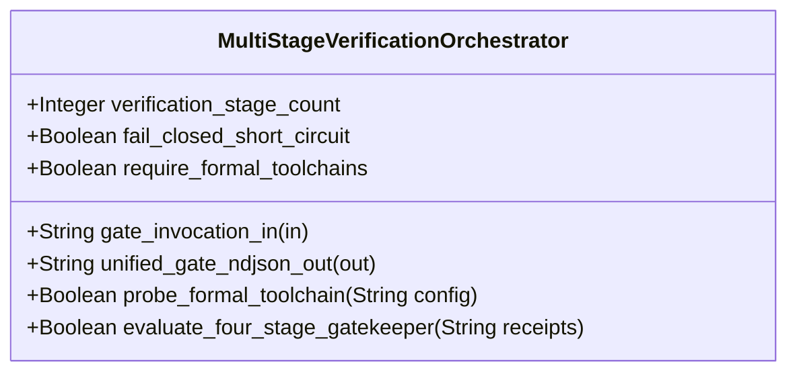

| Attribute | Specification Detail |
| :--- | :--- |
| **Issue ID** | #750 |
| **Title** | Feature 44: [BP 09 Multi Stage Compiler and Formal Verification Gatekeeper] MultiStageVerificationOrchestrator |
| **Type** | feature |
| **Parent Epic** | [EPIC-09-BP_09_Multi_Stage_Compiler_and_Formal_Verification_Gatekeeper](../epics/EPIC-09-BP_09_Multi_Stage_Compiler_and_Formal_Verification_Gatekeeper.md) |
| **Interface Type** | Physical / Structural / Internal Bus |
| **Schema Containers** | `BP_09_Multi_Stage_Compiler_and_Formal_Verification_Gatekeeper::MultiStageVerificationOrchestrator` |
| **Generation Mode** | subagent |
| **Specification Source** | [schema/model.sysml](../../schema/model.sysml) |

# Feature 44: [BP 09 Multi Stage Compiler and Formal Verification Gatekeeper] MultiStageVerificationOrchestrator

## Description
`MultiStageVerificationOrchestrator` specifies the Cross-Platform Multi-Stage Verification Orchestrator within `BP_09_Multi_Stage_Compiler_and_Formal_Verification_Gatekeeper` (**REQ-0609** / `BP-09` / `DEAP-BP-DET-09`).
- **Contract A (100% OMG SysML v2.0 + KerML 1.0 Grammar Coverage)**: Orchestrates formal verification gates across all normative OMG SysML v2.0 and KerML 1.0 constructs (`package`/`library package`/`standard library package`, `import`, `metadata def`/`metadata`/`@Metadata`/`#user_keyword` (`#hazard`, `#risk`, `#capability`, `#rt_loop`, `#dal`, `#fls` and legacy `hazard def`/`risk def`/`capability def`), `part def`/`part`, `item def`/`item`, `attribute def`/`attribute`, `enum def`/`enum`, `port def`/`port`, `connection def`/`connection`, `interface def`/`interface`, `flow def`/`flow`, `allocation def`/`allocation`, `occurrence def`/`occurrence`, `action def`/`action`, `state def`/`state`, `calc def`/`calc`, `constraint def`/`constraint`, `requirement def`/`requirement`, `concern def`/`concern`, `use case def`/`use case`, `analysis def`/`analysis`, `verification def`/`verification`, `test case def`/`test case`, `interaction def`/`interaction`, `view def`/`view`, `viewpoint def`/`viewpoint`, `rendering def`/`rendering`, `variation`/`variant`, and KerML specialization/multiplicity/expressions) with zero 16-construct artificial caps.
- **Contract B (Cross-Platform 5-Stage Pipeline & Dynamic Runtime `PATH` Discovery, Zero Hand-Rolled Scanners)**: Coordinates Stage 1 (`cargo clippy --message-format=json` via `cargo_metadata` + `toml_edit` + `ra_ap_syntax`) -> Stage 2 (excluded `./lints/deap-dylint-mir/` nightly `rustc_middle::mir` plugin) -> Stage 3 (`cargo +nightly miri test` under `-Zmiri-tree-borrows` + `flutter_rust_bridge` + `deap_core::dart_cst`) -> Stage 4 (`cargo kani` `outer kani::proof` synthesis via `syn` + `proc-macro2` + `quote` + `prettyplease`) -> Stage 5 (Ferrocene `criticalup.toml` + `[FLS: fls_*]` + `symbol-report`/`blanket` MC/DC + 3-Ring DAL-A..E partitioning), discovering driver binaries dynamically at runtime via `PATH`, `CARGO_HOME`, and `RUSTUP_HOME` (`std::env::consts::{DLL_PREFIX, DLL_SUFFIX, EXE_SUFFIX}`, `camino::Utf8Path`) across macOS, Linux, and Windows with zero hardcoded host paths and zero hand-rolled scanners.

## UML Class Diagram



## Interface Requirements
### 1. Test Data Shape
```json
{
  "$schema": "https://json-schema.org/draft/2020-12/schema",
  "title": "MultiStageVerificationOrchestratorPayloadSchema",
  "type": "object",
  "properties": {
    "part": {
      "type": "string",
      "const": "MultiStageVerificationOrchestrator"
    },
    "status": {
      "type": "string",
      "enum": ["nominal", "degraded", "fault"]
    },
    "verification_stage_count": {
      "type": "integer",
      "x-sysml-type": "Integer",
      "description": "Declared attribute verification_stage_count (Integer)",
      "default": 4
    },
    "fail_closed_short_circuit": {
      "type": "boolean",
      "x-sysml-type": "Boolean",
      "description": "Halts downstream stage promotion whenever any preceding verification stage exits non-zero. [unit: flag]",
      "default": true
    },
    "require_formal_toolchains": {
      "type": "boolean",
      "x-sysml-type": "Boolean",
      "description": "Mandates live execution of discovered drivers and fails closed if any driver is absent during qualification CI. [unit: flag]",
      "default": false
    },
    "gate_invocation_in": {
      "type": "object",
      "properties": {
        "direction": { "type": "string", "const": "in" },
        "port_type": { "type": "string", "const": "String" }
      },
      "required": ["direction", "port_type"]
    },
    "unified_gate_ndjson_out": {
      "type": "object",
      "properties": {
        "direction": { "type": "string", "const": "out" },
        "port_type": { "type": "string", "const": "String" }
      },
      "required": ["direction", "port_type"]
    }
  },
  "required": [
    "part",
    "status",
    "gate_invocation_in",
    "unified_gate_ndjson_out"
  ],
  "additionalProperties": false
}
```

### 2. Validation & Constraints
Declared structural attributes, boundary ports, invariants, and allocated requirements for classifier `MultiStageVerificationOrchestrator`:

| AST Member Kind | Identifier | Declared Type / Direction | Default / Invariant Contract |
| :--- | :--- | :--- | :--- |
| Attribute | `verification_stage_count` | `Integer` | Default `4` (Stages 1--4 feeding Stage 5 Ferrocene qualification) |
| Attribute | `fail_closed_short_circuit` | `Boolean` | Default `true` (Short-circuits downstream stages on any non-zero stage exit) |
| Attribute | `require_formal_toolchains` | `Boolean` | Default `false` (`--require-formal-toolchains` fails closed with `DEAP-E0905` when a driver is absent) |
| Operation | `probe_formal_toolchain` | `in config: String, return Boolean` | Probes runtime `PATH`, `CARGO_HOME`, and `RUSTUP_HOME` using `std::env::consts::{DLL_PREFIX, DLL_SUFFIX, EXE_SUFFIX}` and `camino::Utf8Path` (`C_VER_08`, `DEAP-E0905`) |
| Operation | `evaluate_four_stage_gatekeeper` | `in receipts: String, return Boolean` | Evaluates ordered Stage 1--4 receipts with fail-closed short-circuiting and emits consolidated NDJSON receipt (`DEAP-0000` / `DEAP-E0900`..`DEAP-E0905`) |
| Port | `gate_invocation_in` | `in String` | Boundary interface contract |
| Port | `unified_gate_ndjson_out` | `out String` | Boundary interface contract |
| Constraint | `C_VER_07` | `max_module_exec_sloc >= 1 and max_module_exec_sloc <= 380` | Submodule executable SLOC ceiling (`< 380` SLOC verified via `ra_ap_syntax`) |
| Constraint | `C_VER_08` | `min_toolchain_discovery_probes >= 1 and min_toolchain_discovery_probes <= 3` | Cross-platform runtime toolchain discovery probe depth |
| Constraint | `Invariant_REQ_0609_SC_05` | Invariant (`REQ-0609 (REQ_0609_BP_09_Multi_Stage_Compiler_and_Formal_Verification_Gatekeeper)`) | Cross-platform runtime `PATH` discovery, `< 380`-SLOC submodule modularity, and fail-closed qualification |
| Requirement | `REQ-0609 (REQ_0609_BP_09_Multi_Stage_Compiler_and_Formal_Verification_Gatekeeper)` | Allocated Requirement | MultiStageFormalVerificationGatekeeper (**REQ-0609** / `BP-09` / `DEAP-BP-DET-09`, UUIDv5 `6ba7b810-9dad-11d1-80b4-00c04fd430c9`, governed by DO-178C Level A, DO-330 TQL-4, and DO-333 Formal Methods Supplement) |

### 3. Visual Layout & Arrangement
Structural composition and boundary topology for classifier `MultiStageVerificationOrchestrator` organize no nested subparts declared in schema paired with boundary ports `in gate_invocation_in : String`, `out unified_gate_ndjson_out : String`.

### 4. Interactive Flow & States
Operational lifecycle events and discrete state transitions for `MultiStageVerificationOrchestrator` across `BP_09_Multi_Stage_Compiler_and_Formal_Verification_Gatekeeper_LifecycleState` (`Idle -> ProbingFormalDrivers -> RunningStage1Clippy -> RunningStage2DylintMir -> RunningStage3FrbAndMiri -> RunningStage4KaniCbmc -> VerifiedAllFourStages`, short-circuiting to `FailedClosedJsonDiagnostic` on any stage violation).

### Layer 1: Domain State & Signal Model
Classifier `MultiStageVerificationOrchestrator` encapsulates typed domain state attributes `verification_stage_count : Integer`, `fail_closed_short_circuit : Boolean`, `require_formal_toolchains : Boolean` alongside `FormalToolchainProbeConfig`, `ToolchainDiscoveryReceipt`, and `StageGateReceipt` records.

### Layer 2: Logic & Safety State Management
Classifier `MultiStageVerificationOrchestrator` governs deterministic 5-stage orchestration (`probe_formal_toolchain`, `evaluate_four_stage_gatekeeper`) enforcing `C_VER_01`..`C_VER_08` and `Invariant_REQ_0609_SC_01`..`Invariant_REQ_0609_SC_05` inside `< 380`-SLOC submodules (`./crates/verify-baseline/src/formal_gates/`) while explicitly deleting legacy hand-rolled scanners and hardcoded OS/user/machine paths.

### Layer 3: Presentation & Actuator Interface Binding
Classifier `MultiStageVerificationOrchestrator` binds external and behavioral interfaces across port `in gate_invocation_in : String` (connected via `BP_09_ClippyToOrchestratorConnection`) and port `out unified_gate_ndjson_out : String`, streaming single-line NDJSON diagnostics (`DEAP-E0900`..`DEAP-E0905` or `DEAP-0000`).

### Associated Use Cases & User Stories

#### Associated Use Cases
- [ ] #773 - [Use Case 45: Stage 1 Universal Stable Clippy Total Function and clippy toml Threshold Enforcement](../use-cases/UC-45-Stage_1_Universal_Stable_Clippy_Total_Function_and_clippy_toml_Threshold_Enforcement.md) (Orchestrates Stage 1 invocation and fail-closed short-circuiting on `DEAP-E0900`)
- [ ] #774 - [Use Case 46: Stage 2 Isolated Nightly Dylint MIR Zero Allocation Proof on Real Time Control Loops](../use-cases/UC-46-Stage_2_Isolated_Nightly_Dylint_MIR_Zero_Allocation_Proof_on_Real_Time_Control_Loops.md) (Orchestrates Stage 2 excluded `./lints/deap-dylint-mir/` execution and fail-closed short-circuiting on `DEAP-E0901`)
- [ ] #775 - [Use Case 47: Stage 2 Compile Time MIR Requirement Binding Verification Against Active SysML Digests](../use-cases/UC-47-Stage_2_Compile_Time_MIR_Requirement_Binding_Verification_Against_Active_SysML_Digests.md) (Orchestrates Stage 2 `REQ-*` SysML digest verification and fail-closed short-circuiting on `DEAP-E0902`)
- [ ] #776 - [Use Case 48: Stage 3 Deterministic flutter_rust_bridge FFI Synthesis with Fail Closed ICD Boundary Guards](../use-cases/UC-48-Stage_3_Deterministic_flutter_rust_bridge_FFI_Synthesis_with_Fail_Closed_ICD_Boundary_Guards.md) (Orchestrates Stage 3 FFI boundary guard and `dart analyze --fatal-infos` evaluation)
- [ ] #777 - [Use Case 49: Stage 3 Miri Tree Borrows Abstract Machine Undefined Behavior Rejection on FFI and Ring Buffer Bridges](../use-cases/UC-49-Stage_3_Miri_Tree_Borrows_Abstract_Machine_Undefined_Behavior_Rejection_on_FFI_and_Ring_Buffer_Bridges.md) (Orchestrates Stage 3 Miri `-Zmiri-tree-borrows` execution and fail-closed short-circuiting on `DEAP-E0903`)
- [ ] #778 - [Use Case 50: Stage 4 Deterministic Kani CBMC Proof Synthesis and STPA Unsafe Control Action Falsification](../use-cases/UC-50-Stage_4_Deterministic_Kani_CBMC_Proof_Synthesis_and_STPA_Unsafe_Control_Action_Falsification.md) (Orchestrates Stage 4 Kani `outer kani::proof` synthesis and CBMC evaluation)
- [ ] #779 - [Use Case 51: Cross Platform Toolchain Discovery Modular Submodule Layout and Fail Closed Qualification Gate](../use-cases/UC-51-Cross_Platform_Toolchain_Discovery_Modular_Submodule_Layout_and_Fail_Closed_Qualification_Gate.md) (Directly realizes cross-platform runtime `PATH` driver discovery and `--require-formal-toolchains` fail-closed `DEAP-E0905` enforcement)

#### Associated User Stories
- [ ] #808 - [User Story 59: probe formal toolchain](../user-stories/US-59-probe_formal_toolchain.md) (Invokes `probe_formal_toolchain(config)` for cross-platform runtime `PATH` discovery)
- [ ] #809 - [User Story 60: verify clippy policy](../user-stories/US-60-verify_clippy_policy.md) (Dispatches Stage 1 Clippy policy verification)
- [ ] #810 - [User Story 61: evaluate stage2 dylint mir](../user-stories/US-61-evaluate_stage2_dylint_mir.md) (Dispatches Stage 2 isolated Dylint MIR evaluation)
- [ ] #811 - [User Story 62: verify in process cst syntax](../user-stories/US-62-verify_in_process_cst_syntax.md) (Dispatches in-process `ra_ap_syntax` CST and `< 380`-SLOC verification)
- [ ] #812 - [User Story 63: guard inbound frb f64](../user-stories/US-63-guard_inbound_frb_f64.md) (Dispatches Stage 3 `flutter_rust_bridge` inbound `f64` boundary guard verification)
- [ ] #813 - [User Story 64: validate kani harness spec](../user-stories/US-64-validate_kani_harness_spec.md) (Dispatches Stage 4 Kani `outer kani::proof` harness validation and synthesis)
- [ ] #814 - [User Story 65: evaluate four stage gatekeeper](../user-stories/US-65-evaluate_four_stage_gatekeeper.md) (Executes `evaluate_four_stage_gatekeeper(receipts)` across all stages)

## Acceptance Criteria (BDD)
- [ ] AC-01: Given valid `MultiStageVerificationOrchestrator` initialization inputs for `verification_stage_count` (`Integer`), `fail_closed_short_circuit` (`Boolean`), `require_formal_toolchains` (`Boolean`) satisfying `C_VER_07` and `C_VER_08`, When `MultiStageVerificationOrchestrator` commits typed domain state, Then declared state attributes hold verified values and formal drivers are probed dynamically via runtime `PATH` without hardcoded host paths.
- [ ] AC-02: Given malformed or out-of-domain input values for `verification_stage_count` (`Integer`), `fail_closed_short_circuit` (`Boolean`), `require_formal_toolchains` (`Boolean`) or a missing driver when `require_formal_toolchains == true`, When `MultiStageVerificationOrchestrator` validates incoming state updates, Then `MultiStageVerificationOrchestrator` rejects the invalid state update and emits a diagnostic (`DEAP-E0905`) via diagnostic port `unified_gate_ndjson_out`.
- [ ] AC-03: Given nominal signal arrival across `gate_invocation_in` (`in String`), `unified_gate_ndjson_out` (`out String`), When `MultiStageVerificationOrchestrator` processes the declared interface transaction, Then output state conforms to the structural classifier contract.
- [ ] AC-04: Given an invalid or unrecognized interface frame across `gate_invocation_in` (`in String`), `unified_gate_ndjson_out` (`out String`), When `MultiStageVerificationOrchestrator` boundary validation executes, Then `MultiStageVerificationOrchestrator` refuses the malformed frame via diagnostic port `unified_gate_ndjson_out` and preserves prior verified state.

## Source References
Formal component specifications and normative systems engineering requirements:
- System Architecture Model: `schema/model.sysml`
- Engineering Design Blueprint: `./docs/designs/blueprint-09-clippy-dylint-miri-kani-formal-verification-gate.md`
- Normative Systems Engineering Standard: ISO/IEC/IEEE 15288:2023 §6.4.3 Architecture Definition Process

Component behavior and interface definitions derive from `schema/model.sysml` pursuant to ISO/IEC/IEEE 15288.
