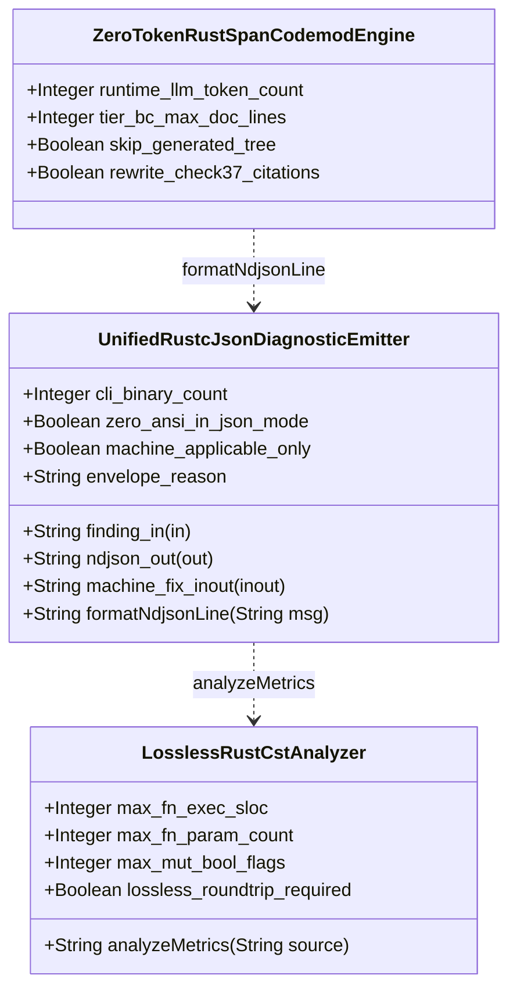
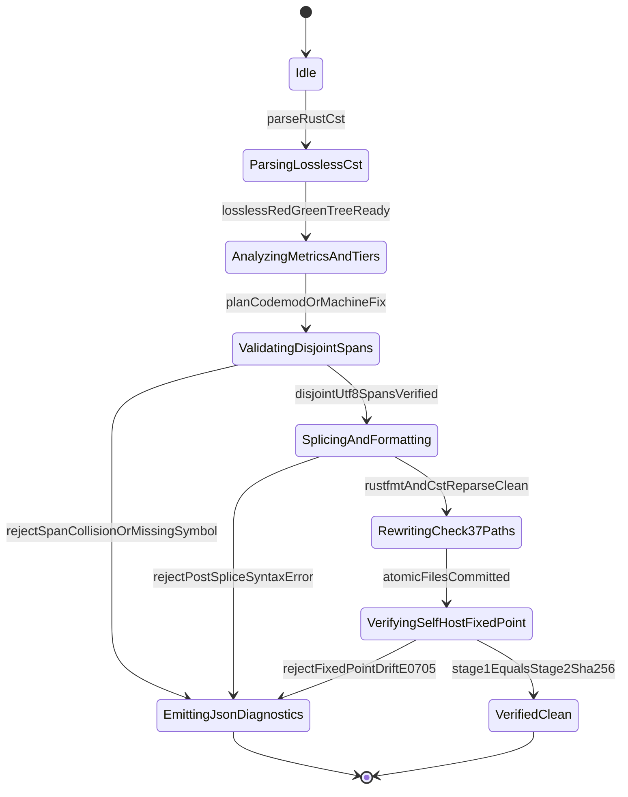

| Attribute | Specification Detail |
| :--- | :--- |
| **Issue ID** | TBD |
| **Title** | Feature 44: [BP 08 Lossless Rust CST Codemod Engine and Unified rustc Compatible JSON Diagnostics] UnifiedRustcJsonDiagnosticEmitter |
| **Type** | feature |
| **Parent Epic** | [EPIC-08-BP_08_Lossless_Rust_CST_Codemod_Engine_and_Unified_rustc_Compatible_JSON_Diagnostics](../epics/EPIC-08-BP_08_Lossless_Rust_CST_Codemod_Engine_and_Unified_rustc_Compatible_JSON_Diagnostics.md) |
| **Interface Type** | Physical / Structural / Internal Bus |
| **Schema Containers** | `BP_08_Lossless_Rust_CST_Codemod_Engine_and_Unified_rustc_Compatible_JSON_Diagnostics::UnifiedRustcJsonDiagnosticEmitter` |
| **Generation Mode** | subagent |
| **Specification Source** | [schema/model.sysml](../../schema/model.sysml) |

# Feature 44: [BP 08 Lossless Rust CST Codemod Engine and Unified rustc Compatible JSON Diagnostics] UnifiedRustcJsonDiagnosticEmitter

## Parent Epic
- [EPIC-08-BP_08_Lossless_Rust_CST_Codemod_Engine_and_Unified_rustc_Compatible_JSON_Diagnostics](../epics/EPIC-08-BP_08_Lossless_Rust_CST_Codemod_Engine_and_Unified_rustc_Compatible_JSON_Diagnostics.md) -- Allocates `part def UnifiedRustcJsonDiagnosticEmitter` under **REQ-0608** / **BP-08** to unify `rustc`-compatible `--message-format=json` single-line NDJSON emission and `MachineApplicable` reverse-byte-order UTF-8 `TextRange` patching across all `5` workspace CLIs.

## Description

`UnifiedRustcJsonDiagnosticEmitter` (**REQ-0608** / **BP-08**, component `BP_08_Lossless_Rust_CST_Codemod_Engine_and_Unified_rustc_Compatible_JSON_Diagnostics::UnifiedRustcJsonDiagnosticEmitter`) specifies the deterministic, zero-ANSI, single-line Newline-Delimited JSON (NDJSON) diagnostic serialization and transactional `MachineApplicable` byte-span auto-fix engine shared across all `cli_binary_count == 5` Tier-0 compiler executables:
1. `verify-baseline` (`crates/verify-baseline/src/main.rs`)
2. `compile-sysml` (`crates/compile-sysml/src/main.rs`)
3. `ingest-sysml` (`crates/ingest-sysml/src/main.rs`)
4. `assemble-conops` (`crates/assemble-conops/src/main.rs`)
5. `reconcile-backlog` (`crates/reconcile-backlog/src/main.rs`)

Hosted in `crates/deap-core/src/diagnostics.rs` (strictly `< 380` production executable SLOC excluding `cfg(test)` module blocks, hard module ceiling `<= 500` SLOC) and integrated with lossless `ra_ap_syntax` + `rowan` Concrete Syntax Tree (CST) verification in `crates/deap-core/src/source_ast.rs` and `crates/deap-core/src/sysml_ast/mod.rs`, this component fulfills two tightly coupled contracts:
- **Unified `rustc`-Compatible `--message-format=json` NDJSON Stream (`ndjson_out`)**: Transforms every structured finding arriving on `finding_in` (`DeapDiagnosticFinding`) via `formatNdjsonLine` ([US-55-formatNdjsonLine](../user-stories/US-55-formatNdjsonLine.md)) into a single-line JSON record carrying top-level discriminator `"reason": "compiler-message"`, `"DEAP-E"`-prefixed `code.code`, canonical `rustc` `level`, `1`-based line and column coordinates projected in `O(log N)` from `0`-based UTF-8 half-open `TextRange` `[byte_start..byte_end)` intervals, and child suggestions carrying `suggested_replacement` and `suggestion_applicability`. When `--message-format=json` is active (`zero_ansi_in_json_mode == true`), every serialized JSON record body is verified free of raw `0x0A` newline bytes (prior to the terminating record delimiter) and free of `0x1B` ANSI escape bytes, while multi-line human banner output is suppressed under an exclusive line-atomic standard-output lock.
- **Transactional `MachineApplicable` Non-Overlapping UTF-8 `TextRange` `[byte_start..byte_end)` Byte-Span Patcher (`machine_fix_inout`)**: When `--apply-machine-fixes` is invoked (`machine_applicable_only == true`), filters candidate spans strictly to `SuggestionApplicability::MachineApplicable` (ignoring `"MaybeIncorrect"`, `"HasPlaceholders"`, and `"Unspecified"` spans), orders edits deterministically in `BTreeMap` / `BTreeSet` structures, validates UTF-8 codepoint boundaries (`str::is_char_boundary`) and pairwise half-open interval disjointness (`prev.byte_end <= next.byte_start`), splices replacements strictly in reverse byte order (`descending byte_start`), re-parses `.rs` buffers in memory through `LosslessRustCstAnalyzer` (`ra_ap_syntax::SourceFile::parse`, `errors == 0`), and commits via atomic temporary-file write-and-rename with zero partial disk writes on failure.

### Mathematical Formulations of Disjoint UTF-8 Byte-Span Patching and Single-Line NDJSON Serialization

$$
\begin{aligned}
\text{DisjointValid}(S, E) &\iff \forall i \in \{1, \dots, m\}, \quad 0 \le a_i \le b_i \le \lvert S \rvert \\
&\land \text{isCharBoundary}(S, a_i) \land \text{isCharBoundary}(S, b_i) \\
&\land \forall i \in \{1, \dots, m - 1\}, \quad b_i \le a_{i+1} \\
\text{AdmissibleCommit}(S, E) &\iff \text{DisjointValid}(S, E) \land \text{CstErrors}(\text{Splice}(S, E)) = 0 \\
\forall d_j \in D_{\text{json}}, \quad \text{ByteCount}(\text{Encode}(d_j), 10) &= 0 \land \text{ByteCount}(\text{Encode}(d_j), 27) = 0 \\
T_{\text{diag}}(N, M) &= O(N + M \log M), \quad S_{\text{diag}}(N, M) = O(N + M), \quad K_{\text{LLM}} = 0
\end{aligned}
$$

- Parameter Definitions & Engineering Units:
- $S$: Input UTF-8 source buffer of length $\lvert S \rvert$ (`Integer`, unit: `bytes`, `crates/deap-core/src/source_ast.rs`).
- $E$: Ordered sequence of $m$ `MachineApplicable` half-open `TextRange` replacement edits $([a_1..b_1), \dots, [a_m..b_m))$ (`Invariant_REQ_0608_SC_03`).
- $a_i, b_i$: `0`-based inclusive start (`byte_start`) and exclusive end (`byte_end`) UTF-8 byte offsets for edit $i$, constrained by $0 \le a_i \le b_i \le \lvert S \rvert$ and UTF-8 scalar boundary predicate $\text{isCharBoundary}$ (`Integer`, unit: `bytes`).
- $\text{CstErrors}(\text{Splice}(S, E))$: Count of syntax errors reported by `ra_ap_syntax::SourceFile::parse` after reverse-byte-order splicing; must equal `0` errors prior to atomic rename (`Integer`, unit: `errors`, `Invariant_REQ_0608_SC_03`).
- $d_j \in D_{\text{json}}$: Serialized JSON diagnostic record emitted by `formatNdjsonLine` prior to appending the single record-terminating LF delimiter (`Invariant_REQ_0608_SC_04_REQ_0608`).
- $10, 27$: Decimal ASCII byte values for raw LF (`0x0A`) and ANSI ESC (`0x1B`), both strictly prohibited (`0` bytes) inside $\text{Encode}(d_j)$ (`Integer`, unit: `bytes`, `Invariant_REQ_0608_SC_04_REQ_0608`).
- $N, M$: Source buffer byte length $N = \lvert S \rvert$ and span/edit count $M = m$, bounding time complexity $T_{\text{diag}}(N, M) = O(N + M \log M)$ and space complexity $S_{\text{diag}}(N, M) = O(N + M)$ (`Invariant_REQ_0608_SC_04_REQ_0608`).
- $K_{\text{LLM}}$: Runtime LLM token consumption across diagnostic serialization and `MachineApplicable` patching, constrained to $K_{\text{LLM}} = 0$ tokens (**C_CST_05**, `runtime_llm_token_count == 0`, unit: `tokens`).

## UML Class Diagram



## Interface Requirements
### 1. Test Data Shape

SysML v2 structural component schema contract for `UnifiedRustcJsonDiagnosticEmitter`:

```json
{
  "$schema": "https://json-schema.org/draft/2020-12/schema",
  "title": "UnifiedRustcJsonDiagnosticEmitterPayloadSchema",
  "type": "object",
  "properties": {
    "part": {
      "type": "string",
      "const": "UnifiedRustcJsonDiagnosticEmitter"
    },
    "status": {
      "type": "string",
      "enum": ["nominal", "degraded", "fault"]
    },
    "cli_binary_count": {
      "type": "integer",
      "x-sysml-type": "Integer",
      "description": "Count of workspace CLI binaries unified on `--message-format=json` (`compile-sysml`, `verify-baseline`, `ingest-sysml`, `assemble-conops`, `reconcile-backlog`). [unit: binaries]",
      "default": 5
    },
    "zero_ansi_in_json_mode": {
      "type": "boolean",
      "x-sysml-type": "Boolean",
      "description": "Suppresses all ANSI escape sequences and multi-line unstructured banner logs when `--message-format=json` is active. [unit: flag]",
      "default": true
    },
    "machine_applicable_only": {
      "type": "boolean",
      "x-sysml-type": "Boolean",
      "description": "Restricts `--apply-machine-fixes` exclusively to disjoint child suggestions tagged `\"MachineApplicable\"`. [unit: flag]",
      "default": true
    },
    "envelope_reason": {
      "type": "string",
      "x-sysml-type": "String",
      "description": "Canonical top-level JSON discriminator matching `rustc` and `cargo check --message-format=json`. [unit: schema]",
      "default": "compiler-message"
    },
    "finding_in": {
      "type": "object",
      "properties": {
        "direction": { "type": "string", "const": "in" },
        "port_type": { "type": "string", "const": "String" }
      },
      "required": ["direction", "port_type"]
    },
    "ndjson_out": {
      "type": "object",
      "properties": {
        "direction": { "type": "string", "const": "out" },
        "port_type": { "type": "string", "const": "String" }
      },
      "required": ["direction", "port_type"]
    },
    "machine_fix_inout": {
      "type": "object",
      "properties": {
        "direction": { "type": "string", "const": "inout" },
        "port_type": { "type": "string", "const": "String" }
      },
      "required": ["direction", "port_type"]
    }
  },
  "required": [
    "part",
    "status",
    "finding_in",
    "ndjson_out",
    "machine_fix_inout"
  ],
  "additionalProperties": false
}
```

Canonical `rustc`-compatible single-line `--message-format=json` NDJSON wire frame emitted on `ndjson_out` (`RustcNdjsonLineStream`, serialized as `1` compact line per diagnostic with `0` internal `0x0A` or `0x1B` bytes):

```json
{"reason":"compiler-message","message":{"message":"overlapping TextRange byte intervals rejected in reverse-span patcher","code":{"code":"DEAP-E0802","explanation":null},"level":"error","spans":[{"file_name":"crates/deap-core/src/diagnostics.rs","byte_start":128,"byte_end":164,"line_start":6,"line_end":6,"column_start":5,"column_end":41,"is_primary":true,"text":[{"text":"    let span_a = (128_usize, 164_usize);","highlight_start":5,"highlight_end":41}],"label":"conflicting span [128..164) overlaps adjacent edit","suggested_replacement":null,"suggestion_applicability":null}],"children":[{"message":"replace legacy docstring header with 2-line Tier B/C summary","code":null,"level":"help","spans":[{"file_name":"crates/deap-core/src/diagnostics.rs","byte_start":64,"byte_end":120,"line_start":3,"line_end":4,"column_start":1,"column_end":29,"is_primary":true,"text":[],"label":null,"suggested_replacement":"/// Formats single-line rustc NDJSON.\n/// Realises: [REQ-0608]","suggestion_applicability":"MachineApplicable"}],"children":[],"rendered":null}],"rendered":"error[DEAP-E0802]: overlapping TextRange byte intervals rejected in reverse-span patcher"}}
```

### 2. Validation & Constraints

Declared structural attributes, boundary ports, ICD logical signal contracts ([ICD_01_SYSTEM_INTERFACE_MATRIX.md](../interfaces/ICD_01_SYSTEM_INTERFACE_MATRIX.md) and [ICD_02_MASTER_SIGNAL_DICTIONARY.md](../interfaces/ICD_02_MASTER_SIGNAL_DICTIONARY.md)), SysML AST constraints, and pre-STPA component failure modes ([FAILURE_MODE_REGISTRY.md](../research/FAILURE_MODE_REGISTRY.md)):

| AST Member Kind | Identifier | Declared Type / Direction | Protocol / Unit | Default / Invariant Contract |
| :--- | :--- | :--- | :--- | :--- |
| Attribute | `cli_binary_count` | `Integer` | `binaries` | Exact `5` binaries (`verify-baseline`, `compile-sysml`, `ingest-sysml`, `assemble-conops`, `reconcile-backlog`) |
| Attribute | `zero_ansi_in_json_mode` | `Boolean` | `flag` | Exact `true` (`0` bytes of `0x1B`, zero unstructured banners in `--message-format=json`) |
| Attribute | `machine_applicable_only` | `Boolean` | `flag` | Exact `true` (applies only `suggestion_applicability == "MachineApplicable"`) |
| Attribute | `envelope_reason` | `String` | `schema` | Exact `"compiler-message"` (`rustc` / `cargo check --message-format=json` discriminator) |
| Port | `finding_in` | `in String` | `DeapDiagnosticFinding` | Validated `"DEAP-E"` code prefix, canonical `level`, `0 <= byte_start <= byte_end <= len`, UTF-8 `is_char_boundary` |
| Port | `ndjson_out` | `out String` | `RustcNdjsonLineStream` | Line-atomic `StdoutLock` emission, `0` bytes of `0x0A` in JSON body, `0` bytes of `0x1B`, `children` depth `<= 64` levels |
| Port | `machine_fix_inout` | `inout String` | `AtomicSpanFixTransaction` | Disjoint `prev.byte_end <= next.byte_start`, reverse-byte-order splice, `SourceFile::parse` `errors == 0`, temp-and-rename commit |
| Action | `formatNdjsonLine` | `(in finding: DeapDiagnosticFinding, out line: String)` | `RustcNdjsonLineStream` | Bound to [US-55-formatNdjsonLine](../user-stories/US-55-formatNdjsonLine.md); pure `O(log N)` span projection, `<= 50` SLOC (**C_CST_01**) |
| Action | `analyzeMetrics` | `(in source: String, out metrics: DeapV2AstMetricsReport)` | `DeapV2AstMetricsReport` | Sequence interaction with `LosslessRustCstAnalyzer` (`crates/deap-core/src/source_ast.rs`) verifying post-splice lossless CST |

#### AST Invariant & Modularity Constraints
- **C_CST_01 (`max_fn_exec_sloc`)**: Every production function in `crates/deap-core/src/diagnostics.rs` and the `5` CLI adapters MUST satisfy `1 <= exec_sloc <= 50` SLOC (strictly within the workspace `<= 80` SLOC Clippy ceiling), and total production executable size of `crates/deap-core/src/diagnostics.rs` (excluding `cfg(test)` blocks) MUST remain `< 380` SLOC (`<= 500` SLOC hard module ceiling).
- **C_CST_02 (`max_fn_param_count`)**: Every callable signature MUST declare `0 <= param_count <= 5` parameters (excluding `self`, `&self`, and `&mut self` receivers).
- **C_CST_03 (`max_mut_bool_flags`)**: Zero mutable boolean local state flags (`let mut flag: bool` count `== 0` flags) are permitted; state transitions use exhaustive typed enums.
- **C_CST_04 & C_CST_05**: Preserves `stage_fixed_point_mismatch_files == 0` files and `runtime_llm_token_count == 0` tokens across all diagnostic emission and auto-fix runs.
- **Bounded Recursion & Complexity (`MAX_AST_DEPTH = 64`)**: Recursive `children` sub-diagnostic nesting and post-splice CST verification walks enforce an explicit iterative/checked depth ceiling of `MAX_AST_DEPTH = 64` levels, achieving `O(N + M log M)` time and `O(N + M)` space (`Invariant_REQ_0608_SC_04_REQ_0608`).

#### Component Failure Mode & Fail-Closed Mitigation Contract (`FM-BP08-013..016`)

| FM ID | Failure Dimension | Trigger Condition | Fail-Closed Error Code & Safety Constraint | Mandatory Mitigation in `crates/deap-core/src/diagnostics.rs` |
| :--- | :--- | :--- | :--- | :--- |
| `FM-BP08-013` | `(1) Input/Boundary & Malformed Syntax` | Malformed `DeapDiagnosticFinding` on `finding_in`, mutated config (`cli_binary_count != 5`, `envelope_reason != "compiler-message"`, `zero_ansi_in_json_mode == false`, `machine_applicable_only == false`), missing `"DEAP-E"` prefix, invalid `level`, inverted `byte_start > byte_end`, `byte_end > len`, or non-UTF-8 mid-codepoint offsets. | **DEAP-E0801** / **SC-BP08-13** | Validate configuration invariants, `"DEAP-E"` code prefix, canonical `DiagnosticLevel`, `0 <= byte_start <= byte_end <= source.len()`, and `source.is_char_boundary(byte_start) && source.is_char_boundary(byte_end)` prior to slicing; abort fail-closed with exit status `1`. |
| `FM-BP08-014` | `(2) State/Concurrency & Ordering` | Forward-offset or unsorted application of multiple `"MachineApplicable"` `suggested_replacement` spans on `machine_fix_inout`, overlapping `TextRange` intervals (`prev_byte_end > next_byte_start`), or unlocked stdout banners interleaving with `formatNdjsonLine`. | **DEAP-E0802** / **SC-BP08-14** | Group edits in `BTreeMap` by canonical path, sort ascending by `(byte_start, byte_end)`, reject any overlap `prev.byte_end > next.byte_start` (or duplicate span collision) with **DEAP-E0802** before mutation, apply splices in reverse byte order, and flush `ndjson_out` under an exclusive `StdoutLock`. |
| `FM-BP08-015` | `(3) Resource/Depth/Arithmetic Exhaustion` | Recursive `children` trees exceeding `MAX_AST_DEPTH = 64` levels, quadratic `O(N * M)` line/column rescanning, or integer overflow/underflow in `byte_end - byte_start`, post-splice buffer sizing, or `1`-based coordinate calculation. | **DEAP-E0804** / **SC-BP08-15** | Precompute an `O(N)` monotone line-start byte offset vector once per file for `O(log N)` `binary_search` coordinate lookup, cap `children` depth at `MAX_AST_DEPTH = 64` levels, bound aggregate replacement bytes, and use `.get()` indexing plus `checked_sub` / `checked_add` / `saturating_add`, aborting fail-closed with **DEAP-E0804** on breach. |
| `FM-BP08-016` | `(4) Output/Serialization & Partial-Write Integrity` | Raw newline (`0x0A`) or ANSI escape (`0x1B`) bytes leaking into `ndjson_out`, post-splice CST syntax errors (`SourceFile::parse` `errors > 0`), or direct in-place file writes leaving half-written files on mid-transaction abort. | **DEAP-E0803** / **SC-BP08-16** | Verify serialized single-line JSON bytes contain `0` bytes of `0x0A` and `0` bytes of `0x1B` before appending the line terminator, re-parse spliced `.rs` buffers via `LosslessRustCstAnalyzer` (`0` errors) in memory, and commit `machine_fix_inout` via sibling temp-file write and atomic `fs::rename`, preserving untouched disk files on **DEAP-E0803**. |

### 3. Visual Layout & Arrangement
Structural composition, logical stream framing, and CLI boundary topology for `UnifiedRustcJsonDiagnosticEmitter`:
- **Component & Boundary Ports**: Organizes `UnifiedRustcJsonDiagnosticEmitter` inside `crates/deap-core/src/diagnostics.rs` with zero upward dependencies on CLI binary crates, exposing typed boundary ports `in finding_in : String` (`DeapDiagnosticFinding`), `out ndjson_out : String` (`RustcNdjsonLineStream`), and `inout machine_fix_inout : String` (`AtomicSpanFixTransaction`) per [ICD_01_SYSTEM_INTERFACE_MATRIX.md](../interfaces/ICD_01_SYSTEM_INTERFACE_MATRIX.md) and [ICD_02_MASTER_SIGNAL_DICTIONARY.md](../interfaces/ICD_02_MASTER_SIGNAL_DICTIONARY.md).
- **Single-Line NDJSON Wire Framing**: In `--message-format=json` mode across all `5` binaries, standard output consists strictly of newline-delimited JSON records (`1` compact JSON line per diagnostic, terminated by a single `0x0A` byte), with all human progress banners, summary tables, and `0x1B` ANSI CSI sequences suppressed (`zero_ansi_in_json_mode == true`).

### 4. Interactive Flow & States
Operational lifecycle transitions for `UnifiedRustcJsonDiagnosticEmitter` within `BP_08_Lossless_Rust_CST_Codemod_Engine_and_Unified_rustc_Compatible_JSON_Diagnostics_LifecycleState`:



### Layer 1: Domain State & Signal Model
Closes Layer 1 (Domain State & Data Model) in `crates/deap-core/src/diagnostics.rs` and `crates/deap-core/src/error.rs` under `#![forbid(unsafe_code)]`:
- **Immutable Configuration & Wire DTOs**: Defines `UnifiedRustcJsonDiagnosticEmitterConfig` (`cli_binary_count: usize = 5`, `zero_ansi_in_json_mode: bool = true`, `machine_applicable_only: bool = true`, `envelope_reason: &'static str = "compiler-message"`), `DeapDiagnosticFinding`, `DiagnosticLevel` (`Error`, `Warning`, `Note`, `Help`, `FailureNote`), `SuggestionApplicability` (`MachineApplicable`, `MaybeIncorrect`, `HasPlaceholders`, `Unspecified`), `RustcDiagnosticEnvelope`, `RustcDiagnosticMessage`, `RustcDiagnosticCode`, `RustcDiagnosticSpan`, `RustcSpanText`, `SpanSpliceEdit`, and `PatchCommitReceipt`.
- **Typed Error Enumeration (Zero `Result<T, String>`)**: Defines `DiagnosticEmitterError` with structured `"DEAP-E"` variants (`InvalidFindingOrUtf8Span` -> **DEAP-E0801**, `OverlappingSpanCollision` -> **DEAP-E0802**, `PostSpliceSyntaxOrSerializationViolation` -> **DEAP-E0803**, `DepthOrArithmeticExhaustion` -> **DEAP-E0804**, `FixedPointDrift` -> **DEAP-E0705**). `Result<T, String>` is strictly forbidden across all public and internal signatures.
- **Deterministic Ordered Containers**: All multi-file edit batches, diagnostic registries, and deduplicated finding sets use `std::collections::{BTreeMap, BTreeSet}` exclusively (`HashMap` and `HashSet` are forbidden).

### Layer 2: Logic & Safety State Management
Closes Layer 2 (Logic & State Management) in `crates/deap-core/src/diagnostics.rs` coupled with `crates/deap-core/src/source_ast.rs`:
- **Total Function & Modularity Discipline**: Every function is a total, panic-free function satisfying `exec_sloc <= 50` SLOC (**C_CST_01**, workspace ceiling `<= 80` SLOC), `param_count <= 5` parameters (**C_CST_02**), `max_mut_bool_flags == 0` flags (**C_CST_03**), and module budget `< 380` SLOC (excluding `cfg(test)` blocks). Direct `[]` slice/vector indexing, `.unwrap()`, and `.expect()` are prohibited in production paths; all buffer and line-table lookups use fallible `.get(...)` projections paired with `checked_add`, `checked_sub`, `saturating_add`, and `saturating_sub`.
- **`O(N)` Line-Start Table & `O(log N)` Span Projection**: `build_line_index_table` scans source bytes once in `O(N)` to record monotone line-start offsets; `resolve_span_coordinates` validates `0 <= byte_start <= byte_end <= source.len()` and `source.is_char_boundary(...)` (**SC-BP08-13**), then resolves `1`-based `line_start`, `line_end`, `column_start`, and `column_end` via `binary_search` in `O(log N)` (**SC-BP08-15**).
- **Bounded `formatNdjsonLine` Serialization (`MAX_AST_DEPTH = 64`)**: `format_ndjson_line` ([US-55-formatNdjsonLine](../user-stories/US-55-formatNdjsonLine.md)) traverses `children` up to `MAX_AST_DEPTH = 64` levels (returning **DEAP-E0804** if exceeded), strips any `0x1B` ANSI escape sequences from rendered strings when `zero_ansi_in_json_mode == true`, serializes compact single-line JSON, and asserts `bytes.iter().all(|&b| b != 0x0A && b != 0x1B)` (**SC-BP08-16**).
- **`MachineApplicable` Non-Overlapping Reverse-Byte-Order Patcher**: `apply_machine_applicable_fixes` extracts only spans with `SuggestionApplicability::MachineApplicable`, sorts ascending by `(byte_start, byte_end)`, verifies `prev.byte_end <= next.byte_start` (failing closed with **DEAP-E0802** on any overlap), applies `[byte_start..byte_end)` splices in reverse byte order (`iter().rev()`) via `.get(..byte_start)` and `.get(byte_end..)`, re-parses `.rs` outputs via `ra_ap_syntax::SourceFile::parse` asserting `errors().is_empty()` (failing closed with **DEAP-E0803** on any syntax error), and commits atomically via sibling temp-file write and rename.

### Layer 3: Presentation & Actuator Interface Binding
Closes Layer 3 (Presentation & CLI / `--message-format=json` NDJSON Interface Binding) across all `cli_binary_count == 5` binaries:
- **5-CLI Unified Flag & Exit Contract**: Binds `--message-format=json` (and `--apply-machine-fixes` where applicable) uniformly across `crates/verify-baseline/src/main.rs`, `crates/compile-sysml/src/main.rs`, `crates/ingest-sysml/src/main.rs`, `crates/assemble-conops/src/main.rs`, and `crates/reconcile-backlog/src/main.rs`.
- **Line-Atomic `StdoutLock` Stream Emission**: Acquires `std::io::stdout().lock()` per emission transaction so each `formatNdjsonLine` record plus its single terminating `\n` (`0x0A` byte) flushes atomically without banner interleaving or ANSI pollution (**SC-BP08-14**). Returns successful exit status when zero error-level diagnostics occur (and all requested `MachineApplicable` patches commit cleanly) and non-zero fail-closed exit status on any error-level diagnostic or rejection (**DEAP-E0801**..**DEAP-E0804**, **DEAP-E0705**).

## Child Micro-Task Decomposition (`<= 80` Exec SLOC Budget, Linked to `US-55`)

All implementation micro-tasks derive from this feature and [US-55-formatNdjsonLine](../user-stories/US-55-formatNdjsonLine.md), enforcing RED-GREEN-REFACTOR native Rust unit tests in auto-cleaned temporary directories and keeping `crates/deap-core/src/diagnostics.rs` `< 380` SLOC:

| Micro-Task ID | Target Crate File | Layer | Responsibility & Signature Scope (`<= 50` SLOC / fn, `<= 5` Params) | Linked Story / Failure Modes |
| :--- | :--- | :--- | :--- | :--- |
| **MT-44.1** | `crates/deap-core/src/diagnostics.rs`, `crates/deap-core/src/error.rs` | Layer 1 | Define `#![forbid(unsafe_code)]` wire DTOs (`RustcDiagnosticEnvelope`, `RustcDiagnosticMessage`, `RustcDiagnosticCode`, `RustcDiagnosticSpan`, `SuggestionApplicability`, `DeapDiagnosticFinding`, `SpanSpliceEdit`, `PatchCommitReceipt`) and typed `DiagnosticEmitterError` (`DEAP-E0801`..`DEAP-E0804`, `DEAP-E0705`) using `BTreeMap` / `BTreeSet` and zero `Result<T, String>`. | [US-55-formatNdjsonLine](../user-stories/US-55-formatNdjsonLine.md), `FM-BP08-013` |
| **MT-44.2** | `crates/deap-core/src/diagnostics.rs` | Layer 2 | Implement `build_line_index_table(source: &str) -> Vec<usize>` (`O(N)`) and `resolve_span_coordinates(source: &str, line_starts: &[usize], range: (usize, usize)) -> Result<SpanCoords, DiagnosticEmitterError>` (`O(log N)`) using `.get()`, `str::is_char_boundary`, and checked arithmetic. | [US-55-formatNdjsonLine](../user-stories/US-55-formatNdjsonLine.md), `FM-BP08-013`, `FM-BP08-015` |
| **MT-44.3** | `crates/deap-core/src/diagnostics.rs` | Layer 2 | Implement `format_ndjson_line(finding: &DeapDiagnosticFinding, config: &UnifiedRustcJsonDiagnosticEmitterConfig) -> Result<String, DiagnosticEmitterError>` (`action def formatNdjsonLine`) with `MAX_AST_DEPTH = 64` levels `children` recursion guard, ANSI `0x1B` stripping, and zero-`0x0A` / zero-`0x1B` byte verification. | [US-55-formatNdjsonLine](../user-stories/US-55-formatNdjsonLine.md), `FM-BP08-015`, `FM-BP08-016` |
| **MT-44.4** | `crates/deap-core/src/diagnostics.rs`, `crates/deap-core/src/source_ast.rs` | Layer 2 | Implement `validate_disjoint_utf8_spans` and `apply_machine_applicable_fixes` filtering strictly for `SuggestionApplicability::MachineApplicable`, rejecting overlaps (**DEAP-E0802**), applying reverse-byte-order `[byte_start..byte_end)` splices, re-verifying `.rs` CST syntax via `ra_ap_syntax::SourceFile::parse` (**DEAP-E0803**), and committing via atomic temp-file rename. | [US-55-formatNdjsonLine](../user-stories/US-55-formatNdjsonLine.md), `FM-BP08-014`, `FM-BP08-016` |
| **MT-44.5** | `crates/verify-baseline/src/main.rs`, `crates/compile-sysml/src/main.rs`, `crates/ingest-sysml/src/main.rs`, `crates/assemble-conops/src/main.rs`, `crates/reconcile-backlog/src/main.rs` | Layer 3 | Bind `--message-format=json` and `--apply-machine-fixes` across all `5` CLI entrypoints using line-atomic `StdoutLock` flushing, banner suppression (`zero_ansi_in_json_mode == true`), and deterministic exit status handling. | [US-55-formatNdjsonLine](../user-stories/US-55-formatNdjsonLine.md), `FM-BP08-013`, `FM-BP08-014` |

## Acceptance Criteria (BDD)
- [ ] **AC-01 (Unified Single-Line `rustc` NDJSON Schema Across All 5 CLIs -- `UC_AC_06`)**: Given validation findings triggered across `verify-baseline`, `compile-sysml`, `ingest-sysml`, `assemble-conops`, and `reconcile-backlog` (`cli_binary_count == 5` binaries) when invoked with `--message-format=json`, When `UnifiedRustcJsonDiagnosticEmitter::format_ndjson_line` ([US-55-formatNdjsonLine](../user-stories/US-55-formatNdjsonLine.md)) serializes each finding to `ndjson_out`, Then every CLI emits strictly single-line NDJSON records containing `"reason": "compiler-message"`, `message.code.code` prefixed with `"DEAP-E"`, canonical `message.level`, exact UTF-8 `byte_start` / `byte_end` and `line_start` / `line_end` / `column_start` / `column_end` coordinates, `0` bytes of raw `0x0A` inside each JSON record body, `0` bytes of `0x1B` ANSI escapes, and zero unstructured multi-line banner lines.
- [ ] **AC-02 (`MachineApplicable`-Only Reverse-Byte-Order Non-Overlapping Auto-Fix -- `UC_AC_06`, `FM-BP08-014`)**: Given a diagnostic batch on `machine_fix_inout` targeting an isolated temporary workspace fixture containing two disjoint `"MachineApplicable"` length-changing `TextRange` `[byte_start..byte_end)` replacement spans and one `"MaybeIncorrect"` child replacement span in the same UTF-8 file, When `--apply-machine-fixes` executes `apply_machine_applicable_fixes`, Then only the two `"MachineApplicable"` spans are spliced in reverse byte order without shifting earlier byte offsets, the `"MaybeIncorrect"` span remains untouched, post-splice `ra_ap_syntax::SourceFile::parse` reports `0` syntax errors, and the patched file is persisted atomically via temp-file rename.
- [ ] **AC-03 (Fail-Closed Rejection on Overlapping `TextRange` Collisions -- `UC_AC_03`, `FM-BP08-014`, `SC-BP08-14`)**: Given two `"MachineApplicable"` `SpanSpliceEdit` records for the same file whose half-open byte intervals `[a_1..b_1)` and `[a_2..b_2)` overlap (`b_1 > a_2`) or collide on identical byte offsets, When `validate_disjoint_utf8_spans` evaluates the transaction on `machine_fix_inout`, Then execution fails closed prior to any buffer or disk write, emits `DiagnosticEmitterError::OverlappingSpanCollision` (**DEAP-E0802**) as a single-line JSON diagnostic on `ndjson_out` with non-zero exit status, and leaves all target files byte-for-byte unchanged.
- [ ] **AC-04 (Fail-Closed Rejection on Malformed UTF-8 Boundary or Invalid Finding -- `FM-BP08-013`, `SC-BP08-13`)**: Given a `DeapDiagnosticFinding` on `finding_in` containing an inverted span (`byte_start > byte_end`), an out-of-bounds offset (`byte_end > source.len()`), a mid-codepoint UTF-8 byte index (`!source.is_char_boundary(offset)`), or a `code` missing the `"DEAP-E"` prefix, When `UnifiedRustcJsonDiagnosticEmitter` validates the finding, Then validation rejects the finding fail-closed without panicking, emits **DEAP-E0801** via `ndjson_out`, and terminates with non-zero exit status.
- [ ] **AC-05 (Fail-Closed Rollback on Post-Splice CST Syntax Error & `MAX_AST_DEPTH` Guard -- `UC_AC_03`, `FM-BP08-015`, `FM-BP08-016`)**: Given either disjoint `"MachineApplicable"` spans targeting a `.rs` fixture whose `suggested_replacement` text introduces a Rust CST syntax error or a diagnostic tree whose nested `children` depth exceeds `MAX_AST_DEPTH = 64` levels, When `apply_machine_applicable_fixes` or `format_ndjson_line` executes, Then CST syntax errors abort atomic persistence with **DEAP-E0803** leaving on-disk files untouched while over-depth trees or arithmetic overflows halt iteratively with **DEAP-E0804** in `O(N + M log M)` time.
- [ ] **AC-06 (Modularity & Total-Function Invariants -- `C_CST_01..03`)**: Given the production implementation of `UnifiedRustcJsonDiagnosticEmitter` in `crates/deap-core/src/diagnostics.rs` and its `5` CLI bindings, When audited by `LosslessRustCstAnalyzer` (`verify-baseline`), Then `crates/deap-core/src/diagnostics.rs` contains `< 380` SLOC of production executable code (excluding `cfg(test)` subtrees), every production function satisfies `exec_sloc <= 50` SLOC (**C_CST_01**), `param_count <= 5` parameters (**C_CST_02**), and `max_mut_bool_flags == 0` flags (**C_CST_03**), with zero `Result<T, String>` signatures and zero `HashMap` / `HashSet` imports.

## Specification Context (Verbatim)

Verbatim SysML v2 structural and requirement contract extracted from `BP_08_Lossless_Rust_CST_Codemod_Engine_and_Unified_rustc_Compatible_JSON_Diagnostics` (`docs/designs/blueprint-08-rust-analyzer-cst-refactoring-and-json-diagnostics.sysml`):

```text
action def formatNdjsonLine;

constraint def Invariant_REQ_0608_SC_03;
/* DisjointValid(S, E) <=> forall i in {1..m}, 0 <= a_i <= b_i <= |S|
   and is_char_boundary(S, a_i) and is_char_boundary(S, b_i)
   and forall i in {1..m-1}, b_i <= a_{i+1}
   AdmissibleCommit(S, E) <=> DisjointValid(S, E)
   and |errors(SourceFile::parse(Splice(S, E)))| = 0 */

constraint def Invariant_REQ_0608_SC_04_REQ_0608;
/* forall d_j in D_json, count(encode(d_j), 0x0A) = 0 and count(encode(d_j), 0x1B) = 0
   T_cst(N, M) = O(N + M log M), S_cst(N, M) = O(N + M), K_LLM = 0 */

part def UnifiedRustcJsonDiagnosticEmitter {
    attribute cli_binary_count : Integer = 5;
    attribute zero_ansi_in_json_mode : Boolean = true;
    attribute machine_applicable_only : Boolean = true;
    attribute envelope_reason : String = "compiler-message";
    port in finding_in : String {
        flow in finding_in_flow : String;
    }
    port out ndjson_out : String {
        flow out ndjson_out_flow : String;
    }
    port inout machine_fix_inout : String;
}
```

## Source References
Formal component specifications, logical interface control documents, failure mode research, and normative systems engineering requirements:
- System Architecture Model: `schema/model.sysml`
- Parent Epic Specification: [EPIC-08-BP_08_Lossless_Rust_CST_Codemod_Engine_and_Unified_rustc_Compatible_JSON_Diagnostics.md](../epics/EPIC-08-BP_08_Lossless_Rust_CST_Codemod_Engine_and_Unified_rustc_Compatible_JSON_Diagnostics.md) (**REQ-0608** / **BP-08**)
- Linked Behavioral User Story: [US-55-formatNdjsonLine.md](../user-stories/US-55-formatNdjsonLine.md) (`action def formatNdjsonLine`)
- Logical Interface Control Documents: [ICD_01_SYSTEM_INTERFACE_MATRIX.md](../interfaces/ICD_01_SYSTEM_INTERFACE_MATRIX.md) and [ICD_02_MASTER_SIGNAL_DICTIONARY.md](../interfaces/ICD_02_MASTER_SIGNAL_DICTIONARY.md)
- Component Failure Mode Registry: [FAILURE_MODE_REGISTRY.md](../research/FAILURE_MODE_REGISTRY.md) (`FM-BP08-013`, `FM-BP08-014`, `FM-BP08-015`, `FM-BP08-016`)
- Normative Systems Engineering Standard: ISO/IEC/IEEE 15288:2023 Clause 6.4.3 Architecture Definition Process

Component behavior and interface definitions derive from `schema/model.sysml` pursuant to ISO/IEC/IEEE 15288.

## Logical UI & Interface Bindings
- **Target LUI Component:** Unbound (Deferred to Implementation Profile)
- **Target Layout Container ID:** Unbound (Deferred to Implementation Profile)
- **Data Source Binding:** Unbound (Deferred to Implementation Profile)
