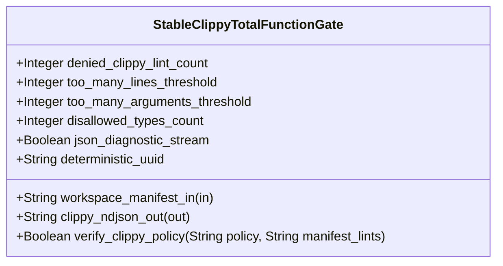

| Attribute | Specification Detail |
| :--- | :--- |
| **Issue ID** | #843 |
| **Title** | Feature 45: [BP 09 Multi Stage Compiler and Formal Verification Gatekeeper] StableClippyTotalFunctionGate |
| **Type** | feature |
| **Parent Epic** | [EPIC-09-BP_09_Multi_Stage_Compiler_and_Formal_Verification_Gatekeeper](../epics/EPIC-09-BP_09_Multi_Stage_Compiler_and_Formal_Verification_Gatekeeper.md) (#854) |
| **Interface Type** | Physical / Structural / Internal Bus |
| **Schema Containers** | `BP_09_Multi_Stage_Compiler_and_Formal_Verification_Gatekeeper::StableClippyTotalFunctionGate` |
| **Generation Mode** | subagent |
| **Specification Source** | [schema/model.sysml](../../schema/model.sysml) |

# Feature 45: [BP 09 Multi Stage Compiler and Formal Verification Gatekeeper] StableClippyTotalFunctionGate

## Description
`StableClippyTotalFunctionGate` specifies the Stage 1 Universal Stable Clippy Total-Function and `clippy.toml` Threshold Gate within `BP_09_Multi_Stage_Compiler_and_Formal_Verification_Gatekeeper` (**REQ-0609** / `BP-09` / `DEAP-BP-DET-09`).
- **Contract A (100% OMG SysML v2.0 + KerML 1.0 Grammar Coverage)**: Enforces Stage 1 total-function, arithmetic, cast, unsafe-doc, and cognitive/structural complexity invariants across all compiler, ingestion, and downstream crates processing the complete OMG SysML v2.0 and KerML 1.0 textual grammar with full Definition and Usage symmetry and zero 16-construct artificial caps.
- **Contract B (Official Cargo, `toml_edit` & `ra_ap_syntax` Compiler Stack, Zero Hand-Rolled Scanners)**: Parses `Cargo.toml` (`[workspace.lints.clippy]`) and `clippy.toml` (`too-many-lines-threshold = 80`, `too-many-arguments-threshold = 5`, `disallowed-types`) via `cargo_metadata`, `cargo-lock`, `cargo-util-schemas`, `cargo-platform`, and `toml_edit`, verifies lossless Rust CST syntax and `< 380`-SLOC submodule modularity via `ra_ap_syntax` (`SourceFile::parse`, `Edition::Edition2024`), and streams `cargo clippy --workspace --all-targets --message-format=json` NDJSON diagnostics with dynamic runtime `PATH` discovery and zero hand-rolled string/line/char-by-char scanners.

## UML Class Diagram



## Interface Requirements
### 1. Test Data Shape
```json
{
  "$schema": "https://json-schema.org/draft/2020-12/schema",
  "title": "StableClippyTotalFunctionGatePayloadSchema",
  "type": "object",
  "properties": {
    "part": {
      "type": "string",
      "const": "StableClippyTotalFunctionGate"
    },
    "status": {
      "type": "string",
      "enum": ["nominal", "degraded", "fault"]
    },
    "denied_clippy_lint_count": {
      "type": "integer",
      "x-sysml-type": "Integer",
      "description": "Declared attribute denied_clippy_lint_count (Integer)",
      "default": 14
    },
    "too_many_lines_threshold": {
      "type": "integer",
      "x-sysml-type": "Integer",
      "description": "Maximum HIR function body line count enforced in root `clippy.toml` (`too-many-lines-threshold`). [unit: lines]",
      "default": 80
    },
    "too_many_arguments_threshold": {
      "type": "integer",
      "x-sysml-type": "Integer",
      "description": "Maximum callable parameter count enforced in root `clippy.toml` (`too-many-arguments-threshold`). [unit: params]",
      "default": 5
    },
    "disallowed_types_count": {
      "type": "integer",
      "x-sysml-type": "Integer",
      "description": "Minimum banned non-deterministic hash container and backtracking pattern-engine entries in `clippy.toml`. [unit: types]",
      "default": 3
    },
    "json_diagnostic_stream": {
      "type": "boolean",
      "x-sysml-type": "Boolean",
      "description": "Emits single-line `cargo clippy --message-format=json` NDJSON diagnostics into the autonomous remediation loop. [unit: flag]",
      "default": true
    },
    "deterministic_uuid": {
      "type": "string",
      "x-sysml-type": "String",
      "description": "Canonical deterministic blueprint identifier (`DEAP-BP-DET-09`). [unit: uuidv5]",
      "default": "6ba7b810-9dad-11d1-80b4-00c04fd430c9"
    },
    "workspace_manifest_in": {
      "type": "object",
      "properties": {
        "direction": { "type": "string", "const": "in" },
        "port_type": { "type": "string", "const": "String" }
      },
      "required": ["direction", "port_type"]
    },
    "clippy_ndjson_out": {
      "type": "object",
      "properties": {
        "direction": { "type": "string", "const": "out" },
        "port_type": { "type": "string", "const": "String" }
      },
      "required": ["direction", "port_type"]
    }
  },
  "required": [
    "part",
    "status",
    "workspace_manifest_in",
    "clippy_ndjson_out"
  ],
  "additionalProperties": false
}
```

### 2. Validation & Constraints
Declared structural attributes, boundary ports, invariants, and allocated requirements for classifier `StableClippyTotalFunctionGate`:

| AST Member Kind | Identifier | Declared Type / Direction | Default / Invariant Contract |
| :--- | :--- | :--- | :--- |
| Attribute | `denied_clippy_lint_count` | `Integer` | Default `14` (All 14 total-function, arithmetic, cast, unsafe-doc, and complexity lints set to `"deny"` or `"forbid"`) |
| Attribute | `too_many_lines_threshold` | `Integer` | Default `80` (`C_VER_01: 1 <= too_many_lines_threshold <= 80`) |
| Attribute | `too_many_arguments_threshold` | `Integer` | Default `5` (`C_VER_02: 0 <= too_many_arguments_threshold <= 5`) |
| Attribute | `disallowed_types_count` | `Integer` | Default `3` (Bans `std::collections::HashMap`, `std::collections::HashSet`, and backtracking pattern types) |
| Attribute | `json_diagnostic_stream` | `Boolean` | Default `true` (`cargo clippy --workspace --all-targets --message-format=json`) |
| Attribute | `deterministic_uuid` | `String` | Default `"6ba7b810-9dad-11d1-80b4-00c04fd430c9"` |
| Operation | `verify_clippy_policy` | `in policy: String, in manifest_lints: String, return Boolean` | Validates `Cargo.toml` and `clippy.toml` policy invariants (`C_VER_01`, `C_VER_02`, `DEAP-E0900`) |
| Port | `workspace_manifest_in` | `in String` | Boundary interface contract |
| Port | `clippy_ndjson_out` | `out String` | Boundary interface contract (`BP_09_ClippyToOrchestratorConnection`) |
| Constraint | `C_VER_01` | `too_many_lines_threshold >= 1 and too_many_lines_threshold <= 80` | Maximum function body line count in `clippy.toml` |
| Constraint | `C_VER_02` | `too_many_arguments_threshold >= 0 and too_many_arguments_threshold <= 5` | Maximum callable argument count in `clippy.toml` |
| Constraint | `C_VER_07` | `max_module_exec_sloc >= 1 and max_module_exec_sloc <= 380` | Submodule executable SLOC ceiling (`< 380` SLOC verified via `ra_ap_syntax`) |
| Constraint | `Invariant_REQ_0609_SC_01` | Invariant (`REQ-0609 (REQ_0609_BP_09_Multi_Stage_Compiler_and_Formal_Verification_Gatekeeper)`) | Stage 1 universal stable Clippy total-function and `clippy.toml` threshold enforcement |
| Requirement | `REQ-0609 (REQ_0609_BP_09_Multi_Stage_Compiler_and_Formal_Verification_Gatekeeper)` | Allocated Requirement | MultiStageFormalVerificationGatekeeper (**REQ-0609** / `BP-09` / `DEAP-BP-DET-09`, UUIDv5 `6ba7b810-9dad-11d1-80b4-00c04fd430c9`, governed by DO-178C Level A, DO-330 TQL-4, and DO-333 Formal Methods Supplement) |

### 3. Visual Layout & Arrangement
Structural composition and boundary topology for classifier `StableClippyTotalFunctionGate` organize no nested subparts declared in schema paired with boundary ports `in workspace_manifest_in : String`, `out clippy_ndjson_out : String`.

### 4. Interactive Flow & States
Operational lifecycle events and discrete state transitions for `StableClippyTotalFunctionGate` within `BP_09_Multi_Stage_Compiler_and_Formal_Verification_Gatekeeper_LifecycleState` (`RunningStage1Clippy -> RunningStage2DylintMir` on `stage1TotalFunctionsVerified`; `RunningStage1Clippy -> FailedClosedJsonDiagnostic` on `rejectStage1ClippyViolation`).

### Layer 1: Domain State & Signal Model
Classifier `StableClippyTotalFunctionGate` encapsulates typed domain state attributes `denied_clippy_lint_count : Integer`, `too_many_lines_threshold : Integer`, `too_many_arguments_threshold : Integer`, `disallowed_types_count : Integer`, `json_diagnostic_stream : Boolean`, `deterministic_uuid : String` alongside `ClippyThresholdPolicy` and `StageGateReceipt` records.

### Layer 2: Logic & Safety State Management
Classifier `StableClippyTotalFunctionGate` governs stateless structural transition evaluation enforcing `C_VER_01`, `C_VER_02`, `C_VER_07`, and `Invariant_REQ_0609_SC_01`. Parses `Cargo.toml` and `clippy.toml` via `cargo_metadata` and `toml_edit` (`verify_clippy_policy`) inside `< 380`-SLOC submodules (`./crates/verify-baseline/src/formal_gates/`) while explicitly deleting legacy hand-rolled TOML/attribute string scanners.

### Layer 3: Presentation & Actuator Interface Binding
Classifier `StableClippyTotalFunctionGate` binds external and behavioral interfaces across port `in workspace_manifest_in : String` and port `out clippy_ndjson_out : String` (routed via `BP_09_ClippyToOrchestratorConnection` to `MultiStageVerificationOrchestrator.gate_invocation_in`), streaming single-line NDJSON diagnostics (`DEAP-E0900`).

### Associated Use Cases & User Stories

#### Associated Use Cases
- [ ] #774 - [Use Case 45: Stage 1 Universal Stable Clippy Total Function and clippy toml Threshold Enforcement](../use-cases/UC-45-Stage_1_Universal_Stable_Clippy_Total_Function_and_clippy_toml_Threshold_Enforcement.md) (Directly realizes Stage 1 `Cargo.toml` and `clippy.toml` policy validation and `cargo clippy --workspace --all-targets --message-format=json` enforcement)
- [ ] #780 - [Use Case 51: Cross Platform Toolchain Discovery Modular Submodule Layout and Fail Closed Qualification Gate](../use-cases/UC-51-Cross_Platform_Toolchain_Discovery_Modular_Submodule_Layout_and_Fail_Closed_Qualification_Gate.md) (Enforces `< 380`-SLOC submodule modularity and cross-platform `cargo-clippy` runtime `PATH` discovery)

#### Associated User Stories
- [ ] #809 - [User Story 59: Probe Formal Toolchain](../user-stories/US-59-probe_formal_toolchain.md) (Probes `cargo-clippy` and formal verification drivers dynamically via runtime `PATH`)
- [ ] #810 - [User Story 60: Verify Clippy Policy](../user-stories/US-60-verify_clippy_policy.md) (Executes `verify_clippy_policy(policy, manifest_lints)` against `C_VER_01`, `C_VER_02`, and all 14 required Clippy denials)
- [ ] #811 - [User Story 61: Evaluate Stage2 Dylint Mir](../user-stories/US-61-evaluate_stage2_dylint_mir.md) (Promotes verified Stage 1 Clippy receipts to Stage 2 Dylint MIR evaluation)
- [ ] #812 - [User Story 62: Verify In Process Cst Syntax](../user-stories/US-62-verify_in_process_cst_syntax.md) (Verifies lossless `ra_ap_syntax` CST parse integrity and `< 380`-SLOC submodule bounds)
- [ ] #813 - [User Story 63: Guard Inbound Frb F64](../user-stories/US-63-guard_inbound_frb_f64.md) (Enforces Stage 1 total-function and `undocumented_unsafe_blocks` prerequisites on Stage 3 FFI guards)
- [ ] #814 - [User Story 64: Validate Kani Harness Spec](../user-stories/US-64-validate_kani_harness_spec.md) (Enforces Stage 1 total-function lint discipline across synthesized Stage 4 Kani harness modules)
- [ ] #815 - [User Story 65: Evaluate Four Stage Gatekeeper](../user-stories/US-65-evaluate_four_stage_gatekeeper.md) (Supplies the Stage 1 `StageGateReceipt` to the 4-stage gatekeeper evaluation)

## Acceptance Criteria (BDD)
- [ ] AC-01: Given valid `StableClippyTotalFunctionGate` initialization inputs for `denied_clippy_lint_count` (`Integer`), `too_many_lines_threshold` (`Integer`), `too_many_arguments_threshold` (`Integer`), `disallowed_types_count` (`Integer`), `json_diagnostic_stream` (`Boolean`), `deterministic_uuid` (`String`) satisfying `C_VER_01`, `C_VER_02`, and `C_VER_07`, When `StableClippyTotalFunctionGate` commits typed domain state, Then declared state attributes hold verified values.
- [ ] AC-02: Given malformed or out-of-domain input values for `denied_clippy_lint_count` (`Integer`), `too_many_lines_threshold` (`Integer`), `too_many_arguments_threshold` (`Integer`), `disallowed_types_count` (`Integer`), `json_diagnostic_stream` (`Boolean`), `deterministic_uuid` (`String`), When `StableClippyTotalFunctionGate` validates incoming state updates, Then `StableClippyTotalFunctionGate` rejects the invalid state update and emits a diagnostic (`DEAP-E0900`) via diagnostic port `clippy_ndjson_out`.
- [ ] AC-03: Given nominal signal arrival across `workspace_manifest_in` (`in String`), `clippy_ndjson_out` (`out String`), When `StableClippyTotalFunctionGate` processes the declared interface transaction, Then output state conforms to the structural classifier contract.
- [ ] AC-04: Given an invalid or unrecognized interface frame across `workspace_manifest_in` (`in String`), `clippy_ndjson_out` (`out String`), When `StableClippyTotalFunctionGate` boundary validation executes, Then `StableClippyTotalFunctionGate` refuses the malformed frame via diagnostic port `clippy_ndjson_out` and preserves prior verified state.

## Source References
Formal component specifications and normative systems engineering requirements:
- System Architecture Model: `schema/model.sysml`
- Engineering Design Blueprint: `./docs/designs/blueprint-09-clippy-dylint-miri-kani-formal-verification-gate.md`
- Normative Systems Engineering Standard: ISO/IEC/IEEE 15288:2023 §6.4.3 Architecture Definition Process

Component behavior and interface definitions derive from `schema/model.sysml` pursuant to ISO/IEC/IEEE 15288.
