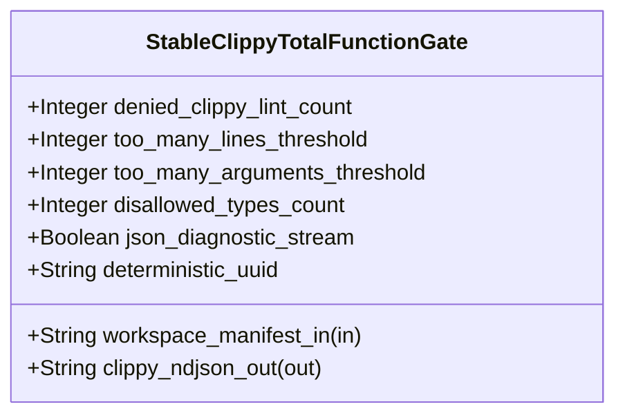

| Attribute | Specification Detail |
| :--- | :--- |
| **Issue ID** | #751 |
| **Title** | Feature 45: [BP 09 Multi Stage Compiler and Formal Verification Gatekeeper] StableClippyTotalFunctionGate |
| **Type** | feature |
| **Parent Epic** | [EPIC-09-BP_09_Multi_Stage_Compiler_and_Formal_Verification_Gatekeeper](../epics/EPIC-09-BP_09_Multi_Stage_Compiler_and_Formal_Verification_Gatekeeper.md) |
| **Interface Type** | Physical / Structural / Internal Bus |
| **Schema Containers** | `BP_09_Multi_Stage_Compiler_and_Formal_Verification_Gatekeeper::StableClippyTotalFunctionGate` |
| **Generation Mode** | subagent |
| **Specification Source** | [schema/model.sysml](../../schema/model.sysml) |

# Feature 45: [BP 09 Multi Stage Compiler and Formal Verification Gatekeeper] StableClippyTotalFunctionGate

## UML Class Diagram



## Interface Requirements
### 1. Test Data Shape
```json
{
  "$schema": "https://json-schema.org/draft/2020-12/schema",
  "title": "StableClippyTotalFunctionGatePayloadSchema",
  "type": "object",
  "properties": {
    "part": {
      "type": "string",
      "const": "StableClippyTotalFunctionGate"
    },
    "status": {
      "type": "string",
      "enum": ["nominal", "degraded", "fault"]
    },
    "denied_clippy_lint_count": {
      "type": "integer",
      "x-sysml-type": "Integer",
      "description": "Declared attribute denied_clippy_lint_count (Integer)",
      "default": 14
    },
    "too_many_lines_threshold": {
      "type": "integer",
      "x-sysml-type": "Integer",
      "description": "Maximum HIR function body line count enforced in root `clippy.toml` (`too-many-lines-threshold`). [unit: lines]",
      "default": 80
    },
    "too_many_arguments_threshold": {
      "type": "integer",
      "x-sysml-type": "Integer",
      "description": "Maximum callable parameter count enforced in root `clippy.toml` (`too-many-arguments-threshold`). [unit: params]",
      "default": 5
    },
    "disallowed_types_count": {
      "type": "integer",
      "x-sysml-type": "Integer",
      "description": "Minimum banned non-deterministic hash container and backtracking pattern-engine entries in `clippy.toml`. [unit: types]",
      "default": 3
    },
    "json_diagnostic_stream": {
      "type": "boolean",
      "x-sysml-type": "Boolean",
      "description": "Emits single-line `cargo clippy --message-format=json` NDJSON diagnostics into the autonomous remediation loop. [unit: flag]",
      "default": true
    },
    "deterministic_uuid": {
      "type": "string",
      "x-sysml-type": "String",
      "description": "Canonical deterministic blueprint identifier (`DEAP-BP-DET-09`). [unit: uuidv5]",
      "default": "6ba7b810-9dad-11d1-80b4-00c04fd430c9"
    },
    "workspace_manifest_in": {
      "type": "object",
      "properties": {
        "direction": { "type": "string", "const": "in" },
        "port_type": { "type": "string", "const": "String" }
      },
      "required": ["direction", "port_type"]
    },
    "clippy_ndjson_out": {
      "type": "object",
      "properties": {
        "direction": { "type": "string", "const": "out" },
        "port_type": { "type": "string", "const": "String" }
      },
      "required": ["direction", "port_type"]
    }
  },
  "required": [
    "part",
    "status",
    "workspace_manifest_in",
    "clippy_ndjson_out"
  ],
  "additionalProperties": false
}
```

### 2. Validation & Constraints
Declared structural attributes, boundary ports, invariants, and allocated requirements for classifier `StableClippyTotalFunctionGate`:

| AST Member Kind | Identifier | Declared Type / Direction | Default / Invariant Contract |
| :--- | :--- | :--- | :--- |
| Attribute | `denied_clippy_lint_count` | `Integer` | Default `14` |
| Attribute | `too_many_lines_threshold` | `Integer` | Default `80` |
| Attribute | `too_many_arguments_threshold` | `Integer` | Default `5` |
| Attribute | `disallowed_types_count` | `Integer` | Default `3` |
| Attribute | `json_diagnostic_stream` | `Boolean` | Default `true` |
| Attribute | `deterministic_uuid` | `String` | Default `"6ba7b810-9dad-11d1-80b4-00c04fd430c9"` |
| Port | `workspace_manifest_in` | `in String` | Boundary interface contract |
| Port | `clippy_ndjson_out` | `out String` | Boundary interface contract |

### 3. Visual Layout & Arrangement
Structural composition and boundary topology for classifier `StableClippyTotalFunctionGate` organize no nested subparts declared in schema paired with boundary ports `in workspace_manifest_in : String`, `out clippy_ndjson_out : String`.

### 4. Interactive Flow & States
Operational lifecycle events and discrete state transitions for StableClippyTotalFunctionGate.

### Layer 1: Domain State & Signal Model
Classifier `StableClippyTotalFunctionGate` encapsulates typed domain state attributes `denied_clippy_lint_count : Integer`, `too_many_lines_threshold : Integer`, `too_many_arguments_threshold : Integer`, `disallowed_types_count : Integer`, `json_diagnostic_stream : Boolean`, `deterministic_uuid : String` alongside operational lifecycle status.

### Layer 2: Logic & Safety State Management
Classifier `StableClippyTotalFunctionGate` governs stateless structural transition evaluation enforcing no additional invariant guards declared in schema.

### Layer 3: Presentation & Actuator Interface Binding
Classifier `StableClippyTotalFunctionGate` binds external and behavioral interfaces across port `in workspace_manifest_in : String`, port `out clippy_ndjson_out : String`.

### Associated Use Cases & User Stories

#### Associated Use Cases
- None allocated (structural subsystem component)

#### Associated User Stories
- [ ] #808 - [User Story 59: probe formal toolchain](../user-stories/US-59-probe_formal_toolchain.md)
- [ ] #809 - [User Story 60: verify clippy policy](../user-stories/US-60-verify_clippy_policy.md)
- [ ] #810 - [User Story 61: evaluate stage2 dylint mir](../user-stories/US-61-evaluate_stage2_dylint_mir.md)
- [ ] #811 - [User Story 62: verify in process cst syntax](../user-stories/US-62-verify_in_process_cst_syntax.md)
- [ ] #812 - [User Story 63: guard inbound frb f64](../user-stories/US-63-guard_inbound_frb_f64.md)
- [ ] #813 - [User Story 64: validate kani harness spec](../user-stories/US-64-validate_kani_harness_spec.md)
- [ ] #814 - [User Story 65: evaluate four stage gatekeeper](../user-stories/US-65-evaluate_four_stage_gatekeeper.md)

## Acceptance Criteria (BDD)
- [ ] AC-01: Given valid `StableClippyTotalFunctionGate` initialization inputs for `denied_clippy_lint_count` (`Integer`), `too_many_lines_threshold` (`Integer`), `too_many_arguments_threshold` (`Integer`), `disallowed_types_count` (`Integer`), `json_diagnostic_stream` (`Boolean`), `deterministic_uuid` (`String`) (no additional constraints specified in schema), When `StableClippyTotalFunctionGate` commits typed domain state, Then declared state attributes hold verified values.
- [ ] AC-02: Given malformed or out-of-domain input values for `denied_clippy_lint_count` (`Integer`), `too_many_lines_threshold` (`Integer`), `too_many_arguments_threshold` (`Integer`), `disallowed_types_count` (`Integer`), `json_diagnostic_stream` (`Boolean`), `deterministic_uuid` (`String`), When `StableClippyTotalFunctionGate` validates incoming state updates, Then `StableClippyTotalFunctionGate` rejects the invalid state update and emits a diagnostic via diagnostic port `clippy_ndjson_out`.
- [ ] AC-03: Given nominal signal arrival across `workspace_manifest_in` (`in String`), `clippy_ndjson_out` (`out String`), When `StableClippyTotalFunctionGate` processes the declared interface transaction, Then output state conforms to the structural classifier contract.
- [ ] AC-04: Given an invalid or unrecognized interface frame across `workspace_manifest_in` (`in String`), `clippy_ndjson_out` (`out String`), When `StableClippyTotalFunctionGate` boundary validation executes, Then `StableClippyTotalFunctionGate` refuses the malformed frame via diagnostic port `clippy_ndjson_out` and preserves prior verified state.

## Source References
Formal component specifications and normative systems engineering requirements:
- System Architecture Model: `schema/model.sysml`
- Normative Systems Engineering Standard: ISO/IEC/IEEE 15288:2023 §6.4.3 Architecture Definition Process

Component behavior and interface definitions derive from `schema/model.sysml` pursuant to ISO/IEC/IEEE 15288.
