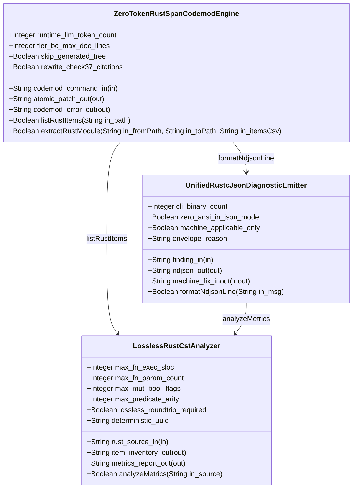
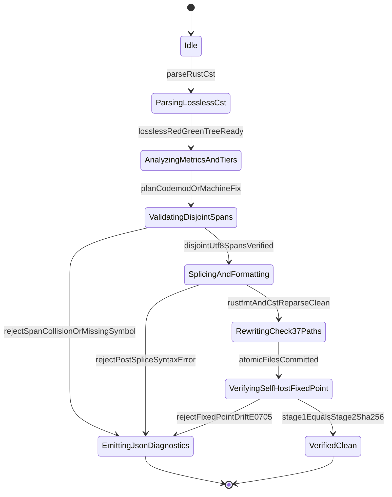

| Attribute | Specification Detail |
| :--- | :--- |
| **Issue ID** | TBD |
| **Title** | Feature 45: [BP 08 Lossless Rust CST Codemod Engine and Unified rustc Compatible JSON Diagnostics] ZeroTokenRustSpanCodemodEngine |
| **Type** | feature |
| **Parent Epic** | [EPIC-08-BP_08_Lossless_Rust_CST_Codemod_Engine_and_Unified_rustc_Compatible_JSON_Diagnostics](../epics/EPIC-08-BP_08_Lossless_Rust_CST_Codemod_Engine_and_Unified_rustc_Compatible_JSON_Diagnostics.md) |
| **Interface Type** | Physical / Structural / Internal Bus |
| **Schema Containers** | `BP_08_Lossless_Rust_CST_Codemod_Engine_and_Unified_rustc_Compatible_JSON_Diagnostics::ZeroTokenRustSpanCodemodEngine` |
| **Generation Mode** | subagent |
| **Specification Source** | [schema/model.sysml](../../schema/model.sysml) |

# Feature 45: [BP 08 Lossless Rust CST Codemod Engine and Unified rustc Compatible JSON Diagnostics] ZeroTokenRustSpanCodemodEngine

## Parent Epic
- [EPIC-08-BP_08_Lossless_Rust_CST_Codemod_Engine_and_Unified_rustc_Compatible_JSON_Diagnostics](../epics/EPIC-08-BP_08_Lossless_Rust_CST_Codemod_Engine_and_Unified_rustc_Compatible_JSON_Diagnostics.md) -- Allocates `ZeroTokenRustSpanCodemodEngine` under **REQ-0608** (`BP-08`, deterministic UUIDv5 `6ba7b810-9dad-11d1-80b4-00c04fd430c8`) to execute zero-LLM-token Rust Concrete Syntax Tree (CST) item inventories, disjoint UTF-8 `TextRange` module extractions with Check-37 citation rewriting, and `DocTier::RustTierBC` docstring compaction.
- Allocated Behavioral User Stories:
  - [US-52-listRustItems](../user-stories/US-52-listRustItems.md) -- Realizes deterministic `BTreeMap`-ordered AST item inventory enumeration (`--list-rust-items`) with trivia-inclusive UTF-8 `TextRange` `[byte_start..byte_end)` spans and `cfg(test)`-excluded `DocTier` classification.
  - [US-53-extractRustModule](../user-stories/US-53-extractRustModule.md) -- Realizes atomic reverse-byte-order UTF-8 `TextRange` module slicing (`--extract-rust-module`), post-splice zero-error CST re-parse verification, and Check-37 blueprint and `README.md` path rewriting.

## Description
`ZeroTokenRustSpanCodemodEngine` is a pure deterministic Rust Concrete Syntax Tree (CST) transformation component within package `BP_08_Lossless_Rust_CST_Codemod_Engine_and_Unified_rustc_Compatible_JSON_Diagnostics` (**REQ-0608**, ConOps Section 4 Compiler Subsystem Architecture). Operating exclusively over lossless `ra_ap_syntax` and `rowan` Red/Green syntax trees produced by `LosslessRustCstAnalyzer` with zero runtime LLM token consumption (`runtime_llm_token_count == 0`, **C_CST_05**), the component executes three closed-world source-to-source refactoring operations across `crates/deap-core` and `crates/compile-sysml` while maintaining a compact target implementation module budget strictly `< 380` production executable SLOC (excluding `cfg(test)` unit-test modules):

1. **Deterministic `--list-rust-items <PATH>` `BTreeMap` Item Inventory ([US-52-listRustItems](../user-stories/US-52-listRustItems.md))**:
   - Requests a lossless Red/Green CST parse from `LosslessRustCstAnalyzer` (`MAX_AST_DEPTH = 64` traversal ceiling) and enumerates all top-level Rust declarations (`struct`, `enum`, `trait`, `fn`, `impl`, `type`, `const`, `static`, `mod`).
   - Captures each item's trivia-inclusive UTF-8 `TextRange` `[byte_start..byte_end)` and 1-based `[line_start..line_end]` coordinates spanning contiguous leading `///` outer docblocks and outer Rust `ast::Attr` nodes (`derive`, `cfg(test)`, `test` attributes) through the item's closing token.
   - Evaluates span-paired `cfg(test)` module and `test`-annotated item scopes so test-only items are deterministically flagged and excluded from production `DocTier` (`DocTier::RustTierA` public API items vs `DocTier::RustTierBC` private or `pub(crate)` items) and `ProductionExecSloc` accumulators.
   - Emits all item records ordered deterministically in a `BTreeMap` (`BTreeOrderedItemInventory`), guaranteeing byte-identical output across platforms and runs.

2. **Atomic `--extract-rust-module --from <FROM_PATH> --to <TO_PATH> --items <ITEMS_CSV>` UTF-8 `TextRange` Span Slicer and Check-37 Citation Rewriter ([US-53-extractRustModule](../user-stories/US-53-extractRustModule.md))**:
   - Canonicalizes workspace-relative `--from` and `--to` paths (rejecting `..` parent traversal, leading `/`, NUL bytes, and symlinks with **DEAP-E0801**).
   - Resolves every requested AST identifier in `<ITEMS_CSV>` together with its contiguous leading `///` docblocks and outer Rust attribute nodes; fails closed with **DEAP-E0801** if any requested symbol is absent.
   - Validates `DisjointValid` (**Invariant_REQ_0608_SC_03**) over sorted `TextRange` intervals (`0 <= byte_start <= byte_end <= source_len`, `str::is_char_boundary(byte_start)`, `str::is_char_boundary(byte_end)`, and pairwise disjointness `prev_byte_end <= next_byte_start`), failing closed with **DEAP-E0802** on any span overlap.
   - Extracts item slices using total `.get(byte_start..byte_end)` indexing and removes extracted ranges from `<from_path>` strictly in reverse byte order using checked arithmetic (`checked_sub`, `checked_add`, `saturating_sub`) so earlier splices never invalidate downstream byte offsets.
   - Synthesizes `<to_path>` with a `DocTier::RustTierA` `//!` module header (preserving `#![forbid(unsafe_code)]` crate/module governance), wires submodule and visibility declarations in `<from_path>`, formats buffers with `rustfmt`, and enforces `AdmissibleCommit` by re-parsing every resulting `.rs` buffer in memory via `ra_ap_syntax::SourceFile::parse` requiring `errors().is_empty()` (failing closed with **DEAP-E0803** and zero disk writes on any syntax error).
   - When `rewrite_check37_citations == true`, deterministically scans `docs/architecture/blueprints/` (`*.md`) and `README.md` (rejecting symlinks) to rewrite legacy single-file `<name>.rs` citations into directory-module `<name>/mod.rs` citations (for example, `crates/deap-core/src/sysml_ast/mod.rs`) within the same staged temp-file-and-rename multi-file transaction (`AtomicWorkspacePatch`).

3. **Lossless `--compact-tier-bc <DIR>` Docblock Compactor Skipping `modular_codegen/generated/`**:
   - Walks workspace Rust source trees canonically (rejecting cyclic symlinks with **DEAP-E0804**) while unconditionally skipping `crates/compile-sysml/src/modular_codegen/generated/` whenever `skip_generated_tree == true`, preserving Stage-1 == Stage-2 metacircular SHA-256 fixed-point identity (**C_CST_04** `stage_fixed_point_mismatch_files == 0`, **Invariant_REQ_0608_SC_02**, **DEAP-E0705**).
   - Preserves `cfg(test)`-excluded `DocTier` classification rules: `DocTier::RustTierA` public items retain their full 7-section Check-36 docstrings untouched, `cfg(test)` modules and `test`-annotated unit-test functions remain exempt from production `DocTier` rewriting, and production `DocTier::RustTierBC` private or `pub(crate)` items carrying legacy multi-line (28-line 7-section) docblocks are compacted in reverse byte order to `tier_bc_max_doc_lines == 2` lines (**C_CST_06**): line 1 `/// <summary>` and line 2 `/// Realises: [REQ-*]`.
   - Verifies non-trivia executable CST token sequence invariance (**Invariant_REQ_0608_SC_01**), retention of every `Realises: [REQ-*]` traceability tag, and zero post-splice `SourceFile::parse` syntax errors (**Invariant_REQ_0608_SC_03**) in memory prior to atomic temp-and-rename persistence, aborting fail-closed with **DEAP-E0803** on any violation.

### Mathematical Formulations of Disjoint UTF-8 Span Splicing and Complexity Invariants

$$
\begin{aligned}
\text{DisjointValid}(S, \mathcal{E}) &\iff \forall i \in \{1, \dots, m\}, \quad 0 \le a_i \le b_i \le \lvert S \rvert \land \text{isCharBoundary}(S, a_i) \land \text{isCharBoundary}(S, b_i) \\
&\land \forall i \in \{1, \dots, m - 1\}, \quad b_i \le a_{i+1} \\
\text{AdmissibleCommit}(S, \mathcal{E}) &\iff \text{DisjointValid}(S, \mathcal{E}) \land \lvert \text{errors}(\text{SourceFileParse}(\text{Splice}(S, \mathcal{E}))) \rvert = 0 \\
\text{ExecTokenInvariant}(S, S') &\iff \tau_{\text{exec}}(T_{\text{red}}(S) \setminus T_{\text{test}}) = \tau_{\text{exec}}(T_{\text{red}}(S') \setminus T_{\text{test}}) \\
T_{\text{cst}}(N, M) &= O(N + M \log M), \quad S_{\text{cst}}(N, M) = O(N + M), \quad K_{\text{LLM}} = 0
\end{aligned}
$$

<!-- Source: docs/designs/blueprint-08-rust-analyzer-cst-refactoring-and-json-diagnostics.sysml Clause Invariant_REQ_0608_SC_01..SC_04 -->
- Parameter Definitions & Engineering Units:
- $S, S'$: Pre-splice and post-splice UTF-8 `.rs` source buffers measured in `bytes` ($\lvert S \rvert \ge 0$).
- $\mathcal{E}$: Ordered sequence of $m$ `SpanSpliceEdit` byte-range descriptors $\{(a_1, b_1, r_1), \dots, (a_m, b_m, r_m)\}$ applied in reverse index order $i = m \dots 1$.
- $a_i, b_i$: Half-open UTF-8 `TextRange` offsets `[byte_start..byte_end)` in `bytes` satisfying $0 \le a_i \le b_i \le \lvert S \rvert$ and UTF-8 scalar boundary validity $\text{isCharBoundary}$.
- $T_{\text{red}}(S) \setminus T_{\text{test}}$: Production `rowan` Red syntax tree projection excluding span-paired `cfg(test)` modules and unit-test `ast::Fn` items.
- $\tau_{\text{exec}}$: Ordered sequence of non-trivia executable CST tokens (excluding comments, docblocks, and whitespace trivia).
- $N$: Input UTF-8 source byte count (`bytes`), and $M$: Candidate `SpanSpliceEdit` count (`edits`).
- $T_{\text{cst}}(N, M), S_{\text{cst}}(N, M)$: Deterministic time complexity $O(N + M \log M)$ and auxiliary linear memory bound $O(N + M)$.
- $K_{\text{LLM}}$: Runtime LLM token consumption fixed at `0` `tokens` (`runtime_llm_token_count == 0`, **C_CST_05**).

## UML Class Diagram



## Interface Requirements
### 1. Test Data Shape
```json
{
  "$schema": "https://json-schema.org/draft/2020-12/schema",
  "title": "ZeroTokenRustSpanCodemodEnginePayloadSchema",
  "type": "object",
  "properties": {
    "part": {
      "type": "string",
      "const": "ZeroTokenRustSpanCodemodEngine"
    },
    "status": {
      "type": "string",
      "enum": ["nominal", "degraded", "fault"]
    },
    "runtime_llm_token_count": {
      "type": "integer",
      "x-sysml-type": "Integer",
      "minimum": 0,
      "maximum": 0,
      "description": "Mandatory zero runtime LLM token consumption across item listing, module extraction, and Tier B/C docstring compaction. [unit: tokens]",
      "default": 0
    },
    "tier_bc_max_doc_lines": {
      "type": "integer",
      "x-sysml-type": "Integer",
      "minimum": 2,
      "maximum": 2,
      "description": "Target compacted docstring line count (`/// <summary>` + `/// Realises: [REQ-*]`) on `DocTier::RustTierBC` items. [unit: lines]",
      "default": 2
    },
    "skip_generated_tree": {
      "type": "boolean",
      "x-sysml-type": "Boolean",
      "const": true,
      "description": "Excludes `crates/compile-sysml/src/modular_codegen/generated/` from `--compact-tier-bc` docstring rewriting. [unit: flag]",
      "default": true
    },
    "rewrite_check37_citations": {
      "type": "boolean",
      "x-sysml-type": "Boolean",
      "const": true,
      "description": "Deterministically updates `.rs` citations to `/mod.rs` across `docs/architecture/blueprints/*.md` and `README.md`. [unit: flag]",
      "default": true
    },
    "codemod_command_in": {
      "type": "object",
      "properties": {
        "direction": { "type": "string", "const": "in" },
        "port_type": { "type": "string", "const": "String" },
        "protocol": { "type": "string", "const": "CstCodemodCommand" }
      },
      "required": ["direction", "port_type", "protocol"]
    },
    "atomic_patch_out": {
      "type": "object",
      "properties": {
        "direction": { "type": "string", "const": "out" },
        "port_type": { "type": "string", "const": "String" },
        "protocol": { "type": "string", "const": "AtomicWorkspacePatch" }
      },
      "required": ["direction", "port_type", "protocol"]
    },
    "codemod_error_out": {
      "type": "object",
      "properties": {
        "direction": { "type": "string", "const": "out" },
        "port_type": { "type": "string", "const": "String" },
        "protocol": { "type": "string", "const": "RustcJsonDiagnosticStream" }
      },
      "required": ["direction", "port_type", "protocol"]
    }
  },
  "required": [
    "part",
    "status",
    "runtime_llm_token_count",
    "tier_bc_max_doc_lines",
    "skip_generated_tree",
    "rewrite_check37_citations",
    "codemod_command_in",
    "atomic_patch_out",
    "codemod_error_out"
  ],
  "additionalProperties": false
}
```

### 2. Validation & Constraints
Declared SysML v2 structural attributes, boundary ports, `ICD_01`/`ICD_02` logical signal contracts, `assert constraint` invariants, and cataloged pre-STPA component failure modes for classifier `ZeroTokenRustSpanCodemodEngine`:

| AST Member Kind | Identifier | Declared Type / Direction | Units / Protocol | Default / Invariant Contract |
| :--- | :--- | :--- | :--- | :--- |
| Attribute | `runtime_llm_token_count` | `Integer` | `tokens` | Default `0`; bound by **C_CST_05** (`0 <= runtime_llm_token_count <= 0`, configurable: read-only invariant) |
| Attribute | `tier_bc_max_doc_lines` | `Integer` | `lines` | Default `2`; bound by **C_CST_06** (`2 <= tier_bc_max_doc_lines <= 2`, `/// <summary>` + `/// Realises: [REQ-*]`) |
| Attribute | `skip_generated_tree` | `Boolean` | `flag` | Default `true`; excludes `crates/compile-sysml/src/modular_codegen/generated/` to preserve **C_CST_04** (`stage_fixed_point_mismatch_files == 0`) |
| Attribute | `rewrite_check37_citations` | `Boolean` | `flag` | Default `true`; rewrites `<name>.rs` to `<name>/mod.rs` (e.g. `crates/deap-core/src/sysml_ast/mod.rs`) across `docs/architecture/blueprints/` and `README.md` |
| Port | `codemod_command_in` | `in String` | `CstCodemodCommand` | Flow `codemod_command_in_flow`; ingests `--list-rust-items`, `--extract-rust-module`, or `--compact-tier-bc` requests (`ICD_01` / `ICD_02`) |
| Port | `atomic_patch_out` | `out String` | `AtomicWorkspacePatch` | Flow `atomic_patch_out_flow`; commits reverse-spliced `.rs` units, Tier A `//!` headers, `rustfmt`, and Check-37 path updates atomically (`ICD_01` / `ICD_02`) |
| Port | `codemod_error_out` | `out String` | `RustcJsonDiagnosticStream` | Flow `codemod_error_out_flow`; emits single-line `reason: "compiler-message"` JSON diagnostics **DEAP-E0801**..**DEAP-E0804** (`0` `0x0A` internal newlines, `0` `0x1B` ANSI escapes) |
| Constraint | `C_CST_01` / `C_CST_02` / `C_CST_03` | `assert constraint` | `SLOC` / `params` / `flags` | `1 <= max_fn_exec_sloc <= 50` (within workspace `<= 80` exec SLOC Clippy ceiling), `0 <= max_fn_param_count <= 5`, `max_mut_bool_flags == 0`, target module `< 380` production exec SLOC |

#### Typed Action Operations and `ICD_01` / `ICD_02` Interface Signal Bindings
All behavioral operations derived from `docs/designs/blueprint-08-rust-analyzer-cst-refactoring-and-json-diagnostics.sysml`, `.pipeline/upstream/docs/ICD/ICD_01_SYSTEM_INTERFACE_MATRIX.md`, and `.pipeline/upstream/docs/ICD/ICD_02_MASTER_SIGNAL_DICTIONARY.md` enforce 100% typed `in`/`out` parameter signatures with zero untyped parameters:
- `+listRustItems(in path: String, out inventory: BTreeOrderedItemInventory) -> Result<BTreeMap<String, RustItemDescriptor>, CodemodError>`: Dispatches `listRustItems` to `LosslessRustCstAnalyzer` and receives `reply_RustItemInventory` ordered by deterministic `BTreeMap` lexical key `(byte_start, item_name)` with `cfg(test)` exclusion flags and `DocTier` labels.
- `+extractRustModule(in fromPath: String, in toPath: String, in itemsCsv: String, out patchReceipt: AtomicWorkspacePatch) -> Result<AtomicWorkspacePatch, CodemodError>`: Validates disjoint UTF-8 `TextRange` `[byte_start..byte_end)` intervals (`DisjointValid`), splices spans in reverse byte order, synthesizes `<to_path>` Tier A `//!` headers, formats with `rustfmt`, re-parses CST (`errors == 0`), and rewrites Check-37 citations (`<name>.rs` -> `<name>/mod.rs`) atomically on `atomic_patch_out`.
- `+compactTierBcDocblocks(in targetDir: String, in skipGeneratedTree: Boolean, out patchReceipt: AtomicWorkspacePatch) -> Result<AtomicWorkspacePatch, CodemodError>`: Compacts legacy multi-line docblocks on production `DocTier::RustTierBC` items outside `crates/compile-sysml/src/modular_codegen/generated/` to `tier_bc_max_doc_lines == 2` lines (`/// <summary>` + `/// Realises: [REQ-*]`) while preserving `DocTier::RustTierA` 7-section headers, `cfg(test)` exemptions, and executable token streams.
- `+formatNdjsonLine(in finding: DeapDiagnosticFinding, out ndjsonLine: RustcNdjsonLineStream) -> Result<String, CodemodError>`: Delegates fail-closed codemod rejections (**DEAP-E0801**..**DEAP-E0804**, **DEAP-E0705**) to `UnifiedRustcJsonDiagnosticEmitter` for single-line `rustc`-compatible NDJSON emission on `codemod_error_out`.

```rust
#![forbid(unsafe_code)]
//! Extracted submodule synthesized by ZeroTokenRustSpanCodemodEngine (DocTier::RustTierA).

/// Compacted Tier B/C private helper contract (tier_bc_max_doc_lines == 2).
/// Realises: [REQ-0608]
pub(crate) fn slice_disjoint_utf8_span(source: &str, start: usize, end: usize) -> Option<&str> {
    if source.is_char_boundary(start) && source.is_char_boundary(end) {
        source.get(start..end)
    } else {
        None
    }
}
```

#### Pre-STPA Failure Mode Bindings (`FAILURE_MODE_REGISTRY.md` `FM-BP08-017`..`FM-BP08-020`)
| FM ID | Failure Category | Trigger Condition on `ZeroTokenRustSpanCodemodEngine` | Fail-Closed Diagnostic & Safety Constraint |
| :--- | :--- | :--- | :--- |
| `FM-BP08-017` | `(1) Input/Boundary & Malformed Syntax` | Missing AST item identifier in `--items`, path-traversing `--from`/`--to` (`..`, leading `/`, NUL), mid-codepoint UTF-8 `TextRange` (`!str::is_char_boundary`), or mutated invariants (`runtime_llm_token_count != 0`, `tier_bc_max_doc_lines != 2`, `skip_generated_tree == false`, `rewrite_check37_citations == false`). | **DEAP-E0801** / **SC-BP08-03** -- Reject before splicing on `codemod_error_out` (exit code `1`), preserving untouched workspace files. |
| `FM-BP08-018` | `(2) State/Concurrency & Ordering` | Overlapping or unsorted `TextRange` byte intervals (`b_i > a_{i+1}`), forward-offset splicing shifting downstream byte spans, non-deterministic map iteration in `--list-rust-items`, or failing to skip `crates/compile-sysml/src/modular_codegen/generated/` before `VerifyingSelfHostFixedPoint`. | **DEAP-E0802** (and **DEAP-E0705** fixed-point guard) / **SC-BP08-03** -- Enforce `BTreeMap` ordering, reverse-byte-order `DisjointValid` splicing, and unconditional `modular_codegen/generated/` exclusion. |
| `FM-BP08-019` | `(3) Resource/Depth/Arithmetic Exhaustion` | Unchecked integer overflow/underflow on `TextRange` splice byte deltas, CST nesting exceeding `MAX_AST_DEPTH = 64`, cyclic directory symlinks during `--compact-tier-bc` or Check-37 scan, or quadratic string reallocation breaching $O(N + M \log M)$ time and $O(N + M)$ space. | **DEAP-E0804** / **SC-BP08-04** -- Enforce `checked_add`/`checked_sub`/`saturating_sub`, `MAX_AST_DEPTH = 64`, pre-allocated linear buffers, and symlink-rejecting directory walks. |
| `FM-BP08-020` | `(4) Output/Serialization & Partial-Write Integrity` | Post-splice `SourceFile::parse` syntax error (`errors > 0`), `--compact-tier-bc` dropping `/// Realises: [REQ-*]` or altering executable tokens, or non-atomic persistence updating `.rs` modules without rewriting Check-37 citations across `docs/architecture/blueprints/` and `README.md`. | **DEAP-E0803** / **SC-BP08-03** -- Re-parse every spliced buffer in memory (`AdmissibleCommit`), verify executable token parity and 2-line `REQ-*` retention, and commit multi-file `.rs` + Check-37 edits via staged temp-and-rename swap. |

### 3. Visual Layout & Arrangement
Structural composition and boundary topology for classifier `ZeroTokenRustSpanCodemodEngine` enforce strict modular isolation (`< 380` production executable SLOC total module budget across `crates/deap-core` and `crates/compile-sysml` CLI dispatch, excluding `cfg(test)` blocks) paired with boundary ports `in codemod_command_in : String` (`CstCodemodCommand`), `out atomic_patch_out : String` (`AtomicWorkspacePatch`), and `out codemod_error_out : String` (`RustcJsonDiagnosticStream`). Check-37 path rewriting operates strictly over workspace-relative markdown files under `docs/architecture/blueprints/` and root `README.md` (for example updating legacy single-file citations to directory-module `crates/deap-core/src/sysml_ast/mod.rs`), while `crates/compile-sysml/src/modular_codegen/generated/` is fenced as a read-only self-hosted boundary skipped by `--compact-tier-bc`. When `--message-format=json` is active, terminal output suppresses multi-line prose banners and ANSI color sequences (`0x1B`), framing every diagnostic as a single-line NDJSON object terminated by a single trailing newline.

### 4. Interactive Flow & States
`ZeroTokenRustSpanCodemodEngine` executes deterministic, non-backtracking transitions governed by `BP_08_Lossless_Rust_CST_Codemod_Engine_and_Unified_rustc_Compatible_JSON_Diagnostics_LifecycleState`:



## 3-Layer Definition of Done

### Layer 1: Domain State & Data Model
- Encapsulates immutable, strongly typed domain structures (`ZeroTokenCodemodConfig`, `CstCodemodCommand`, `RustItemDescriptor`, `Utf8ByteSpan`, `SpanSpliceEdit`, `DocTier`, `AtomicWorkspacePatch`) under `#![forbid(unsafe_code)]`.
- Defines an exhaustive typed error enumeration `CodemodError` (`MissingItemE0801`, `InvalidWorkspacePathE0801`, `InvalidUtf8BoundaryE0801`, `OverlappingSpanE0802`, `ProtectedGeneratedTreeE0802`, `PostSpliceSyntaxErrorE0803`, `DroppedReqBindingE0803`, `DepthOrArithmeticOverflowE0804`, `SymlinkTraversalRejectedE0804`, `SelfHostFixedPointDriftE0705`) mapping 1:1 to `DEAP-E0801`..`DEAP-E0804` and `DEAP-E0705`; `Result<T, String>` return signatures are strictly forbidden.
- Uses `BTreeMap` and `BTreeSet` exclusively for all item inventories, symbol lookup tables, staged file manifests, and Check-37 citation rewrite maps (`std::collections::HashMap` and `HashSet` are disallowed).

### Layer 2: Logic & State Management
- Every function is a total function obeying `<= 80` executable SLOC (and conforming to BP-08 **C_CST_01** `<= 50` executable SLOC target), `<= 5` formal parameters (**C_CST_02**), `0` mutable boolean local flags (**C_CST_03**), `MAX_AST_DEPTH = 64` iterative/depth-guarded CST traversal, and `< 380` aggregate production executable SLOC across the target codemod module (excluding `cfg(test)` blocks).
- Enforces panic-free slice and collection access via `.get(byte_start..byte_end)` paired with `str::is_char_boundary` checks (zero direct `[a..b]` or `[idx]` indexing, zero `.unwrap()` or `.expect()` in production paths) and total integer arithmetic via `checked_add`, `checked_sub`, and `saturating_sub` across all splice offset and buffer capacity computations.
- Sorts `SpanSpliceEdit` descriptors deterministically, verifies `DisjointValid` (`prev.byte_end <= next.byte_start`), applies splices strictly in reverse byte order, skips `crates/compile-sysml/src/modular_codegen/generated/` unconditionally during `--compact-tier-bc`, preserves span-paired `cfg(test)` exclusion during `DocTier` classification, and re-parses every modified buffer via `ra_ap_syntax::SourceFile::parse` (`errors().is_empty()`) plus non-trivia executable token comparison before atomic temp-file-and-rename commit.

### Layer 3: Presentation & Actuator Interface Binding
- Binds `codemod_command_in` directly to `crates/compile-sysml` CLI arguments: `--list-rust-items <PATH>`, `--extract-rust-module --from <FROM_PATH> --to <TO_PATH> --items <ITEMS_CSV>`, and `--compact-tier-bc <DIR>`.
- Binds `atomic_patch_out` to transactional temp-directory staging and atomic `rename` persistence committing extracted `.rs` submodules, `DocTier::RustTierA` `//!` headers, `rustfmt`-normalized sources, and synchronized Check-37 path citations in `docs/architecture/blueprints/` and `README.md`.
- Binds `codemod_error_out` to `UnifiedRustcJsonDiagnosticEmitter` under `--message-format=json` across the 5 workspace CLIs (`crates/compile-sysml`, `crates/verify-baseline`, `crates/ingest-sysml`, `crates/assemble-conops`, `crates/reconcile-backlog`), emitting single-line `rustc`-compatible NDJSON objects (`reason: "compiler-message"`, `code.code: "DEAP-E080*"`, primary `TextRange` `byte_start`/`byte_end` spans, zero `0x0A` internal newlines, zero `0x1B` ANSI escapes) and deterministic non-zero exit code `1` on failure.

## Child Micro-Task Breakdown (<= 80 Exec SLOC Each)

Target module production budget: `272` estimated executable SLOC (`< 380` production executable SLOC ceiling, excluding `cfg(test)` unit tests), partitioned into 6 atomic RED-GREEN-REFACTOR TDD micro-tasks:

| Micro-Task ID | Linked User Story | Target Crate Scope | Est. Exec SLOC / Max Params | Responsibility & 3-Layer Closure (Rust Unit-Test TDD Contract) |
| :--- | :--- | :--- | :--- | :--- |
| `MT-45-01` | [US-52-listRustItems](../user-stories/US-52-listRustItems.md) | `crates/deap-core` | `44` SLOC (`<= 50`) / `3` params | **Domain Models & Typed `CodemodError` Taxonomy**: Define `CstCodemodCommand`, `RustItemDescriptor`, `Utf8ByteSpan`, `SpanSpliceEdit`, and `CodemodError` (`DEAP-E0801`..`DEAP-E0804`, `DEAP-E0705`) backed by `BTreeMap`/`BTreeSet` and canonical workspace path / symlink validators (`FM-BP08-017`, `FM-BP08-019`). Verified via Rust unit-test boundary rejection suites. |
| `MT-45-02` | [US-52-listRustItems](../user-stories/US-52-listRustItems.md) | `crates/deap-core` | `48` SLOC (`<= 50`) / `4` params | **Deterministic `BTreeMap` `--list-rust-items` Enumerator**: Traverse `LosslessRustCstAnalyzer` Red/Green CST (`MAX_AST_DEPTH = 64`), pair `cfg(test)` and `test`-attribute exclusion spans, classify `DocTier`, and extract trivia-inclusive (`///` + outer attribute) `TextRange` `[byte_start..byte_end)` records into a `BTreeMap`. Verified via determinism and trivia-attachment unit tests. |
| `MT-45-03` | [US-53-extractRustModule](../user-stories/US-53-extractRustModule.md) | `crates/deap-core` | `46` SLOC (`<= 50`) / `4` params | **Disjoint UTF-8 `TextRange` Validator & Reverse-Order Span Splicer**: Enforce `str::is_char_boundary`, `DisjointValid` overlap rejection (**DEAP-E0802**), `checked_add`/`checked_sub` capacity pre-allocation, and reverse-byte-order `.get(a..b)` splicing (`FM-BP08-018`, `FM-BP08-019`). Verified via multi-byte UTF-8 and overlap-collision mutation tests. |
| `MT-45-04` | [US-53-extractRustModule](../user-stories/US-53-extractRustModule.md) | `crates/deap-core` | `48` SLOC (`<= 50`) / `5` params | **Atomic Module Extractor, Post-Splice CST Gate & Check-37 Citation Rewriter**: Synthesize `<to_path>` Tier A `//!` headers, splice `<from_path>`, run `rustfmt` + `SourceFile::parse` zero-error gate (**DEAP-E0803**), and atomically rewrite `<name>.rs` to `<name>/mod.rs` (e.g. `crates/deap-core/src/sysml_ast/mod.rs`) across `docs/architecture/blueprints/` and `README.md` via temp-and-rename staging (`FM-BP08-020`). |
| `MT-45-05` | [US-52-listRustItems](../user-stories/US-52-listRustItems.md), [US-53-extractRustModule](../user-stories/US-53-extractRustModule.md) | `crates/deap-core` | `46` SLOC (`<= 50`) / `4` params | **Lossless `--compact-tier-bc` Compactor with `modular_codegen/generated/` Skip**: Skip `crates/compile-sysml/src/modular_codegen/generated/` (`skip_generated_tree == true`, **C_CST_04**), preserve `cfg(test)`-excluded `DocTier` and Tier A 7-section docstrings, compact `DocTier::RustTierBC` docblocks to 2-line `/// <summary>` + `/// Realises: [REQ-*]` (**C_CST_06**), and assert executable token stream invariance (`FM-BP08-018`, `FM-BP08-020`). |
| `MT-45-06` | [US-52-listRustItems](../user-stories/US-52-listRustItems.md), [US-53-extractRustModule](../user-stories/US-53-extractRustModule.md) | `crates/compile-sysml` | `40` SLOC (`<= 50`) / `4` params | **CLI Subcommand Dispatch & `--message-format=json` NDJSON Binding**: Wire `--list-rust-items`, `--extract-rust-module`, and `--compact-tier-bc` in `crates/compile-sysml` to `ZeroTokenRustSpanCodemodEngine` and `UnifiedRustcJsonDiagnosticEmitter` (`reason: "compiler-message"`, zero `0x0A`/`0x1B` leakage, exit code `1` on `CodemodError`). Verified via isolated temp-dir CLI integration fixtures. |

## Acceptance Criteria (BDD)
- [ ] **AC-45-01 (Deterministic `BTreeMap` Item Inventory -- `US-52`, `C_CST_05`)**: **Given** a UTF-8 `.rs` fixture inside an isolated temporary directory containing `pub` structs/functions (`DocTier::RustTierA`), `pub(crate)` and private helpers (`DocTier::RustTierBC`), leading `///` docblocks, outer Rust attributes, and a `cfg(test)` module with `test`-annotated unit-test functions, **When** `compile-sysml --list-rust-items <path>` executes on `codemod_command_in`, **Then** `ZeroTokenRustSpanCodemodEngine` consumes `0` runtime LLM tokens (`runtime_llm_token_count == 0`) and emits a deterministic `BTreeMap`-ordered inventory recording each item's `kind`, `name`, `cfg(test)` exclusion flag, `DocTier`, and exact trivia-inclusive UTF-8 `TextRange` `[byte_start..byte_end)` and 1-based line spans.
- [ ] **AC-45-02 (Atomic UTF-8 `TextRange` Module Extraction and Check-37 Path Rewriting -- `US-53`, `Invariant_REQ_0608_SC_03`)**: **Given** an isolated temporary workspace containing a multi-item Rust module transitioned from `<name>.rs` to `<name>/mod.rs` (modeled on `crates/deap-core/src/sysml_ast/mod.rs`) and cited in `docs/architecture/blueprints/*.md` and `README.md`, **When** `compile-sysml --extract-rust-module --from <name>/mod.rs --to <name>/<sub>.rs --items <ItemA,ItemB>` executes with `rewrite_check37_citations == true`, **Then** `ZeroTokenRustSpanCodemodEngine` slices `<ItemA,ItemB>` with their leading `///` and outer attribute trivia in reverse byte order via `.get(byte_start..byte_end)`, synthesizes `<name>/<sub>.rs` with a Tier A `//!` header, formats modified `.rs` files cleanly (`SourceFile::parse` errors `== 0`), and atomically updates `<name>.rs` citations to `<name>/mod.rs` across `docs/architecture/blueprints/` and `README.md` on `atomic_patch_out`.
- [ ] **AC-45-03 (Lossless `--compact-tier-bc` Docblock Compaction Skipping `modular_codegen/generated/` -- `C_CST_04`, `C_CST_06`, `Invariant_REQ_0608_SC_01`, `Invariant_REQ_0608_SC_02`)**: **Given** a temporary Rust directory tree containing `DocTier::RustTierA` public items with 7-section docstrings, production `DocTier::RustTierBC` private/`pub(crate)` items carrying 28-line 7-section docblocks with `Realises: [REQ-*]` bindings, `cfg(test)` test helpers, and a `crates/compile-sysml/src/modular_codegen/generated/` subtree, **When** `compile-sysml --compact-tier-bc <DIR>` executes with `skip_generated_tree == true`, **Then** `crates/compile-sysml/src/modular_codegen/generated/` files remain byte-for-byte untouched (`stage_fixed_point_mismatch_files == 0`), `DocTier::RustTierA` and `cfg(test)` items are preserved, production `DocTier::RustTierBC` docblocks compact to `tier_bc_max_doc_lines == 2` lines (`/// <summary>` + `/// Realises: [REQ-*]`), non-trivia executable CST tokens remain bit-for-bit identical, and post-splice CST re-parse reports `0` syntax errors.
- [ ] **AC-45-04 (Fail-Closed Boundary and Missing-Symbol Rejection -- `FM-BP08-017`, `DEAP-E0801`)**: **Given** a `CstCodemodCommand` specifying a non-existent AST item identifier, a path-traversing `--from` or `--to` path containing `..` or a leading `/`, a mid-codepoint UTF-8 `TextRange` offset (`!str::is_char_boundary`), or an invalid configuration (`runtime_llm_token_count != 0` or `tier_bc_max_doc_lines != 2`), **When** `ZeroTokenRustSpanCodemodEngine` validates the command under `--message-format=json`, **Then** execution aborts fail-closed with exit code `1`, emits a single-line zero-ANSI `reason: "compiler-message"` JSON diagnostic coded `DEAP-E0801` on `codemod_error_out`, and performs zero filesystem writes.
- [ ] **AC-45-05 (Fail-Closed Span-Collision and Ordering Rejection -- `FM-BP08-018`, `DEAP-E0802`)**: **Given** a proposed `SpanSpliceEdit` batch containing overlapping `TextRange` byte intervals (`prev_byte_end > next_byte_start`) or a direct compaction request overriding `skip_generated_tree` against `crates/compile-sysml/src/modular_codegen/generated/`, **When** `ValidatingDisjointSpans` evaluates the transaction, **Then** `ZeroTokenRustSpanCodemodEngine` rejects the batch fail-closed with exit code `1` and single-line `DEAP-E0802` NDJSON on `codemod_error_out` without mutating any workspace file.
- [ ] **AC-45-06 (Fail-Closed Depth, Symlink, and Checked-Arithmetic Guard -- `FM-BP08-019`, `DEAP-E0804`)**: **Given** a Rust fixture exceeding `MAX_AST_DEPTH = 64`, an overflowing `TextRange` delta calculation, or a directory containing a cyclic symlink encountered during `--compact-tier-bc` or Check-37 blueprint scanning, **When** `ZeroTokenRustSpanCodemodEngine` traverses the target, **Then** checked arithmetic (`checked_add`/`checked_sub`) and canonical symlink guards abort fail-closed with exit code `1` and single-line `DEAP-E0804` NDJSON within $O(N + M \log M)$ time and $O(N + M)$ space bounds.
- [ ] **AC-45-07 (Fail-Closed Post-Splice CST Syntax and Atomic Rollback Gate -- `FM-BP08-020`, `DEAP-E0803`)**: **Given** a splice or docblock compaction candidate whose resulting buffer introduces a `ra_ap_syntax::SourceFile::parse` syntax error (`errors().len() > 0`), strips a `Realises: [REQ-*]` tag, or alters any non-trivia executable CST token, **When** `SplicingAndFormatting` evaluates `AdmissibleCommit`, **Then** `ZeroTokenRustSpanCodemodEngine` discards all staged buffers, emits single-line `DEAP-E0803` NDJSON on `codemod_error_out` with exit code `1`, and leaves all `.rs` modules, `docs/architecture/blueprints/` files, and `README.md` untouched on disk.

## Specification Context (Verbatim)
Verbatim normative AST declarations from `docs/designs/blueprint-08-rust-analyzer-cst-refactoring-and-json-diagnostics.sysml`:

```sysml
    doc /* [unit: `tokens`] */
    assert constraint C_CST_05 {
        runtime_llm_token_count >= 0 and runtime_llm_token_count <= 0;
    }
    doc /* [unit: `lines`] */
    assert constraint C_CST_06 {
        tier_bc_max_doc_lines >= 2 and tier_bc_max_doc_lines <= 2;
    }
    doc /* Mandatory zero runtime LLM token consumption across item listing, module extraction, and Tier B/C docstring compaction. [unit: tokens] */
    part def ZeroTokenRustSpanCodemodEngine {
        attribute runtime_llm_token_count : Integer = 0;
        doc /* Target compacted docstring line count (`/// ` + `/// Realises: [REQ-*]`) on `DocTier::RustTierBC` items. [unit: lines] */
        attribute tier_bc_max_doc_lines : Integer = 2;
        doc /* Excludes `crates/compile-sysml/src/modular_codegen/generated/` from `--compact-tier-bc` docstring rewriting. [unit: flag] */
        attribute skip_generated_tree : Boolean = true;
        doc /* Deterministically updates `.rs` citations to `/mod.rs` across `docs/architecture/blueprints/ *.md` and `README.md`. [unit: flag] */
        attribute rewrite_check37_citations : Boolean = true;
        doc /* Receives `--list-rust-items`, `--extract-rust-module`, or `--compact-tier-bc` CLI invocation payloads. [protocol: CstCodemodCommand] */
        port in codemod_command_in : String {
            flow in codemod_command_in_flow : String;
        }
        doc /* Commits non-overlapping CST byte-span splices, Tier A `//!` headers, `rustfmt` formatting, and Check-37 path updates atomically. [protocol: AtomicWorkspacePatch] */
        port out atomic_patch_out : String {
            flow out atomic_patch_out_flow : String;
        }
        doc /* Emits fail-closed `DEAP-E0801`..`DEAP-E0804` diagnostics on syntax errors, missing items, or span collisions. [protocol: RustcJsonDiagnosticStream] */
        port out codemod_error_out : String {
            flow out codemod_error_out_flow : String;
        }
    }
```

## Source References
Formal component specifications and normative systems engineering requirements:
- System Architecture Model: `schema/model.sysml`
- Normative Blueprint Model: `docs/designs/blueprint-08-rust-analyzer-cst-refactoring-and-json-diagnostics.sysml`
- Logical Interface Control Documents: `.pipeline/upstream/docs/ICD/ICD_01_SYSTEM_INTERFACE_MATRIX.md` and `.pipeline/upstream/docs/ICD/ICD_02_MASTER_SIGNAL_DICTIONARY.md`
- Pre-STPA Component Failure Mode Registry: `.pipeline/upstream/docs/research/FAILURE_MODE_REGISTRY.md` (`FM-BP08-017`..`FM-BP08-020`)
- Allocated Backlog Artifacts: [EPIC-08](../epics/EPIC-08-BP_08_Lossless_Rust_CST_Codemod_Engine_and_Unified_rustc_Compatible_JSON_Diagnostics.md), [US-52-listRustItems](../user-stories/US-52-listRustItems.md), and [US-53-extractRustModule](../user-stories/US-53-extractRustModule.md)
- Normative Systems Engineering Standard: ISO/IEC/IEEE 15288:2023 Clause 6.4.3 Architecture Definition Process and ISO/IEC/IEEE 29148:2018 Clause 5.2.5

Component behavior and interface definitions derive from `schema/model.sysml` pursuant to ISO/IEC/IEEE 15288.
