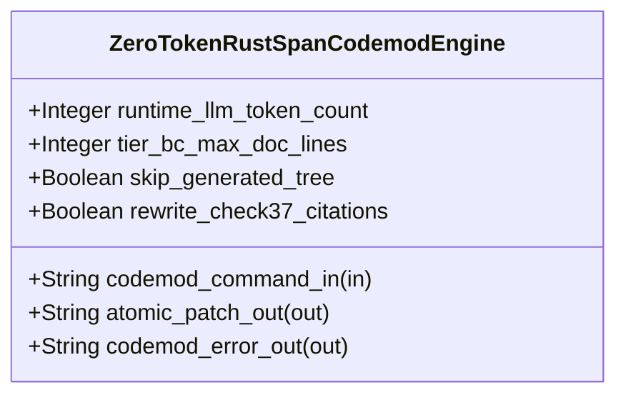

| Attribute | Specification Detail |
| :--- | :--- |
| **Issue ID** | TBD |
| **Title** | Feature 45: [BP 08 Lossless Rust CST Codemod Engine and Unified rustc Compatible JSON Diagnostics] ZeroTokenRustSpanCodemodEngine |
| **Type** | feature |
| **Parent Epic** | [EPIC-08-BP_08_Lossless_Rust_CST_Codemod_Engine_and_Unified_rustc_Compatible_JSON_Diagnostics](../epics/EPIC-08-BP_08_Lossless_Rust_CST_Codemod_Engine_and_Unified_rustc_Compatible_JSON_Diagnostics.md) |
| **Interface Type** | Physical / Structural / Internal Bus |
| **Schema Containers** | `BP_08_Lossless_Rust_CST_Codemod_Engine_and_Unified_rustc_Compatible_JSON_Diagnostics::ZeroTokenRustSpanCodemodEngine` |
| **Generation Mode** | subagent |
| **Specification Source** | [schema/model.sysml](../../schema/model.sysml) |

# Feature 45: [BP 08 Lossless Rust CST Codemod Engine and Unified rustc Compatible JSON Diagnostics] ZeroTokenRustSpanCodemodEngine

## UML Class Diagram



## Interface Requirements
### 1. Test Data Shape
```json
{
  "$schema": "https://json-schema.org/draft/2020-12/schema",
  "title": "ZeroTokenRustSpanCodemodEnginePayloadSchema",
  "type": "object",
  "properties": {
    "part": {
      "type": "string",
      "const": "ZeroTokenRustSpanCodemodEngine"
    },
    "status": {
      "type": "string",
      "enum": ["nominal", "degraded", "fault"]
    },
    "runtime_llm_token_count": {
      "type": "integer",
      "x-sysml-type": "Integer",
      "description": "Declared attribute runtime_llm_token_count (Integer)",
      "default": 0
    },
    "tier_bc_max_doc_lines": {
      "type": "integer",
      "x-sysml-type": "Integer",
      "description": "Target compacted docstring line count (`/// ` + `/// Realises: [REQ-*]`) on `DocTier::RustTierBC` items. [unit: lines]",
      "default": 2
    },
    "skip_generated_tree": {
      "type": "boolean",
      "x-sysml-type": "Boolean",
      "description": "Excludes `crates/compile-sysml/src/modular_codegen/generated/` from `--compact-tier-bc` docstring rewriting. [unit: flag]",
      "default": true
    },
    "rewrite_check37_citations": {
      "type": "boolean",
      "x-sysml-type": "Boolean",
      "description": "Deterministically updates `.rs` citations to `/mod.rs` across `docs/architecture/blueprints/ *.md` and `README.md`. [unit: flag]",
      "default": true
    },
    "codemod_command_in": {
      "type": "object",
      "properties": {
        "direction": { "type": "string", "const": "in" },
        "port_type": { "type": "string", "const": "String" }
      },
      "required": ["direction", "port_type"]
    },
    "atomic_patch_out": {
      "type": "object",
      "properties": {
        "direction": { "type": "string", "const": "out" },
        "port_type": { "type": "string", "const": "String" }
      },
      "required": ["direction", "port_type"]
    },
    "codemod_error_out": {
      "type": "object",
      "properties": {
        "direction": { "type": "string", "const": "out" },
        "port_type": { "type": "string", "const": "String" }
      },
      "required": ["direction", "port_type"]
    }
  },
  "required": [
    "part",
    "status",
    "codemod_command_in",
    "atomic_patch_out",
    "codemod_error_out"
  ],
  "additionalProperties": false
}
```

### 2. Validation & Constraints
Declared structural attributes, boundary ports, invariants, and allocated requirements for classifier `ZeroTokenRustSpanCodemodEngine`:

| AST Member Kind | Identifier | Declared Type / Direction | Default / Invariant Contract |
| :--- | :--- | :--- | :--- |
| Attribute | `runtime_llm_token_count` | `Integer` | Default `0` |
| Attribute | `tier_bc_max_doc_lines` | `Integer` | Default `2` |
| Attribute | `skip_generated_tree` | `Boolean` | Default `true` |
| Attribute | `rewrite_check37_citations` | `Boolean` | Default `true` |
| Port | `codemod_command_in` | `in String` | Boundary interface contract |
| Port | `atomic_patch_out` | `out String` | Boundary interface contract |
| Port | `codemod_error_out` | `out String` | Boundary interface contract |

### 3. Visual Layout & Arrangement
Structural composition and boundary topology for classifier `ZeroTokenRustSpanCodemodEngine` organize no nested subparts declared in schema paired with boundary ports `in codemod_command_in : String`, `out atomic_patch_out : String`, `out codemod_error_out : String`.

### 4. Interactive Flow & States
Operational lifecycle events and discrete state transitions for ZeroTokenRustSpanCodemodEngine.

### Layer 1: Domain State & Signal Model
Classifier `ZeroTokenRustSpanCodemodEngine` encapsulates typed domain state attributes `runtime_llm_token_count : Integer`, `tier_bc_max_doc_lines : Integer`, `skip_generated_tree : Boolean`, `rewrite_check37_citations : Boolean` alongside operational lifecycle status.

### Layer 2: Logic & Safety State Management
Classifier `ZeroTokenRustSpanCodemodEngine` governs stateless structural transition evaluation enforcing no additional invariant guards declared in schema.

### Layer 3: Presentation & Actuator Interface Binding
Classifier `ZeroTokenRustSpanCodemodEngine` binds external and behavioral interfaces across port `in codemod_command_in : String`, port `out atomic_patch_out : String`, port `out codemod_error_out : String`.

## Acceptance Criteria (BDD)
- [ ] AC-01: Given valid `ZeroTokenRustSpanCodemodEngine` initialization inputs for `runtime_llm_token_count` (`Integer`), `tier_bc_max_doc_lines` (`Integer`), `skip_generated_tree` (`Boolean`), `rewrite_check37_citations` (`Boolean`) (no additional constraints specified in schema), When `ZeroTokenRustSpanCodemodEngine` commits typed domain state, Then declared state attributes hold verified values.
- [ ] AC-02: Given malformed or out-of-domain input values for `runtime_llm_token_count` (`Integer`), `tier_bc_max_doc_lines` (`Integer`), `skip_generated_tree` (`Boolean`), `rewrite_check37_citations` (`Boolean`), When `ZeroTokenRustSpanCodemodEngine` validates incoming state updates, Then `ZeroTokenRustSpanCodemodEngine` rejects the invalid state update and emits a diagnostic via diagnostic port `atomic_patch_out`.
- [ ] AC-03: Given nominal signal arrival across `codemod_command_in` (`in String`), `atomic_patch_out` (`out String`), `codemod_error_out` (`out String`), When `ZeroTokenRustSpanCodemodEngine` processes the declared interface transaction, Then output state conforms to the structural classifier contract.
- [ ] AC-04: Given an invalid or unrecognized interface frame across `codemod_command_in` (`in String`), `atomic_patch_out` (`out String`), `codemod_error_out` (`out String`), When `ZeroTokenRustSpanCodemodEngine` boundary validation executes, Then `ZeroTokenRustSpanCodemodEngine` refuses the malformed frame via diagnostic port `atomic_patch_out` and preserves prior verified state.

## Source References
Formal component specifications and normative systems engineering requirements:
- System Architecture Model: `schema/model.sysml`
- Normative Systems Engineering Standard: ISO/IEC/IEEE 15288:2023 §6.4.3 Architecture Definition Process

Component behavior and interface definitions derive from `schema/model.sysml` pursuant to ISO/IEC/IEEE 15288.
