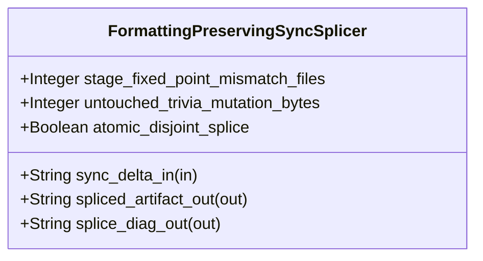

| Attribute | Specification Detail |
| :--- | :--- |
| **Issue ID** | #844 |
| **Title** | Feature 46: [BP 10 Incremental Lossless SysML v2 and Polyglot Compiler Engine] FormattingPreservingSyncSplicer |
| **Type** | feature |
| **Parent Epic** | [EPIC-10-BP_10_Incremental_Lossless_SysML_v2_and_Polyglot_Compiler_Engine](../epics/EPIC-10-BP_10_Incremental_Lossless_SysML_v2_and_Polyglot_Compiler_Engine.md) (#855) |
| **Interface Type** | Physical / Structural / Internal Bus |
| **Schema Containers** | `BP_10_Incremental_Lossless_SysML_v2_and_Polyglot_Compiler_Engine::FormattingPreservingSyncSplicer` |
| **Generation Mode** | subagent |
| **Specification Source** | [schema/model.sysml](../../schema/model.sysml) |

# Feature 46: [BP 10 Incremental Lossless SysML v2 and Polyglot Compiler Engine] FormattingPreservingSyncSplicer

## UML Class Diagram



## Interface Requirements
### 1. Test Data Shape
```json
{
  "$schema": "https://json-schema.org/draft/2020-12/schema",
  "title": "FormattingPreservingSyncSplicerPayloadSchema",
  "type": "object",
  "properties": {
    "part": {
      "type": "string",
      "const": "FormattingPreservingSyncSplicer"
    },
    "status": {
      "type": "string",
      "enum": ["nominal", "degraded", "fault"]
    },
    "stage_fixed_point_mismatch_files": {
      "type": "integer",
      "x-sysml-type": "Integer",
      "description": "Declared attribute stage_fixed_point_mismatch_files (Integer)",
      "default": 0
    },
    "untouched_trivia_mutation_bytes": {
      "type": "integer",
      "x-sysml-type": "Integer",
      "description": "Permitted byte mutations to comments and whitespace outside modified declaration `Utf8TextRange` intervals during incremental sync. [unit: bytes]",
      "default": 0
    },
    "atomic_disjoint_splice": {
      "type": "boolean",
      "x-sysml-type": "Boolean",
      "description": "Enforces pairwise-disjoint UTF-8 boundary verification and post-splice CST re-parse checks in `deap_core::sysml_cst::printer` before atomic commit. [unit: flag]",
      "default": true
    },
    "sync_delta_in": {
      "type": "object",
      "properties": {
        "direction": { "type": "string", "const": "in" },
        "port_type": { "type": "string", "const": "String" }
      },
      "required": ["direction", "port_type"]
    },
    "spliced_artifact_out": {
      "type": "object",
      "properties": {
        "direction": { "type": "string", "const": "out" },
        "port_type": { "type": "string", "const": "String" }
      },
      "required": ["direction", "port_type"]
    },
    "splice_diag_out": {
      "type": "object",
      "properties": {
        "direction": { "type": "string", "const": "out" },
        "port_type": { "type": "string", "const": "String" }
      },
      "required": ["direction", "port_type"]
    }
  },
  "required": [
    "part",
    "status",
    "sync_delta_in",
    "spliced_artifact_out",
    "splice_diag_out"
  ],
  "additionalProperties": false
}
```

### 2. Validation & Constraints
Declared structural attributes, boundary ports, invariants, and allocated requirements for classifier `FormattingPreservingSyncSplicer`:

| AST Member Kind | Identifier | Declared Type / Direction | Default / Invariant Contract |
| :--- | :--- | :--- | :--- |
| Attribute | `stage_fixed_point_mismatch_files` | `Integer` | Default `0` |
| Attribute | `untouched_trivia_mutation_bytes` | `Integer` | Default `0` |
| Attribute | `atomic_disjoint_splice` | `Boolean` | Default `true` |
| Port | `sync_delta_in` | `in String` | Boundary interface contract |
| Port | `spliced_artifact_out` | `out String` | Boundary interface contract |
| Port | `splice_diag_out` | `out String` | Boundary interface contract |
| Constraint | `Invariant_REQ_0610_SC_01` | Invariant (`REQ-0610 (REQ_0610_BP_10_Incremental_Lossless_SysML_v2_and_Polyglot_Compiler_Engine)`) | Declared structural invariant |
| Constraint | `Invariant_REQ_0610_SC_02` | Invariant (`REQ-0610 (REQ_0610_BP_10_Incremental_Lossless_SysML_v2_and_Polyglot_Compiler_Engine)`) | Declared structural invariant |
| Constraint | `Invariant_REQ_0610_SC_03_Incremental_Complexity` | Invariant (`REQ-0610 (REQ_0610_BP_10_Incremental_Lossless_SysML_v2_and_Polyglot_Compiler_Engine)`) | Declared structural invariant |
| Constraint | `Invariant_REQ_0610_SC_04` | Invariant (`REQ-0610 (REQ_0610_BP_10_Incremental_Lossless_SysML_v2_and_Polyglot_Compiler_Engine)`) | Declared structural invariant |
| Requirement | `REQ-0610 (REQ_0610_BP_10_Incremental_Lossless_SysML_v2_and_Polyglot_Compiler_Engine)` | Allocated Requirement | IncrementalLosslessSysmlAndPolyglotCompilerEngine (**REQ-0610** / BP-10 / DEAP-BP-DET-10, UUIDv5 6ba7b810-9dad-11d1-80b4-00c04fd430ca, Class P linear DFA lexing, lossless Red/Green syntax-tree construction across 100% of normative OMG SysML v2.0 + KerML 1.0 with zero 16-construct caps, ariadne deterministic byte-span rendering, and O(delta) early-cutoff incremental query evaluation) |
| Constraint | `C_INC_02` | `untouched_trivia_mutation_bytes == 0` | Zero untouched comment/whitespace byte mutations outside modified `Utf8TextRange` splice intervals |
| Constraint | `C_INC_03` | `stage_fixed_point_mismatch_files == 0` | Stage-1 == Stage-2 fixed-point identity (`syn` + `proc-macro2` + `quote` + `prettyplease` / `deap_core::sysml_cst::printer`) |

```sysml
constraint Invariant_REQ_0610_SC_01 {}
constraint Invariant_REQ_0610_SC_02 {}
constraint Invariant_REQ_0610_SC_03_Incremental_Complexity {}
constraint Invariant_REQ_0610_SC_04 {}
```

### 3. Visual Layout & Arrangement
Structural composition and boundary topology for classifier `FormattingPreservingSyncSplicer` organize no nested subparts declared in schema paired with boundary ports `in sync_delta_in : String`, `out spliced_artifact_out : String`, `out splice_diag_out : String`.

### 4. Interactive Flow & States
Operational lifecycle events and discrete state transitions for `FormattingPreservingSyncSplicer` (`EvaluatingSafetyAndKaniQueries -> SplicingFormattingPreservingSync` on `apply_formatting_preserving_splices`, `SplicingFormattingPreservingSync -> VerifiedIncrementalClean` on `bijectiveAndStage2FixedPointVerified`, and `SplicingFormattingPreservingSync -> EmittingAriadneAndJsonDiagnostics` on `rejectOverlappingSpliceE1003`).

### Layer 1: Domain State & Signal Model
Classifier `FormattingPreservingSyncSplicer` encapsulates typed domain state attributes `stage_fixed_point_mismatch_files : Integer`, `untouched_trivia_mutation_bytes : Integer`, `atomic_disjoint_splice : Boolean`, pairwise-disjoint `Utf8TextRange` splice descriptors in `HirSourceMap`, lossless `rowan::GreenNode` / `SysmlSyntaxNode` CST spans across 100% of normative OMG SysML v2.0 + KerML 1.0 Definition and Usage constructs (Contract A: zero 16-construct caps, including `package`/`library package`/`standard library package`, `import`, `alias`, `doc`, `comment`, `rep`, `dependency`, `metadata def`/`@Metadata`/`#user_keyword` for `#hazard`/`#risk`/`#capability`/`#rt_loop`/`#dal`/`#fls` and legacy `hazard def`/`risk def`/`capability def`, `attribute def`/`attribute`, `enum def`/`enum`, `item def`/`item`, `part def`/`part`, `port def`/`port`, `connection def`/`connection`, `interface def`/`interface`, `flow def`/`flow`, `allocation def`/`allocation`, `occurrence def`/`occurrence`, `action def`/`action`, `state def`/`state`, `calc def`/`calc`, `constraint def`/`constraint`, `requirement def`/`requirement`, `concern def`/`concern`, `use case def`/`use case`, `analysis def`/`analysis`, `verification def`/`verification`, `test case def`/`test case`, `interaction def`/`interaction`, `view def`/`view`, `viewpoint def`/`viewpoint`, `rendering def`/`rendering`, `variation`/`variant`, and KerML specialization/expressions), and lossless Markdown AST nodes (`pulldown-cmark` + `pulldown-cmark-to-cmark`).

### Layer 2: Logic & Safety State Management
Classifier `FormattingPreservingSyncSplicer` governs structural transition evaluation enforcing invariant obligations `Invariant_REQ_0610_SC_01`, `Invariant_REQ_0610_SC_02`, `Invariant_REQ_0610_SC_03_Incremental_Complexity`, `Invariant_REQ_0610_SC_04`, `C_INC_02` (`untouched_trivia_mutation_bytes == 0`), and `C_INC_03` (`stage_fixed_point_mismatch_files == 0`). Under Contract B, `apply_formatting_preserving_splices` executes reverse-byte-order CST range replacement in `./crates/deap-core/src/sysml_cst/printer.rs` (`< 380` executable SLOC per submodule), re-parses candidate `.sysml` and Markdown buffers via `logos` + `rowan` (`deap_core::sysml_cst`) and `pulldown-cmark` before atomic commit, and enforces explicit deletion of legacy hand-rolled string/line/char-by-char scanners (`./crates/deap-core/src/sysml_ast/mod.rs` `-2,400+` SLOC, `./crates/compile-sysml/src/parser.rs` `-1,100+` SLOC, and `./crates/ingest-sysml/src/extractors.rs` `-900+` SLOC).

### Layer 3: Presentation & Actuator Interface Binding
Classifier `FormattingPreservingSyncSplicer` binds external and behavioral interfaces across port `in sync_delta_in : String`, port `out spliced_artifact_out : String`, and port `out splice_diag_out : String`, emitting deterministic ANSI-free `ariadne` byte-span diagnostics and single-line `--message-format=json` NDJSON error reports (`DEAP-E1003`) whenever overlapping `Utf8TextRange` splice intervals or post-splice CST syntax errors occur.

### Associated Use Cases & User Stories

#### Associated Use Cases
- [ ] #781 - [Use Case 52: Lossless logos and rowan Concrete Syntax Tree Full Fidelity Roundtrip and Cross Platform CRLF Normalization](../use-cases/UC-52-Lossless_logos_and_rowan_Concrete_Syntax_Tree_Full_Fidelity_Roundtrip_and_Cross_Platform_CRLF_Normalization.md) (verifies lossless `rowan::GreenNode` roundtrip and CRLF-to-LF normalization)
- [ ] #782 - [Use Case 53: Resilient Error Recovery Parsing MAX AST DEPTH Guard and Deterministic Ariadne Byte Span Diagnostics](../use-cases/UC-53-Resilient_Error_Recovery_Parsing_MAX_AST_DEPTH_Guard_and_Deterministic_Ariadne_Byte_Span_Diagnostics.md) (verifies `ErrorNode` recovery and `MAX_AST_DEPTH = 64` guard)
- [ ] #783 - [Use Case 54: Formatting Preserving Bidirectional CST Splicing Across Forward and Reverse Sync](../use-cases/UC-54-Formatting_Preserving_Bidirectional_CST_Splicing_Across_Forward_and_Reverse_Sync.md) (verifies disjoint `Utf8TextRange` CST splicing and `DEAP-E1003` overlap rejection)
- [ ] #784 - [Use Case 55: Salsa Early Cutoff Durability Preventing Downstream Recomputations on Trivia Edits](../use-cases/UC-55-Salsa_Early_Cutoff_Durability_Preventing_Downstream_Recomputations_on_Trivia_Edits.md) (verifies `salsa` early-cutoff durability on trivia edits)
- [ ] #785 - [Use Case 56: Fail Closed Salsa Cycle Detection and Net Negative Legacy Cst Parser Retirement](../use-cases/UC-56-Fail_Closed_Salsa_Cycle_Detection_and_Net_Negative_Legacy_Cst_Parser_Retirement.md) (verifies fail-closed `salsa` cycle recovery and legacy parser deletion)
- [ ] #786 - [Use Case 57: Cohesive Typed Polyglot CST AST Lowering with Zero rustc private and Exact Byte Span Diagnostics](../use-cases/UC-57-Cohesive_Typed_Polyglot_CST_AST_Lowering_with_Zero_rustc_private_and_Exact_Byte_Span_Diagnostics.md) (verifies typed 6-frontend polyglot CST/AST lowering)
- [ ] #787 - [Use Case 58: Twelve Gate Blueprint Verification and Baseline Cleanliness Gate Conformance](../use-cases/UC-58-Twelve_Gate_Blueprint_Verification_and_Baseline_Cleanliness_Gate_Conformance.md) (verifies 12-gate blueprint and baseline cleanliness conformance)

#### Associated User Stories
- [ ] #821 - [User Story 71: Apply Formatting Preserving Splices](../user-stories/US-71-apply_formatting_preserving_splices.md) (binds pairwise-disjoint `Utf8TextRange` CST splicing and post-splice verification)

## Acceptance Criteria (BDD)
- [ ] AC-01: Given valid `FormattingPreservingSyncSplicer` inputs satisfying `Invariant_REQ_0610_SC_01` [Req `REQ-0610 (REQ_0610_BP_10_Incremental_Lossless_SysML_v2_and_Polyglot_Compiler_Engine)`], When `FormattingPreservingSyncSplicer` evaluates invariant `Invariant_REQ_0610_SC_01`, Then the invariant holds and verified state is committed.
- [ ] AC-02: Given boundary inputs that violate `Invariant_REQ_0610_SC_01` [Req `REQ-0610 (REQ_0610_BP_10_Incremental_Lossless_SysML_v2_and_Polyglot_Compiler_Engine)`], When `FormattingPreservingSyncSplicer` evaluates invariant `Invariant_REQ_0610_SC_01`, Then `FormattingPreservingSyncSplicer` rejects the invalid transition and routes a diagnostic via diagnostic port `spliced_artifact_out`.
- [ ] AC-03: Given valid `FormattingPreservingSyncSplicer` inputs satisfying `Invariant_REQ_0610_SC_02` [Req `REQ-0610 (REQ_0610_BP_10_Incremental_Lossless_SysML_v2_and_Polyglot_Compiler_Engine)`], When `FormattingPreservingSyncSplicer` evaluates invariant `Invariant_REQ_0610_SC_02`, Then the invariant holds and verified state is committed.
- [ ] AC-04: Given boundary inputs that violate `Invariant_REQ_0610_SC_02` [Req `REQ-0610 (REQ_0610_BP_10_Incremental_Lossless_SysML_v2_and_Polyglot_Compiler_Engine)`], When `FormattingPreservingSyncSplicer` evaluates invariant `Invariant_REQ_0610_SC_02`, Then `FormattingPreservingSyncSplicer` rejects the invalid transition and routes a diagnostic via diagnostic port `spliced_artifact_out`.
- [ ] AC-05: Given valid `FormattingPreservingSyncSplicer` inputs satisfying `Invariant_REQ_0610_SC_03_Incremental_Complexity` [Req `REQ-0610 (REQ_0610_BP_10_Incremental_Lossless_SysML_v2_and_Polyglot_Compiler_Engine)`], When `FormattingPreservingSyncSplicer` evaluates invariant `Invariant_REQ_0610_SC_03_Incremental_Complexity`, Then the invariant holds and verified state is committed.
- [ ] AC-06: Given boundary inputs that violate `Invariant_REQ_0610_SC_03_Incremental_Complexity` [Req `REQ-0610 (REQ_0610_BP_10_Incremental_Lossless_SysML_v2_and_Polyglot_Compiler_Engine)`], When `FormattingPreservingSyncSplicer` evaluates invariant `Invariant_REQ_0610_SC_03_Incremental_Complexity`, Then `FormattingPreservingSyncSplicer` rejects the invalid transition and routes a diagnostic via diagnostic port `spliced_artifact_out`.
- [ ] AC-07: Given valid `FormattingPreservingSyncSplicer` inputs satisfying `Invariant_REQ_0610_SC_04` [Req `REQ-0610 (REQ_0610_BP_10_Incremental_Lossless_SysML_v2_and_Polyglot_Compiler_Engine)`], When `FormattingPreservingSyncSplicer` evaluates invariant `Invariant_REQ_0610_SC_04`, Then the invariant holds and verified state is committed.
- [ ] AC-08: Given boundary inputs that violate `Invariant_REQ_0610_SC_04` [Req `REQ-0610 (REQ_0610_BP_10_Incremental_Lossless_SysML_v2_and_Polyglot_Compiler_Engine)`], When `FormattingPreservingSyncSplicer` evaluates invariant `Invariant_REQ_0610_SC_04`, Then `FormattingPreservingSyncSplicer` rejects the invalid transition and routes a diagnostic via diagnostic port `spliced_artifact_out`.
- [ ] AC-09: Given nominal typed values for `stage_fixed_point_mismatch_files` (`Integer`), `untouched_trivia_mutation_bytes` (`Integer`), `atomic_disjoint_splice` (`Boolean`) across `sync_delta_in` (`in String`), `spliced_artifact_out` (`out String`), `splice_diag_out` (`out String`), When `FormattingPreservingSyncSplicer` executes structural interface processing inside `< 380`-SLOC submodules (`./crates/deap-core/src/sysml_cst/printer.rs`) across 100% of normative OMG SysML v2.0 + KerML 1.0 constructs (Contract A) and lossless `rowan`/`pulldown-cmark` trees (Contract B), Then state and output ports conform to declared schema types with `untouched_trivia_mutation_bytes == 0` (`C_INC_02`) and `stage_fixed_point_mismatch_files == 0` (`C_INC_03`).
- [ ] AC-10: Given malformed input frames or overlapping `Utf8TextRange` splice intervals across `stage_fixed_point_mismatch_files` (`Integer`), `untouched_trivia_mutation_bytes` (`Integer`), `atomic_disjoint_splice` (`Boolean`) or `sync_delta_in` (`in String`), `spliced_artifact_out` (`out String`), `splice_diag_out` (`out String`), When `FormattingPreservingSyncSplicer` boundary validation executes, Then `FormattingPreservingSyncSplicer` rejects the malformed input via diagnostic port `spliced_artifact_out` and `splice_diag_out` (`DEAP-E1003`) without mutating disk files.

## Source References
Formal component specifications and normative systems engineering requirements:
- System Architecture Model: `schema/model.sysml`
- Normative Systems Engineering Standard: ISO/IEC/IEEE 15288:2023 §6.4.3 Architecture Definition Process

Component behavior and interface definitions derive from `schema/model.sysml` pursuant to ISO/IEC/IEEE 15288.
