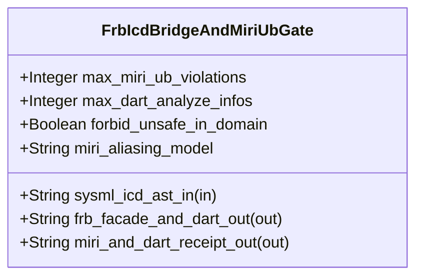

| Attribute | Specification Detail |
| :--- | :--- |
| **Issue ID** | TBD |
| **Title** | Feature 46: [BP 09 Multi Stage Compiler and Formal Verification Gatekeeper] FrbIcdBridgeAndMiriUbGate |
| **Type** | feature |
| **Parent Epic** | [EPIC-09-BP_09_Multi_Stage_Compiler_and_Formal_Verification_Gatekeeper](../epics/EPIC-09-BP_09_Multi_Stage_Compiler_and_Formal_Verification_Gatekeeper.md) |
| **Interface Type** | Physical / Structural / Internal Bus |
| **Schema Containers** | `BP_09_Multi_Stage_Compiler_and_Formal_Verification_Gatekeeper::FrbIcdBridgeAndMiriUbGate` |
| **Generation Mode** | subagent |
| **Specification Source** | [schema/model.sysml](../../schema/model.sysml) |

# Feature 46: [BP 09 Multi Stage Compiler and Formal Verification Gatekeeper] FrbIcdBridgeAndMiriUbGate

## UML Class Diagram



## Interface Requirements
### 1. Test Data Shape
```json
{
  "$schema": "https://json-schema.org/draft/2020-12/schema",
  "title": "FrbIcdBridgeAndMiriUbGatePayloadSchema",
  "type": "object",
  "properties": {
    "part": {
      "type": "string",
      "const": "FrbIcdBridgeAndMiriUbGate"
    },
    "status": {
      "type": "string",
      "enum": ["nominal", "degraded", "fault"]
    },
    "max_miri_ub_violations": {
      "type": "integer",
      "x-sysml-type": "Integer",
      "description": "Declared attribute max_miri_ub_violations (Integer)",
      "default": 0
    },
    "max_dart_analyze_infos": {
      "type": "integer",
      "x-sysml-type": "Integer",
      "description": "Permitted static analysis errors, warnings, or info findings under `dart analyze --fatal-infos`. [unit: diagnostics]",
      "default": 0
    },
    "forbid_unsafe_in_domain": {
      "type": "boolean",
      "x-sysml-type": "Boolean",
      "description": "Enforces `#![forbid(unsafe_code)]` across all pure domain, lowering, and FSM crates outside isolated FFI/HAL bridges. [unit: flag]",
      "default": true
    },
    "miri_aliasing_model": {
      "type": "string",
      "x-sysml-type": "String",
      "description": "Active Miri pointer-provenance and aliasing operational semantics flag enforced on FFI and ring-buffer test suites. [unit: flag]",
      "default": "-Zmiri-tree-borrows"
    },
    "sysml_icd_ast_in": {
      "type": "object",
      "properties": {
        "direction": { "type": "string", "const": "in" },
        "port_type": { "type": "string", "const": "String" }
      },
      "required": ["direction", "port_type"]
    },
    "frb_facade_and_dart_out": {
      "type": "object",
      "properties": {
        "direction": { "type": "string", "const": "out" },
        "port_type": { "type": "string", "const": "String" }
      },
      "required": ["direction", "port_type"]
    },
    "miri_and_dart_receipt_out": {
      "type": "object",
      "properties": {
        "direction": { "type": "string", "const": "out" },
        "port_type": { "type": "string", "const": "String" }
      },
      "required": ["direction", "port_type"]
    }
  },
  "required": [
    "part",
    "status",
    "sysml_icd_ast_in",
    "frb_facade_and_dart_out",
    "miri_and_dart_receipt_out"
  ],
  "additionalProperties": false
}
```

### 2. Validation & Constraints
Declared structural attributes, boundary ports, invariants, and allocated requirements for classifier `FrbIcdBridgeAndMiriUbGate`:

| AST Member Kind | Identifier | Declared Type / Direction | Default / Invariant Contract |
| :--- | :--- | :--- | :--- |
| Attribute | `max_miri_ub_violations` | `Integer` | Default `0` |
| Attribute | `max_dart_analyze_infos` | `Integer` | Default `0` |
| Attribute | `forbid_unsafe_in_domain` | `Boolean` | Default `true` |
| Attribute | `miri_aliasing_model` | `String` | Default `"-Zmiri-tree-borrows"` |
| Port | `sysml_icd_ast_in` | `in String` | Boundary interface contract |
| Port | `frb_facade_and_dart_out` | `out String` | Boundary interface contract |
| Port | `miri_and_dart_receipt_out` | `out String` | Boundary interface contract |
| Constraint | `Invariant_REQ_0609_SC_01` | Invariant (`REQ-0609 (REQ_0609_BP_09_Multi_Stage_Compiler_and_Formal_Verification_Gatekeeper)`) | Declared structural invariant |
| Constraint | `Invariant_REQ_0609_SC_02` | Invariant (`REQ-0609 (REQ_0609_BP_09_Multi_Stage_Compiler_and_Formal_Verification_Gatekeeper)`) | Declared structural invariant |
| Constraint | `Invariant_REQ_0609_SC_03` | Invariant (`REQ-0609 (REQ_0609_BP_09_Multi_Stage_Compiler_and_Formal_Verification_Gatekeeper)`) | Declared structural invariant |
| Constraint | `Invariant_REQ_0609_SC_04` | Invariant (`REQ-0609 (REQ_0609_BP_09_Multi_Stage_Compiler_and_Formal_Verification_Gatekeeper)`) | Declared structural invariant |
| Requirement | `REQ-0609 (REQ_0609_BP_09_Multi_Stage_Compiler_and_Formal_Verification_Gatekeeper)` | Allocated Requirement | MultiStageFormalVerificationGatekeeper (**REQ-0609** / BP-09 / DEAP-BP-DET-09, UUIDv5 6ba7b810-9dad-11d1-80b4-00c04fd430c9, Class P static HIR/THIR/MIR linear pass complexity paired with bounded CBMC state-space unwinding, governed by DO-178C Level A, DO-330 TQL-4, DO-333 Formal Methods Supplement, |

```sysml
constraint Invariant_REQ_0609_SC_01 {}
constraint Invariant_REQ_0609_SC_02 {}
constraint Invariant_REQ_0609_SC_03 {}
constraint Invariant_REQ_0609_SC_04 {}
```

### 3. Visual Layout & Arrangement
Structural composition and boundary topology for classifier `FrbIcdBridgeAndMiriUbGate` organize no nested subparts declared in schema paired with boundary ports `in sysml_icd_ast_in : String`, `out frb_facade_and_dart_out : String`, `out miri_and_dart_receipt_out : String`.

### 4. Interactive Flow & States
Operational lifecycle events and discrete state transitions for FrbIcdBridgeAndMiriUbGate.

### Layer 1: Domain State & Signal Model
Classifier `FrbIcdBridgeAndMiriUbGate` encapsulates typed domain state attributes `max_miri_ub_violations : Integer`, `max_dart_analyze_infos : Integer`, `forbid_unsafe_in_domain : Boolean`, `miri_aliasing_model : String` alongside operational lifecycle status.

### Layer 2: Logic & Safety State Management
Classifier `FrbIcdBridgeAndMiriUbGate` governs stateless structural transition evaluation enforcing invariant obligations `Invariant_REQ_0609_SC_01`, `Invariant_REQ_0609_SC_02`, `Invariant_REQ_0609_SC_03`, `Invariant_REQ_0609_SC_04`.

### Layer 3: Presentation & Actuator Interface Binding
Classifier `FrbIcdBridgeAndMiriUbGate` binds external and behavioral interfaces across port `in sysml_icd_ast_in : String`, port `out frb_facade_and_dart_out : String`, port `out miri_and_dart_receipt_out : String`.

## Acceptance Criteria (BDD)
- [ ] AC-01: Given valid `FrbIcdBridgeAndMiriUbGate` inputs satisfying `Invariant_REQ_0609_SC_01` [Req `REQ-0609 (REQ_0609_BP_09_Multi_Stage_Compiler_and_Formal_Verification_Gatekeeper)`], When `FrbIcdBridgeAndMiriUbGate` evaluates invariant `Invariant_REQ_0609_SC_01`, Then the invariant holds and verified state is committed.
- [ ] AC-02: Given boundary inputs that violate `Invariant_REQ_0609_SC_01` [Req `REQ-0609 (REQ_0609_BP_09_Multi_Stage_Compiler_and_Formal_Verification_Gatekeeper)`], When `FrbIcdBridgeAndMiriUbGate` evaluates invariant `Invariant_REQ_0609_SC_01`, Then `FrbIcdBridgeAndMiriUbGate` rejects the invalid transition and routes a diagnostic via diagnostic port `frb_facade_and_dart_out`.
- [ ] AC-03: Given valid `FrbIcdBridgeAndMiriUbGate` inputs satisfying `Invariant_REQ_0609_SC_02` [Req `REQ-0609 (REQ_0609_BP_09_Multi_Stage_Compiler_and_Formal_Verification_Gatekeeper)`], When `FrbIcdBridgeAndMiriUbGate` evaluates invariant `Invariant_REQ_0609_SC_02`, Then the invariant holds and verified state is committed.
- [ ] AC-04: Given boundary inputs that violate `Invariant_REQ_0609_SC_02` [Req `REQ-0609 (REQ_0609_BP_09_Multi_Stage_Compiler_and_Formal_Verification_Gatekeeper)`], When `FrbIcdBridgeAndMiriUbGate` evaluates invariant `Invariant_REQ_0609_SC_02`, Then `FrbIcdBridgeAndMiriUbGate` rejects the invalid transition and routes a diagnostic via diagnostic port `frb_facade_and_dart_out`.
- [ ] AC-05: Given valid `FrbIcdBridgeAndMiriUbGate` inputs satisfying `Invariant_REQ_0609_SC_03` [Req `REQ-0609 (REQ_0609_BP_09_Multi_Stage_Compiler_and_Formal_Verification_Gatekeeper)`], When `FrbIcdBridgeAndMiriUbGate` evaluates invariant `Invariant_REQ_0609_SC_03`, Then the invariant holds and verified state is committed.
- [ ] AC-06: Given boundary inputs that violate `Invariant_REQ_0609_SC_03` [Req `REQ-0609 (REQ_0609_BP_09_Multi_Stage_Compiler_and_Formal_Verification_Gatekeeper)`], When `FrbIcdBridgeAndMiriUbGate` evaluates invariant `Invariant_REQ_0609_SC_03`, Then `FrbIcdBridgeAndMiriUbGate` rejects the invalid transition and routes a diagnostic via diagnostic port `frb_facade_and_dart_out`.
- [ ] AC-07: Given valid `FrbIcdBridgeAndMiriUbGate` inputs satisfying `Invariant_REQ_0609_SC_04` [Req `REQ-0609 (REQ_0609_BP_09_Multi_Stage_Compiler_and_Formal_Verification_Gatekeeper)`], When `FrbIcdBridgeAndMiriUbGate` evaluates invariant `Invariant_REQ_0609_SC_04`, Then the invariant holds and verified state is committed.
- [ ] AC-08: Given boundary inputs that violate `Invariant_REQ_0609_SC_04` [Req `REQ-0609 (REQ_0609_BP_09_Multi_Stage_Compiler_and_Formal_Verification_Gatekeeper)`], When `FrbIcdBridgeAndMiriUbGate` evaluates invariant `Invariant_REQ_0609_SC_04`, Then `FrbIcdBridgeAndMiriUbGate` rejects the invalid transition and routes a diagnostic via diagnostic port `frb_facade_and_dart_out`.
- [ ] AC-09: Given nominal typed values for `max_miri_ub_violations` (`Integer`), `max_dart_analyze_infos` (`Integer`), `forbid_unsafe_in_domain` (`Boolean`), `miri_aliasing_model` (`String`) across `sysml_icd_ast_in` (`in String`), `frb_facade_and_dart_out` (`out String`), `miri_and_dart_receipt_out` (`out String`), When `FrbIcdBridgeAndMiriUbGate` executes structural interface processing, Then state and output ports conform to declared schema types.
- [ ] AC-10: Given malformed input frames across `max_miri_ub_violations` (`Integer`), `max_dart_analyze_infos` (`Integer`), `forbid_unsafe_in_domain` (`Boolean`), `miri_aliasing_model` (`String`) or `sysml_icd_ast_in` (`in String`), `frb_facade_and_dart_out` (`out String`), `miri_and_dart_receipt_out` (`out String`), When `FrbIcdBridgeAndMiriUbGate` boundary validation executes, Then `FrbIcdBridgeAndMiriUbGate` rejects the malformed input via diagnostic port `frb_facade_and_dart_out`.

## Source References
Formal component specifications and normative systems engineering requirements:
- System Architecture Model: `schema/model.sysml`
- Normative Systems Engineering Standard: ISO/IEC/IEEE 15288:2023 §6.4.3 Architecture Definition Process

Component behavior and interface definitions derive from `schema/model.sysml` pursuant to ISO/IEC/IEEE 15288.
