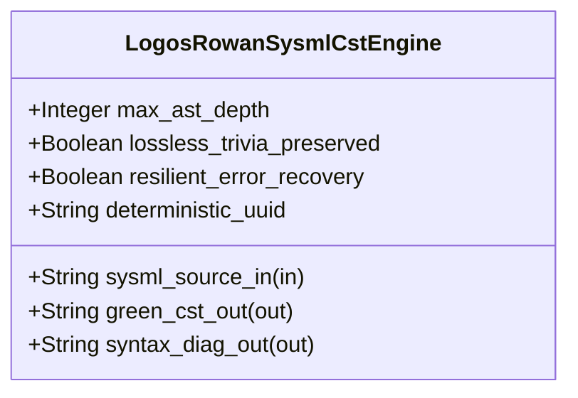

| Attribute | Specification Detail |
| :--- | :--- |
| **Issue ID** | #845 |
| **Title** | Feature 47: [BP 10 Incremental Lossless SysML v2 and Polyglot Compiler Engine] LogosRowanSysmlCstEngine |
| **Type** | feature |
| **Parent Epic** | [EPIC-10-BP_10_Incremental_Lossless_SysML_v2_and_Polyglot_Compiler_Engine](../epics/EPIC-10-BP_10_Incremental_Lossless_SysML_v2_and_Polyglot_Compiler_Engine.md) |
| **Interface Type** | Physical / Structural / Internal Bus |
| **Schema Containers** | `BP_10_Incremental_Lossless_SysML_v2_and_Polyglot_Compiler_Engine::LogosRowanSysmlCstEngine` |
| **Generation Mode** | subagent |
| **Specification Source** | [schema/model.sysml](../../schema/model.sysml) |

# Feature 47: [BP 10 Incremental Lossless SysML v2 and Polyglot Compiler Engine] LogosRowanSysmlCstEngine

## UML Class Diagram



## Interface Requirements
### 1. Test Data Shape
```json
{
  "$schema": "https://json-schema.org/draft/2020-12/schema",
  "title": "LogosRowanSysmlCstEnginePayloadSchema",
  "type": "object",
  "properties": {
    "part": {
      "type": "string",
      "const": "LogosRowanSysmlCstEngine"
    },
    "status": {
      "type": "string",
      "enum": ["nominal", "degraded", "fault"]
    },
    "max_ast_depth": {
      "type": "integer",
      "x-sysml-type": "Integer",
      "description": "Declared attribute max_ast_depth (Integer)",
      "default": 64
    },
    "lossless_trivia_preserved": {
      "type": "boolean",
      "x-sysml-type": "Boolean",
      "description": "Requires root `rowan::GreenNode` byte concatenation to match the LF-normalized UTF-8 `.sysml` buffer byte-for-byte including comments and whitespace. [unit: flag]",
      "default": true
    },
    "resilient_error_recovery": {
      "type": "boolean",
      "x-sysml-type": "Boolean",
      "description": "Wraps malformed token spans in `ErrorNode` subtrees and continues parsing at synchronization tokens while emitting `ariadne` / JSON `DEAP-E1001` diagnostics. [unit: flag]",
      "default": true
    },
    "deterministic_uuid": {
      "type": "string",
      "x-sysml-type": "String",
      "description": "Canonical deterministic blueprint component identifier (`DEAP-BP-DET-10`). [unit: uuidv5]",
      "default": "6ba7b810-9dad-11d1-80b4-00c04fd430ca"
    },
    "sysml_source_in": {
      "type": "object",
      "properties": {
        "direction": { "type": "string", "const": "in" },
        "port_type": { "type": "string", "const": "String" }
      },
      "required": ["direction", "port_type"]
    },
    "green_cst_out": {
      "type": "object",
      "properties": {
        "direction": { "type": "string", "const": "out" },
        "port_type": { "type": "string", "const": "String" }
      },
      "required": ["direction", "port_type"]
    },
    "syntax_diag_out": {
      "type": "object",
      "properties": {
        "direction": { "type": "string", "const": "out" },
        "port_type": { "type": "string", "const": "String" }
      },
      "required": ["direction", "port_type"]
    }
  },
  "required": [
    "part",
    "status",
    "sysml_source_in",
    "green_cst_out",
    "syntax_diag_out"
  ],
  "additionalProperties": false
}
```

### 2. Validation & Constraints
Declared structural attributes, boundary ports, invariants, and allocated requirements for classifier `LogosRowanSysmlCstEngine`:

| AST Member Kind | Identifier | Declared Type / Direction | Default / Invariant Contract |
| :--- | :--- | :--- | :--- |
| Attribute | `max_ast_depth` | `Integer` | Default `64` |
| Attribute | `lossless_trivia_preserved` | `Boolean` | Default `true` |
| Attribute | `resilient_error_recovery` | `Boolean` | Default `true` |
| Attribute | `deterministic_uuid` | `String` | Default `"6ba7b810-9dad-11d1-80b4-00c04fd430ca"` |
| Port | `sysml_source_in` | `in String` | Boundary interface contract |
| Port | `green_cst_out` | `out String` | Boundary interface contract |
| Port | `syntax_diag_out` | `out String` | Boundary interface contract |
| Constraint | `C_INC_01` | `max_ast_depth >= 1 and max_ast_depth <= 64` | Bounded recursion depth guard (`DEAP-E1002`) |
| Requirement | `REQ-0610 (REQ_0610_BP_10_Incremental_Lossless_SysML_v2_and_Polyglot_Compiler_Engine)` | Allocated Requirement | Contract A (100% normative OMG SysML v2.0 + KerML 1.0 textual grammar coverage with zero 16-construct caps) and Contract B (`logos` + `rowan` + `salsa` + `ariadne` lossless CST in `deap_core::sysml_cst`, zero hand-rolled scanners) |

### 3. Visual Layout & Arrangement
Structural composition and boundary topology for classifier `LogosRowanSysmlCstEngine` organize no nested subparts declared in schema paired with boundary ports `in sysml_source_in : String`, `out green_cst_out : String`, `out syntax_diag_out : String`.

### 4. Interactive Flow & States
Operational lifecycle events and discrete state transitions for `LogosRowanSysmlCstEngine` (`Idle -> NormalizingSourceRevision` on `normalize_line_endings`, `NormalizingSourceRevision -> LexingAndBuildingRowanCst` on `parse_lossless_sysml_cst`, `LexingAndBuildingRowanCst -> LoweringTriviaErasedHir` on `verify_lossless_cst_invariants`, and `LexingAndBuildingRowanCst -> EmittingAriadneAndJsonDiagnostics` on `rejectMaxAstDepthOverflowE1002`).

### Layer 1: Domain State & Signal Model
Classifier `LogosRowanSysmlCstEngine` encapsulates typed domain state attributes `max_ast_depth : Integer`, `lossless_trivia_preserved : Boolean`, `resilient_error_recovery : Boolean`, `deterministic_uuid : String` alongside `SysmlToken` (`derive(Logos)`), `SysmlSyntaxKind`, immutable `rowan::GreenNode` (`rowan` pinned identically to `ra_ap_syntax`), and typed `SysmlSyntaxNode` red-tree wrappers across 100% of the normative OMG SysML v2.0 and KerML 1.0 textual grammar (Contract A: zero 16-construct caps, full Definition and Usage symmetry for `package`/`library package`/`standard library package`, `import`, `alias`, `comment`/`doc`/`rep`, `dependency`, `metadata def`/`metadata`/`@`/`#` user-defined keyword extensions for `#hazard`, `#risk`, `#capability`, `#rt_loop`, `#dal`, `#fls` plus backward-compatible legacy `hazard def`/`risk def`/`capability def`, `attribute def`/`attribute`, `enum def`/`enum`, `item def`/`item`, `part def`/`part`, `port def`/`port` with `~` conjugation and `in`/`out`/`inout`, `connection def`/`connection`, `interface def`/`interface`, `flow def`/`flow`/`succession`, `allocation def`/`allocation`/`allocate`, `occurrence def`/`occurrence`/`individual`/`snapshot`/`timeslice`, `action def`/`action` with `perform`/`accept`/`send`/`assign`/`if`/`while`/`for`/`fork`/`join`/`merge`/`decide`/`first ... then`, `state def`/`state`/`exhibit` with `entry`/`do`/`exit`/`transition`, `calc def`/`calc`, `constraint def`/`constraint` with `assert`/`assume`/`require`, `requirement def`/`requirement` with `subject`/`actor`/`stakeholder`/`framed concern`/`satisfy`, `concern def`/`concern`, `use case def`/`use case` with `include use case`, `analysis def`/`analysis` with `objective`, `verification def`/`verification` with `verify`, `test case def`/`test case`, `interaction def`/`interaction`, `view def`/`view`, `viewpoint def`/`viewpoint`, `rendering def`/`rendering` with `expose` and `filter`, `variation`/`variant`, and KerML specialization & feature operators `:` `defined by`, `:>` `subsets`, `:>>` `redefines`, `::>` `references`, `~` conjugation, `ref`, `abstract`, `readonly`, `derived`, `end`, multiplicity `[lo..hi]` / `{ordered, nonunique}`, full KerML operator expressions, and `ISQ`/`SI`/`ScalarValues` standard library imports).

### Layer 2: Logic & Safety State Management
Classifier `LogosRowanSysmlCstEngine` governs linear-time `logos` DFA lexing, CRLF-to-LF normalization (`normalize_line_endings`), recursive-descent `rowan::GreenNodeBuilder` CST construction (`parse_lossless_sysml_cst`) bounded by `MAX_AST_DEPTH = 64` (`C_INC_01`), resilient `ErrorNode` recovery at `;` / `}`, and byte-for-byte roundtrip verification (`verify_lossless_cst_invariants`) under `Invariant_REQ_0610_SC_01` and `Invariant_REQ_0610_SC_02`. Under Contract B, all implementation resides in `< 380` executable-SLOC submodules under `./crates/deap-core/src/sysml_cst/` (`lexer.rs`, `syntax_kind.rs`, `parser.rs`, `ast_nodes.rs`, `printer.rs`, `diagnostics.rs`) with zero hand-rolled string/line/char-by-char scanners and explicit deletion of legacy `./crates/deap-core/src/sysml_ast/mod.rs` (`-2,400+` SLOC) and `./crates/compile-sysml/src/parser.rs` (`-1,100+` SLOC).

### Layer 3: Presentation & Actuator Interface Binding
Classifier `LogosRowanSysmlCstEngine` binds external and behavioral interfaces across port `in sysml_source_in : String`, port `out green_cst_out : String`, and port `out syntax_diag_out : String`, rendering deterministic ANSI-free `ariadne` byte-span diagnostics and single-line `--message-format=json` NDJSON error reports (`DEAP-E1001`, `DEAP-E1002`).

### Associated Use Cases & User Stories

#### Associated Use Cases
- [ ] #781 - [Use Case 52: Lossless logos and rowan Concrete Syntax Tree Full Fidelity Roundtrip and Cross Platform CRLF Normalization](../use-cases/UC-52-Lossless_logos_and_rowan_Concrete_Syntax_Tree_Full_Fidelity_Roundtrip_and_Cross_Platform_CRLF_Normalization.md) (verifies lossless `logos` + `rowan` Red/Green CST byte-for-byte roundtrip and CRLF-to-LF normalization)
- [ ] #782 - [Use Case 53: Resilient Error Recovery Parsing MAX AST DEPTH Guard and Deterministic Ariadne Byte Span Diagnostics](../use-cases/UC-53-Resilient_Error_Recovery_Parsing_MAX_AST_DEPTH_Guard_and_Deterministic_Ariadne_Byte_Span_Diagnostics.md) (verifies `ErrorNode` recovery, `MAX_AST_DEPTH = 64` guard `C_INC_01`, and `DEAP-E1001`/`DEAP-E1002` diagnostics)

#### Associated User Stories
- [ ] #817 - [User Story 67: Normalize Line Endings](../user-stories/US-67-normalize_line_endings.md) (binds deterministic CRLF-to-LF line-ending normalization)
- [ ] #818 - [User Story 68: Parse Lossless Sysml Cst](../user-stories/US-68-parse_lossless_sysml_cst.md) (binds lossless `logos` + `rowan` CST parsing across 100% of OMG SysML v2.0 + KerML 1.0 grammar constructs)
- [ ] #819 - [User Story 69: Verify Lossless Cst Invariants](../user-stories/US-69-verify_lossless_cst_invariants.md) (binds byte-for-byte `GreenNode` roundtrip and `MAX_AST_DEPTH <= 64` invariant verification)
- [ ] #822 - [User Story 72: Render Ariadne Diagnostic](../user-stories/US-72-render_ariadne_diagnostic.md) (binds deterministic `ariadne` byte-span and NDJSON diagnostic rendering)

## Acceptance Criteria (BDD)
- [ ] AC-01: Given valid `LogosRowanSysmlCstEngine` initialization inputs for `max_ast_depth` (`Integer`), `lossless_trivia_preserved` (`Boolean`), `resilient_error_recovery` (`Boolean`), `deterministic_uuid` (`String`) across 100% of normative OMG SysML v2.0 + KerML 1.0 Definition and Usage constructs (Contract A: zero 16-construct caps), When `LogosRowanSysmlCstEngine` commits typed domain state inside `< 380`-SLOC submodules (`./crates/deap-core/src/sysml_cst/`), Then declared state attributes hold verified values and root `rowan::GreenNode` byte concatenation equals the LF-normalized input byte-for-byte.
- [ ] AC-02: Given malformed or out-of-domain input values for `max_ast_depth` (`Integer` exceeding `64`, `C_INC_01`), `lossless_trivia_preserved` (`Boolean`), `resilient_error_recovery` (`Boolean`), `deterministic_uuid` (`String`), When `LogosRowanSysmlCstEngine` validates incoming state updates, Then `LogosRowanSysmlCstEngine` rejects the invalid state update and emits a deterministic `ariadne` + NDJSON diagnostic (`DEAP-E1001` / `DEAP-E1002`) via diagnostic port `green_cst_out` and `syntax_diag_out`.
- [ ] AC-03: Given nominal signal arrival across `sysml_source_in` (`in String`), `green_cst_out` (`out String`), `syntax_diag_out` (`out String`), When `LogosRowanSysmlCstEngine` processes the declared interface transaction via `logos` DFA lexing and `rowan::GreenNodeBuilder` (Contract B: zero hand-rolled scanners, legacy `./crates/deap-core/src/sysml_ast/mod.rs` and `./crates/compile-sysml/src/parser.rs` deleted), Then output state conforms to the structural classifier contract.
- [ ] AC-04: Given an invalid or unrecognized interface frame across `sysml_source_in` (`in String`), `green_cst_out` (`out String`), `syntax_diag_out` (`out String`), When `LogosRowanSysmlCstEngine` boundary validation executes, Then `LogosRowanSysmlCstEngine` wraps malformed spans in `SysmlSyntaxKind::ErrorNode`, refuses downstream promotion via diagnostic port `green_cst_out` and `syntax_diag_out`, and preserves prior verified state.

## Source References
Formal component specifications and normative systems engineering requirements:
- System Architecture Model: `schema/model.sysml`
- Normative Systems Engineering Standard: ISO/IEC/IEEE 15288:2023 §6.4.3 Architecture Definition Process

Component behavior and interface definitions derive from `schema/model.sysml` pursuant to ISO/IEC/IEEE 15288.
