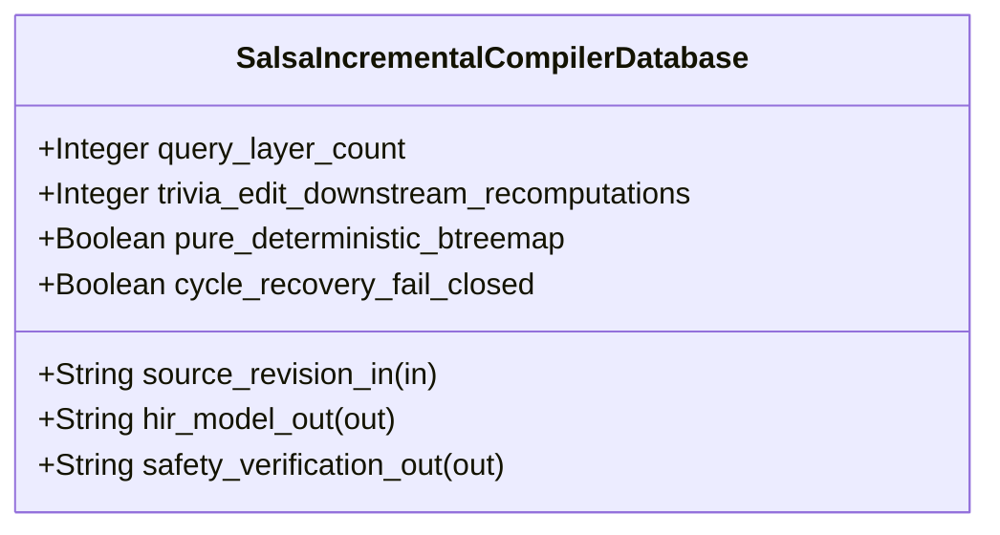

| Attribute | Specification Detail |
| :--- | :--- |
| **Issue ID** | #846 |
| **Title** | Feature 48: [BP 10 Incremental Lossless SysML v2 and Polyglot Compiler Engine] SalsaIncrementalCompilerDatabase |
| **Type** | feature |
| **Parent Epic** | [EPIC-10-BP_10_Incremental_Lossless_SysML_v2_and_Polyglot_Compiler_Engine](../epics/EPIC-10-BP_10_Incremental_Lossless_SysML_v2_and_Polyglot_Compiler_Engine.md) |
| **Interface Type** | Physical / Structural / Internal Bus |
| **Schema Containers** | `BP_10_Incremental_Lossless_SysML_v2_and_Polyglot_Compiler_Engine::SalsaIncrementalCompilerDatabase` |
| **Generation Mode** | subagent |
| **Specification Source** | [schema/model.sysml](../../schema/model.sysml) |

# Feature 48: [BP 10 Incremental Lossless SysML v2 and Polyglot Compiler Engine] SalsaIncrementalCompilerDatabase

## UML Class Diagram



## Interface Requirements
### 1. Test Data Shape
```json
{
  "$schema": "https://json-schema.org/draft/2020-12/schema",
  "title": "SalsaIncrementalCompilerDatabasePayloadSchema",
  "type": "object",
  "properties": {
    "part": {
      "type": "string",
      "const": "SalsaIncrementalCompilerDatabase"
    },
    "status": {
      "type": "string",
      "enum": ["nominal", "degraded", "fault"]
    },
    "query_layer_count": {
      "type": "integer",
      "x-sysml-type": "Integer",
      "description": "Declared attribute query_layer_count (Integer)",
      "default": 4
    },
    "trivia_edit_downstream_recomputations": {
      "type": "integer",
      "x-sysml-type": "Integer",
      "description": "Required count of downstream STPA, Kani, and baseline verification query recomputations when edits alter only non-semantic trivia. [unit: queries]",
      "default": 0
    },
    "pure_deterministic_btreemap": {
      "type": "boolean",
      "x-sysml-type": "Boolean",
      "description": "Mandates `BTreeMap` and `BTreeSet` deterministic ordering and forbids filesystem or clock side effects inside derived `salsa` queries. [unit: flag]",
      "default": true
    },
    "cycle_recovery_fail_closed": {
      "type": "boolean",
      "x-sysml-type": "Boolean",
      "description": "Intercepts cyclic `salsa` dependency chains across imports or specializations and emits deterministic `DEAP-E1004` `ariadne` + JSON diagnostics. [unit: flag]",
      "default": true
    },
    "source_revision_in": {
      "type": "object",
      "properties": {
        "direction": { "type": "string", "const": "in" },
        "port_type": { "type": "string", "const": "String" }
      },
      "required": ["direction", "port_type"]
    },
    "hir_model_out": {
      "type": "object",
      "properties": {
        "direction": { "type": "string", "const": "out" },
        "port_type": { "type": "string", "const": "String" }
      },
      "required": ["direction", "port_type"]
    },
    "safety_verification_out": {
      "type": "object",
      "properties": {
        "direction": { "type": "string", "const": "out" },
        "port_type": { "type": "string", "const": "String" }
      },
      "required": ["direction", "port_type"]
    }
  },
  "required": [
    "part",
    "status",
    "source_revision_in",
    "hir_model_out",
    "safety_verification_out"
  ],
  "additionalProperties": false
}
```

### 2. Validation & Constraints
Declared structural attributes, boundary ports, invariants, and allocated requirements for classifier `SalsaIncrementalCompilerDatabase`:

| AST Member Kind | Identifier | Declared Type / Direction | Default / Invariant Contract |
| :--- | :--- | :--- | :--- |
| Attribute | `query_layer_count` | `Integer` | Default `4` |
| Attribute | `trivia_edit_downstream_recomputations` | `Integer` | Default `0` |
| Attribute | `pure_deterministic_btreemap` | `Boolean` | Default `true` |
| Attribute | `cycle_recovery_fail_closed` | `Boolean` | Default `true` |
| Port | `source_revision_in` | `in String` | Boundary interface contract |
| Port | `hir_model_out` | `out String` | Boundary interface contract |
| Port | `safety_verification_out` | `out String` | Boundary interface contract |
| Constraint | `C_INC_04` | `query_layer_count == 4` | Four `salsa` query groups (`SourceDatabase`, `CstDatabase`, `HirDatabase`, `SafetyVerificationDatabase`) |
| Constraint | `C_INC_05` | `trivia_edit_downstream_recomputations == 0` | Trivia-erased `HirPackageSummary` early-cutoff memoization prevents downstream recomputations on comment/whitespace edits |
| Requirement | `REQ-0610 (REQ_0610_BP_10_Incremental_Lossless_SysML_v2_and_Polyglot_Compiler_Engine)` | Allocated Requirement | Contract A (100% normative OMG SysML v2.0 + KerML 1.0 HIR coverage with zero 16-construct caps) and Contract B (`salsa` incremental compiler database in `compile_sysml::salsa_db`, zero hand-rolled scanners) |

### 3. Visual Layout & Arrangement
Structural composition and boundary topology for classifier `SalsaIncrementalCompilerDatabase` organize no nested subparts declared in schema paired with boundary ports `in source_revision_in : String`, `out hir_model_out : String`, `out safety_verification_out : String`.

### 4. Interactive Flow & States
Operational lifecycle events and discrete state transitions for `SalsaIncrementalCompilerDatabase` (`LoweringTriviaErasedHir -> EarlyCutoffShortCircuited` on `cutoffPreservedDownstream`, `LoweringTriviaErasedHir -> EvaluatingSafetyAndKaniQueries` on `recomputeDownstreamDependents`, and `LoweringTriviaErasedHir -> EmittingAriadneAndJsonDiagnostics` on `rejectCyclicSalsaQueryE1004`).

### Layer 1: Domain State & Signal Model
Classifier `SalsaIncrementalCompilerDatabase` encapsulates typed domain state attributes `query_layer_count : Integer`, `trivia_edit_downstream_recomputations : Integer`, `pure_deterministic_btreemap : Boolean`, `cycle_recovery_fail_closed : Boolean` alongside the 4-layer `salsa` query tables (`SourceDatabase`, `CstDatabase`, `HirDatabase`, `SafetyVerificationDatabase`), trivia-erased `HirPackageSummary` (`PartialEq` + `Eq` + `Hash` over `BTreeMap`/`BTreeSet` with zero raw byte offsets), and separate `HirSourceMap` tables covering 100% of normative OMG SysML v2.0 + KerML 1.0 Definition and Usage constructs (Contract A: zero 16-construct caps, including `#hazard`, `#risk`, `#capability`, `#rt_loop`, `#dal`, `#fls` via `metadata def` and backward-compatible legacy `hazard def`/`risk def`/`capability def`).

### Layer 2: Logic & Safety State Management
Classifier `SalsaIncrementalCompilerDatabase` governs demand-driven incremental evaluation (`evaluate_hir_early_cutoff`), scoped symbol/import/specialization resolution (`:`, `:>`, `:>>`, `::>`, `~`), STPA/FMECA/Kani verification query memoization (`C_INC_04`, `C_INC_05`), and fail-closed `salsa` cycle recovery (`DEAP-E1004`) under `Invariant_REQ_0610_SC_03_Incremental_Complexity` and `Invariant_REQ_0610_SC_04`. Under Contract B, all query groups reside in `< 380` executable-SLOC submodules under `./crates/compile-sysml/src/salsa_db/` (`inputs.rs`, `cst_queries.rs`, `hir_queries.rs`, `safety_queries.rs`) with zero hand-rolled string/line/char-by-char scanners and explicit deletion of legacy `./crates/compile-sysml/src/parser.rs` (`-1,100+` SLOC) and `./crates/deap-core/src/sysml_ast/mod.rs` (`-2,400+` SLOC).

### Layer 3: Presentation & Actuator Interface Binding
Classifier `SalsaIncrementalCompilerDatabase` binds external and behavioral interfaces across port `in source_revision_in : String`, port `out hir_model_out : String`, and port `out safety_verification_out : String`, routing deterministic `ariadne` byte-span reports and single-line `--message-format=json` NDJSON diagnostics (`DEAP-E1004`) via `render_ariadne_diagnostic`.

### Associated Use Cases & User Stories

#### Associated Use Cases
- [ ] #784 - [Use Case 55: Salsa Early Cutoff Durability Preventing Downstream Recomputations on Trivia Edits](../use-cases/UC-55-Salsa_Early_Cutoff_Durability_Preventing_Downstream_Recomputations_on_Trivia_Edits.md) (verifies 4-layer `salsa` early-cutoff durability with `trivia_edit_downstream_recomputations == 0`)
- [ ] #785 - [Use Case 56: Fail Closed Salsa Cycle Detection and Net Negative Legacy Cst Parser Retirement](../use-cases/UC-56-Fail_Closed_Salsa_Cycle_Detection_and_Net_Negative_Legacy_Cst_Parser_Retirement.md) (verifies fail-closed `salsa` cycle recovery `DEAP-E1004` and legacy hand-rolled parser retirement)

#### Associated User Stories
- [ ] #816 - [User Story 66: Resolve Polyglot Backend](../user-stories/US-66-resolve_polyglot_backend.md) (binds polyglot CST/AST backend dispatch into `SalsaIncrementalCompilerDatabase`)
- [ ] #817 - [User Story 67: Normalize Line Endings](../user-stories/US-67-normalize_line_endings.md) (binds CRLF-to-LF normalization in `SourceDatabase`)
- [ ] #818 - [User Story 68: Parse Lossless Sysml Cst](../user-stories/US-68-parse_lossless_sysml_cst.md) (binds `CstDatabase` lossless `logos` + `rowan` CST parsing)
- [ ] #819 - [User Story 69: Verify Lossless Cst Invariants](../user-stories/US-69-verify_lossless_cst_invariants.md) (binds `CstDatabase` byte-for-byte roundtrip and depth verification)
- [ ] #820 - [User Story 70: Evaluate Hir Early Cutoff](../user-stories/US-70-evaluate_hir_early_cutoff.md) (binds `HirDatabase` trivia-erased `HirPackageSummary` early-cutoff evaluation)
- [ ] #821 - [User Story 71: Apply Formatting Preserving Splices](../user-stories/US-71-apply_formatting_preserving_splices.md) (binds formatting-preserving CST splicing across `HirSourceMap` spans)
- [ ] #822 - [User Story 72: Render Ariadne Diagnostic](../user-stories/US-72-render_ariadne_diagnostic.md) (binds deterministic `ariadne` and NDJSON diagnostic rendering)

## Acceptance Criteria (BDD)
- [ ] AC-01: Given valid `SalsaIncrementalCompilerDatabase` initialization inputs for `query_layer_count` (`Integer == 4`, `C_INC_04`), `trivia_edit_downstream_recomputations` (`Integer == 0`, `C_INC_05`), `pure_deterministic_btreemap` (`Boolean == true`), `cycle_recovery_fail_closed` (`Boolean == true`) across 100% of normative OMG SysML v2.0 + KerML 1.0 constructs (Contract A: zero 16-construct caps), When `SalsaIncrementalCompilerDatabase` commits typed domain state inside `< 380`-SLOC submodules (`./crates/compile-sysml/src/salsa_db/`), Then declared state attributes hold verified values and trivia-only edits trigger `0` downstream recomputations.
- [ ] AC-02: Given malformed or out-of-domain input values or cyclic `import` / `:> BasePart` specialization chains for `query_layer_count` (`Integer`), `trivia_edit_downstream_recomputations` (`Integer`), `pure_deterministic_btreemap` (`Boolean`), `cycle_recovery_fail_closed` (`Boolean`), When `SalsaIncrementalCompilerDatabase` validates incoming state updates, Then `SalsaIncrementalCompilerDatabase` intercepts cycles deterministically without infinite recursion and emits diagnostic `DEAP-E1004` via diagnostic port `hir_model_out` and `safety_verification_out`.
- [ ] AC-03: Given nominal signal arrival across `source_revision_in` (`in String`), `hir_model_out` (`out String`), `safety_verification_out` (`out String`), When `SalsaIncrementalCompilerDatabase` processes the declared interface transaction under Contract B (zero hand-rolled scanners, legacy `./crates/compile-sysml/src/parser.rs` deleted), Then output state conforms to the structural classifier contract.
- [ ] AC-04: Given an invalid or unrecognized interface frame across `source_revision_in` (`in String`), `hir_model_out` (`out String`), `safety_verification_out` (`out String`), When `SalsaIncrementalCompilerDatabase` boundary validation executes, Then `SalsaIncrementalCompilerDatabase` refuses the malformed frame via diagnostic port `hir_model_out` and preserves prior verified state.

## Source References
Formal component specifications and normative systems engineering requirements:
- System Architecture Model: `schema/model.sysml`
- Normative Systems Engineering Standard: ISO/IEC/IEEE 15288:2023 §6.4.3 Architecture Definition Process

Component behavior and interface definitions derive from `schema/model.sysml` pursuant to ISO/IEC/IEEE 15288.
