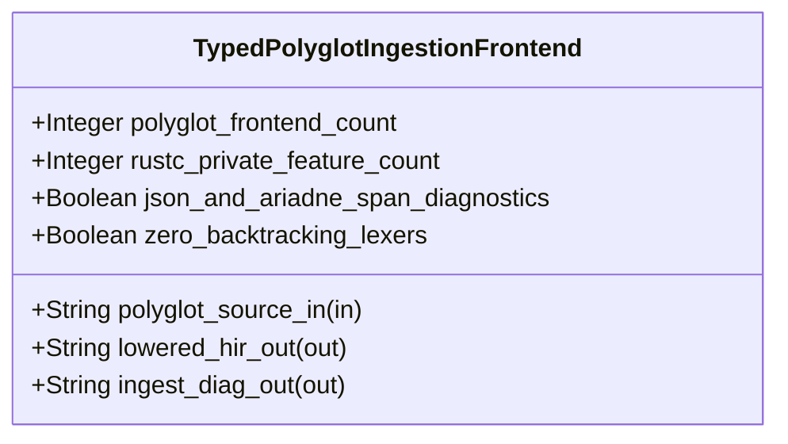

| Attribute | Specification Detail |
| :--- | :--- |
| **Issue ID** | #755 |
| **Title** | Feature 49: [BP 10 Incremental Lossless SysML v2 and Polyglot Compiler Engine] TypedPolyglotIngestionFrontend |
| **Type** | feature |
| **Parent Epic** | [EPIC-10-BP_10_Incremental_Lossless_SysML_v2_and_Polyglot_Compiler_Engine](../epics/EPIC-10-BP_10_Incremental_Lossless_SysML_v2_and_Polyglot_Compiler_Engine.md) |
| **Interface Type** | Physical / Structural / Internal Bus |
| **Schema Containers** | `BP_10_Incremental_Lossless_SysML_v2_and_Polyglot_Compiler_Engine::TypedPolyglotIngestionFrontend` |
| **Generation Mode** | subagent |
| **Specification Source** | [schema/model.sysml](../../schema/model.sysml) |

# Feature 49: [BP 10 Incremental Lossless SysML v2 and Polyglot Compiler Engine] TypedPolyglotIngestionFrontend

## UML Class Diagram



## Interface Requirements
### 1. Test Data Shape
```json
{
  "$schema": "https://json-schema.org/draft/2020-12/schema",
  "title": "TypedPolyglotIngestionFrontendPayloadSchema",
  "type": "object",
  "properties": {
    "part": {
      "type": "string",
      "const": "TypedPolyglotIngestionFrontend"
    },
    "status": {
      "type": "string",
      "enum": ["nominal", "degraded", "fault"]
    },
    "polyglot_frontend_count": {
      "type": "integer",
      "x-sysml-type": "Integer",
      "description": "Declared attribute polyglot_frontend_count (Integer)",
      "default": 6
    },
    "rustc_private_feature_count": {
      "type": "integer",
      "x-sysml-type": "Integer",
      "description": "Enforces `ZERO #![feature(rustc_private)]` occurrences across all workspace crates under `./crates/ *`. [unit: crates]",
      "default": 0
    },
    "json_and_ariadne_span_diagnostics": {
      "type": "boolean",
      "x-sysml-type": "Boolean",
      "description": "Emits deterministic `ariadne` byte-span reports and `--message-format=json` diagnostics (`DEAP-E1005`) across all polyglot formats. [unit: flag]",
      "default": true
    },
    "zero_backtracking_lexers": {
      "type": "boolean",
      "x-sysml-type": "Boolean",
      "description": "Enforces linear-time `logos` DFA / `rowan` CST and typed `serde_json` AST parsing with zero hand-rolled line lexers or NFA backtracking (`Check 34`). [unit: flag]",
      "default": true
    },
    "polyglot_source_in": {
      "type": "object",
      "properties": {
        "direction": { "type": "string", "const": "in" },
        "port_type": { "type": "string", "const": "String" }
      },
      "required": ["direction", "port_type"]
    },
    "lowered_hir_out": {
      "type": "object",
      "properties": {
        "direction": { "type": "string", "const": "out" },
        "port_type": { "type": "string", "const": "String" }
      },
      "required": ["direction", "port_type"]
    },
    "ingest_diag_out": {
      "type": "object",
      "properties": {
        "direction": { "type": "string", "const": "out" },
        "port_type": { "type": "string", "const": "String" }
      },
      "required": ["direction", "port_type"]
    }
  },
  "required": [
    "part",
    "status",
    "polyglot_source_in",
    "lowered_hir_out",
    "ingest_diag_out"
  ],
  "additionalProperties": false
}
```

### 2. Validation & Constraints
Declared structural attributes, boundary ports, invariants, and allocated requirements for classifier `TypedPolyglotIngestionFrontend`:

| AST Member Kind | Identifier | Declared Type / Direction | Default / Invariant Contract |
| :--- | :--- | :--- | :--- |
| Attribute | `polyglot_frontend_count` | `Integer` | Default `6` |
| Attribute | `rustc_private_feature_count` | `Integer` | Default `0` |
| Attribute | `json_and_ariadne_span_diagnostics` | `Boolean` | Default `true` |
| Attribute | `zero_backtracking_lexers` | `Boolean` | Default `true` |
| Port | `polyglot_source_in` | `in String` | Boundary interface contract |
| Port | `lowered_hir_out` | `out String` | Boundary interface contract |
| Port | `ingest_diag_out` | `out String` | Boundary interface contract |
| Constraint | `C_INC_06` | `polyglot_frontend_count == 6` | Cohesive 6-frontend polyglot CST/AST ingestion (`ra_ap_syntax` Rust, `deap_core::dart_cst` Dart, typed `serde_json` OpenAPI/JSON-Schema, `logos` + `rowan` OMG IDL & IETF YANG in `ingest_sysml::cst::{idl_cst, yang_cst}`, and `pulldown-cmark` + `pulldown-cmark-to-cmark` Markdown AST) |
| Constraint | `C_INC_07` | `rustc_private_feature_count == 0` | Zero `#![feature(rustc_private)]` occurrences across all workspace crates under `./crates/*` |
| Requirement | `REQ-0610 (REQ_0610_BP_10_Incremental_Lossless_SysML_v2_and_Polyglot_Compiler_Engine)` | Allocated Requirement | Contract A (100% normative OMG SysML v2.0 + KerML 1.0 HIR lowering coverage with zero 16-construct caps) and Contract B (typed polyglot CST/AST ingestion with zero hand-rolled scanners) |

### 3. Visual Layout & Arrangement
Structural composition and boundary topology for classifier `TypedPolyglotIngestionFrontend` organize no nested subparts declared in schema paired with boundary ports `in polyglot_source_in : String`, `out lowered_hir_out : String`, `out ingest_diag_out : String`, connected via `BP_10_PolyglotToSalsaDbConnection` to `SalsaIncrementalCompilerDatabase.source_revision_in`.

### 4. Interactive Flow & States
Operational lifecycle events and discrete state transitions for `TypedPolyglotIngestionFrontend` (`resolve_polyglot_backend` dispatching `.rs`, `.dart`, `.json`, `.idl`, `.yang`, and `.md` inputs into typed CST/AST lowering and routing `DEAP-E1005` diagnostics on malformed spans).

### Layer 1: Domain State & Signal Model
Classifier `TypedPolyglotIngestionFrontend` encapsulates typed domain state attributes `polyglot_frontend_count : Integer`, `rustc_private_feature_count : Integer`, `json_and_ariadne_span_diagnostics : Boolean`, `zero_backtracking_lexers : Boolean` alongside `PolyglotFormat` (`Rust`, `Dart`, `OpenApiJson`, `OmgIdl`, `IetfYang`, `MarkdownSpec`) and `PolyglotBackend` descriptors lowering into canonical OMG SysML v2.0 + KerML 1.0 `HirPackageSummary` and `HirSourceMap` structures across 100% of normative Definition and Usage constructs (Contract A: zero 16-construct caps, including `#hazard`, `#risk`, `#capability`, `#rt_loop`, `#dal`, `#fls` via `metadata def` and backward-compatible legacy `hazard def`/`risk def`/`capability def`).

### Layer 2: Logic & Safety State Management
Classifier `TypedPolyglotIngestionFrontend` governs deterministic polyglot backend resolution (`resolve_polyglot_backend`) and 100% typed CST/AST projection under Contract B:
- Rust (`.rs`) via `ra_ap_syntax::SourceFile::parse` (`Edition::Edition2024`) with `rustc_private_feature_count == 0` (`C_INC_07`) across `./crates/*`;
- Dart (`.dart`) via `deap_core::dart_cst` (`logos` + `rowan` lossless CST);
- OpenAPI 3.x / JSON-Schema (`.json`) via typed `serde_json` AST deserialization;
- OMG IDL (`.idl`) and IETF YANG (`.yang` RFC 7950) via `logos` + `rowan` lossless CSTs in `ingest_sysml::cst::{idl_cst, yang_cst}` (`./crates/ingest-sysml/src/cst/`);
- Markdown specifications (`.md`) via `pulldown-cmark` + `pulldown-cmark-to-cmark` lossless event ASTs.
All submodules are bounded to `< 380` executable SLOC (`./crates/ingest-sysml/src/cst/`, `./crates/deap-core/src/dart_cst/`) with zero hand-rolled string/line/char-by-char scanners, zero `.syntax().text().contains(...)` substring hacks, and explicit deletion of legacy `./crates/ingest-sysml/src/extractors.rs` (`-900+` SLOC).

### Layer 3: Presentation & Actuator Interface Binding
Classifier `TypedPolyglotIngestionFrontend` binds external and behavioral interfaces across port `in polyglot_source_in : String`, port `out lowered_hir_out : String`, and port `out ingest_diag_out : String`, emitting deterministic ANSI-free `ariadne` byte-span reports and single-line `--message-format=json` NDJSON diagnostics (`DEAP-E1005`) on malformed polyglot syntax or unresolved JSON pointers.

### Associated Use Cases & User Stories

#### Associated Use Cases
- [ ] #785 - [Use Case 57: Cohesive Typed Polyglot CST AST Lowering with Zero rustc private and Exact Byte Span Diagnostics](../use-cases/UC-57-Cohesive_Typed_Polyglot_CST_AST_Lowering_with_Zero_rustc_private_and_Exact_Byte_Span_Diagnostics.md) (verifies 6-frontend polyglot CST/AST lowering via `ra_ap_syntax`, `deap_core::dart_cst`, `serde_json`, `ingest_sysml::cst::{idl_cst, yang_cst}`, and `pulldown-cmark` with `rustc_private_feature_count == 0`)

#### Associated User Stories
- [ ] #815 - [User Story 66: resolve polyglot backend](../user-stories/US-66-resolve_polyglot_backend.md) (binds deterministic `resolve_polyglot_backend` dispatch across all 6 polyglot CST/AST frontends)
- [ ] #816 - [User Story 67: normalize line endings](../user-stories/US-67-normalize_line_endings.md) (binds cross-platform CRLF-to-LF normalization prior to CST lexing)
- [ ] #817 - [User Story 68: parse lossless sysml cst](../user-stories/US-68-parse_lossless_sysml_cst.md) (binds lossless `logos` + `rowan` CST parsing)
- [ ] #818 - [User Story 69: verify lossless cst invariants](../user-stories/US-69-verify_lossless_cst_invariants.md) (binds lossless CST roundtrip and depth invariant verification)
- [ ] #819 - [User Story 70: evaluate hir early cutoff](../user-stories/US-70-evaluate_hir_early_cutoff.md) (binds trivia-erased `HirPackageSummary` early-cutoff comparison)
- [ ] #820 - [User Story 71: apply formatting preserving splices](../user-stories/US-71-apply_formatting_preserving_splices.md) (binds disjoint `Utf8TextRange` CST splicing)
- [ ] #821 - [User Story 72: render ariadne diagnostic](../user-stories/US-72-render_ariadne_diagnostic.md) (binds deterministic `ariadne` and NDJSON diagnostic rendering)

## Acceptance Criteria (BDD)
- [ ] AC-01: Given valid `TypedPolyglotIngestionFrontend` initialization inputs for `polyglot_frontend_count` (`Integer == 6`, `C_INC_06`), `rustc_private_feature_count` (`Integer == 0`, `C_INC_07`), `json_and_ariadne_span_diagnostics` (`Boolean == true`), `zero_backtracking_lexers` (`Boolean == true`) across `ra_ap_syntax`, `deap_core::dart_cst`, typed `serde_json`, `ingest_sysml::cst::{idl_cst, yang_cst}`, and `pulldown-cmark` (Contract B), When `TypedPolyglotIngestionFrontend` commits typed domain state inside `< 380`-SLOC submodules (`./crates/ingest-sysml/src/cst/`) and lowers into 100% normative OMG SysML v2.0 + KerML 1.0 HIR (Contract A: zero 16-construct caps), Then declared state attributes hold verified values and legacy `./crates/ingest-sysml/src/extractors.rs` (`-900+` SLOC) is retired.
- [ ] AC-02: Given malformed or out-of-domain input values for `polyglot_frontend_count` (`Integer`), `rustc_private_feature_count` (`Integer > 0`), `json_and_ariadne_span_diagnostics` (`Boolean`), `zero_backtracking_lexers` (`Boolean`), When `TypedPolyglotIngestionFrontend` validates incoming state updates, Then `TypedPolyglotIngestionFrontend` rejects the invalid state update and emits a deterministic `DEAP-E1005` diagnostic via diagnostic port `lowered_hir_out` and `ingest_diag_out`.
- [ ] AC-03: Given nominal signal arrival across `polyglot_source_in` (`in String`), `lowered_hir_out` (`out String`), `ingest_diag_out` (`out String`), When `TypedPolyglotIngestionFrontend` processes the declared interface transaction with zero hand-rolled scanners, Then output state conforms to the structural classifier contract.
- [ ] AC-04: Given an invalid or unrecognized interface frame across `polyglot_source_in` (`in String`), `lowered_hir_out` (`out String`), `ingest_diag_out` (`out String`), When `TypedPolyglotIngestionFrontend` boundary validation executes, Then `TypedPolyglotIngestionFrontend` refuses the malformed frame via diagnostic port `lowered_hir_out` and `ingest_diag_out` (`DEAP-E1005`) and preserves prior verified state.

## Source References
Formal component specifications and normative systems engineering requirements:
- System Architecture Model: `schema/model.sysml`
- Normative Systems Engineering Standard: ISO/IEC/IEEE 15288:2023 §6.4.3 Architecture Definition Process

Component behavior and interface definitions derive from `schema/model.sysml` pursuant to ISO/IEC/IEEE 15288.
