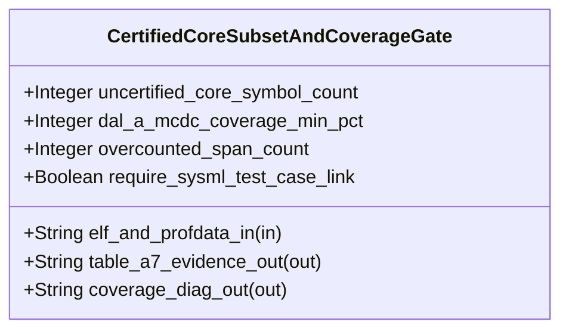

| Attribute | Specification Detail |
| :--- | :--- |
| **Issue ID** | #756 |
| **Title** | Feature 50: [BP 11 Ferrocene Qualified Toolchain FLS Traceability Structural Coverage and 3 Ring Rust_Flutter DO 178 C DO 330 Certification Architecture] CertifiedCoreSubsetAndCoverageGate |
| **Type** | feature |
| **Parent Epic** | [EPIC-11-BP_11_Ferrocene_Qualified_Toolchain_FLS_Traceability_Structural_Coverage_and_3_Ring_Rust_Flutter_DO_178C_DO_330_Certification_Architecture](../epics/EPIC-11-BP_11_Ferrocene_Qualified_Toolchain_FLS_Traceability_Structural_Coverage_and_3_Ring_Rust_Flutter_DO_178C_DO_330_Certification_Architecture.md) |
| **Interface Type** | Physical / Structural / Internal Bus |
| **Schema Containers** | `BP_11_Ferrocene_Qualified_Toolchain_FLS_Traceability_Structural_Coverage_and_3_Ring_Rust_Flutter_DO_178C_DO_330_Certification_Architecture::CertifiedCoreSubsetAndCoverageGate` |
| **Generation Mode** | subagent |
| **Specification Source** | [schema/model.sysml](../../schema/model.sysml) |

# Feature 50: [BP 11 Ferrocene Qualified Toolchain FLS Traceability Structural Coverage and 3 Ring Rust_Flutter DO 178 C DO 330 Certification Architecture] CertifiedCoreSubsetAndCoverageGate

## UML Class Diagram



## Interface Requirements
### 1. Test Data Shape
```json
{
  "$schema": "https://json-schema.org/draft/2020-12/schema",
  "title": "CertifiedCoreSubsetAndCoverageGatePayloadSchema",
  "type": "object",
  "properties": {
    "part": {
      "type": "string",
      "const": "CertifiedCoreSubsetAndCoverageGate"
    },
    "status": {
      "type": "string",
      "enum": ["nominal", "degraded", "fault"]
    },
    "uncertified_core_symbol_count": {
      "type": "integer",
      "x-sysml-type": "Integer",
      "description": "Declared attribute uncertified_core_symbol_count (Integer)",
      "default": 0
    },
    "dal_a_mcdc_coverage_min_pct": {
      "type": "integer",
      "x-sysml-type": "Integer",
      "description": "Minimum Statement, Decision, and MC/DC structural coverage percentage required for Ring-1 DAL-A units (DO-178C Table A-7). [unit: percent]",
      "default": 100
    },
    "overcounted_span_count": {
      "type": "integer",
      "x-sysml-type": "Integer",
      "description": "Permitted macro-duplicated or inlined source-span coverage overcount anomalies in `blanket` / `llvm-profdata` reports. [unit: spans]",
      "default": 0
    },
    "require_sysml_test_case_link": {
      "type": "boolean",
      "x-sysml-type": "Boolean",
      "description": "Requires every structural coverage record to resolve via a SysML `TEST-*` verification case to at least one `REQ-*`. [unit: flag]",
      "default": true
    },
    "elf_and_profdata_in": {
      "type": "object",
      "properties": {
        "direction": { "type": "string", "const": "in" },
        "port_type": { "type": "string", "const": "String" }
      },
      "required": ["direction", "port_type"]
    },
    "table_a7_evidence_out": {
      "type": "object",
      "properties": {
        "direction": { "type": "string", "const": "out" },
        "port_type": { "type": "string", "const": "String" }
      },
      "required": ["direction", "port_type"]
    },
    "coverage_diag_out": {
      "type": "object",
      "properties": {
        "direction": { "type": "string", "const": "out" },
        "port_type": { "type": "string", "const": "String" }
      },
      "required": ["direction", "port_type"]
    }
  },
  "required": [
    "part",
    "status",
    "elf_and_profdata_in",
    "table_a7_evidence_out",
    "coverage_diag_out"
  ],
  "additionalProperties": false
}
```

### 2. Validation & Constraints
Declared structural attributes, boundary ports, invariants, and allocated requirements for classifier `CertifiedCoreSubsetAndCoverageGate`:

| AST Member Kind | Identifier | Declared Type / Direction | Default / Invariant Contract |
| :--- | :--- | :--- | :--- |
| Attribute | `uncertified_core_symbol_count` | `Integer` | Default `0` (`C_CERT_04`: `uncertified_core_symbol_count >= 0 and uncertified_core_symbol_count <= 0`; rejects `std`, `alloc`, `__rust_alloc`, `alloc::vec::Vec`, and `std::io::stdio::_print` symbols with `DEAP-E1103`) |
| Attribute | `dal_a_mcdc_coverage_min_pct` | `Integer` | Default `100` (`C_CERT_05`: `dal_a_mcdc_coverage_min_pct >= 100 and dal_a_mcdc_coverage_min_pct <= 100`; enforces DO-178C Table A-7 `100%` Statement, Decision, and MC/DC coverage with `DEAP-E1104`) |
| Attribute | `overcounted_span_count` | `Integer` | Default `0` (zero permitted macro-duplicated or inlined source-span coverage overcount anomalies in `blanket` / `llvm-profdata` JSON reports) |
| Attribute | `require_sysml_test_case_link` | `Boolean` | Default `true` (every structural coverage record must resolve via a SysML `test case def` / `verification def` `TEST-* -> REQ-*` verified binding) |
| Port | `elf_and_profdata_in` | `in String` | Boundary interface contract receiving Ring-1 ELF/MIR `symbol-report` inventories and `blanket` / `llvm-profdata` coverage profiles |
| Port | `table_a7_evidence_out` | `out String` | Boundary interface contract emitting `Do178cTableA7Receipt` and certified `core` symbol attestation |
| Port | `coverage_diag_out` | `out String` | Boundary interface contract emitting single-line NDJSON diagnostics (`DEAP-E1103`, `DEAP-E1104`) |
| Constraint | `C_CERT_04` | `uncertified_core_symbol_count >= 0 and uncertified_core_symbol_count <= 0` | Enforces 100% Ferrocene certified `core` library subset compliance on Ring-1 `#![no_std]` artifacts |
| Constraint | `C_CERT_05` | `dal_a_mcdc_coverage_min_pct >= 100 and dal_a_mcdc_coverage_min_pct <= 100` | Enforces 100% Statement, Decision, and MC/DC structural coverage for Ring-1 DAL-A units |
| Constraint | `C_CERT_07` | `max_module_exec_sloc >= 1 and max_module_exec_sloc <= 380` | Bounds submodule implementation inside `< 380` executable SLOC (`crates/verify-baseline/src/ferrocene_gate/`) |
| Constraint | `Invariant_REQ_0611_SC_01` | Invariant (`REQ-0611 (REQ_0611_BP_11_Ferrocene_Qualified_Toolchain_FLS_Traceability_Structural_Coverage_and_3_Ring_Rust_Flutter_DO_178C)`) | Dual-mode `criticalup.toml` + `rust-toolchain.toml` semantic parity and Stage-1 == Stage-2 fixed-point compilation (`C_CERT_01`, `C_CERT_02`) |
| Constraint | `Invariant_REQ_0611_SC_02` | Invariant (`REQ-0611 (REQ_0611_BP_11_Ferrocene_Qualified_Toolchain_FLS_Traceability_Structural_Coverage_and_3_Ring_Rust_Flutter_DO_178C)`) | 5-link normative `[FLS: fls_*]` paragraph traceability chain (`C_CERT_03`, `DEAP-E1102`) |
| Constraint | `Invariant_REQ_0611_SC_03` | Invariant (`REQ-0611 (REQ_0611_BP_11_Ferrocene_Qualified_Toolchain_FLS_Traceability_Structural_Coverage_and_3_Ring_Rust_Flutter_DO_178C)`) | Certified `core` subset `symbol-report` gate and DO-178C Table A-7 zero-overcount `blanket` MC/DC coverage (`C_CERT_04`, `C_CERT_05`, `DEAP-E1103`, `DEAP-E1104`) |
| Constraint | `Invariant_REQ_0611_SC_04` | Invariant (`REQ-0611 (REQ_0611_BP_11_Ferrocene_Qualified_Toolchain_FLS_Traceability_Structural_Coverage_and_3_Ring_Rust_Flutter_DO_178C)`) | 3-Ring DAL-A..E workspace partitioning, Ring-2 Miri-guarded FFI boundary, and Ring-1 `SafetyMonitor` readback interlock (`C_CERT_06`, `DEAP-E1105`, `DEAP-E1106`) |
| Constraint | `Invariant_REQ_0611_SC_05` | Invariant (`REQ-0611 (REQ_0611_BP_11_Ferrocene_Qualified_Toolchain_FLS_Traceability_Structural_Coverage_and_3_Ring_Rust_Flutter_DO_178C)`) | Cross-platform runtime `PATH` discovery across macOS, Linux, and Windows (`C_CERT_08`) and `< 380`-SLOC submodule modularity (`C_CERT_07`) |
| Requirement | `REQ-0611 (REQ_0611_BP_11_Ferrocene_Qualified_Toolchain_FLS_Traceability_Structural_Coverage_and_3_Ring_Rust_Flutter_DO_178C)` | Allocated Requirement | FerroceneThreeRingCertificationArchitecture (**REQ-0611** / BP-11 / DEAP-BP-DET-11, UUIDv5 `6ba7b810-9dad-11d1-80b4-00c04fd430cb`, Class P linear AST, ELF symbol-table, and LLVM coverage-profile verification complexity, governed by RTCA DO-178C DAL-A through DAL-E, RTCA DO-330 TQL-1 and TQL-5, ISO 26262 ASIL-D, and IEC 61508 SIL-4) |

```sysml
constraint Invariant_REQ_0611_SC_01 {}
constraint Invariant_REQ_0611_SC_02 {}
constraint Invariant_REQ_0611_SC_03 {}
constraint Invariant_REQ_0611_SC_04 {}
constraint Invariant_REQ_0611_SC_05 {}
```

### 3. Visual Layout & Arrangement
Structural composition and boundary topology for classifier `CertifiedCoreSubsetAndCoverageGate` organize no nested subparts declared in schema paired with boundary ports `in elf_and_profdata_in : String`, `out table_a7_evidence_out : String`, `out coverage_diag_out : String`. Under Contract A, `CertifiedCoreSubsetAndCoverageGate` ingests full OMG SysML v2.0 + KerML 1.0 `verification def`/`verification` and `test case def`/`test case` (`verify requirement`) CST/AST nodes via `logos` + `rowan` + `salsa` + `ariadne` (`deap_core::sysml_cst`) with zero 16-construct caps.

### 4. Interactive Flow & States
Operational lifecycle events and discrete state transitions for `CertifiedCoreSubsetAndCoverageGate` follow `BP_11_Ferrocene_Qualified_Toolchain_FLS_Traceability_Structural_Coverage_and_3_Ring_Rust_Flutter_DO_178C_DO_330_Certification_Architecture_LifecycleState` (`EmbeddingFlsTraceability -> AuditingCoreSubsetAndMcdc` on `fiveLinkFlsChainComplete`; `AuditingCoreSubsetAndMcdc -> VerifyingRing1SafetyMonitor` on `coreSubsetAndTableA7Verified`; `AuditingCoreSubsetAndMcdc -> RejectedFailClosed` on `rejectUncertifiedSymbolOrCoverageE1103E1104`).

### Layer 1: Domain State & Signal Model
Classifier `CertifiedCoreSubsetAndCoverageGate` encapsulates typed domain state attributes `uncertified_core_symbol_count : Integer`, `dal_a_mcdc_coverage_min_pct : Integer`, `overcounted_span_count : Integer`, `require_sysml_test_case_link : Boolean` alongside operational lifecycle status, typed `serde_json` schemas for Ferrocene `symbol-report` ELF/MIR symbol inventories and `blanket` / `llvm-profdata` JSON structural coverage profiles, and full OMG SysML v2.0 + KerML 1.0 `test case def` / `verification def` AST bindings (Contract A, zero 16-construct caps).

### Layer 2: Logic & Safety State Management
Classifier `CertifiedCoreSubsetAndCoverageGate` governs deterministic structural transition evaluation (`verify_certified_core_and_table_a7_coverage(summary, certified_core_prefixes)`) enforcing invariant obligations `C_CERT_04`, `C_CERT_05`, `C_CERT_07`, `Invariant_REQ_0611_SC_01`, `Invariant_REQ_0611_SC_02`, `Invariant_REQ_0611_SC_03`, `Invariant_REQ_0611_SC_04`, `Invariant_REQ_0611_SC_05`. Under Contract B, all symbol-report allowlist verification (rejecting `std`, `alloc`, `__rust_alloc`, `alloc::vec::Vec`, and `std::io::stdio::_print` dynamic formatting symbols with `DEAP-E1103`) and DO-178C Table A-7 zero-overcount MC/DC condition-flip evaluation (`DEAP-E1104`) execute via typed AST/JSON structures inside `< 380`-SLOC submodules (`crates/verify-baseline/src/ferrocene_gate/`, `max_module_exec_sloc <= 380`, `C_CERT_07`) with explicit deletion of legacy hand-rolled line/string symbol-table and coverage scanners.

### Layer 3: Presentation & Actuator Interface Binding
Classifier `CertifiedCoreSubsetAndCoverageGate` binds external and behavioral interfaces across port `in elf_and_profdata_in : String`, port `out table_a7_evidence_out : String`, port `out coverage_diag_out : String`, emitting `Do178cTableA7Receipt` evidence artifacts and single-line NDJSON diagnostics (`DEAP-E1103`, `DEAP-E1104`) across macOS, Linux, and Windows (`std::env::consts::{DLL_PREFIX, DLL_SUFFIX, EXE_SUFFIX}`, `camino::Utf8Path`) with zero hardcoded OS/user/machine paths.

### Associated Use Cases & User Stories

#### Associated Use Cases
- [ ] #787 - [Use Case 59: Dual Mode criticalup toml and rust toolchain toml Parity Cross Platform Discovery and DO 330 Fixed Point Qualification](../use-cases/UC-59-Dual_Mode_criticalup_toml_and_rust_toolchain_toml_Parity_Cross_Platform_Discovery_and_DO_330_Fixed_Point_Qualification.md)
- [ ] #788 - [Use Case 60: End to End FLS Normative Paragraph Traceability Emission and Fail Closed Orphan Detection](../use-cases/UC-60-End_to_End_FLS_Normative_Paragraph_Traceability_Emission_and_Fail_Closed_Orphan_Detection.md)
- [ ] #789 - [Use Case 61: Certified core Library Subset Symbol Report Gate Rejecting std alloc and Dynamic Formatting Symbols](../use-cases/UC-61-Certified_core_Library_Subset_Symbol_Report_Gate_Rejecting_std_alloc_and_Dynamic_Formatting_Symbols.md)
- [ ] #790 - [Use Case 62: Zero Overcount Structural and MC DC Coverage Verification Mapped to SysML Verification Cases](../use-cases/UC-62-Zero_Overcount_Structural_and_MC_DC_Coverage_Verification_Mapped_to_SysML_Verification_Cases.md)
- [ ] #791 - [Use Case 63: Schema Driven 3 Ring Workspace Partitioning and Ring 2 Miri Guarded FFI Precondition Enforcement](../use-cases/UC-63-Schema_Driven_3_Ring_Workspace_Partitioning_and_Ring_2_Miri_Guarded_FFI_Precondition_Enforcement.md)
- [ ] #792 - [Use Case 64: Ring 1 Challenge Response Command Interlock and Telemetry Frame Digest Readback Safety Monitor Against Ring 3 Faults](../use-cases/UC-64-Ring_1_Challenge_Response_Command_Interlock_and_TelemetryFrame_Digest_Readback_SafetyMonitor_Against_Ring_3_Faults.md)
- [ ] #793 - [Use Case 65: Cross Platform Execution Submodule Layout Conformance and Twelve Gate Blueprint Verification Gate](../use-cases/UC-65-Cross_Platform_Execution_Submodule_Layout_Conformance_and_Twelve_Gate_Blueprint_Verification_Gate.md)

#### Associated User Stories
- [ ] #826 - [User Story 77: verify certified core and table a7 coverage](../user-stories/US-77-verify_certified_core_and_table_a7_coverage.md)

## Acceptance Criteria (BDD)
- [ ] AC-01: Given valid `CertifiedCoreSubsetAndCoverageGate` inputs satisfying `Invariant_REQ_0611_SC_01` [Req `REQ-0611 (REQ_0611_BP_11_Ferrocene_Qualified_Toolchain_FLS_Traceability_Structural_Coverage_and_3_Ring_Rust_Flutter_DO_178C)`], When `CertifiedCoreSubsetAndCoverageGate` evaluates invariant `Invariant_REQ_0611_SC_01`, Then the invariant holds and verified state is committed.
- [ ] AC-02: Given boundary inputs that violate `Invariant_REQ_0611_SC_01` [Req `REQ-0611 (REQ_0611_BP_11_Ferrocene_Qualified_Toolchain_FLS_Traceability_Structural_Coverage_and_3_Ring_Rust_Flutter_DO_178C)`], When `CertifiedCoreSubsetAndCoverageGate` evaluates invariant `Invariant_REQ_0611_SC_01`, Then `CertifiedCoreSubsetAndCoverageGate` rejects the invalid transition and routes a diagnostic via diagnostic port `table_a7_evidence_out` and `coverage_diag_out`.
- [ ] AC-03: Given valid `CertifiedCoreSubsetAndCoverageGate` inputs satisfying `Invariant_REQ_0611_SC_02` [Req `REQ-0611 (REQ_0611_BP_11_Ferrocene_Qualified_Toolchain_FLS_Traceability_Structural_Coverage_and_3_Ring_Rust_Flutter_DO_178C)`], When `CertifiedCoreSubsetAndCoverageGate` evaluates invariant `Invariant_REQ_0611_SC_02`, Then the invariant holds and verified state is committed.
- [ ] AC-04: Given boundary inputs that violate `Invariant_REQ_0611_SC_02` [Req `REQ-0611 (REQ_0611_BP_11_Ferrocene_Qualified_Toolchain_FLS_Traceability_Structural_Coverage_and_3_Ring_Rust_Flutter_DO_178C)`], When `CertifiedCoreSubsetAndCoverageGate` evaluates invariant `Invariant_REQ_0611_SC_02`, Then `CertifiedCoreSubsetAndCoverageGate` rejects the invalid transition and routes a diagnostic via diagnostic port `table_a7_evidence_out` and `coverage_diag_out`.
- [ ] AC-05: Given valid `CertifiedCoreSubsetAndCoverageGate` inputs satisfying `Invariant_REQ_0611_SC_03` (`C_CERT_04`: `uncertified_core_symbol_count == 0` and `C_CERT_05`: `dal_a_mcdc_coverage_min_pct == 100`, `overcounted_span_count == 0`, `require_sysml_test_case_link == true`) [Req `REQ-0611 (REQ_0611_BP_11_Ferrocene_Qualified_Toolchain_FLS_Traceability_Structural_Coverage_and_3_Ring_Rust_Flutter_DO_178C)`], When `CertifiedCoreSubsetAndCoverageGate` evaluates invariant `Invariant_REQ_0611_SC_03`, Then the invariant holds, `Do178cTableA7Receipt` is emitted on `table_a7_evidence_out`, and verified state is committed.
- [ ] AC-06: Given boundary inputs that violate `Invariant_REQ_0611_SC_03` (any linked `std`, `alloc`, `__rust_alloc`, `alloc::vec::Vec`, or `std::io::stdio::_print` symbol, `< 100%` Statement/Decision/MC/DC coverage, `overcounted_span_count > 0`, or missing `TEST-* -> REQ-*` binding) [Req `REQ-0611 (REQ_0611_BP_11_Ferrocene_Qualified_Toolchain_FLS_Traceability_Structural_Coverage_and_3_Ring_Rust_Flutter_DO_178C)`], When `CertifiedCoreSubsetAndCoverageGate` evaluates invariant `Invariant_REQ_0611_SC_03`, Then `CertifiedCoreSubsetAndCoverageGate` rejects the invalid transition and routes a deterministic `DEAP-E1103` or `DEAP-E1104` diagnostic via `table_a7_evidence_out` and `coverage_diag_out`.
- [ ] AC-07: Given valid `CertifiedCoreSubsetAndCoverageGate` state satisfying composite invariants (`Invariant_REQ_0611_SC_04` [Req `REQ-0611 (REQ_0611_BP_11_Ferrocene_Qualified_Toolchain_FLS_Traceability_Structural_Coverage_and_3_Ring_Rust_Flutter_DO_178C)`]; `Invariant_REQ_0611_SC_05` [Req `REQ-0611 (REQ_0611_BP_11_Ferrocene_Qualified_Toolchain_FLS_Traceability_Structural_Coverage_and_3_Ring_Rust_Flutter_DO_178C)`]), When `CertifiedCoreSubsetAndCoverageGate` evaluates the remaining invariant conjunction inside `< 380`-SLOC submodules (`C_CERT_07`), Then all declared invariants hold and verified state is committed.
- [ ] AC-08: Given input state that violates any invariant in (`Invariant_REQ_0611_SC_04` [Req `REQ-0611 (REQ_0611_BP_11_Ferrocene_Qualified_Toolchain_FLS_Traceability_Structural_Coverage_and_3_Ring_Rust_Flutter_DO_178C)`]; `Invariant_REQ_0611_SC_05` [Req `REQ-0611 (REQ_0611_BP_11_Ferrocene_Qualified_Toolchain_FLS_Traceability_Structural_Coverage_and_3_Ring_Rust_Flutter_DO_178C)`]), When `CertifiedCoreSubsetAndCoverageGate` evaluates the composite guard, Then `CertifiedCoreSubsetAndCoverageGate` rejects the invalid state transition and routes a diagnostic via diagnostic port `table_a7_evidence_out` and `coverage_diag_out`.
- [ ] AC-09: Given nominal typed values for `uncertified_core_symbol_count` (`Integer`), `dal_a_mcdc_coverage_min_pct` (`Integer`), `overcounted_span_count` (`Integer`), `require_sysml_test_case_link` (`Boolean`) across `elf_and_profdata_in` (`in String`), `table_a7_evidence_out` (`out String`), `coverage_diag_out` (`out String`), When `CertifiedCoreSubsetAndCoverageGate` executes structural interface processing, Then state and output ports conform to declared schema types.
- [ ] AC-10: Given malformed input frames across `uncertified_core_symbol_count` (`Integer`), `dal_a_mcdc_coverage_min_pct` (`Integer`), `overcounted_span_count` (`Integer`), `require_sysml_test_case_link` (`Boolean`) or `elf_and_profdata_in` (`in String`), `table_a7_evidence_out` (`out String`), `coverage_diag_out` (`out String`), When `CertifiedCoreSubsetAndCoverageGate` boundary validation executes, Then `CertifiedCoreSubsetAndCoverageGate` rejects the malformed input via diagnostic port `table_a7_evidence_out` and `coverage_diag_out`.

## Source References
Formal component specifications and normative systems engineering requirements:
- System Architecture Model: `schema/model.sysml`
- Normative Systems Engineering Standard: ISO/IEC/IEEE 15288:2023 §6.4.3 Architecture Definition Process

Component behavior and interface definitions derive from `schema/model.sysml` pursuant to ISO/IEC/IEEE 15288.
