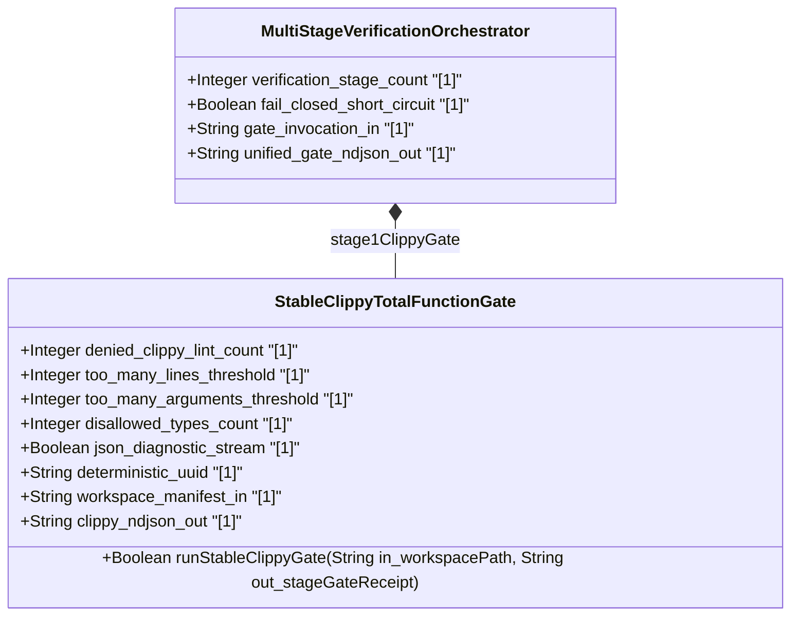
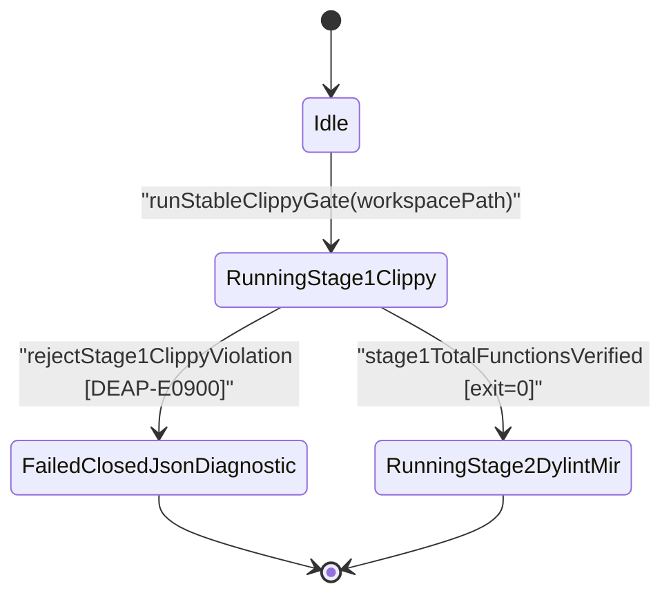

| Attribute | Specification Detail |
| :--- | :--- |
| **Issue ID** | TBD |
| **Title** | Feature 50: [BP 09 Multi Stage Compiler and Formal Verification Gatekeeper] StableClippyTotalFunctionGate |
| **Type** | feature |
| **Parent Epic** | [EPIC-09-BP_09_Multi_Stage_Compiler_and_Formal_Verification_Gatekeeper](../epics/EPIC-09-BP_09_Multi_Stage_Compiler_and_Formal_Verification_Gatekeeper.md) |
| **Interface Type** | Physical / Structural / Internal Bus |
| **Schema Containers** | `BP_09_Multi_Stage_Compiler_and_Formal_Verification_Gatekeeper::StableClippyTotalFunctionGate` |
| **Generation Mode** | subagent |
| **Specification Source** | [schema/model.sysml](../../schema/model.sysml) |

# Feature 50: [BP 09 Multi Stage Compiler and Formal Verification Gatekeeper] StableClippyTotalFunctionGate

## Parent Epic
- [ ] [EPIC-09-BP_09_Multi_Stage_Compiler_and_Formal_Verification_Gatekeeper](../epics/EPIC-09-BP_09_Multi_Stage_Compiler_and_Formal_Verification_Gatekeeper.md) -- Allocates Wave-1 Stage-1 universal stable-toolchain Clippy total-function, arithmetic, cast-safety, unsafe-doc, complexity-threshold, and supply-chain lockfile verification (**REQ-0609**, **Invariant_REQ_0609_SC_01**) to `StableClippyTotalFunctionGate` while explicitly deferring Wave-2 Stages 2-4 to sibling features.

## Description
`StableClippyTotalFunctionGate` (`BP-09` / `DEAP-BP-DET-09`, **REQ-0609**, deterministic UUIDv5 `6ba7b810-9dad-11d1-80b4-00c04fd430c9`, complexity `Class P`) specifies the Wave-1 Stage-1 static HIR/THIR total-function and structural complexity verification gate allocated under `BP_09_Multi_Stage_Compiler_and_Formal_Verification_Gatekeeper` (tracing to `EPIC-09` and ConOps Section 4 Subsystem Architecture). Executing strictly on the pinned stable Rust toolchain without nightly `rustc_private`, abstract-machine interpreter, or SAT/CBMC solver coupling, `StableClippyTotalFunctionGate` audits upstream compiler crates (`crates/deap-core/src/lib.rs`, `crates/deap-core/src/sysml_ast/mod.rs`, `crates/compile-sysml/src/main.rs`, `crates/verify-baseline/src/main.rs`) and generated downstream Rust workspaces before any artifact promotion.

The gate enforces four deterministic Stage-1 contracts within a `< 380` executable SLOC target implementation module budget (excluding `cfg(test)` unit-test module blocks):
1. **14-Lint `[workspace.lints.clippy]` `deny` Table (`denied_clippy_lint_count = 14`)**: Mandates workspace-wide `deny` (or `forbid`) enforcement across all 14 total-function, bounds-indexing, checked-arithmetic, numeric-cast, unsafe-block documentation, structural-complexity, and deterministic-type Clippy lints, paired with mandatory `[lints] workspace = true` inheritance in every member `Cargo.toml`, crate-root `#![forbid(unsafe_code)]` on pure domain/lowering/FSM crates, and zero unauthorized `allow(...)` item attributes or `#![allow(...)]` crate-level lint-suppression attributes.
2. **Root `clippy.toml` Complexity & Determinism Thresholds**: Enforces `too-many-lines-threshold = 80` (**C_VER_01**: `1 <= too_many_lines_threshold <= 80` lines), `too-many-arguments-threshold = 5` (**C_VER_02**: `0 <= too_many_arguments_threshold <= 5` parameters), `max-fn-params-bools = 3` (`BoolParams_HIR <= 3` per **Invariant_REQ_0609_SC_01**), and `disallowed-types` (`disallowed_types_count >= 3`) banning non-deterministic SipHash containers (`std::collections::HashMap`, `std::collections::HashSet`, `std::collections::hash_map::RandomState`) and external backtracking NFA pattern-matching engine types in favor of `BTreeMap`, `BTreeSet`, and linear-time DFA/CST scanners.
3. **`Cargo.lock` `--offline --locked` Supply-Chain Integrity & Cache-Fingerprint Isolation**: Requires an existing, committed root `Cargo.lock`, executes `cargo clippy --workspace --all-targets --offline --locked --message-format=json` in air-gapped offline mode, binds incremental target-cache validity to the combined SHA-256 digest of `(Cargo.toml, Cargo.lock, clippy.toml)`, and verifies byte-identical `Cargo.lock` SHA-256 preservation pre- and post-execution.
4. **Workspace-Scoped `--message-format=json` NDJSON Span Filter**: Streams `compiler-message` JSON records via bounded single-line `BufRead` framing (`MAX_AST_DEPTH = 64`), resolves both primary spans and recursive macro-expansion call-site spans (including `cfg(test)` test-module targets and `include!` targets) to workspace-relative crate paths, preserves primary spans, lint `code`, and machine-applicable `suggested_replacement` payloads, and emits ANSI-free (`0x1B`-free) single-line `DEAP-E0900` diagnostics on `clippy_ndjson_out`.

### Explicit Wave-1 Scope & Wave-2 Stage 2-4 Deferral Boundary
`FEAT-50` delivers the complete, self-contained **Wave-1** verification gate (`RunningStage1Clippy`) inside `MultiStageVerificationOrchestrator` ([FEAT-49-MultiStageVerificationOrchestrator.md](FEAT-49-MultiStageVerificationOrchestrator.md)). Stages 2 through 4 of `BP-09` require isolated nightly `rustc_private`, `flutter_rust_bridge` / Miri Tree Borrows, and CBMC proof toolchains and are **explicitly deferred to Wave-2**:

| `BP-09` Verification Stage | Allocated Component (`part def`) | Allocated Feature | Delivery Wave & Operational Disposition in `FEAT-50` |
| :--- | :--- | :--- | :--- |
| **Stage 1** (`RunningStage1Clippy`) | `StableClippyTotalFunctionGate` | `FEAT-50` (Active) | **Wave-1 Active**: Enforces 14-lint `[workspace.lints.clippy]` `deny` table, `clippy.toml` (`80`-SLOC / `5`-arg / `disallowed-types`), `Cargo.lock` `--offline --locked` immutability, and `--message-format=json` NDJSON `DEAP-E0900` span filtering. |
| **Stage 2** (`RunningStage2DylintMir`) | `IsolatedDylintMirAllocationGate` | [FEAT-47-IsolatedDylintMirAllocationGate.md](FEAT-47-IsolatedDylintMirAllocationGate.md) | **Wave-2 Explicitly Deferred**: Standalone nightly Dylint `rustc_middle::mir::Body` transitive zero-heap-allocation proof on `rt_loop`-annotated call graphs (**C_VER_03**, `DEAP-E0901`) and `realises("REQ-*")` attribute `.digest.json` verification (`DEAP-E0902`). |
| **Stage 3** (`RunningStage3FrbAndMiri`) | `FrbIcdBridgeAndMiriUbGate` | [FEAT-46-FrbIcdBridgeAndMiriUbGate.md](FEAT-46-FrbIcdBridgeAndMiriUbGate.md) | **Wave-2 Explicitly Deferred**: Deterministic `flutter_rust_bridge` fail-closed `ICD_01`/`ICD_02` FFI facade synthesis, `dart analyze --fatal-infos`, and `cargo +nightly miri test` with `-Zmiri-tree-borrows` (**C_VER_04**, `DEAP-E0903`). |
| **Stage 4** (`RunningStage4KaniCbmc`) | `KaniCbmcProofSynthesizer` | [FEAT-48-KaniCbmcProofSynthesizer.md](FEAT-48-KaniCbmcProofSynthesizer.md) | **Wave-2 Explicitly Deferred**: Structured `syn` + `quote` + `prettyplease` synthesis of `cfg(kani)` proof modules, `kani::proof` attributes, and `kani::unwind(N)` CBMC harnesses (**C_VER_05**, **C_VER_06**, `DEAP-E0904`). |

### Mathematical Formulations of Stage-1 Total-Function & Supply-Chain Invariants

$$
\begin{aligned}
\operatorname{Stage1Pass}(\mathcal{W}) &\iff \Big(\lvert \mathcal{L}_{\mathrm{deny}}(\mathcal{W}) \rvert = N_{\mathrm{deny}}\Big) \land \Big(\lvert \mathcal{T}_{\mathrm{banned}}(\mathcal{W}) \rvert \ge N_{\mathrm{banned}}\Big) \land \Big(H(\Lambda_{\mathrm{pre}}) = H(\Lambda_{\mathrm{post}})\Big) \\
&\land \forall C \in \mathcal{W}, \quad \forall \ell \in \mathcal{L}_{\mathrm{deny}}(\mathcal{W}), \quad \Big(\operatorname{Violations}_{\ell}(C) = \emptyset\Big) \land \Big(\operatorname{Types}(C) \cap \mathcal{T}_{\mathrm{banned}}(\mathcal{W}) = \emptyset\Big) \\
&\land \forall f \in \operatorname{Fns}(\mathcal{W}), \quad \Big(1 \le L_{\mathrm{cfg}} \le L_{\max}\Big) \land \Big(\operatorname{Lines}_{\mathrm{HIR}}(f) \le L_{\mathrm{cfg}}\Big) \\
&\land \Big(0 \le A_{\mathrm{cfg}} \le A_{\max}\Big) \land \Big(\lvert \operatorname{Args}_{\mathrm{HIR}}(f) \rvert \le A_{\mathrm{cfg}}\Big) \land \Big(\operatorname{BoolParams}_{\mathrm{HIR}}(f) \le B_{\max}\Big)
\end{aligned}
$$

- Parameter Definitions & Engineering Units:
- $\mathcal{W}$: Closed set of workspace member crates inheriting `[workspace.lints.clippy]` via `lints.workspace = true` (dimensionless crate set).
- $\mathcal{L}_{\mathrm{deny}}(\mathcal{W})$: Active Clippy lint identifiers configured at `deny` or `forbid` severity in root `Cargo.toml`, with mandatory cardinality $N_{\mathrm{deny}} = 14$ lints (`denied_clippy_lint_count = 14`).
- $\mathcal{T}_{\mathrm{banned}}(\mathcal{W})$: Configured `disallowed-types` set in root `clippy.toml`, with minimum cardinality $N_{\mathrm{banned}} = 3$ types (`disallowed_types_count = 3`).
- $H(\Lambda_{\mathrm{pre}}), H(\Lambda_{\mathrm{post}})$: Pre-invocation and post-invocation 256-bit SHA-256 digests of workspace `Cargo.lock` enforced under `--offline --locked` supply-chain rules.
- $\operatorname{Violations}_{\ell}(C)$: Workspace-span-filtered `compiler-message` error set for lint $\ell$ across all compilation targets (`--all-targets`) of crate $C$ (`0` violations required).
- $\operatorname{Lines}_{\mathrm{HIR}}(f)$: Executable HIR body line count of function $f$, bounded by configured threshold $L_{\mathrm{cfg}}$ where $1 \le L_{\mathrm{cfg}} \le L_{\max}$ and $L_{\max} = 80$ lines (**C_VER_01**, `too_many_lines_threshold = 80`).
- $\lvert \operatorname{Args}_{\mathrm{HIR}}(f) \rvert$: Callable parameter arity of function $f$, bounded by configured threshold $A_{\mathrm{cfg}}$ where $0 \le A_{\mathrm{cfg}} \le A_{\max}$ and $A_{\max} = 5$ params (**C_VER_02**, `too_many_arguments_threshold = 5`).
- $\operatorname{BoolParams}_{\mathrm{HIR}}(f)$: Boolean parameter count in the signature of function $f$, bounded by $B_{\max} = 3$ params (**Invariant_REQ_0609_SC_01**, `max-fn-params-bools = 3`).

## UML Class Diagram



## Interface Requirements
### 1. Test Data Shape
```json
{
  "$schema": "https://json-schema.org/draft/2020-12/schema",
  "title": "StableClippyTotalFunctionGatePayloadSchema",
  "type": "object",
  "properties": {
    "part": {
      "type": "string",
      "const": "StableClippyTotalFunctionGate"
    },
    "status": {
      "type": "string",
      "enum": ["nominal", "degraded", "fault"]
    },
    "denied_clippy_lint_count": {
      "type": "integer",
      "x-sysml-type": "Integer",
      "description": "Mandatory count of total-function, cast-safety, arithmetic, unsafe-doc, and structural complexity Clippy lints set to deny or forbid. [unit: lints]",
      "const": 14,
      "default": 14
    },
    "too_many_lines_threshold": {
      "type": "integer",
      "x-sysml-type": "Integer",
      "description": "Maximum HIR function body line count enforced in root clippy.toml (too-many-lines-threshold) per C_VER_01. [unit: lines]",
      "minimum": 1,
      "maximum": 80,
      "default": 80
    },
    "too_many_arguments_threshold": {
      "type": "integer",
      "x-sysml-type": "Integer",
      "description": "Maximum callable parameter count enforced in root clippy.toml (too-many-arguments-threshold) per C_VER_02. [unit: params]",
      "minimum": 0,
      "maximum": 5,
      "default": 5
    },
    "disallowed_types_count": {
      "type": "integer",
      "x-sysml-type": "Integer",
      "description": "Minimum banned non-deterministic hash container and backtracking pattern-engine entries in clippy.toml. [unit: types]",
      "minimum": 3,
      "default": 3
    },
    "json_diagnostic_stream": {
      "type": "boolean",
      "x-sysml-type": "Boolean",
      "description": "Emits single-line cargo clippy --message-format=json NDJSON diagnostics into the autonomous remediation loop. [unit: flag]",
      "const": true,
      "default": true
    },
    "deterministic_uuid": {
      "type": "string",
      "x-sysml-type": "String",
      "description": "Canonical deterministic blueprint identifier (DEAP-BP-DET-09). [unit: uuidv5]",
      "const": "6ba7b810-9dad-11d1-80b4-00c04fd430c9",
      "default": "6ba7b810-9dad-11d1-80b4-00c04fd430c9"
    },
    "workspace_manifest_in": {
      "type": "object",
      "properties": {
        "direction": { "type": "string", "const": "in" },
        "port_type": { "type": "string", "const": "String" },
        "protocol": { "type": "string", "const": "CargoAndClippyTomlBundle" }
      },
      "required": ["direction", "port_type", "protocol"]
    },
    "clippy_ndjson_out": {
      "type": "object",
      "properties": {
        "direction": { "type": "string", "const": "out" },
        "port_type": { "type": "string", "const": "String" },
        "protocol": { "type": "string", "const": "RustcCompilerMessageNdjson" }
      },
      "required": ["direction", "port_type", "protocol"]
    }
  },
  "required": [
    "part",
    "status",
    "denied_clippy_lint_count",
    "too_many_lines_threshold",
    "too_many_arguments_threshold",
    "disallowed_types_count",
    "json_diagnostic_stream",
    "deterministic_uuid",
    "workspace_manifest_in",
    "clippy_ndjson_out"
  ],
  "additionalProperties": false
}
```

### 2. Validation & Constraints
#### 2.1 SysML v2 AST Classifier, Port, Operation & Invariant Bindings
Declared structural attributes, boundary ports, operations, and allocated invariants for `BP_09_Multi_Stage_Compiler_and_Formal_Verification_Gatekeeper::StableClippyTotalFunctionGate`:

| AST Member Kind | Identifier | Declared Type / Signature | Units / Protocol | Default / Invariant Contract |
| :--- | :--- | :--- | :--- | :--- |
| Attribute | `denied_clippy_lint_count` | `Integer` | `lints` | Exact `14` (`[workspace.lints.clippy]` `deny`/`forbid` entries; **Invariant_REQ_0609_SC_01**) |
| Attribute | `too_many_lines_threshold` | `Integer` | `lines` | Default `80`; **C_VER_01**: `1 <= too_many_lines_threshold <= 80` |
| Attribute | `too_many_arguments_threshold` | `Integer` | `params` | Default `5`; **C_VER_02**: `0 <= too_many_arguments_threshold <= 5` |
| Attribute | `disallowed_types_count` | `Integer` | `types` | Default `3`; `disallowed_types_count >= 3` banned types in `clippy.toml` |
| Attribute | `json_diagnostic_stream` | `Boolean` | `flag` | Exact `true` (single-line `--message-format=json` NDJSON framing) |
| Attribute | `deterministic_uuid` | `String` | `uuidv5` | Exact `"6ba7b810-9dad-11d1-80b4-00c04fd430c9"` (`DEAP-BP-DET-09`) |
| Port (`in`) | `workspace_manifest_in` | `in String` (`workspace_manifest_in_flow`) | `CargoAndClippyTomlBundle` | Validated root `Cargo.toml`, `Cargo.lock`, `clippy.toml`, and member crate trees |
| Port (`out`) | `clippy_ndjson_out` | `out String` (`clippy_ndjson_out_flow`) | `RustcCompilerMessageNdjson` | Single-line ANSI-free (`0x1B`-free) `DEAP-E0900` diagnostics + `reply_StageGateReceipt` |
| Action (`action def`) | `runStableClippyGate` | `+runStableClippyGate(in workspacePath: String, out stageGateReceipt: String): Boolean` | `VerificationGateCommand` | Executes pre-flight manifest audit, `--offline --locked` Clippy run, and NDJSON span filter |

#### 2.2 Mandatory 14-Lint `[workspace.lints.clippy]` `deny` Table (`denied_clippy_lint_count = 14`)
Root `Cargo.toml` MUST declare all 14 Clippy lints below at `"deny"` (or `"forbid"`), every workspace member `Cargo.toml` MUST declare `[lints] workspace = true`, pure domain/lowering/FSM crates MUST declare crate-root `#![forbid(unsafe_code)]`, and workspace source files MUST contain zero unauthorized item-level `allow(...)` attributes or crate-level `#![allow(...)]` overrides:

| Ordinal | `[workspace.lints.clippy]` Key | Required Level | Safety Category | Rejected Partial / Unsafe Construct | Mandatory Total-Function Construct |
| :--- | :--- | :--- | :--- | :--- | :--- |
| 1 | `unwrap_used` | `"deny"` | Total-Function | `Option::unwrap()` / `Result::unwrap()` | `?` propagation, pattern matching, or `unwrap_or_default` |
| 2 | `expect_used` | `"deny"` | Total-Function | `Option::expect(...)` / `Result::expect(...)` | Typed `Result<T, E>` domain error variant |
| 3 | `panic` | `"deny"` | Total-Function | `panic!(...)` divergent macro | Total error return via typed `StableClippyGateError` |
| 4 | `todo` | `"deny"` | Total-Function | `todo!(...)` incomplete stub | Complete verified total-function implementation |
| 5 | `indexing_slicing` | `"deny"` | Bounds Safety | Direct `slice[i]` or `&slice[a..b]` panicking index | `.get(i)` / `.get(a..b)` returning `Option<&T>` |
| 6 | `arithmetic_side_effects` | `"deny"` | Arithmetic Safety | Unchecked `+`, `-`, `*`, `/`, `%`, `+=`, `-=` operators | `checked_add`, `checked_sub`, `checked_mul`, `checked_div`, or `saturating_*` |
| 7 | `cast_possible_truncation` | `"deny"` | Cast Safety | Narrowing `as` numeric casts (e.g., `u64 as u32`) | `TryFrom::try_from(...)` with typed overflow error |
| 8 | `cast_sign_loss` | `"deny"` | Cast Safety | Signed-to-unsigned `as` casts (e.g., `i32 as u32`) | `u32::try_from(...)` with explicit negative-value rejection |
| 9 | `cast_possible_wrap` | `"deny"` | Cast Safety | Unsigned-to-signed wrapping `as` casts (e.g., `u32 as i32`) | `i32::try_from(...)` preserving upper-half range bounds |
| 10 | `undocumented_unsafe_blocks` | `"deny"` | Unsafe-Doc Safety | `unsafe` block lacking preceding `// SAFETY:` proof | Crate-root `#![forbid(unsafe_code)]` (or `// SAFETY:` in isolated Wave-2 FFI bridges) |
| 11 | `too_many_lines` | `"deny"` | Complexity (**C_VER_01**) | Function HIR body exceeding `80` executable lines | Helper / stage outlining keeping every function `<= 80` lines |
| 12 | `too_many_arguments` | `"deny"` | Complexity (**C_VER_02**) | Function / method signature exceeding `5` parameters | Typed context value-object grouping keeping arity `<= 5` params |
| 13 | `fn_params_excessive_bools` | `"deny"` | Complexity (**SC-01**) | Signature containing `> 3` `bool` parameters (`BoolParams_HIR > 3`) | Explicit two-variant or multi-state typed domain `enum` |
| 14 | `disallowed_types` | `"deny"` | Determinism & Linear DFA | Banned SipHash or backtracking NFA pattern-engine types | `std::collections::BTreeMap`, `BTreeSet`, and linear-time DFA/CST lexers |

#### 2.3 Root `clippy.toml` Thresholds & `Cargo.lock` `--offline --locked` Supply-Chain Contract
Root `clippy.toml` MUST enforce the following deterministic thresholds:

```toml
too-many-lines-threshold = 80
too-many-arguments-threshold = 5
max-fn-params-bools = 3
disallowed-types = [
  { path = "std::collections::HashMap", reason = "Non-deterministic randomized hash iteration breaks fixed-point parity; use std::collections::BTreeMap" },
  { path = "std::collections::HashSet", reason = "Non-deterministic randomized hash iteration breaks fixed-point parity; use std::collections::BTreeSet" },
  { path = "std::collections::hash_map::RandomState", reason = "Non-deterministic hash seed prohibited; use deterministic BTreeMap/BTreeSet ordering" }
]
```

Supply-chain lockfile and incremental cache rules enforced before, during, and after `cargo clippy --workspace --all-targets --offline --locked --message-format=json`:
- **Pre-Flight `Cargo.lock` Presence & Digest Pinning**: `StableClippyTotalFunctionGate` verifies that workspace-root `Cargo.lock` exists as a regular non-empty UTF-8 file and records `lock_sha256_pre = SHA-256(Cargo.lock)` alongside `bundle_fingerprint = SHA-256(Cargo.toml || Cargo.lock || clippy.toml)`.
- **Air-Gapped `--offline --locked` Execution**: Subprocess invocation MUST pass both `--offline` (zero network socket/registry fetches) and `--locked` (immediate fail-closed abort if any `Cargo.toml` dependency specification diverges from `Cargo.lock`).
- **Cache-Fingerprint Invalidation & Post-Run Immutability**: Any change in `bundle_fingerprint` invalidates cached Stage-1 verification receipts so `clippy.toml` or `[workspace.lints.clippy]` edits cannot be masked by stale incremental `rustc` artifacts (**SC-BP09-18**). Post-invocation verification recomputes `lock_sha256_post = SHA-256(Cargo.lock)` and aborts fail-closed with `DEAP-E0900` if `lock_sha256_pre != lock_sha256_post`.

#### 2.4 `ICD_01` Logical Interface Matrix & `ICD_02` Master Signal Dictionary Alignment
| ICD Document | Interface / Signal ID | Source -> Destination (`part def`) | Port & Flow Binding | Wire Protocol & Payload Invariants |
| :--- | :--- | :--- | :--- | :--- |
| `ICD_01` | `IF-BP09-STAGE1-IN` | `MultiStageVerificationOrchestrator` -> `StableClippyTotalFunctionGate` | `gate_invocation_in` -> `workspace_manifest_in` (`workspace_manifest_in_flow`) | `CargoAndClippyTomlBundle`: normalized workspace-relative path + `Cargo.toml`, `Cargo.lock`, `clippy.toml` bundle |
| `ICD_01` | `IF-BP09-STAGE1-OUT` | `StableClippyTotalFunctionGate` -> `MultiStageVerificationOrchestrator` | `clippy_ndjson_out` (`clippy_ndjson_out_flow`) -> `unified_gate_ndjson_out` | `RustcCompilerMessageNdjson`: single-line UTF-8 JSON (`0x1B` byte count `== 0`), `DEAP-E0900` + `reply_StageGateReceipt` |
| `ICD_02` | `SIG-BP09-CLIPPY-CMD` | `runStableClippyGate` request message | `in workspacePath : String` | Non-empty canonical workspace-relative directory path rejecting `..` traversal and NUL bytes |
| `ICD_02` | `SIG-BP09-STAGE1-RCPT` | `reply_StageGateReceipt` response message | `out stageGateReceipt : String` | Deterministic JSON receipt containing `deterministic_uuid`, `bundle_fingerprint`, `violation_count == 0`, and `wave2_deferred_stages: [2, 3, 4]` |

#### 2.5 Component Failure Modes & Fail-Closed Safety Constraints (`FAILURE_MODE_REGISTRY.md`)
| FM ID | Failure Dimension | Trigger Condition on `StableClippyTotalFunctionGate` | Fail-Closed Diagnostic & Safety Constraint |
| :--- | :--- | :--- | :--- |
| `FM-BP09-017` | `(1) Input/Boundary & Malformed Syntax` | Protocol mismatch on `workspace_manifest_in`, `< 14` denied lints in `[workspace.lints.clippy]`, missing member `lints.workspace = true`, injected item-level `allow(...)` / `#![allow(...)]` overrides, `too_many_lines_threshold` outside `1..80` (**C_VER_01**), `too_many_arguments_threshold` outside `0..5` (**C_VER_02**), `disallowed_types_count < 3`, `json_diagnostic_stream == false`, or mutated `deterministic_uuid`. | `DEAP-E0900` / **SC-BP09-17**: Reject bundle during pre-flight AST/TOML validation and transition immediately to `FailedClosedJsonDiagnostic` before spawning Clippy. |
| `FM-BP09-018` | `(2) State/Concurrency & Ordering` | Stale incremental Clippy fingerprint suppressing lint errors after `clippy.toml` or `Cargo.toml` edits, `--message-format=json` span filter dropping macro-expanded, `include!`, or `cfg(test)` module spans inside workspace crates, or concurrent `target/` / `Cargo.lock` contention without `--offline --locked`. | `DEAP-E0900` / **SC-BP09-18**: Bind cache fingerprint to `SHA-256(Cargo.toml || Cargo.lock || clippy.toml)`, isolate target lock, resolve primary plus macro call-site spans to workspace roots, and trigger `rejectStage1ClippyViolation` on any hit. |
| `FM-BP09-019` | `(3) Resource/Depth/Arithmetic Exhaustion` | Unbounded `--message-format=json` stdout buffering on high-volume macro diagnostics, JSON nesting depth exceeding `MAX_AST_DEPTH = 64` levels, unbounded subprocess buffering across `--all-targets`, or integer overflow wrapping violation counters back to `0` findings. | `DEAP-E0900` / **SC-BP09-19**: Stream stdout via bounded single-line `BufRead` lines, enforce `MAX_AST_DEPTH = 64` levels of JSON recursion depth, and accumulate tallies via `checked_add` failing closed on counter overflow. |
| `FM-BP09-020` | `(4) Output/Serialization & Partial-Write Integrity` | Truncated, multi-line, or ANSI-tainted (`0x1B`) records on `clippy_ndjson_out`, stripped primary `spans` / lint `code` / `suggested_replacement`, or false-positive `stage1TotalFunctionsVerified` when `cargo clippy` exits non-zero on a `rustc` compile error with zero `clippy::*` lint messages. | `DEAP-E0900` / **SC-BP09-20**: Schema-validate every single-line ANSI-free `RustcCompilerMessageNdjson` record and require BOTH exit code `0` AND zero `compiler-message` errors before sealing `reply_StageGateReceipt`. |

### 3. Visual Layout & Arrangement
Structural composition and boundary topology for classifier `StableClippyTotalFunctionGate` organize zero nested subparts inside `BP_09_Multi_Stage_Compiler_and_Formal_Verification_Gatekeeper`, pairing inbound port `in workspace_manifest_in : String` (`CargoAndClippyTomlBundle`) with outbound port `out clippy_ndjson_out : String` (`RustcCompilerMessageNdjson`). Internally, the `< 380` executable SLOC verification pipeline arranges four sequential pure-Rust stages: (1) manifest and `Cargo.lock` SHA-256 pre-flight validator, (2) air-gapped `cargo clippy --workspace --all-targets --offline --locked --message-format=json` subprocess actuator, (3) `MAX_AST_DEPTH = 64` workspace call-site span filter, and (4) single-line ANSI-free NDJSON diagnostic and Wave-1 `reply_StageGateReceipt` serializer.

### 4. Interactive Flow & States
Operational lifecycle events and discrete fail-closed state transitions for `StableClippyTotalFunctionGate` within `BP_09_Multi_Stage_Compiler_and_Formal_Verification_Gatekeeper_LifecycleState`:



In Wave-1 standalone Stage-1 operation (`FEAT-50`), triggering `stage1TotalFunctionsVerified` seals `reply_StageGateReceipt` directly to `MultiStageVerificationOrchestrator` at the `RunningStage1Clippy` -> `RunningStage2DylintMir` boundary while explicitly deferring Wave-2 execution of `RunningStage2DylintMir` (`FEAT-47`), `RunningStage3FrbAndMiri` (`FEAT-46`), and `RunningStage4KaniCbmc` (`FEAT-48`).

Logical operations and fail-closed exception states:
- `+runStableClippyGate(in workspacePath: String, out stageGateReceipt: String): Boolean`: Executes pre-flight TOML/lockfile validation, runs `cargo clippy --workspace --all-targets --offline --locked --message-format=json`, streams `DEAP-E0900` findings over `clippy_ndjson_out`, and returns `true` with a sealed `reply_StageGateReceipt` if and only if all invariants in **Invariant_REQ_0609_SC_01** hold.
- Logical Exception States: `ManifestLintTableIncomplete` (**SC-BP09-17**), `ClippyTomlThresholdOutOfBounds` (**C_VER_01** / **C_VER_02**), `UnauthorizedAllowAttributeDetected` (**SC-BP09-17**), `CargoLockMissingOrMutated` (**SC-BP09-18**), `NdjsonDepthOrCounterOverflow` (**SC-BP09-19**), and `ClippyNonZeroExitOrCompileError` (**SC-BP09-20**), each transitioning deterministically to `FailedClosedJsonDiagnostic` (`fail_closed_short_circuit = true`).

### Layer 1: Domain State & Signal Model
Classifier `StableClippyTotalFunctionGate` encapsulates immutable typed domain structures (`ClippyGateConfig`, `ManifestBundleDigest`, `FilteredClippySpan`, `ClippyNdjsonRecord`, `Stage1GateReceipt`) and a closed typed error enum `StableClippyGateError` covering **SC-BP09-17** through **SC-BP09-20** (`DEAP-E0900`), enforcing **zero `Result<T, String>`** signatures across all public and internal interfaces. All lint-table audits, member-crate inheritance registries, `disallowed-types` inventories, and per-file diagnostic aggregations use deterministic `std::collections::BTreeMap` and `std::collections::BTreeSet` containers exclusively (zero `HashMap` or `HashSet`). The implementation module enforces crate-root `#![forbid(unsafe_code)]` and remains strictly `< 380` executable SLOC (excluding `cfg(test)` unit-test blocks).

### Layer 2: Logic & Safety State Management
Classifier `StableClippyTotalFunctionGate` implements stateless, side-effect-isolated total functions obeying `<= 80` executable SLOC per function (**C_VER_01**), `<= 5` callable parameters (**C_VER_02**), and `<= 3` boolean parameters (`BoolParams_HIR <= 3`), with zero `.unwrap()`, `.expect()`, `panic!`, `todo!`, or `unimplemented!` calls. All slice, byte-buffer, and JSON span-array lookups use bounds-safe `.get(...)` indexing; recursive JSON `children` and macro-expansion `expansion.span` traversals enforce an explicit `MAX_AST_DEPTH = 64` ceiling; and all violation tallies use `checked_add` (failing closed on arithmetic overflow, with `saturating_add` permitted strictly for non-gating summary telemetry after overflow trap). Pre-flight and post-flight guards compute `SHA-256(Cargo.toml || Cargo.lock || clippy.toml)` cache fingerprints and assert byte-identical `Cargo.lock` preservation under `--offline --locked`.

### Layer 3: Presentation & Actuator Interface Binding
Classifier `StableClippyTotalFunctionGate` binds CLI and orchestrator execution across inbound port `in workspace_manifest_in : String` (`CargoAndClippyTomlBundle`) and outbound port `out clippy_ndjson_out : String` (`RustcCompilerMessageNdjson`) in `crates/verify-baseline/src/main.rs` and `crates/compile-sysml/src/main.rs`. The actuator spawns `cargo clippy --workspace --all-targets --offline --locked --message-format=json`, filters `compiler-message` spans via bounded `BufRead` line streaming, strips or rejects `0x1B` ANSI escape sequences, flushes single-line `DEAP-E0900` JSON diagnostics (preserving primary workspace spans, lint `code`, and machine-applicable `suggested_replacement` fields), and emits `reply_StageGateReceipt` recording Wave-1 Stage-1 completion and explicit Wave-2 deferral of Stages 2-4 (`FEAT-47`, `FEAT-46`, `FEAT-48`).

## Micro-Task Decomposition (<= 80 Exec SLOC, Module < 380 Exec SLOC)
Atomic RED-GREEN-REFACTOR implementation tasks traced to [US-57-runStableClippyGate.md](../user-stories/US-57-runStableClippyGate.md) (total production module `< 380` executable SLOC excluding `cfg(test)` test modules):

| Micro-Task ID | DoD Layer | Target Crate Anchor | Max Exec SLOC / Arity | Atomic Deliverable & Unit-Test RED-GREEN-REFACTOR Contract |
| :--- | :--- | :--- | :--- | :--- |
| `MT-50-01` | Layer 1 | `crates/deap-core/src/sysml_ast/mod.rs` | `<= 65` SLOC, `<= 4` params | Define `#![forbid(unsafe_code)]` domain structs (`ClippyGateConfig`, `ManifestBundleDigest`, `ClippyNdjsonRecord`, `Stage1GateReceipt`) and typed `StableClippyGateError` enum (`0` `Result<T, String>`) backed by `BTreeMap` / `BTreeSet` for [US-57-runStableClippyGate.md](../user-stories/US-57-runStableClippyGate.md). |
| `MT-50-02` | Layer 2 | `crates/verify-baseline/src/main.rs` | `<= 75` SLOC, `<= 4` params | Implement pre-flight `[workspace.lints.clippy]` 14-lint `deny` table, member-crate `lints.workspace = true`, unauthorized item-level `allow(...)` / `#![allow(...)]` scanner, and `clippy.toml` (`1..=80` lines, `0..=5` args, `<= 3` bools, `>= 3` `disallowed-types`) validator (**SC-BP09-17**). |
| `MT-50-03` | Layer 2 | `crates/verify-baseline/src/main.rs` | `<= 65` SLOC, `<= 4` params | Implement `Cargo.lock` presence check, pre/post SHA-256 lockfile immutability guard under `--offline --locked`, and `SHA-256(Cargo.toml || Cargo.lock || clippy.toml)` cache-fingerprint invalidator (**SC-BP09-18**). |
| `MT-50-04` | Layer 2 & 3 | `crates/verify-baseline/src/main.rs` | `<= 75` SLOC, `<= 5` params | Implement bounded `BufRead` `cargo clippy --workspace --all-targets --offline --locked --message-format=json` runner and `MAX_AST_DEPTH = 64` NDJSON span filter resolving primary and macro-expansion call-site spans via `.get(...)` and `checked_add` (**SC-BP09-18**, **SC-BP09-19**). |
| `MT-50-05` | Layer 3 | `crates/compile-sysml/src/main.rs` | `<= 70` SLOC, `<= 4` params | Wire single-line ANSI-free (`0x1B`-free) `DEAP-E0900` NDJSON serialization, dual `exit_code == 0 && error_count == 0` `reply_StageGateReceipt` sealer (**SC-BP09-20**), explicit Wave-2 Stage 2-4 deferral metadata, and `cfg(test)` negative-fixture regression suite (`<= 350` total module exec SLOC, `< 380` budget). |

## Acceptance Criteria (BDD)
- [ ] AC-01 (Nominal Stage-1 Clean Pass & Wave-1 Receipt Sealing): Given a Rust workspace whose root `Cargo.toml` enforces all `denied_clippy_lint_count == 14` `[workspace.lints.clippy]` `deny` entries with `lints.workspace = true` across all member crates, root `clippy.toml` configured with `too-many-lines-threshold = 80` (**C_VER_01**), `too-many-arguments-threshold = 5` (**C_VER_02**), `max-fn-params-bools = 3`, and `disallowed_types_count >= 3`, a committed `Cargo.lock`, and zero total-function or complexity violations across `--all-targets`, When `StableClippyTotalFunctionGate` executes `runStableClippyGate` (`cargo clippy --workspace --all-targets --offline --locked --message-format=json`), Then the subprocess exits with code `0`, `Cargo.lock` retains an identical SHA-256 digest, zero `DEAP-E0900` errors are emitted on `clippy_ndjson_out`, and `reply_StageGateReceipt` seals `stage1TotalFunctionsVerified` (**Invariant_REQ_0609_SC_01**).
- [ ] AC-02 (14-Lint `[workspace.lints.clippy]` Total-Function, Arithmetic, Cast & Override Rejection): Given a workspace manifest missing any of the 14 required `[workspace.lints.clippy]` `deny` lints, omitting `lints.workspace = true` in a member crate, injecting an unauthorized item-level `allow(...)` attribute or `#![allow(...)]` crate-level override, or compiling a negative fixture containing `.unwrap()`, `.expect(...)`, `panic!(...)`, `todo!(...)`, direct `slice[i]` indexing, unchecked `+` arithmetic, narrowing/sign-losing/wrapping `as` casts, or an undocumented `unsafe` block, When `StableClippyTotalFunctionGate` executes, Then the gate transitions fail-closed to `FailedClosedJsonDiagnostic` (`FM-BP09-017` / **SC-BP09-17**), emits single-line `DEAP-E0900` NDJSON diagnostics on `clippy_ndjson_out`, and returns a non-zero exit status.
- [ ] AC-03 (`clippy.toml` `80`-SLOC, `5`-Arg, `3`-Bool & `disallowed-types` Threshold Enforcement): Given a workspace where `clippy.toml` configures `too-many-lines-threshold` outside `1..80` (**C_VER_01**), `too-many-arguments-threshold` outside `0..5` (**C_VER_02**), or fewer than `3` `disallowed-types` entries, OR a negative fixture containing an `81`-line function, a `6`-argument function, a `4`-boolean-parameter function, or `std::collections::HashMap` / `std::collections::HashSet`, When `StableClippyTotalFunctionGate` executes, Then `StableClippyTotalFunctionGate` fails closed with `DEAP-E0900` (**SC-BP09-17**) and halts downstream promotion (`fail_closed_short_circuit = true`).
- [ ] AC-04 (`Cargo.lock` `--offline --locked` Supply-Chain Immutability & Cache-Fingerprint Invalidation): Given a workspace missing `Cargo.lock`, having `Cargo.toml` dependency drift relative to `Cargo.lock`, attempting network resolution, or modifying `clippy.toml` / `[workspace.lints.clippy]` over a previously compiled `target/` directory, When `StableClippyTotalFunctionGate` computes `SHA-256(Cargo.toml || Cargo.lock || clippy.toml)` and invokes `cargo clippy --workspace --all-targets --offline --locked --message-format=json`, Then stale cache fingerprints are invalidated, any missing or drifted `Cargo.lock` fails closed with `DEAP-E0900` (`FM-BP09-018` / **SC-BP09-18**), and pre/post `Cargo.lock` SHA-256 equality is preserved.
- [ ] AC-05 (`--message-format=json` Macro-Expansion & `cfg(test)` Span Filter with Bounded `MAX_AST_DEPTH = 64`): Given `cargo clippy --message-format=json` output containing workspace violations inside `cfg(test)` unit-test modules, `include!` files, or macro-expanded call sites alongside deeply nested JSON `children`/`spans` payloads exceeding `MAX_AST_DEPTH = 64`, When the NDJSON span filter processes the `BufRead` stream using `.get(...)` indexing and `checked_add` counters, Then workspace macro call-site and `cfg(test)` violations are retained with primary workspace file spans, lint `code`, and machine-applicable `suggested_replacement` fields, while depth or counter overflows abort fail-closed with `DEAP-E0900` (`FM-BP09-018`, `FM-BP09-019` / **SC-BP09-18**, **SC-BP09-19**).
- [ ] AC-06 (Dual Exit-Code & Zero-Error Gate Sealing with ANSI-Free Single-Line NDJSON): Given an aborted `cargo clippy` invocation that exits non-zero due to a `rustc` syntax or type error emitting zero `clippy::*` lint codes, When `StableClippyTotalFunctionGate` evaluates completion on `clippy_ndjson_out`, Then `StableClippyTotalFunctionGate` refuses to emit `stage1TotalFunctionsVerified`, serializes ANSI-free (`0x1B`-free) single-line `DEAP-E0900` `RustcCompilerMessageNdjson` error output, and transitions to `FailedClosedJsonDiagnostic` (`FM-BP09-020` / **SC-BP09-20**).
- [ ] AC-07 (Wave-1 Standalone Execution & Explicit Wave-2 Deferral of Stages 2-4): Given Wave-1 execution of `StableClippyTotalFunctionGate` under `EPIC-09` (`BP-09`), When `runStableClippyGate` completes Stage-1 verification on a stable Rust workspace without nightly Dylint, Miri, or Kani installed, Then Stage-1 succeeds deterministically and records explicit Wave-2 deferral for Stage 2 (`FEAT-47` Dylint MIR), Stage 3 (`FEAT-46` FRB-Miri UB), and Stage 4 (`FEAT-48` Kani CBMC) in `reply_StageGateReceipt` without invoking nightly sub-toolchains.

## Specification Context (Verbatim)
Verbatim normative AST declarations from `docs/designs/blueprint-09-clippy-dylint-miri-kani-formal-verification-gate.sysml`:

```sysml
assert constraint C_VER_01 {
    too_many_lines_threshold >= 1 and too_many_lines_threshold <= 80;
}
assert constraint C_VER_02 {
    too_many_arguments_threshold >= 0 and too_many_arguments_threshold <= 5;
}
action def runStableClippyGate;
part def StableClippyTotalFunctionGate {
    attribute denied_clippy_lint_count : Integer = 14;
    attribute too_many_lines_threshold : Integer = 80;
    attribute too_many_arguments_threshold : Integer = 5;
    attribute disallowed_types_count : Integer = 3;
    attribute json_diagnostic_stream : Boolean = true;
    attribute deterministic_uuid : String = "6ba7b810-9dad-11d1-80b4-00c04fd430c9";
    port in workspace_manifest_in : String {
        flow in workspace_manifest_in_flow : String;
    }
    port out clippy_ndjson_out : String {
        flow out clippy_ndjson_out_flow : String;
    }
}
```

## Source References
Formal component specifications and normative systems engineering requirements:
- System Architecture Model: [schema/model.sysml](../../schema/model.sysml) (Package: `BP_09_Multi_Stage_Compiler_and_Formal_Verification_Gatekeeper::StableClippyTotalFunctionGate`)
- Engineering Design Blueprint Metamodel: `docs/designs/blueprint-09-clippy-dylint-miri-kani-formal-verification-gate.sysml` (Clause: `REQ-0609`, `C_VER_01`, `C_VER_02`, `Invariant_REQ_0609_SC_01`)
- Component Failure Mode Registry: [FAILURE_MODE_REGISTRY.md](../research/FAILURE_MODE_REGISTRY.md) (Clause: `FM-BP09-017` through `FM-BP09-020`)
- Parent Epic & Linked User Story: [EPIC-09-BP_09_Multi_Stage_Compiler_and_Formal_Verification_Gatekeeper.md](../epics/EPIC-09-BP_09_Multi_Stage_Compiler_and_Formal_Verification_Gatekeeper.md), [US-57-runStableClippyGate.md](../user-stories/US-57-runStableClippyGate.md)
- Normative Systems Engineering Standards: ISO/IEC/IEEE 15288:2023 Section 6.4.3 Architecture Definition Process; ISO/IEC/IEEE 29148:2018; DO-178C Level A / DO-330 TQL-4 / DO-333 Formal Methods Supplement

Component behavior and interface definitions derive from `schema/model.sysml` pursuant to ISO/IEC/IEEE 15288.
