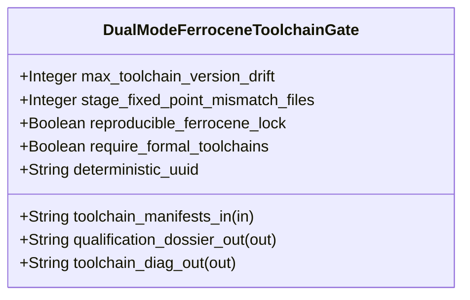

| Attribute | Specification Detail |
| :--- | :--- |
| **Issue ID** | #757 |
| **Title** | Feature 51: [BP 11 Ferrocene Qualified Toolchain FLS Traceability Structural Coverage and 3 Ring Rust_Flutter DO 178 C DO 330 Certification Architecture] DualModeFerroceneToolchainGate |
| **Type** | feature |
| **Parent Epic** | [EPIC-11-BP_11_Ferrocene_Qualified_Toolchain_FLS_Traceability_Structural_Coverage_and_3_Ring_Rust_Flutter_DO_178C_DO_330_Certification_Architecture](../epics/EPIC-11-BP_11_Ferrocene_Qualified_Toolchain_FLS_Traceability_Structural_Coverage_and_3_Ring_Rust_Flutter_DO_178C_DO_330_Certification_Architecture.md) |
| **Interface Type** | Physical / Structural / Internal Bus |
| **Schema Containers** | `BP_11_Ferrocene_Qualified_Toolchain_FLS_Traceability_Structural_Coverage_and_3_Ring_Rust_Flutter_DO_178C_DO_330_Certification_Architecture::DualModeFerroceneToolchainGate` |
| **Generation Mode** | subagent |
| **Specification Source** | [schema/model.sysml](../../schema/model.sysml) |

# Feature 51: [BP 11 Ferrocene Qualified Toolchain FLS Traceability Structural Coverage and 3 Ring Rust_Flutter DO 178 C DO 330 Certification Architecture] DualModeFerroceneToolchainGate

## UML Class Diagram



## Interface Requirements
### 1. Test Data Shape
```json
{
  "$schema": "https://json-schema.org/draft/2020-12/schema",
  "title": "DualModeFerroceneToolchainGatePayloadSchema",
  "type": "object",
  "properties": {
    "part": {
      "type": "string",
      "const": "DualModeFerroceneToolchainGate"
    },
    "status": {
      "type": "string",
      "enum": ["nominal", "degraded", "fault"]
    },
    "max_toolchain_version_drift": {
      "type": "integer",
      "x-sysml-type": "Integer",
      "description": "Declared attribute max_toolchain_version_drift (Integer)",
      "default": 0
    },
    "stage_fixed_point_mismatch_files": {
      "type": "integer",
      "x-sysml-type": "Integer",
      "description": "Permitted Stage-1 versus Stage-2 SHA-256 digest mismatch count under Ferrocene and standard `rustc` bootstrap (`E0705`). [unit: files]",
      "default": 0
    },
    "reproducible_ferrocene_lock": {
      "type": "boolean",
      "x-sysml-type": "Boolean",
      "description": "Enforces `--locked --offline` deterministic compilation and independent `verify-baseline` TQL-5 cross-checking. [unit: flag]",
      "default": true
    },
    "require_formal_toolchains": {
      "type": "boolean",
      "x-sysml-type": "Boolean",
      "description": "When asserted in qualification CI, fails closed if Ferrocene criticalup or toolchains are absent. [unit: flag]",
      "default": false
    },
    "deterministic_uuid": {
      "type": "string",
      "x-sysml-type": "String",
      "description": "Canonical deterministic blueprint component identifier (`DEAP-BP-DET-11`). [unit: uuidv5]",
      "default": "6ba7b810-9dad-11d1-80b4-00c04fd430cb"
    },
    "toolchain_manifests_in": {
      "type": "object",
      "properties": {
        "direction": { "type": "string", "const": "in" },
        "port_type": { "type": "string", "const": "String" }
      },
      "required": ["direction", "port_type"]
    },
    "qualification_dossier_out": {
      "type": "object",
      "properties": {
        "direction": { "type": "string", "const": "out" },
        "port_type": { "type": "string", "const": "String" }
      },
      "required": ["direction", "port_type"]
    },
    "toolchain_diag_out": {
      "type": "object",
      "properties": {
        "direction": { "type": "string", "const": "out" },
        "port_type": { "type": "string", "const": "String" }
      },
      "required": ["direction", "port_type"]
    }
  },
  "required": [
    "part",
    "status",
    "toolchain_manifests_in",
    "qualification_dossier_out",
    "toolchain_diag_out"
  ],
  "additionalProperties": false
}
```

### 2. Validation & Constraints
Declared structural attributes, boundary ports, invariants, and allocated requirements for classifier `DualModeFerroceneToolchainGate`:

| AST Member Kind | Identifier | Declared Type / Direction | Default / Invariant Contract |
| :--- | :--- | :--- | :--- |
| Attribute | `max_toolchain_version_drift` | `Integer` | Default `0` |
| Attribute | `stage_fixed_point_mismatch_files` | `Integer` | Default `0` |
| Attribute | `reproducible_ferrocene_lock` | `Boolean` | Default `true` |
| Attribute | `require_formal_toolchains` | `Boolean` | Default `false` |
| Attribute | `deterministic_uuid` | `String` | Default `"6ba7b810-9dad-11d1-80b4-00c04fd430cb"` |
| Port | `toolchain_manifests_in` | `in String` | Boundary interface contract |
| Port | `qualification_dossier_out` | `out String` | Boundary interface contract |
| Port | `toolchain_diag_out` | `out String` | Boundary interface contract |

### 3. Visual Layout & Arrangement
Structural composition and boundary topology for classifier `DualModeFerroceneToolchainGate` organize no nested subparts declared in schema paired with boundary ports `in toolchain_manifests_in : String`, `out qualification_dossier_out : String`, `out toolchain_diag_out : String`.

### 4. Interactive Flow & States
Operational lifecycle events and discrete state transitions for DualModeFerroceneToolchainGate.

### Layer 1: Domain State & Signal Model
Classifier `DualModeFerroceneToolchainGate` encapsulates typed domain state attributes `max_toolchain_version_drift : Integer`, `stage_fixed_point_mismatch_files : Integer`, `reproducible_ferrocene_lock : Boolean`, `require_formal_toolchains : Boolean`, `deterministic_uuid : String` alongside operational lifecycle status.

### Layer 2: Logic & Safety State Management
Classifier `DualModeFerroceneToolchainGate` governs stateless structural transition evaluation enforcing no additional invariant guards declared in schema.

### Layer 3: Presentation & Actuator Interface Binding
Classifier `DualModeFerroceneToolchainGate` binds external and behavioral interfaces across port `in toolchain_manifests_in : String`, port `out qualification_dossier_out : String`, port `out toolchain_diag_out : String`.

### Associated Use Cases & User Stories

#### Associated Use Cases
- None allocated (structural subsystem component)

#### Associated User Stories
- [ ] #822 - [User Story 73: probe criticalup toolchain](../user-stories/US-73-probe_criticalup_toolchain.md)
- [ ] #823 - [User Story 74: verify dual toolchain parity](../user-stories/US-74-verify_dual_toolchain_parity.md)
- [ ] #824 - [User Story 75: synthesize three ring workspace](../user-stories/US-75-synthesize_three_ring_workspace.md)
- [ ] #825 - [User Story 76: verify fls traceability chain](../user-stories/US-76-verify_fls_traceability_chain.md)
- [ ] #826 - [User Story 77: verify certified core and table a7 coverage](../user-stories/US-77-verify_certified_core_and_table_a7_coverage.md)
- [ ] #827 - [User Story 78: verify three ring edge and monitor readback](../user-stories/US-78-verify_three_ring_edge_and_monitor_readback.md)

## Acceptance Criteria (BDD)
- [ ] AC-01: Given valid `DualModeFerroceneToolchainGate` initialization inputs for `max_toolchain_version_drift` (`Integer`), `stage_fixed_point_mismatch_files` (`Integer`), `reproducible_ferrocene_lock` (`Boolean`), `require_formal_toolchains` (`Boolean`), `deterministic_uuid` (`String`) (no additional constraints specified in schema), When `DualModeFerroceneToolchainGate` commits typed domain state, Then declared state attributes hold verified values.
- [ ] AC-02: Given malformed or out-of-domain input values for `max_toolchain_version_drift` (`Integer`), `stage_fixed_point_mismatch_files` (`Integer`), `reproducible_ferrocene_lock` (`Boolean`), `require_formal_toolchains` (`Boolean`), `deterministic_uuid` (`String`), When `DualModeFerroceneToolchainGate` validates incoming state updates, Then `DualModeFerroceneToolchainGate` rejects the invalid state update and emits a diagnostic via diagnostic port `qualification_dossier_out`.
- [ ] AC-03: Given nominal signal arrival across `toolchain_manifests_in` (`in String`), `qualification_dossier_out` (`out String`), `toolchain_diag_out` (`out String`), When `DualModeFerroceneToolchainGate` processes the declared interface transaction, Then output state conforms to the structural classifier contract.
- [ ] AC-04: Given an invalid or unrecognized interface frame across `toolchain_manifests_in` (`in String`), `qualification_dossier_out` (`out String`), `toolchain_diag_out` (`out String`), When `DualModeFerroceneToolchainGate` boundary validation executes, Then `DualModeFerroceneToolchainGate` refuses the malformed frame via diagnostic port `qualification_dossier_out` and preserves prior verified state.

## Source References
Formal component specifications and normative systems engineering requirements:
- System Architecture Model: `schema/model.sysml`
- Normative Systems Engineering Standard: ISO/IEC/IEEE 15288:2023 §6.4.3 Architecture Definition Process

Component behavior and interface definitions derive from `schema/model.sysml` pursuant to ISO/IEC/IEEE 15288.
