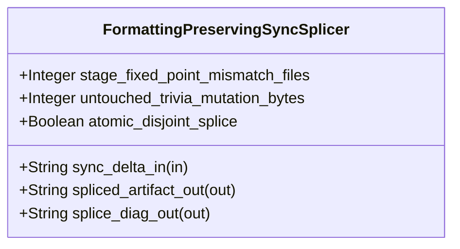

| Attribute | Specification Detail |
| :--- | :--- |
| **Issue ID** | TBD |
| **Title** | Feature 51: [BP 10 Incremental Lossless SysML v2 and Polyglot Compiler Engine] FormattingPreservingSyncSplicer |
| **Type** | feature |
| **Parent Epic** | [EPIC-10-BP_10_Incremental_Lossless_SysML_v2_and_Polyglot_Compiler_Engine](../epics/EPIC-10-BP_10_Incremental_Lossless_SysML_v2_and_Polyglot_Compiler_Engine.md) |
| **Interface Type** | Physical / Structural / Internal Bus |
| **Schema Containers** | `BP_10_Incremental_Lossless_SysML_v2_and_Polyglot_Compiler_Engine::FormattingPreservingSyncSplicer` |
| **Generation Mode** | subagent |
| **Specification Source** | [schema/model.sysml](../../schema/model.sysml) |

# Feature 51: [BP 10 Incremental Lossless SysML v2 and Polyglot Compiler Engine] FormattingPreservingSyncSplicer

## UML Class Diagram



## Interface Requirements
### 1. Test Data Shape
```json
{
  "$schema": "https://json-schema.org/draft/2020-12/schema",
  "title": "FormattingPreservingSyncSplicerPayloadSchema",
  "type": "object",
  "properties": {
    "part": {
      "type": "string",
      "const": "FormattingPreservingSyncSplicer"
    },
    "status": {
      "type": "string",
      "enum": ["nominal", "degraded", "fault"]
    },
    "stage_fixed_point_mismatch_files": {
      "type": "integer",
      "x-sysml-type": "Integer",
      "description": "Declared attribute stage_fixed_point_mismatch_files (Integer)",
      "default": 0
    },
    "untouched_trivia_mutation_bytes": {
      "type": "integer",
      "x-sysml-type": "Integer",
      "description": "Permitted byte mutations to comments and whitespace outside modified declaration `TextRange` intervals during incremental sync. [unit: bytes]",
      "default": 0
    },
    "atomic_disjoint_splice": {
      "type": "boolean",
      "x-sysml-type": "Boolean",
      "description": "Enforces pairwise-disjoint UTF-8 boundary verification and post-splice CST re-parse checks before atomic file commit. [unit: flag]",
      "default": true
    },
    "sync_delta_in": {
      "type": "object",
      "properties": {
        "direction": { "type": "string", "const": "in" },
        "port_type": { "type": "string", "const": "String" }
      },
      "required": ["direction", "port_type"]
    },
    "spliced_artifact_out": {
      "type": "object",
      "properties": {
        "direction": { "type": "string", "const": "out" },
        "port_type": { "type": "string", "const": "String" }
      },
      "required": ["direction", "port_type"]
    },
    "splice_diag_out": {
      "type": "object",
      "properties": {
        "direction": { "type": "string", "const": "out" },
        "port_type": { "type": "string", "const": "String" }
      },
      "required": ["direction", "port_type"]
    }
  },
  "required": [
    "part",
    "status",
    "sync_delta_in",
    "spliced_artifact_out",
    "splice_diag_out"
  ],
  "additionalProperties": false
}
```

### 2. Validation & Constraints
Declared structural attributes, boundary ports, invariants, and allocated requirements for classifier `FormattingPreservingSyncSplicer`:

| AST Member Kind | Identifier | Declared Type / Direction | Default / Invariant Contract |
| :--- | :--- | :--- | :--- |
| Attribute | `stage_fixed_point_mismatch_files` | `Integer` | Default `0` |
| Attribute | `untouched_trivia_mutation_bytes` | `Integer` | Default `0` |
| Attribute | `atomic_disjoint_splice` | `Boolean` | Default `true` |
| Port | `sync_delta_in` | `in String` | Boundary interface contract |
| Port | `spliced_artifact_out` | `out String` | Boundary interface contract |
| Port | `splice_diag_out` | `out String` | Boundary interface contract |
| Constraint | `Invariant_REQ_0610_SC_01` | Invariant (`REQ-0610 (REQ_0610_BP_10_Incremental_Lossless_SysML_v2_and_Polyglot_Compiler_Engine)`) | Declared structural invariant |
| Constraint | `Invariant_REQ_0610_SC_02` | Invariant (`REQ-0610 (REQ_0610_BP_10_Incremental_Lossless_SysML_v2_and_Polyglot_Compiler_Engine)`) | Declared structural invariant |
| Constraint | `Invariant_REQ_0610_SC_03_Incremental_Complexity` | Invariant (`REQ-0610 (REQ_0610_BP_10_Incremental_Lossless_SysML_v2_and_Polyglot_Compiler_Engine)`) | Declared structural invariant |
| Constraint | `Invariant_REQ_0610_SC_04` | Invariant (`REQ-0610 (REQ_0610_BP_10_Incremental_Lossless_SysML_v2_and_Polyglot_Compiler_Engine)`) | Declared structural invariant |
| Requirement | `REQ-0610 (REQ_0610_BP_10_Incremental_Lossless_SysML_v2_and_Polyglot_Compiler_Engine)` | Allocated Requirement | IncrementalLosslessSysmlAndPolyglotCompilerEngine (**REQ-0610** / BP-10 / DEAP-BP-DET-10, UUIDv5 6ba7b810-9dad-11d1-80b4-00c04fd430ca, Class P linear DFA lexing, lossless Red/Green syntax-tree construction, and O(delta) early-cutoff incremental query complexity, governed by DO-178C Level A, DO-330 |

```sysml
constraint Invariant_REQ_0610_SC_01 {}
constraint Invariant_REQ_0610_SC_02 {}
constraint Invariant_REQ_0610_SC_03_Incremental_Complexity {}
constraint Invariant_REQ_0610_SC_04 {}
```

### 3. Visual Layout & Arrangement
Structural composition and boundary topology for classifier `FormattingPreservingSyncSplicer` organize no nested subparts declared in schema paired with boundary ports `in sync_delta_in : String`, `out spliced_artifact_out : String`, `out splice_diag_out : String`.

### 4. Interactive Flow & States
Operational lifecycle events and discrete state transitions for FormattingPreservingSyncSplicer.

### Layer 1: Domain State & Signal Model
Classifier `FormattingPreservingSyncSplicer` encapsulates typed domain state attributes `stage_fixed_point_mismatch_files : Integer`, `untouched_trivia_mutation_bytes : Integer`, `atomic_disjoint_splice : Boolean` alongside operational lifecycle status.

### Layer 2: Logic & Safety State Management
Classifier `FormattingPreservingSyncSplicer` governs stateless structural transition evaluation enforcing invariant obligations `Invariant_REQ_0610_SC_01`, `Invariant_REQ_0610_SC_02`, `Invariant_REQ_0610_SC_03_Incremental_Complexity`, `Invariant_REQ_0610_SC_04`.

### Layer 3: Presentation & Actuator Interface Binding
Classifier `FormattingPreservingSyncSplicer` binds external and behavioral interfaces across port `in sync_delta_in : String`, port `out spliced_artifact_out : String`, port `out splice_diag_out : String`.

## Acceptance Criteria (BDD)
- [ ] AC-01: Given valid `FormattingPreservingSyncSplicer` inputs satisfying `Invariant_REQ_0610_SC_01` [Req `REQ-0610 (REQ_0610_BP_10_Incremental_Lossless_SysML_v2_and_Polyglot_Compiler_Engine)`], When `FormattingPreservingSyncSplicer` evaluates invariant `Invariant_REQ_0610_SC_01`, Then the invariant holds and verified state is committed.
- [ ] AC-02: Given boundary inputs that violate `Invariant_REQ_0610_SC_01` [Req `REQ-0610 (REQ_0610_BP_10_Incremental_Lossless_SysML_v2_and_Polyglot_Compiler_Engine)`], When `FormattingPreservingSyncSplicer` evaluates invariant `Invariant_REQ_0610_SC_01`, Then `FormattingPreservingSyncSplicer` rejects the invalid transition and routes a diagnostic via diagnostic port `spliced_artifact_out`.
- [ ] AC-03: Given valid `FormattingPreservingSyncSplicer` inputs satisfying `Invariant_REQ_0610_SC_02` [Req `REQ-0610 (REQ_0610_BP_10_Incremental_Lossless_SysML_v2_and_Polyglot_Compiler_Engine)`], When `FormattingPreservingSyncSplicer` evaluates invariant `Invariant_REQ_0610_SC_02`, Then the invariant holds and verified state is committed.
- [ ] AC-04: Given boundary inputs that violate `Invariant_REQ_0610_SC_02` [Req `REQ-0610 (REQ_0610_BP_10_Incremental_Lossless_SysML_v2_and_Polyglot_Compiler_Engine)`], When `FormattingPreservingSyncSplicer` evaluates invariant `Invariant_REQ_0610_SC_02`, Then `FormattingPreservingSyncSplicer` rejects the invalid transition and routes a diagnostic via diagnostic port `spliced_artifact_out`.
- [ ] AC-05: Given valid `FormattingPreservingSyncSplicer` inputs satisfying `Invariant_REQ_0610_SC_03_Incremental_Complexity` [Req `REQ-0610 (REQ_0610_BP_10_Incremental_Lossless_SysML_v2_and_Polyglot_Compiler_Engine)`], When `FormattingPreservingSyncSplicer` evaluates invariant `Invariant_REQ_0610_SC_03_Incremental_Complexity`, Then the invariant holds and verified state is committed.
- [ ] AC-06: Given boundary inputs that violate `Invariant_REQ_0610_SC_03_Incremental_Complexity` [Req `REQ-0610 (REQ_0610_BP_10_Incremental_Lossless_SysML_v2_and_Polyglot_Compiler_Engine)`], When `FormattingPreservingSyncSplicer` evaluates invariant `Invariant_REQ_0610_SC_03_Incremental_Complexity`, Then `FormattingPreservingSyncSplicer` rejects the invalid transition and routes a diagnostic via diagnostic port `spliced_artifact_out`.
- [ ] AC-07: Given valid `FormattingPreservingSyncSplicer` inputs satisfying `Invariant_REQ_0610_SC_04` [Req `REQ-0610 (REQ_0610_BP_10_Incremental_Lossless_SysML_v2_and_Polyglot_Compiler_Engine)`], When `FormattingPreservingSyncSplicer` evaluates invariant `Invariant_REQ_0610_SC_04`, Then the invariant holds and verified state is committed.
- [ ] AC-08: Given boundary inputs that violate `Invariant_REQ_0610_SC_04` [Req `REQ-0610 (REQ_0610_BP_10_Incremental_Lossless_SysML_v2_and_Polyglot_Compiler_Engine)`], When `FormattingPreservingSyncSplicer` evaluates invariant `Invariant_REQ_0610_SC_04`, Then `FormattingPreservingSyncSplicer` rejects the invalid transition and routes a diagnostic via diagnostic port `spliced_artifact_out`.
- [ ] AC-09: Given nominal typed values for `stage_fixed_point_mismatch_files` (`Integer`), `untouched_trivia_mutation_bytes` (`Integer`), `atomic_disjoint_splice` (`Boolean`) across `sync_delta_in` (`in String`), `spliced_artifact_out` (`out String`), `splice_diag_out` (`out String`), When `FormattingPreservingSyncSplicer` executes structural interface processing, Then state and output ports conform to declared schema types.
- [ ] AC-10: Given malformed input frames across `stage_fixed_point_mismatch_files` (`Integer`), `untouched_trivia_mutation_bytes` (`Integer`), `atomic_disjoint_splice` (`Boolean`) or `sync_delta_in` (`in String`), `spliced_artifact_out` (`out String`), `splice_diag_out` (`out String`), When `FormattingPreservingSyncSplicer` boundary validation executes, Then `FormattingPreservingSyncSplicer` rejects the malformed input via diagnostic port `spliced_artifact_out`.

## Source References
Formal component specifications and normative systems engineering requirements:
- System Architecture Model: `schema/model.sysml`
- Normative Systems Engineering Standard: ISO/IEC/IEEE 15288:2023 §6.4.3 Architecture Definition Process

Component behavior and interface definitions derive from `schema/model.sysml` pursuant to ISO/IEC/IEEE 15288.
