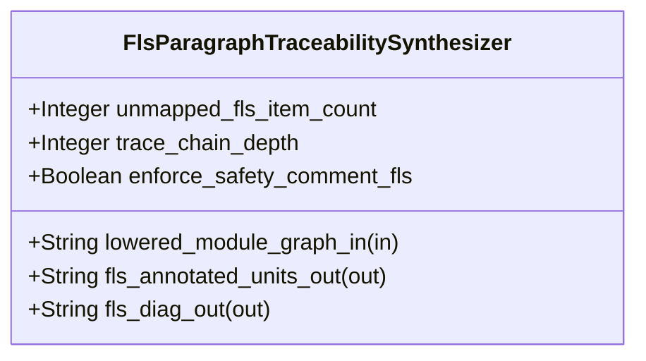

| Attribute | Specification Detail |
| :--- | :--- |
| **Issue ID** | #850 |
| **Title** | Feature 52: [BP 11 Ferrocene Qualified Toolchain FLS Traceability Structural Coverage and 3 Ring Rust_Flutter DO 178 C DO 330 Certification Architecture] FlsParagraphTraceabilitySynthesizer |
| **Type** | feature |
| **Parent Epic** | [EPIC-11-BP_11_Ferrocene_Qualified_Toolchain_FLS_Traceability_Structural_Coverage_and_3_Ring_Rust_Flutter_DO_178C_DO_330_Certification_Architecture](../epics/EPIC-11-BP_11_Ferrocene_Qualified_Toolchain_FLS_Traceability_Structural_Coverage_and_3_Ring_Rust_Flutter_DO_178C_DO_330_Certification_Architecture.md) (#856) |
| **Interface Type** | Physical / Structural / Internal Bus |
| **Schema Containers** | `BP_11_Ferrocene_Qualified_Toolchain_FLS_Traceability_Structural_Coverage_and_3_Ring_Rust_Flutter_DO_178C_DO_330_Certification_Architecture::FlsParagraphTraceabilitySynthesizer` |
| **Generation Mode** | subagent |
| **Specification Source** | [schema/model.sysml](../../schema/model.sysml) |

# Feature 52: [BP 11 Ferrocene Qualified Toolchain FLS Traceability Structural Coverage and 3 Ring Rust_Flutter DO 178 C DO 330 Certification Architecture] FlsParagraphTraceabilitySynthesizer

## UML Class Diagram



## Interface Requirements
### 1. Test Data Shape
```json
{
  "$schema": "https://json-schema.org/draft/2020-12/schema",
  "title": "FlsParagraphTraceabilitySynthesizerPayloadSchema",
  "type": "object",
  "properties": {
    "part": {
      "type": "string",
      "const": "FlsParagraphTraceabilitySynthesizer"
    },
    "status": {
      "type": "string",
      "enum": ["nominal", "degraded", "fault"]
    },
    "unmapped_fls_item_count": {
      "type": "integer",
      "x-sysml-type": "Integer",
      "description": "Declared attribute unmapped_fls_item_count (Integer)",
      "default": 0
    },
    "trace_chain_depth": {
      "type": "integer",
      "x-sysml-type": "Integer",
      "description": "Mandatory end-to-end traceability link count (`REQ-*`, `SC-*`, `RustItem`, `fls_*`, `KaniAndCoverage`). [unit: links]",
      "default": 5
    },
    "enforce_safety_comment_fls": {
      "type": "boolean",
      "x-sysml-type": "Boolean",
      "description": "Requires every Ring-2 FFI `unsafe` block to carry `// SAFETY: [SC-*] [FLS: fls_*]` matching the pinned FLS catalog. [unit: flag]",
      "default": true
    },
    "lowered_module_graph_in": {
      "type": "object",
      "properties": {
        "direction": { "type": "string", "const": "in" },
        "port_type": { "type": "string", "const": "String" }
      },
      "required": ["direction", "port_type"]
    },
    "fls_annotated_units_out": {
      "type": "object",
      "properties": {
        "direction": { "type": "string", "const": "out" },
        "port_type": { "type": "string", "const": "String" }
      },
      "required": ["direction", "port_type"]
    },
    "fls_diag_out": {
      "type": "object",
      "properties": {
        "direction": { "type": "string", "const": "out" },
        "port_type": { "type": "string", "const": "String" }
      },
      "required": ["direction", "port_type"]
    }
  },
  "required": [
    "part",
    "status",
    "lowered_module_graph_in",
    "fls_annotated_units_out",
    "fls_diag_out"
  ],
  "additionalProperties": false
}
```

### 2. Validation & Constraints
Declared structural attributes, boundary ports, invariants, and allocated requirements for classifier `FlsParagraphTraceabilitySynthesizer`:

| AST Member Kind | Identifier | Declared Type / Direction | Default / Invariant Contract |
| :--- | :--- | :--- | :--- |
| Attribute | `unmapped_fls_item_count` | `Integer` | Default `0` (`C_CERT_03`: `unmapped_fls_item_count >= 0 and unmapped_fls_item_count <= 0`; rejects missing or orphan `fls_*` paragraph anchors with `DEAP-E1102`) |
| Attribute | `trace_chain_depth` | `Integer` | Default `5` (mandatory 5-link traceability chain: `REQ-*` -> `SC-*` -> `RustItem` -> `fls_*` -> `KaniAndCoverage`) |
| Attribute | `enforce_safety_comment_fls` | `Boolean` | Default `true` (requires every Ring-2 FFI `unsafe` block to carry `// SAFETY: [SC-*] [FLS: fls_*]` resolved via `ra_ap_syntax`) |
| Port | `lowered_module_graph_in` | `in String` | Boundary interface contract connected via `BP_11_PartitionToFlsTraceabilityConnection` from `ThreeRingAssurancePartitionCompiler.partitioned_workspace_out` |
| Port | `fls_annotated_units_out` | `out String` | Boundary interface contract emitting `FlsTaggedTraceBundle` and `[FLS: fls_*]`-annotated Rust compilation units |
| Port | `fls_diag_out` | `out String` | Boundary interface contract emitting single-line NDJSON diagnostics (`DEAP-E1102`) |
| Constraint | `C_CERT_03` | `unmapped_fls_item_count >= 0 and unmapped_fls_item_count <= 0` | Enforces 100% 5-link `[FLS: fls_*]` paragraph traceability across all generated Ring-1 items and Ring-2 `unsafe` blocks |
| Constraint | `C_CERT_07` | `max_module_exec_sloc >= 1 and max_module_exec_sloc <= 380` | Bounds submodule implementation inside `< 380` executable SLOC (`crates/deap-core/src/fls_trace/`) |
| Requirement | `REQ-0611 (REQ_0611_BP_11_Ferrocene_Qualified_Toolchain_FLS_Traceability_Structural_Coverage_and_3_Ring_Rust_Flutter_DO_178C)` | Allocated Requirement | Enforces `Invariant_REQ_0611_SC_02` and `Invariant_REQ_0611_SC_05` under RTCA DO-178C DAL-A..E and RTCA DO-330 TQL-1 / TQL-5 |

### 3. Visual Layout & Arrangement
Structural composition and boundary topology for classifier `FlsParagraphTraceabilitySynthesizer` organize no nested subparts declared in schema paired with boundary ports `in lowered_module_graph_in : String`, `out fls_annotated_units_out : String`, `out fls_diag_out : String`. Under Contract A, all OMG SysML v2.0 + KerML 1.0 constructs (`requirement def`/`requirement`, `constraint def`/`constraint`, `part def`/`part`, `state def`/`state`, `action def`/`action`, `calc def`/`calc`, `port def`/`port`, and `metadata def`/`@Metadata`/`#fls`/`#dal` annotations) are ingested losslessly via `logos` + `rowan` + `salsa` + `ariadne` (`deap_core::sysml_cst`) with zero 16-construct caps.

### 4. Interactive Flow & States
Operational lifecycle events and discrete state transitions for `FlsParagraphTraceabilitySynthesizer` follow `BP_11_Ferrocene_Qualified_Toolchain_FLS_Traceability_Structural_Coverage_and_3_Ring_Rust_Flutter_DO_178C_DO_330_Certification_Architecture_LifecycleState` (`SynthesizingThreeRingPartitions -> EmbeddingFlsTraceability` on `threeRingTopologyIsolated`; `EmbeddingFlsTraceability -> AuditingCoreSubsetAndMcdc` on `fiveLinkFlsChainComplete` or `RejectedFailClosed` on `rejectMissingFlsAnchorE1102`).

### Layer 1: Domain State & Signal Model
Classifier `FlsParagraphTraceabilitySynthesizer` encapsulates typed domain state attributes `unmapped_fls_item_count : Integer`, `trace_chain_depth : Integer`, `enforce_safety_comment_fls : Boolean` alongside operational lifecycle status, the pinned Ferrocene Language Specification (`fls_*`) paragraph catalog, and 5-link traceability records (`REQ-*` -> `SC-*` -> `RustItem` -> `fls_*` -> `KaniAndCoverage`).

### Layer 2: Logic & Safety State Management
Classifier `FlsParagraphTraceabilitySynthesizer` governs deterministic structural transition evaluation (`verify_fls_traceability_chain(records, pinned_fls_catalog)`) enforcing invariant obligations `C_CERT_03`, `C_CERT_07`, `Invariant_REQ_0611_SC_02`, and `Invariant_REQ_0611_SC_05`. Under Contract B, all `[FLS: fls_*]` docstring stamping executes deterministically via `syn` + `proc-macro2` + `quote` + `prettyplease` and all docstring / `// SAFETY: [SC-*] [FLS: fls_*]` verification executes via `ra_ap_syntax` (`ast::{Fn, HasDocComments, HasAttrs}`) inside `< 380`-SLOC submodules (`crates/deap-core/src/fls_trace/`, `max_module_exec_sloc <= 380`, `C_CERT_07`) with explicit deletion of legacy hand-rolled line/string docstring and comment scanners.

### Layer 3: Presentation & Actuator Interface Binding
Classifier `FlsParagraphTraceabilitySynthesizer` binds external and behavioral interfaces across port `in lowered_module_graph_in : String`, port `out fls_annotated_units_out : String`, port `out fls_diag_out : String`, emitting `FlsTaggedTraceBundle` artifacts and single-line NDJSON diagnostics (`DEAP-E1102`) with zero hardcoded OS/user/machine paths.

### Associated Use Cases & User Stories

#### Associated Use Cases
- [ ] #789 - [Use Case 60: End to End FLS Normative Paragraph Traceability Emission and Fail Closed Orphan Detection](../use-cases/UC-60-End_to_End_FLS_Normative_Paragraph_Traceability_Emission_and_Fail_Closed_Orphan_Detection.md)

#### Associated User Stories
- [ ] #826 - [User Story 76: Verify Fls Traceability Chain](../user-stories/US-76-verify_fls_traceability_chain.md)

## Acceptance Criteria (BDD)
- [ ] AC-01: Given valid `FlsParagraphTraceabilitySynthesizer` initialization inputs for `unmapped_fls_item_count` (`Integer`), `trace_chain_depth` (`Integer`), `enforce_safety_comment_fls` (`Boolean`) satisfying `C_CERT_03` (`unmapped_fls_item_count == 0`, `trace_chain_depth == 5`) and `Invariant_REQ_0611_SC_02`, When `FlsParagraphTraceabilitySynthesizer` stamps `[FLS: fls_*]` anchors via `syn`, `quote`, and `prettyplease` and commits typed domain state, Then declared state attributes hold verified values with 100% 5-link FLS traceability coverage.
- [ ] AC-02: Given malformed or out-of-domain input values for `unmapped_fls_item_count` (`Integer`), `trace_chain_depth` (`Integer`), `enforce_safety_comment_fls` (`Boolean`), or a Ring-1 item / Ring-2 `unsafe` block missing a valid `fls_*` anchor in `pinned_fls_catalog` (`unmapped_fls_item_count > 0`), When `FlsParagraphTraceabilitySynthesizer` validates incoming state updates via `ra_ap_syntax`, Then `FlsParagraphTraceabilitySynthesizer` rejects the invalid state update fail-closed and emits diagnostic `DEAP-E1102` via diagnostic port `fls_annotated_units_out` and `fls_diag_out`.
- [ ] AC-03: Given nominal signal arrival across `lowered_module_graph_in` (`in String`), `fls_annotated_units_out` (`out String`), `fls_diag_out` (`out String`), When `FlsParagraphTraceabilitySynthesizer` processes the declared interface transaction inside `< 380`-SLOC submodules (`C_CERT_07`), Then output state conforms to the structural classifier contract.
- [ ] AC-04: Given an invalid or unrecognized interface frame across `lowered_module_graph_in` (`in String`), `fls_annotated_units_out` (`out String`), `fls_diag_out` (`out String`), When `FlsParagraphTraceabilitySynthesizer` boundary validation executes, Then `FlsParagraphTraceabilitySynthesizer` refuses the malformed frame via diagnostic port `fls_annotated_units_out` and `fls_diag_out` (`DEAP-E1102`) and preserves prior verified state.

## Source References
Formal component specifications and normative systems engineering requirements:
- System Architecture Model: `schema/model.sysml`
- Normative Systems Engineering Standard: ISO/IEC/IEEE 15288:2023 §6.4.3 Architecture Definition Process

Component behavior and interface definitions derive from `schema/model.sysml` pursuant to ISO/IEC/IEEE 15288.
