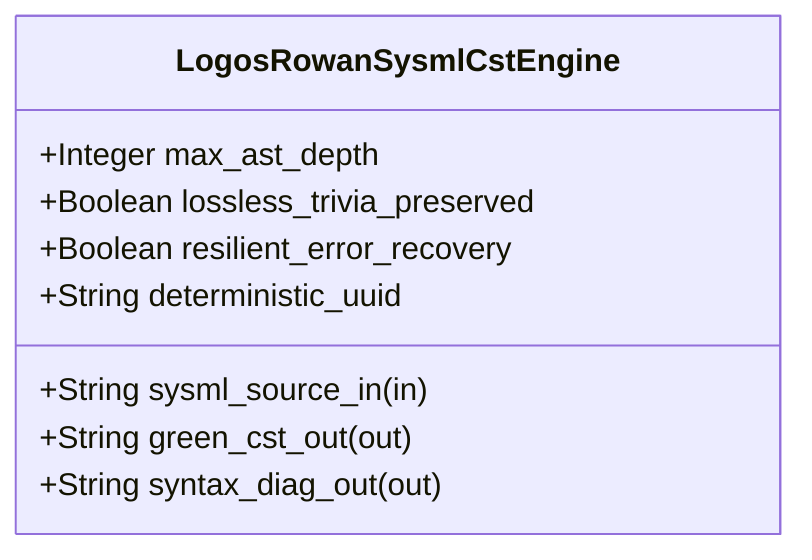

| Attribute | Specification Detail |
| :--- | :--- |
| **Issue ID** | TBD |
| **Title** | Feature 52: [BP 10 Incremental Lossless SysML v2 and Polyglot Compiler Engine] LogosRowanSysmlCstEngine |
| **Type** | feature |
| **Parent Epic** | [EPIC-10-BP_10_Incremental_Lossless_SysML_v2_and_Polyglot_Compiler_Engine](../epics/EPIC-10-BP_10_Incremental_Lossless_SysML_v2_and_Polyglot_Compiler_Engine.md) |
| **Interface Type** | Physical / Structural / Internal Bus |
| **Schema Containers** | `BP_10_Incremental_Lossless_SysML_v2_and_Polyglot_Compiler_Engine::LogosRowanSysmlCstEngine` |
| **Generation Mode** | subagent |
| **Specification Source** | [schema/model.sysml](../../schema/model.sysml) |

# Feature 52: [BP 10 Incremental Lossless SysML v2 and Polyglot Compiler Engine] LogosRowanSysmlCstEngine

## UML Class Diagram



## Interface Requirements
### 1. Test Data Shape
```json
{
  "$schema": "https://json-schema.org/draft/2020-12/schema",
  "title": "LogosRowanSysmlCstEnginePayloadSchema",
  "type": "object",
  "properties": {
    "part": {
      "type": "string",
      "const": "LogosRowanSysmlCstEngine"
    },
    "status": {
      "type": "string",
      "enum": ["nominal", "degraded", "fault"]
    },
    "max_ast_depth": {
      "type": "integer",
      "x-sysml-type": "Integer",
      "description": "Declared attribute max_ast_depth (Integer)",
      "default": 64
    },
    "lossless_trivia_preserved": {
      "type": "boolean",
      "x-sysml-type": "Boolean",
      "description": "Requires root `rowan::GreenNode` byte concatenation to match the input UTF-8 `.sysml` buffer byte-for-byte including comments and whitespace. [unit: flag]",
      "default": true
    },
    "resilient_error_recovery": {
      "type": "boolean",
      "x-sysml-type": "Boolean",
      "description": "Wraps malformed token spans in `ERROR_NODE` subtrees and continues parsing at recovery synchronization tokens rather than aborting on first error. [unit: flag]",
      "default": true
    },
    "deterministic_uuid": {
      "type": "string",
      "x-sysml-type": "String",
      "description": "Canonical deterministic blueprint component identifier (`DEAP-BP-DET-10`). [unit: uuidv5]",
      "default": "6ba7b810-9dad-11d1-80b4-00c04fd430ca"
    },
    "sysml_source_in": {
      "type": "object",
      "properties": {
        "direction": { "type": "string", "const": "in" },
        "port_type": { "type": "string", "const": "String" }
      },
      "required": ["direction", "port_type"]
    },
    "green_cst_out": {
      "type": "object",
      "properties": {
        "direction": { "type": "string", "const": "out" },
        "port_type": { "type": "string", "const": "String" }
      },
      "required": ["direction", "port_type"]
    },
    "syntax_diag_out": {
      "type": "object",
      "properties": {
        "direction": { "type": "string", "const": "out" },
        "port_type": { "type": "string", "const": "String" }
      },
      "required": ["direction", "port_type"]
    }
  },
  "required": [
    "part",
    "status",
    "sysml_source_in",
    "green_cst_out",
    "syntax_diag_out"
  ],
  "additionalProperties": false
}
```

### 2. Validation & Constraints
Declared structural attributes, boundary ports, invariants, and allocated requirements for classifier `LogosRowanSysmlCstEngine`:

| AST Member Kind | Identifier | Declared Type / Direction | Default / Invariant Contract |
| :--- | :--- | :--- | :--- |
| Attribute | `max_ast_depth` | `Integer` | Default `64` |
| Attribute | `lossless_trivia_preserved` | `Boolean` | Default `true` |
| Attribute | `resilient_error_recovery` | `Boolean` | Default `true` |
| Attribute | `deterministic_uuid` | `String` | Default `"6ba7b810-9dad-11d1-80b4-00c04fd430ca"` |
| Port | `sysml_source_in` | `in String` | Boundary interface contract |
| Port | `green_cst_out` | `out String` | Boundary interface contract |
| Port | `syntax_diag_out` | `out String` | Boundary interface contract |

### 3. Visual Layout & Arrangement
Structural composition and boundary topology for classifier `LogosRowanSysmlCstEngine` organize no nested subparts declared in schema paired with boundary ports `in sysml_source_in : String`, `out green_cst_out : String`, `out syntax_diag_out : String`.

### 4. Interactive Flow & States
Operational lifecycle events and discrete state transitions for LogosRowanSysmlCstEngine.

### Layer 1: Domain State & Signal Model
Classifier `LogosRowanSysmlCstEngine` encapsulates typed domain state attributes `max_ast_depth : Integer`, `lossless_trivia_preserved : Boolean`, `resilient_error_recovery : Boolean`, `deterministic_uuid : String` alongside operational lifecycle status.

### Layer 2: Logic & Safety State Management
Classifier `LogosRowanSysmlCstEngine` governs stateless structural transition evaluation enforcing no additional invariant guards declared in schema.

### Layer 3: Presentation & Actuator Interface Binding
Classifier `LogosRowanSysmlCstEngine` binds external and behavioral interfaces across port `in sysml_source_in : String`, port `out green_cst_out : String`, port `out syntax_diag_out : String`.

## Acceptance Criteria (BDD)
- [ ] AC-01: Given valid `LogosRowanSysmlCstEngine` initialization inputs for `max_ast_depth` (`Integer`), `lossless_trivia_preserved` (`Boolean`), `resilient_error_recovery` (`Boolean`), `deterministic_uuid` (`String`) (no additional constraints specified in schema), When `LogosRowanSysmlCstEngine` commits typed domain state, Then declared state attributes hold verified values.
- [ ] AC-02: Given malformed or out-of-domain input values for `max_ast_depth` (`Integer`), `lossless_trivia_preserved` (`Boolean`), `resilient_error_recovery` (`Boolean`), `deterministic_uuid` (`String`), When `LogosRowanSysmlCstEngine` validates incoming state updates, Then `LogosRowanSysmlCstEngine` rejects the invalid state update and emits a diagnostic via diagnostic port `green_cst_out`.
- [ ] AC-03: Given nominal signal arrival across `sysml_source_in` (`in String`), `green_cst_out` (`out String`), `syntax_diag_out` (`out String`), When `LogosRowanSysmlCstEngine` processes the declared interface transaction, Then output state conforms to the structural classifier contract.
- [ ] AC-04: Given an invalid or unrecognized interface frame across `sysml_source_in` (`in String`), `green_cst_out` (`out String`), `syntax_diag_out` (`out String`), When `LogosRowanSysmlCstEngine` boundary validation executes, Then `LogosRowanSysmlCstEngine` refuses the malformed frame via diagnostic port `green_cst_out` and preserves prior verified state.

## Source References
Formal component specifications and normative systems engineering requirements:
- System Architecture Model: `schema/model.sysml`
- Normative Systems Engineering Standard: ISO/IEC/IEEE 15288:2023 §6.4.3 Architecture Definition Process

Component behavior and interface definitions derive from `schema/model.sysml` pursuant to ISO/IEC/IEEE 15288.
